## But why?

A friend picked up a pair of Silent Sounds headphones but wasn't able to use them as they require a radio transmitter. We had done some digging through the headphones product page to find out the specifications required but neither of us could figure out a clear cut and cheap way to get it working. And even if we had a working transmitter, it wouldn't be very portable.

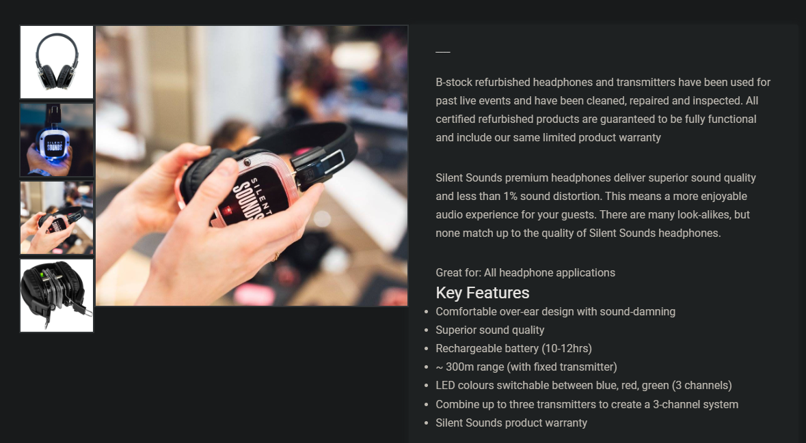  

## Project goals

There were a few goals going into this project. We wanted to keep as much of the existing functionality as possible.

- Keep the existing headphones shell and not make any major modifications that would change the look.

- Make sure the most important part of the headphones were saved, the tri-color LED's.

- Make sure the battery life of the headphones remained reasonable. (~6 hours on a single charge).

- Keep the cost down as much as possible.

## Inspecting the headphones

There are two PCB's on each side of the headphones. One looks like it handles the radio and audio side of things, while the other one handles the battery and charging. The power and headphone signal is transferred to the other PCB using multi-core headphone wire fed through the headband.

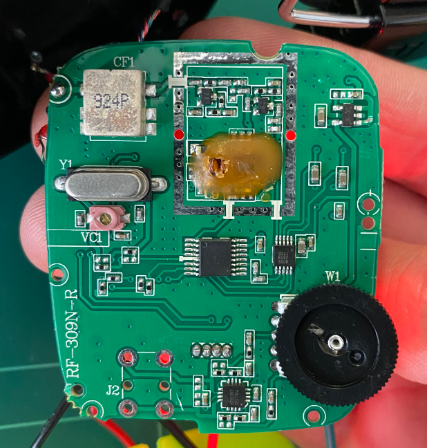 
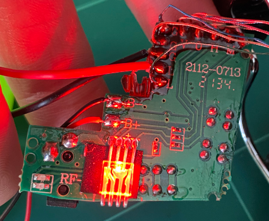  

Now that we had some idea of what we were dealing with, tried to come up with a plan. Our first thought was to completely strip the contents of the headphones and wire up our own PCB since reverse engineering the existing PCB's would be too difficult, so we thought...

### The radio PCB

Most of the IC's on the PCB were either not present or we couldn't find any data sheets on them. However, there was 1 that we could read, a [TA31101F](https://datasheetspdf.com/pdf-file/996463/Toshiba/TA31101F/1). 

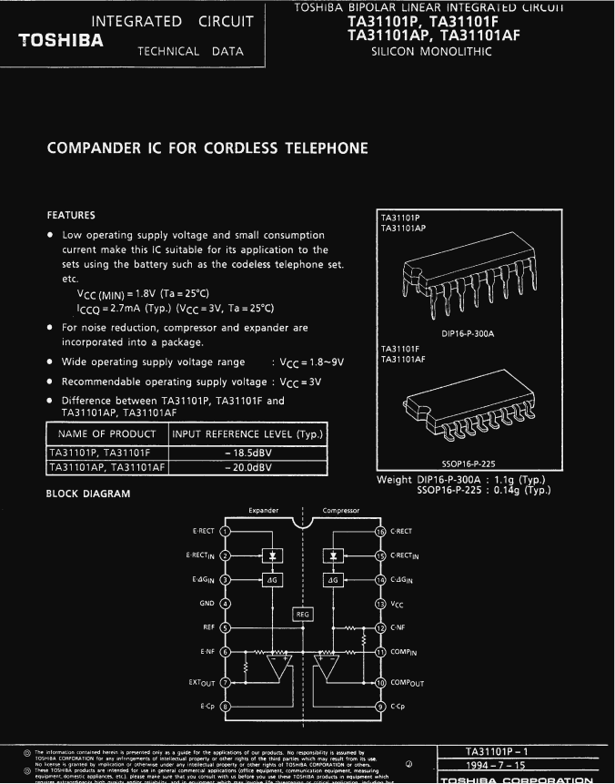  

It's a compander IC for cordless telephones which takes in an analog audio signal and handles noise reduction and compression.

  

We're also able to match the traces on the PCB to the pin-out diagram in the datasheet. There are two testing pads on the PCB labelled L and R, most likely corresponding to the left and right headphone channels.

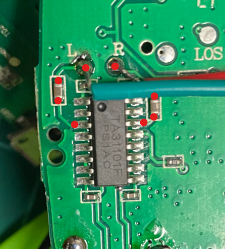

The two pins the testing pads are connected to are `EGin` (Expander In) and `CGin` (Compressor In). 

We can also look at the testing circuit diagram and see how the IC is hooked up.

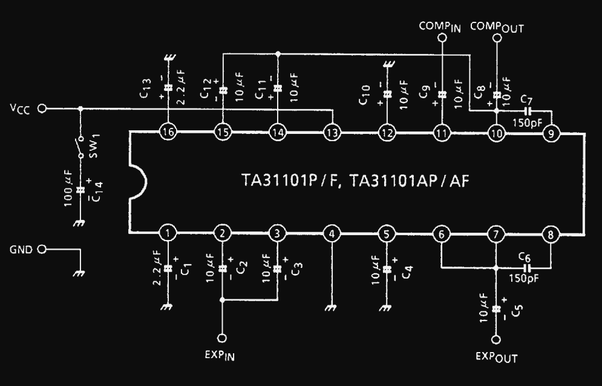  

We can assume the two capacitors behind the testing pads are the `10µF` ones labelled `C3` and `C11` connected to pins 3 and 14 used for signal smoothing.

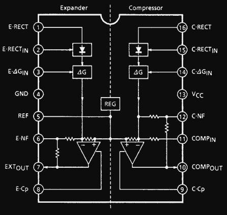   

`COMPout` and `EXPout` look like the go down the PCB to the variable resistor which lets you adjust the volume. I had removed the potentiometer to get a better look.

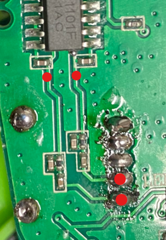  

## Bluetooth receiver

We came up with an idea to connect the output of a bluetooth receiver to the `L` and `R` testing pads of the radio PCB to try and hijack the connection to the IC. This would also mean that if the bluetooth connection was not connected the original radio function of the headphones should *theoretically* still work.

We got the cheapest [bluetooth car receiver](https://www.supercheapauto.com.au/p/aerpro-bluetooth-audio-streaming-hands-free-receiver/593189.html#q=bluetooth&lang=en_AU&start=9) we could find.

  

The receiver is pretty simple. Most important to us is the battery, USB Micro-B charging connection, L/R and GND outputs and push button used to turn the receiver on and off.

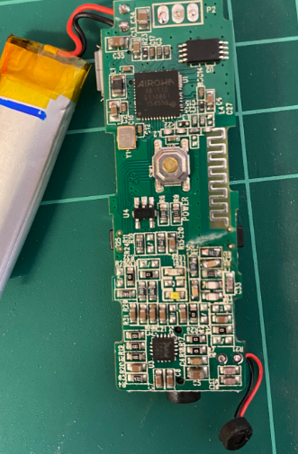  
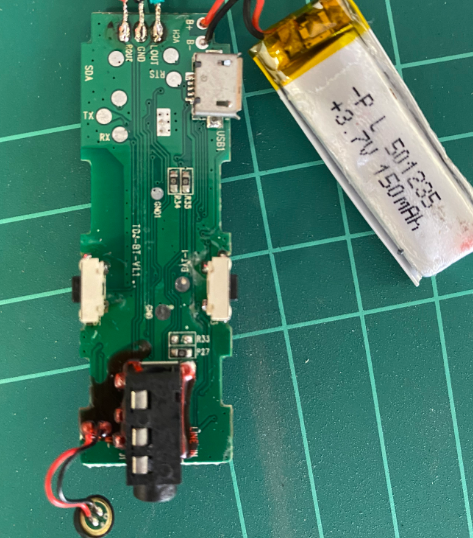  

## Proof of concept

Since the bluetooth receiver had it's own volume management we decided to keep the volume potentiometer removed and replaced it with 2 `10k` resistors. And yes, that's a really bad solder job.

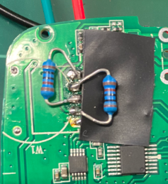  

The existing output AUX jack on the bluetooth receiver was removed and hooked up to the L and R testing pins on the radio PCB.

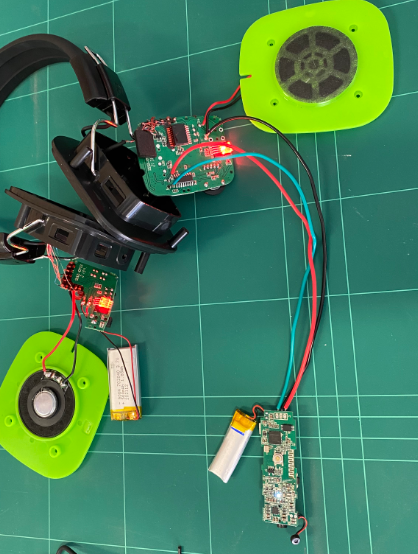  

Somehow it actually worked! And was way simpler than we originally thought.

## Putting it all together

Now we had the challenge of putting this all together so it fits inside the headphones. Since the headphones case is super small we had to remove all extraneous items.

The battery on the bluetooth receiver was removed and instead was powered using the existing headphones battery. The audio extension cable that came with the bluetooth receiver was reused and run through the head-band.

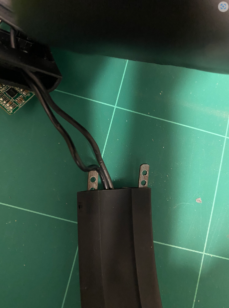  

The parts that make up the section that connects the head-band to the headphone itself had plenty of space to run a second cable through.

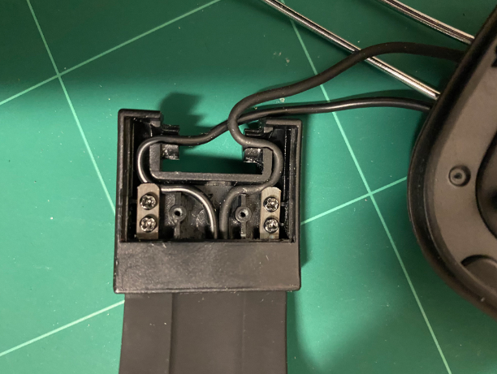  

Next, the USB Micro-B, volume buttons and AUX input connector have to go. The push button and LED indicator were removed and replaced so they can accessed and seen from outside the headphones.

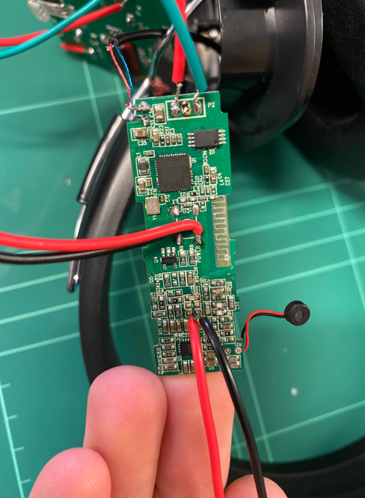

Now we can start trying to fit everything back in the headphones. The bluetooth receiver PCB fits underneath the radio PCB.

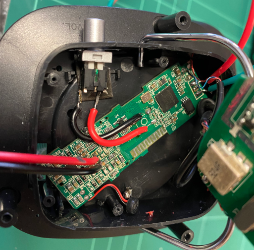  

It all fits!

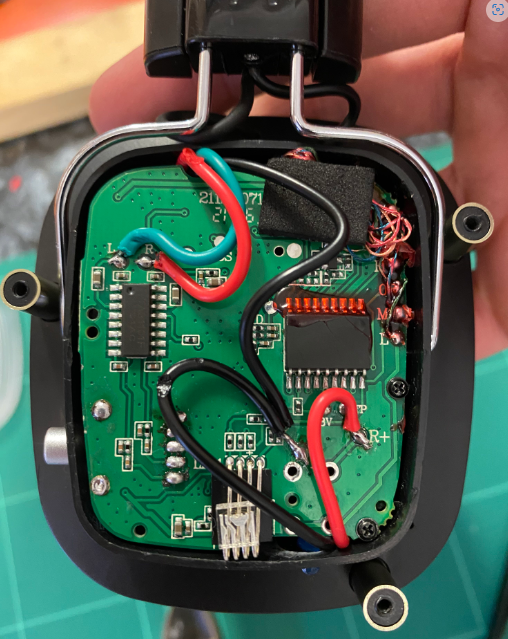  

## Final thoughts

This was a super fun project to work on, everything seemed to just work and we didn't break anything which was a plus. The simplicity of the existing headphone electronics made it much easier to reverse engineer and use in combination with the bluetooth receiver we picked up. 

We did end up with a slight hiss which was audible when the volume is low probably caused from interference between the two PCB's. Everything else however works flawlessly.

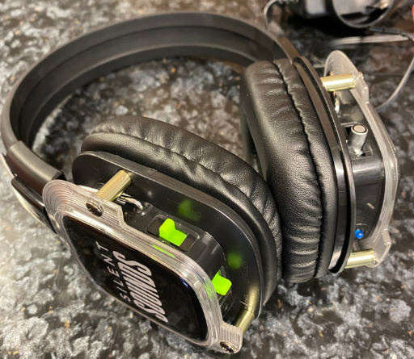  